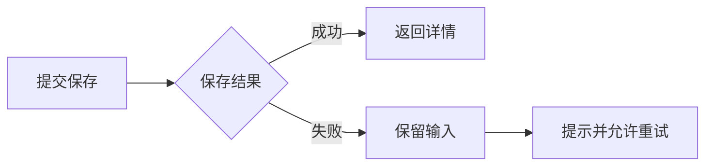

# Issue tracker：GitHub

仅用户明确要求查询或维护 [GitHub Issues](https://github.com/zodea/crm-new/issues) 时使用本流程。需求与范围以用户当前指令为准，疑问直接询问用户。

## 查询

```text
gh issue list --repo zodea/crm-new --state open --search "<关键词>"
gh issue view <number> --repo zodea/crm-new --comments
```

模块场景、数据影响、异常和验收要求见 [`module-review.md`](./module-review.md)；标签和历史关闭状态不能代替规格或完成证据。

## 常用写操作

```text
gh issue create --repo zodea/crm-new --title "<标题>" --body-file "<正文文件>"
gh issue comment <number> --repo zodea/crm-new --body-file "<证据或进度文件>"
gh issue edit <number> --repo zodea/crm-new --add-label "<标签>"
gh issue close <number> --repo zodea/crm-new
```

多行正文写入仓库外的任务专用临时 UTF-8 文件，通过 `--body-file` 发布，完成后删除临时文件。关闭 Issue 时先发布完成证据，再执行关闭操作。

## 每次提交的 show-me 图解

用户已要求在 GitHub Issue 工作中持续使用 [HumanLayer 的 `show-me`](https://github.com/humanlayer/skills/tree/main/plugins/show-me/skills/show-me)。首次撰写本任务反馈前读取已安装的 `show-me/SKILL.md`，按其“选能解释重点的最小视图”原则呈现。

- 适用于每次创建或更新 Issue 正文、发布进度或完成评论，以及关联代码提交后的交付反馈。每个关联 commit 的反馈标注 SHA，并展示本次变化；Git commit 标题仍遵循 [Git 工作流](./git-workflow.md)。
- 默认结构为一句结论、一张简约图或表、至多三条必要的验证结果／阻塞／下一步。正文仍覆盖下方最低要求；详细证据链接到权威文档或提交。
- 流程、依赖和状态变化用 Mermaid；改前／改后与验收结果用小型 Markdown 表格；职责或调用结构用浅层树／`diff`。每次选最合适的一种，图表内容以本次实际变化为准。
- Mermaid 默认保留 3–7 个关键节点，使用简短中文标签；表格只列受影响项。图表直接嵌入 GitHub 正文，使读者能就地查看；说明文字补充图中未表达的事实。
- 明确区分已实现、已验证、待验证和阻塞。提交反馈中的图解不代替实际验收；单纯修改标签或指派无需额外刷评论。

例如，下面仅演示一次修复提交的反馈结构，发布时须替换为真实内容与证据：

> `<SHA>`：保存失败后保留用户输入，允许重试。



验证：`<实际命令与结果>`；待验证：`<尚未覆盖项或无>`。

## Issue 内容最低要求

- 问题或目标，以及为什么现在要做。
- 明确范围与不在范围内的事项。
- 可验证的验收条件。
- 已知依赖、相关 ADR/页面蓝本和复现证据。
- 不复制数据模型或长期规格；链接到权威源。

## 任务关系

地图使用 `wayfinder:map`，调查/前置任务使用 `wayfinder:task`，确需用户裁定的事项使用 `wayfinder:grilling`；外部研究和可交互原型按需使用各自类型。子票通过 GitHub 原生父子关系挂接，先创建 Issue，再建立原生阻塞关系。

```text
gh api repos/zodea/crm-new/issues/<parent>/sub_issues --paginate
gh api repos/zodea/crm-new/issues/<number>/dependencies/blocked_by
gh api repos/zodea/crm-new/issues/<number> --jq .id
```

添加父子关系使用 `POST /repos/zodea/crm-new/issues/<parent>/sub_issues`，JSON 参数 `sub_issue_id` 是上面取得的数据库 ID；添加依赖使用 `POST /repos/zodea/crm-new/issues/<dependent>/dependencies/blocked_by`，`issue_id` 同样是阻塞票的数据库 ID，而非可见票号。按需传递 `replace_parent`，只重挂明确获授权的任务。接口说明见 [GitHub 子任务文档](https://docs.github.com/en/rest/issues/sub-issues)与[依赖文档](https://docs.github.com/en/rest/issues/issue-dependencies)。

可领取前沿为开放、无未完成阻塞、尚未认领的子票；开工前先指派给实际执行者。调查依赖与实施依赖分开：只读采证可并行，实施前必须接齐真实依赖的公共能力和上游事实。基线票不以修完全部历史问题为关闭条件；模块决定充分后即可发布规格和实施票。

## 旧任务替换

被替代的旧票保留正文、评论和已采纳决定，在正文顶部标明主要承接者及跨域协作入口，使用 `superseded` 标签并以 `not_planned` 关闭；该关闭只表示旧工单停止执行，不能作为功能完成证据。`wontfix` 在这类旧票上表示停止旧工作安排，业务义务继续由承接票处理。

每项旧验收义务必须在承接票中登记保留、已有证据满足、经依据修订或明确待裁定的去向。处理旧票时核对承接关系。已关闭的历史领域决议、正在开发的代码和仅本地成果都保留；重组任务不自动授权合并或删除工作树。
