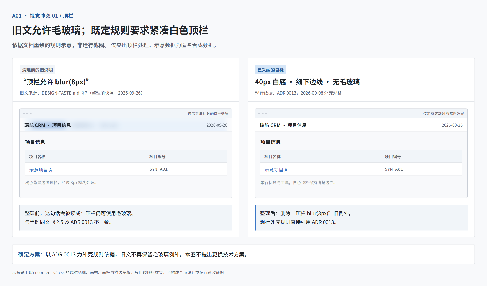
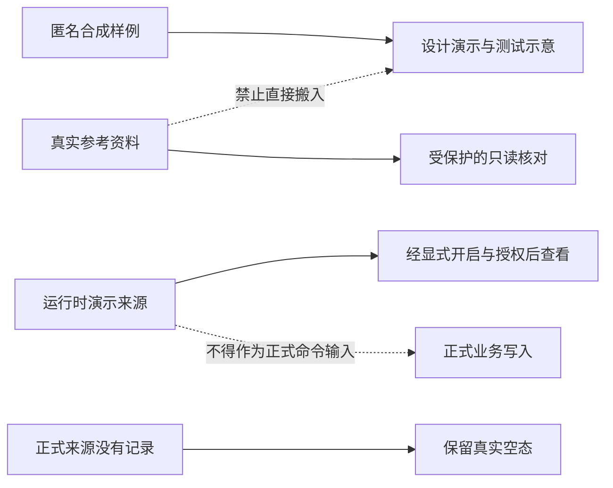

# 设计品味与历史说明（DESIGN-TASTE）

> 来源：2026-07-17 满意版本的品味提炼；2026-09-26 按 A01 清理过时指令与重复配方。本文保留设计理由、旧引用定位和规则对照，**不再作为独立实施规格**。现行职责见[设计入口](./README.md)。

## 1. 为什么采用这套视觉语言

“克制面板 × 高密度台账”服务于项目记账与核对：白底、细线和适量留白帮助扫读；品牌色突出关键操作；数字对齐帮助比较。早期密度 7 / 变化 2 / 动效 2 是品味描述，不是可量化验收阈值，也不覆盖具体页面的信息组织。

这些原则的现行约束归[设计系统边界](../rewrite/DESIGN-SYSTEM.md)；按钮、表格、浮层与状态的结构和行为归 [KitUI 组件规格](./kit-ui-component-specs.md)。字体、颜色、圆角、间距与动效时长直接消费实际样式源，不再从本文复制历史数值。

## 2. 颜色与状态的来源

[content-v5.css](../../DC重构设计源码/_ds/crm-e3d87120-cf57-4b83-8a9b-188c305f529d/tokens/content-v5.css) 及其导入的 typography / spacing 文件维护共享令牌；[Nuxt tokens.css](../../app/assets/css/tokens.css) 维护应用桥接和外壳专属值。旧色值表、字阶与字体栈快照已移除，避免与实际源并行维护。

### 2.3 业务状态（旧引用定位）

状态标签的现行裁定见 [ADR 0013](../adr/0013-align-all-ui-to-online-design.md)，具体语义色与非交互边界直接见 [KitUI 状态规格](./kit-ui-component-specs.md#16--业务状态-tag-kit-status-tag--公共原语已实现2026-09-08)。历史“列表状态只用纯文字”不能作为当前要求；计数、来源、类别标识不随业务状态标签一起改形状。

## 3. 顶栏：收回旧毛玻璃例外

原 §7 仍把顶栏毛玻璃写成例外，与 [ADR 0013 的现行外壳规格](../adr/0013-align-all-ui-to-online-design.md#外壳规格2026-09-08-按直接复刻授权更新) 相反。该旧实施指令已移除，外壳直接遵循 ADR 0013。

图为匿名重绘的规则说明，**不是红圈或 CRM 当前页面截图，也不是运行验收证据**。[HTML 图源](./assets/show-me-a01-ui-comparisons.html)用于维护这组示意。

## 4. 组件配方的承接

原逐组件数值表和配方已归回现行组件规格。页面使用已有通用原语，按对应页面的事实组织信息；详情壳不固定所有领域的流程、经营指标与页签顺序。

### 4.2 按钮：五变体 + 「每屏一枚章」铁律

本节保留旧代码注释与历史讨论的定位。五变体用途、hover / active / disabled 和 loading / success 行为已完整承接到 [KitUI 按钮规格](./kit-ui-component-specs.md#06--按钮三态-button-states--已定案公共零件无-adr)，不在本文维护第二份配方。

### 4.5 StatusChip（旧引用定位）

列表与详情状态的结构和语义统一直达 [KitUI 状态规格](./kit-ui-component-specs.md#16--业务状态-tag-kit-status-tag--公共原语已实现2026-09-08)，不使用旧版品味快照反推当前外观。

## 5. 演示数据：区分设计样例与正式事实

原“演示数据取自真实蓝本”的要求已移除。设计演示来源遵循 [ADR 0014 §9](../adr/0014-full-page-entity-forms.md#9-数据与实施纪律)，运行时来源隔离遵循 [ADR 0020](../adr/0020-browser-authority-and-demo-workspace-boundary.md)。下图概括已定边界，**不新增表、字段、迁移或写入链路**。

本图不表示所有中央能力已生产验收；当前可用边界看对应[用户指南](../guides/README.md)与验收证据。无原始事实时不以合成记录填充正式列表，也不以演示反馈伪造成功。

## 6. 动效与排版

长期约束已并入[设计系统边界](../rewrite/DESIGN-SYSTEM.md#2-稳定视觉语言)。过去的组件位移、时长与字重实测属于历史快照，不作为新的全站尺寸或动画要求；具体交互按组件契约与实际令牌核对。

## 8. 历史差异的处理

### 8.1 外壳不再属于有意分叉

这是 ADR 0013 所引用的旧章节定位。早期“外壳不对照设计稿”的决定已被替代，外壳视觉归 [ADR 0013](../adr/0013-align-all-ui-to-online-design.md)，[ADR 0011](../adr/0011-redesign-application-shell.md) 保留页签、导航等行为条款。

按钮层级、字阶和 danger 变体的历史修正见 [#109 审计评论](https://github.com/zodea/crm-new/issues/109#issuecomment-4998491581)及 Git 历史；本文不再复制完成记录或旧代码问题。当前功能缺口直接看[界面实现状态](./ui-implementation-status.md)。

## 9. 维护边界

现行规则变化时修改其直接权威来源；本文只同步受影响的示意与定位链接。运行参考差异按[运行参考审计](./runtime-reference-audit.md)留证，不能将本文图片写作新的现场观察。
