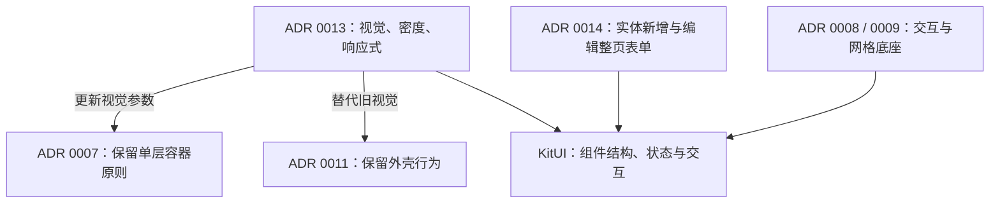

# 设计入口

> 不清楚设计资料位置时查本页；已知任务直接读取相关规格，不从历史稿反推现行规则。

历史核对证据：[#292](https://github.com/zodea/crm-new/issues/292)、[#276](https://github.com/zodea/crm-new/issues/276)；不作为新任务的强制流程。

## 权威源与职责

| 定位 | 要回答的问题 | 直接来源 |
|---|---|---|
| 1 | 当前功能是否要做、做到什么程度 | 用户当前指令；需求疑问直接问用户 |
| 2 | 页面字段、Tab、业务边界 | [`docs/rewrite/pages/`](../rewrite/pages/)；数据实体看 [DATABASE.md](../rewrite/DATABASE.md)，领域术语看 [CONTEXT.md](../../CONTEXT.md) |
| 3 | 有直接对应页时的构图、密度、控件状态和只读交互路径 | 用户已登录的运行态参考系统；证据、差异和只读边界登记在 [`runtime-reference-audit.md`](./runtime-reference-audit.md) |
| 4 | 瑞航品牌、无直接对应页和 DC 独有能力的当前方案 | `DC重构设计源码/app.dc.html`；屏幕源码为 `DC重构设计源码/kit/**/*.jsx` |
| 5 | 颜色、间距、圆角等令牌 | `DC重构设计源码/_ds/crm-e3d87120-cf57-4b83-8a9b-188c305f529d/tokens/content-v5.css` |
| 6 | 参考冲突、响应式和可达性裁定 | [ADR 0013](../adr/0013-align-all-ui-to-online-design.md)；整页实体表单继续遵守 [ADR 0014](../adr/0014-full-page-entity-forms.md) |
| 7 | 组件和交互原语 | [KitUI 组件规格](./kit-ui-component-specs.md)；底座选型见 ADR 0008 / 0009 |

上表按问题定位来源，不是按行号覆盖规则。ADR 按明确的适用范围与替代关系理解：



这些 ADR 共同约束实现，不是几套可任选的风格。冲突核对遵守以下边界：

- 运行态参考只决定有直接对应页的界面信息流和安全可观察交互，不覆盖瑞航品牌、字段含义、数据、权限或领域状态机。
- `app.dc.html` 与运行态参考中的固定视口都不是固定画布合同；与 ADR 0013 的响应式、滚动或可达性要求冲突时，以 ADR 0013 为准。
- 参考系统没有直接对应页，或现有业务能力变化很大时，先按 `runtime-reference-audit.md` 提供脱敏标注图或重绘线框，不拿相邻页面伪装成直接证据。
- 用户明确变更业务口径时，同轮更新 `docs/rewrite` 或 ADR。

稳定设计原则、令牌消费与组件职责见 [DESIGN-SYSTEM](../rewrite/DESIGN-SYSTEM.md)；品味理由与规则对照已[并入同一文件](../rewrite/DESIGN-SYSTEM.md#a01-history)，旧 DESIGN-TASTE 文件已退役。[交互参考](./interaction-style-references.md)只保留独有外部来源与采纳理由，不另发实施规格。

### 与协作、文档、测试和指南入口的关系

| 入口 | 与设计整理的关联 |
| --- | --- |
| [AGENTS.md](../../AGENTS.md) | 确定任务授权、只读参考、权威唯一和交付边界 |
| [文档入口](../README.md) | 定位 ADR、设计、页面、数据与读写契约；按职责直达 |
| [测试入口](../testing/README.md) | 区分静态契约与运行验收，按受影响行为选测试；示意图不代替运行证据 |
| [指南入口](../guides/README.md) | 用户操作变化时更新相应专题，并标明可用版本；仅纠正旧设计说明不重写既定用户流程 |

图片、流程图和数据关系图就近嵌入承担该规则的 Markdown，并注明规则示意、历史证据或当前运行实拍。更正数据来源说明不等于修改数据库；实体、字段或关系实际变化仍由 DATABASE 承接。

## 当前设计源码只保留这些入口

```text
DC重构设计源码/
├─ app.dc.html        # 当前设计稿 HTML 应用入口
├─ support.js         # Claude Design 支撑脚本
├─ kit/               # 当前各屏幕和交互源码
└─ _ds/               # 设计系统运行时、CSS 与令牌
```

`app-old.html`、`app-new.html`、打印试验页、色彩对比原型、`DC重构设计源码/docs/` 副本均属于旧稿，不再保留在工作树。历史需要通过 Git 记录查看。

## 当前设计覆盖与待补设计

缺一一对应 DC 页面的路由统一登记在 [`design-coverage.json`](./design-coverage.json)，数量见[实现状态生成表](./ui-implementation-status.md#2-当前总数)。当前工作区已注册并挂载付款详情 `payApplyDetail`、数据迁移 `dataMigration`、施工阶段配置 `quantityStages` 和工序库版本详情 `processLibraryDetail`，覆盖映射按其实际 PAGE、路由开关与 x-import 登记。DC 源码的并行改动属于既有工作区成果，本轮只同步索引；设计落点不提升页面业务、运行或生产验收等级。付款、迁移、阶段与工序库的历史实施来源分别保留 #305/#294、#442、#443；当前复核范围仍按对应领域规格。此前施工进度「前后置依赖设置」已由 #244 合入设计源码，[补图 brief](../research/schedule-dependency-editor-brief.md) 保留为历史研究。

当前界面数量、未实现和未闭环清单统一看 [`ui-implementation-status.md`](./ui-implementation-status.md)；全部生产 Nuxt 路由的运行态参考证据和差异看 [`runtime-reference-audit.md`](./runtime-reference-audit.md)，可机读双向集合见 [`runtime-evidence-ledger.json`](./runtime-evidence-ledger.json)。

动态单据、导入阶段、当前挂载的页签/子表和 browser/Tauri 读写差异，进入 [全模块复核覆盖索引](./module-review-coverage.md)；其 [JSON](./module-review-coverage.json) 为派生清单。它与路由证据账本分别记录“需要核验哪些面”和“已有何种参考证据”，不以生成行数宣告功能完成。

运行态视觉与公共交互回归的覆盖矩阵、更新方式和数据脱敏边界见 [`runtime-visual-regression.md`](./runtime-visual-regression.md)。页面切片完成时必须同时更新对应模板样本与真实页面基线。

分供方证照中央链的流程、实际交互与文档验收分别见 [#446 原件与人工核验](./evidence/issue-446/README.md) 和 [#447 OCR 人工确认与税务核验](./evidence/issue-447/README.md)；结果与未验范围以对应页为准，不以某条子流程接通推定整个证照或主档模块完成。

排程中央链分别查 [#443 工序库版本](./evidence/issue-443/README.md) 与 [#444 WBS、阶段往返及旧图接管](./evidence/issue-444/README.md) 的流程图、实际交互和验收记录。新增暂估绑定由 #445 接通；各切片不代替成本、工资或生产部署验收。

工资完整接管及中央历史只读的流程、实际交互与指南见 [#412 工资接管记录](./evidence/issue-412-payroll-history/README.md)。工资来源及相关独立屏已按当前 DC 注册纳入设计覆盖，落点见 [`design-coverage.json`](./design-coverage.json)。设计覆盖只说明屏幕存在；只读切片、A/C1/C2 核算、发放和完整工作簿仍分别验收。

## 文档放置规则

- 新的架构或不可逆技术决策：写入 `docs/adr/`。
- 页面字段、交互和验收变化：更新 `docs/rewrite/pages/`，不要复制第二份页面蓝本。
- 数据结构变化：只更新 `docs/rewrite/DATABASE.md`。
- 领域词义变化：只更新根目录 `CONTEXT.md`。
- 组件级设计：放在 `docs/design/`，先检查是否已有对应专题文件。
- 调研证据：放在 `docs/research/`，必须标注“非权威源”。
- 临时记录中的长期有效结论并入现有权威文档后删除；任务进度留在已授权使用的 Issue，写入须经用户授权，不另存本地反馈副本。

## 开工检查

| 当前任务 | 直接核对 |
| --- | --- |
| 页面布局或交互 | 对应页面规格、运行证据和 DC 对应页 |
| 组件或底座调整 | 现有组件、安装版本官方 API/扩展与 KitUI 契约 |
| 响应式、滚动和焦点 | ADR 0013 及受影响视口的实际运行 |
| 业务或权限含义冲突 | 先核实事实并向用户说明；相关 Issue 仅按 AGENTS 定向核对，写入须授权 |

既定方案内优先使用官方扩展。改变业务行为、组件契约或底层方案前说明依据与影响并取得用户确认；按确认范围同步直接受影响的文档。

<!-- issue-441:begin -->
## #441 送货中央归档切片

送货归档、完整原件、结构化修订和受控迁移已完成本地真实浏览器切片验收；三条旅程、五档界面、冲突核对、文件字节及指南 PDF 证据统一见 [#441 验收记录](./evidence/issue-441/README.md)。最终整合测试、类型检查与构建通过；物资父票 #411 的有效到货、库存及结算范围不因此标记完成。
<!-- issue-441:end -->
