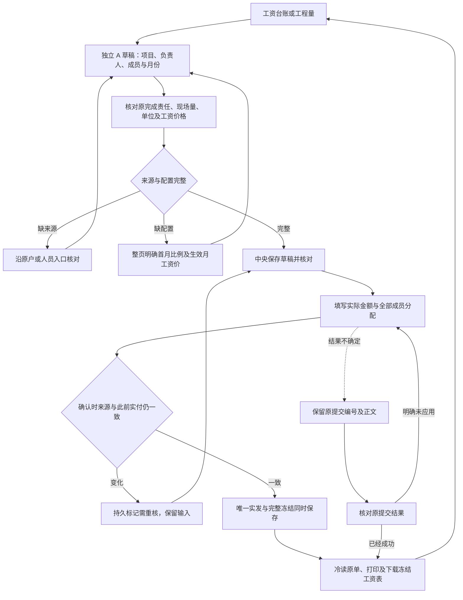

# #412 P1：A 工资中央核算与实际发放

> 本期已完成本地行为、视觉、完整测试及独立复核，达到 `slice-verified`；已独立提交 `c4c5b9f2e8398cc6e4dc6b51bd6f844dff9cb91d`，正常提交钩子通过。固定前置为 `1de44da2fdeb8091fb0e2cc2f3bcfd9794e07fc3`；[P0 历史接管](../issue-412-payroll-history/README.md)的证据不替代本期日常写入。

本期验证从真实已完成施工与现场量进入工资配置、独立草稿、核对、实际分配、冻结输出和原来源返回。范围及全部验收以[本地 P1 实施票](https://github.com/zodea/crm-new/blob/212a1cb586af9396f4e4a9dbee50eeb7333e0cf5/docs/research/issue-review-2026-09-11/payroll-tickets/01-central-a-payroll.md)为准；长期计算和状态只见[工资页面](../../../rewrite/pages/subcontract-payroll.md)。未外发本票，未推送、部署或运行云 CI。

## 本期流程

## 已定位并验证的差异

| 问题 | 纠正依据与可观察结果 | 当前证据 |
| --- | --- | --- |
| 上月结算 95% 覆盖月度已保存 80% | 沿 #117 上月月度单保存比例，未发也可继承，0 不回退首月配置 | 公开服务反例先失败后通过；[`central-a-amount-integrity.test.ts`](../../../../tests/payroll/central-a-amount-integrity.test.ts) |
| 价格修订缩小范围后旧价复活 | 先选稳定价格的适用修订，再判断范围；跨次重叠价格明确拒绝 | 价格两条反例先失败后通过；[`central-a-prices.test.ts`](../../../../tests/payroll/central-a-prices.test.ts) |
| 旧实际金额未知被应发或成员分配补齐 | 旧实发未知保持未知；累计 1280 减实际 900 得 380，不重复扣分配或其他格式 | 独立金额服务用例，P0 原表证据和冻结呈现分别断言 |
| 已核对单之间新增实际支付 | 付款身份及金额集合进入核对来源；第二单持久标记需重核，冷读保持 | 两张已核对单依次发放的公开事务反例 |
| 真实 29 分实发被浮点绝对相等误拒 | 使用整数分一致性验证，零成员同时保留 | 独立完整保存→核对→发放→冻结输出反例先失败后通过 |
| 旧班组比例导出丢失，初始化默认值冒充配置 | 原比例随身份接管；缺字段/null 未配置，明确 0 保真，重复接管保后续更正 | 原 SQL→迁移请求→中央事实的定向测试 |
| 原责任细分范围在软删或缺链后消失 | 保留原 assignment/scope 和 8/null/0；缺链不扩大范围、不移交当前责任 | 真实 SQLite 量事实用例；同总量同时间换源改变指纹 |
| 后来 A 配置与已付来源未受旧图恢复保护 | 原配置、价格范围、单据来源、回执、历史和零成员引用使危险恢复整批拒绝 | 逐表比对恢复前后全部 SQL 和权威状态；不相关配置仍可恢复 |
| 日常保存的空配置回执误报结构损坏 | 工资动作没有配置范围时保存真正空值，使恢复保护识别真实引用 | 公开保存→恢复引用解析反例先失败后通过；没有通过忽略回执来解除保护 |
| 无效未来日期被当成合法未来完成而静默跳过 | 先校验真实日期，再按月份排除；缺损保留原责任主体诊断 | `2026-13-01`、`2026-09-31` 两例先失败后通过，同时验证合法 `2026-09-10` 正常排除；新旧量事实共 6 项通过 |
| 半分在核算与冻结复验中舍入不一致 | 同一金额边界同时服务核算和冻结勾稽，不放松完整性检查 | `1.45×0.10` 与 `0.29×50%` 均实际发放 0.15 元，两条公开保存→核对→发放→冷读反例先失败后通过 |

## 最终验收

最终批次 `8a1b9aed-bdf5-4eca-af94-67422e0ce565` 在全新专用内存实例，从真实 SQLite 预检、试运行、导入、确认开始，连续完成首张 A 工资、配置保稿、原来源往返、实际发放、冻结输出及第二张工资重核。未重置业务库，也未拼接旧批次结果。[来源身份与字节摘要](./browser/source-verification.json)、[完整浏览器记录](https://github.com/zodea/crm-new/blob/0467f2298e7f72ed1c1dce5d578a3f131aa9a4bb/docs/design/evidence/issue-412-payroll-a/browser/browser-run.log)和[逐图清单](https://github.com/zodea/crm-new/blob/0467f2298e7f72ed1c1dce5d578a3f131aa9a4bb/docs/design/evidence/issue-412-payroll-a/browser/manifest.json)对应同一个批次。

| 验证 | 最终结果 |
| --- | --- |
| 浏览器 | 4 个套件、9 项全部通过，1.3 分钟；包括完整 A 主流程及 8 项旧页面边界 |
| 五档交互画面 | 17 组 × 390 / 768 / 1024 / 1280 / 1440，共 85 张逐张通过；C 20、Root 35、另一独立审查员 30 |
| 完整测试 | `npm test`：626 个文件、3783 项全部通过，242.54 秒 |
| 类型、构建及规范 | `pnpm typecheck`、构建及本期 109 个源码文件规范检查全部通过 |
| 独立审查 | Standards / Spec 最终均为 0 项未解决；过程及增量修正见[审查记录](./review.md) |
| 冻结输出 | 原工资 PDF 文本回读通过，[工资打印页图](./pdf/frozen-a-payroll-1.png)目检通过；[真实 XLSX](./browser/frozen-a-payroll.xlsx)四表文件解析通过，发放汇总与成员分配核对一致 |
| 使用指南 | 工资 5 页、迁移 7 页共 12 页已逐页检查；另有实际工资表 1 页，摘要分别记录于 [PDF 清单](https://github.com/zodea/crm-new/blob/0467f2298e7f72ed1c1dce5d578a3f131aa9a4bb/docs/design/evidence/issue-412-payroll-a/pdf/manifest.json) |

实发工资按冻结值显示核算应发 320 元、实际发放 300 元，组内保留 300 元及明确 0 元成员；第二张已核对单在此前实际支付改变后持久标记需重核，重核保留原 75 元输入，再按此前实付 300 元完成发放。实际打印页的中文、金额、签字位和白纸背景均经目检，[查看渲染页](./pdf/frozen-a-payroll-1.png)。

2026-09-14，旧工资打印 PDF 样本已按用户要求移入 Windows 回收站；当前阅读使用上述页图和 Markdown，原始清单中的路径及哈希保留为历史证据。恢复来源见[清理记录](https://github.com/zodea/crm-new/blob/0467f2298e7f72ed1c1dce5d578a3f131aa9a4bb/docs/research/guide-pdf-cleanup-2026-09-14.md)。

## 交互效果

| 流程 | 代表画面 |
| --- | --- |
| 首张工资与真实缺量 | [工程量入口](https://github.com/zodea/crm-new/blob/0467f2298e7f72ed1c1dce5d578a3f131aa9a4bb/docs/design/evidence/issue-412-payroll-a/browser/first-payroll-from-quantity-1440.png)、[8 / 缺值 / 0 的来源核对](https://github.com/zodea/crm-new/blob/0467f2298e7f72ed1c1dce5d578a3f131aa9a4bb/docs/design/evidence/issue-412-payroll-a/browser/quantity-missing-zero-390.png) |
| 整页配置与原草稿 | [工资价格配置](https://github.com/zodea/crm-new/blob/0467f2298e7f72ed1c1dce5d578a3f131aa9a4bb/docs/design/evidence/issue-412-payroll-a/browser/subject-price-configuration-390.png)、[配置返回保留输入](https://github.com/zodea/crm-new/blob/0467f2298e7f72ed1c1dce5d578a3f131aa9a4bb/docs/design/evidence/issue-412-payroll-a/browser/draft-config-return-390.png) |
| 原来源与跨楼层定位 | [第二楼层来源焦点](https://github.com/zodea/crm-new/blob/0467f2298e7f72ed1c1dce5d578a3f131aa9a4bb/docs/design/evidence/issue-412-payroll-a/browser/second-floor-source-focus-390.png)、[工程量返回](https://github.com/zodea/crm-new/blob/0467f2298e7f72ed1c1dce5d578a3f131aa9a4bb/docs/design/evidence/issue-412-payroll-a/browser/quantity-matrix-source-return-1440.png) |
| 实发确认与失败保留 | [一分不一致](https://github.com/zodea/crm-new/blob/0467f2298e7f72ed1c1dce5d578a3f131aa9a4bb/docs/design/evidence/issue-412-payroll-a/browser/release-cent-mismatch-390.png)、[基准变化](https://github.com/zodea/crm-new/blob/0467f2298e7f72ed1c1dce5d578a3f131aa9a4bb/docs/design/evidence/issue-412-payroll-a/browser/stale-release-retained-390.png)、[回执丢失后核对原提交](https://github.com/zodea/crm-new/blob/0467f2298e7f72ed1c1dce5d578a3f131aa9a4bb/docs/design/evidence/issue-412-payroll-a/browser/unknown-release-retained-390.png) |
| 冷读与跨月重核 | [完整冻结输出](https://github.com/zodea/crm-new/blob/0467f2298e7f72ed1c1dce5d578a3f131aa9a4bb/docs/design/evidence/issue-412-payroll-a/browser/released-frozen-output-1440.png)、[需重新核对](https://github.com/zodea/crm-new/blob/0467f2298e7f72ed1c1dce5d578a3f131aa9a4bb/docs/design/evidence/issue-412-payroll-a/browser/second-statement-needs-recheck-390.png)、[重核保留 75 元](https://github.com/zodea/crm-new/blob/0467f2298e7f72ed1c1dce5d578a3f131aa9a4bb/docs/design/evidence/issue-412-payroll-a/browser/rechecked-allocation-retained-390.png) |

全部视口及各文件 SHA256 见[唯一画面清单](https://github.com/zodea/crm-new/blob/0467f2298e7f72ed1c1dce5d578a3f131aa9a4bb/docs/design/evidence/issue-412-payroll-a/browser/manifest.json)。Root 的 [35 张记录](https://github.com/zodea/crm-new/blob/0467f2298e7f72ed1c1dce5d578a3f131aa9a4bb/docs/design/evidence/issue-412-payroll-a/review/root-image-review-final.json)与独立审查员的 [30 张记录](https://github.com/zodea/crm-new/blob/0467f2298e7f72ed1c1dce5d578a3f131aa9a4bb/docs/design/evidence/issue-412-payroll-a/review/source-image-review-final.json)已归档。此前空白打印、灰底、窄屏配置和来源摘要裁切均有失败复现并已修正；旧诊断轮和视觉失败批次不计入本次 85 张通过结论。

## 验收边界

本期仅证明本地中央 A 工资切片和隔离测试实例中的完整链路。已独立提交 `c4c5b9f2e8398cc6e4dc6b51bd6f844dff9cb91d`，正常提交钩子再次通过626文件、3783项（219.34秒），110个代码内容身份与提交逐项一致，未推送、部署或运行云 CI；新增整页的既定设计来源等级不因行为通过而提升。

C1/C2、独立更正与实际补退、房补管理费、空鼓扣款、批量资金建议和完整工作簿仍继续 P2–P7；#416 保留生产保存、备份与部署关口。各期可用范围见[总规格](https://github.com/zodea/crm-new/blob/212a1cb586af9396f4e4a9dbee50eeb7333e0cf5/docs/research/issue-review-2026-09-11/payroll-central-spec-draft.md)，当前总图及逐 Issue 图见[交互报告](https://github.com/zodea/crm-new/blob/212a1cb586af9396f4e4a9dbee50eeb7333e0cf5/docs/research/issue-review-2026-09-11/index.html#issue-412)。

2026-09-13 10:27 已重新获取远端：13 个实际远端分支均为本地 HEAD 祖先，开放 PR 与未解决冲突为空。本地领先线上主分支 166 个提交、落后 0；包含本期功能提交，尚未推送。具体整合和原工作树边界见[分支记录](https://github.com/zodea/crm-new/blob/212a1cb5/docs/research/local-branch-integration-2026-09-10.md)。

正常提交及代码核对见[提交凭据](https://github.com/zodea/crm-new/blob/0467f2298e7f72ed1c1dce5d578a3f131aa9a4bb/docs/design/evidence/issue-412-payroll-a/commit-receipt.json)。三个浏览器JSON产物在正常格式化中只补末尾换行；唯一清单同时保存原摘要与当前归档摘要，原业务内容逐值相同。
