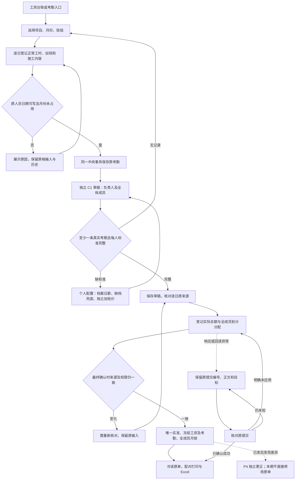

# #412 P2：逐日考勤至 C1 实际发放与配对输出

> 2026-09-14，P2 本地限定验收通过。固定比较基线为 `579d9383357fffd2bd87e727dbc21b903a7cb69c`；最终输入与检查见 [verification.json](./verification.json)。本页不代表全部工资、线上部署或生产保存已完成。

产品与正式证据提交为 `fd0a7b6b4ab58eb177eea1db86a069067be92a4a`，正常提交钩子再次通过 654 文件 / 3866 项，112 个代码内容身份与提交一致，见[提交回执](./commit-receipt.json)。693 个专用临时文件及此前 15 份重复证据已送入回收站，可恢复；正式产物保留，见[清理记录](./cleanup-record.json)。

本期承接[本地 P2 实施票](../../../research/issue-review-2026-09-11/payroll-tickets/02-central-c1-attendance.md)。业务口径以[工资页面](../../../rewrite/pages/subcontract-payroll.md)、[数据库](../../../rewrite/DATABASE.md)与[命令](../../../rewrite/COMMANDS.md)为准；P1 的通过结果不替代本期 C1 验收。

## 本期流程

工资不要求项目存在工程量；空考勤与真实零工时分别处理。每月独立核算，前月实发不再次从次月 C1 扣减。分配记录只解释本次实发的去向，不形成第二笔工资成本。

## 已发现并纠正的缺口

| 缺口 | 可观察的修正 | 证据与当前状态 |
| --- | --- | --- |
| 全班组视图的空班组被当成工资实际归属 | 实际有班组的负责人不能保存为空班组的坏工资；保留真实主体范围 | [独立公开服务反例](../../../../tests/payroll/central-c1-independent.test.ts)已通过 |
| 工人转组后同日记录可能被新组覆盖 | 原记录保留原组与原 ID，新组同项目同人同日不得重复登记 | 同一公开服务测试核对原 ID、原组及 7.51 小时原内容 |
| 同工时总数和更新时间掩盖逐日内容变化 | 逐日内容参与核对依据，旧核对持久变为需重核 | 同一公开服务测试已通过，整库失败回滚另行核对 |
| 工资输出只核金额，无法识别冻结考勤关系受损 | 日期、项目、月份、删除状态及原发放依据同时核对 | 同一公开服务测试：金额不变的坏来源仍拒绝输出 |
| 最后一次人员读取期间撤权或改价 | 考勤/发放在提交前重新验证，失败不留下部分数据、审计或回执 | 同一公开服务测试逐表核对全部相关状态不变 |
| 旧工资迁入对占用成员和月份的提取少于日常写入 | 候选原图与现存原图共用一套来源占用提取，保留冻结行、负责人、原月份及软删关联 | [独立迁入反例](../../../../tests/payroll/c1-b-independent-review.test.ts)5 项先失败后通过；原断言未改 |
| 非法整日被忽略后释放仍可证明的月份占用 | 保留原坏日期和诊断，已可辨月份不能压到后来的真实零考勤 | 同一独立迁入测试通过；不把坏日期升级成可发来源 |
| 配置返回丢失原 C1 草稿 | 带多状态筛选及嵌套考勤返回的地址按 C1 有界合同校验，返回同一个 draftKey | 本轮真实主流程实际往返通过 |
| 提交成功但回读失败时提前清掉原编号 | 成功回执仍保留，只有同身份同目标的后续读取核实后才确认完成 | 独立 store / 组件及原键浏览器恢复验证 |
| 批量关闭页面时，前页同意丢稿但后页取消 | 守卫仅裁定是否离开，整批取消时仍保留所有输入 | 独立真实页签关闭测试先失败后通过 |
| 未选月份直接打开考勤得到笼统错误 | 保原空项目/月与候选，提示先选择；不读取全年，写命令仍拒空月 | 公开 service / HTTP 反例先失败后通过 |
| 已发 C1 明细把 60.125 时薪显示成 60.13 | C1 详情 HTTP 两套明细及页面保留原费率；实际金额和 A 类单价仍按原规则校验 | [真实 HTTP 反例](../../../../tests/payroll/central-c1-http.test.ts)先失败后通过；最终浏览器同时断言 HTTP、Repository 及实际单元格 60.125 |
| 旧缺损已发历史显示本次完整冻结成功 | 显示原记录已发且只读、来源或发放证据不完整，不生成配对输出，也不显示新建或重核指令 | 本轮只读浏览器流程及五档原图通过；原实发关系 100 保真，完整事实 actualAmount 仍为 null |
| 配置冷恢复只显示原项目与班组 ID | 待核对原提交时仍显示该次原项目、班组名称；保留原价、空值及原命令 | 冷恢复五档实际图通过；普通已保存配置另补五档名称就绪后的只读原图 |

## 验收状态

主流程实际走通真实迁入、无工程量项目考勤、个人费率、核算 1,041 元、实发 900 元及 550/350/0 分配、原键恢复和配对输出。最终 `npm test` 为 **654 文件 / 3866 项通过**；类型、112 个代码文件规范检查及构建通过；本轮真实浏览器 **14/14 通过**。三项目检发现均已修复并在最终运行复验。

正式证据包含 **125 张实际交互图**，覆盖 390/768/1024/1280/1440px：主流程 85、历史及权限只读 20、恢复 15、普通配置名称就绪补图 5。三位复核者逐张检查全部原图；主流程最早三张普通配置图仅证明标签读取过渡态，名称完整状态以补图为准。另有实际配对 PDF 2 页及两份使用指南 13 页逐页目检，分别计数，不冒充额外交互图。

- [工资打印页](./browser/c1-paired-page-1.png)、[考勤打印页](./browser/c1-paired-page-2.png)与[实际下载的 Excel](./browser/c1-wage-and-attendance.xlsx)：两张工作表已重新读取，费率、原工时、实发及零分配核实。
- [主流程记录](./browser/journey-verification.json)、[浏览器检查](./checks/browser.log)与[完整测试](./checks/npm-test.log)。
- [独立 Spec 复核](./checks/spec/review.md)与[独立 Standards 复核](./checks/standards/review.md)：当前范围无未决阻断；保留真实失败到修复的记录。

2026-09-14，旧配对打印 PDF 样本已按用户要求移入 Windows 回收站；当前阅读使用上述两张页图和 Markdown，原始清单中的路径及哈希保留为历史证据。恢复来源见[清理记录](../../../research/guide-pdf-cleanup-2026-09-14.md)。
- [逐项验收证据索引](./checks/README.md)保留各作者及独立审查的实际范围，原临时路径可通过图片映射找到正式副本。
- [最终证据摘要](./verification.json)及[逐文件指纹](./file-manifest.json)固定本期输入和正式产物。

本期运行证据只来自本地隔离中央验证实例。P2 为已接通且通过本地切片验收，不以源码接线、组件模拟或旧期结果替代真实运行，更不提升生产等级。

## 后续边界

P3 新签工/C2、P4 补退及完整成本消费者、P5 房补管理费、P6 空鼓、P7 批量建议及完整工作簿继续独立实施；已记录的业务取舍留在各票 `$grill`。逐 Issue 流程与完整总图由[交互报告](../../../research/issue-review-2026-09-11/index.html#issue-412)统一展示。
