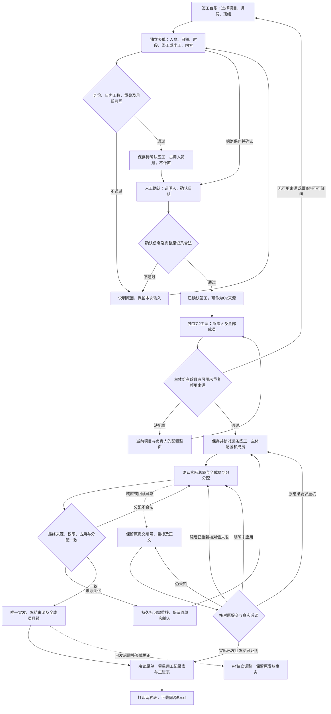

# #412 P3：签工原记录至 C2 实发与配对输出

> 本页保留已完成切片的实测摘要及原验收边界；日期、数量和阶段状态属于当次记录。已纳入版本控制的历史图片、审查与归档流水由[固定 Git 原始材料](https://github.com/zodea/crm-new/tree/c16869fcbf954dddd46143839afe5790f3828f1a/docs/design/evidence/issue-412-payroll-c2)定位。未跟踪的提交标准输出不在 Git 中，其回收原文通过回收站恢复。当前规则以所引现行权威文档为准，真实原件、源证明和产品打印不改写。

> 2026-09-14，P3 已通过本地限定验收。固定比较基线为 P2 最终登记 `4738be98730955cd63832c8df04fc6f1d855caff`，其产品为 `fd0a7b6b4ab58eb177eea1db86a069067be92a4a`。C2 签工与核算实发在本地中央验证实例已可用；本期不代表完整工资、生产保存或部署完成。提交状态另以提交回执为准。

本期承接 [P3 实施票](https://github.com/zodea/crm-new/blob/c16869fcbf954dddd46143839afe5790f3828f1a/docs/research/issue-review-2026-09-11/payroll-tickets/03-central-c2-daywork.md)，业务以[工资页面](../../../rewrite/pages/subcontract-payroll.md)、[命令](../../../rewrite/COMMANDS.md)及[数据模型](../../../rewrite/DATABASE.md)为准。

产品已独立提交为 `f39d8106579ea09cd1335119701ba6105cd22846`，正常提交钩子再次通过规范、类型及682文件/3964项测试。产品提交当时112项源码身份保持不变。钩子仅整理12份证据JSON格式，原始清单仍保留提交前摘要，精确原件与提交后对应见[格式记录](https://github.com/zodea/crm-new/blob/c16869fcbf954dddd46143839afe5790f3828f1a/docs/design/evidence/issue-412-payroll-c2/checks/commit-normalization.json)；两者解析内容相同。产品提交事实见[提交回执](https://github.com/zodea/crm-new/blob/c16869fcbf954dddd46143839afe5790f3828f1a/docs/design/evidence/issue-412-payroll-c2/commit-receipt.md)；后置覆盖断言与HTTP单例时限已另行改变，分轮结果和最终验证见[后置登记](https://github.com/zodea/crm-new/blob/c16869fcbf954dddd46143839afe5790f3828f1a/docs/design/evidence/issue-412-payroll-c2/checks/closeout/README.md)，不倒改原始清单。

## 操作与异常返回

无工程量项目也可登记签工。待确认记录参与时段、日工数和 C1/C2 互斥检查，但只有合法已确认记录计薪。一条签工至多被一张有效 C2 工资领用；未发工资的原来源可按规则修正，之后必须重新核对。已发后不靠改人、改日、软删或另建记录解除月锁。

## 已解决的问题

| 原缺口 | 现在的可观察行为 | 实际依据 |
| --- | --- | --- |
| 浏览器只能读旧签工，不能完成确认、配置与 C2 发放 | 无工程量项目从逐日整页签工开始，人工确认后按主体价核算，实发后读取同次两种冻结输出 | [完整主旅程](./browser/main/verification.json) |
| 自动重读可能把旧稿视为已经同意最新来源，或继续使用旧权限 | 原稿及采用依据分开保存；只有明确重新核对才采用新版本，撤权立即限制写入 | [独立规格复核](https://github.com/zodea/crm-new/blob/c16869fcbf954dddd46143839afe5790f3828f1a/docs/design/evidence/issue-412-payroll-c2/checks/spec-final/review.md)及组件反例 |
| 已发无签工、零收款成员可能从当前筛选的月份锁中遗漏 | 月份锁独立于可见签工行及确认状态筛选，所有原成员均保留占用 | [零成员锁图](https://github.com/zodea/crm-new/blob/c16869fcbf954dddd46143839afe5790f3828f1a/docs/design/evidence/issue-412-payroll-c2/browser/main/zero-member-month-lock-390.png)及公开服务反例 |
| 成功但后读失败、原结果之后又被合法更新时可能清掉原稿 | 原编号、原日期、正文及证明信息保持；恢复原回执与当前记录分别显示，不能借旧输入覆盖后来的记录 | [恢复原稿](https://github.com/zodea/crm-new/blob/c16869fcbf954dddd46143839afe5790f3828f1a/docs/design/evidence/issue-412-payroll-c2/browser/later-change-recovery/daywork-original-ack-retained-content-390.png)、[当前记录展开](https://github.com/zodea/crm-new/blob/c16869fcbf954dddd46143839afe5790f3828f1a/docs/design/evidence/issue-412-payroll-c2/browser/later-change-recovery/daywork-original-ack-current-expanded-390.png) |
| C2 详情和编码可能舍入精确单价，或输出科学计数法 | C1/C2 的精确费率保留原值并使用固定十进制；金额与 A 单价的原限制不放宽 | [HTTP/编解码反例索引](https://github.com/zodea/crm-new/blob/c16869fcbf954dddd46143839afe5790f3828f1a/docs/design/evidence/issue-412-payroll-c2/checks/README.md)，0.0000001、350.125、极端有限值已验证 |
| 只凭工资头或当前姓名补出的输出可能冒充完整发放 | 原签工、成员、配置、冻结与成功回执必须相互证明；旧100元仍在原表历史中，完整冻结未知保持未知 | [缺损历史](https://github.com/zodea/crm-new/blob/c16869fcbf954dddd46143839afe5790f3828f1a/docs/design/evidence/issue-412-payroll-c2/browser/legacy-readonly/legacy-c2-missing-snapshot-390.png)、[原金额](https://github.com/zodea/crm-new/blob/c16869fcbf954dddd46143839afe5790f3828f1a/docs/design/evidence/issue-412-payroll-c2/browser/legacy-readonly/legacy-c2-original-amount-390.png) |
| 恢复旧迁入可能覆盖后来的签工、配置或发放来源 | 原件证据、独立来源、已发月份与原回执共同保护；危险恢复删除前整批拒绝 | [独立迁入审查](https://github.com/zodea/crm-new/blob/c16869fcbf954dddd46143839afe5790f3828f1a/docs/design/evidence/issue-412-payroll-c2/checks/b-independent/review.md) |
| 人工确认内容贴边、长打印末页灰底及接管说明过时 | 确认区有留白、正文局部滚动和完整按钮；打印十页逐页检查，最终说明只陈述已开放与暂未开放能力 | [确认图](https://github.com/zodea/crm-new/blob/c16869fcbf954dddd46143839afe5790f3828f1a/docs/design/evidence/issue-412-payroll-c2/browser/main/manual-daywork-confirmation-390.png)、[长表逐页检查](./checks/visual/long-output/review.md) |

## 验收与实际输出

主旅程核算 **525 元**，实发 **500 元**，完整分配 **350 / 150 / 0**。额外公开服务验证同人相邻两半工在保存、核对及冷读后均为350元；上月已发500后，次月新一工仍独立核算350元。停用和缺价的真实迁入配置保留原事实并阻断建单；实发原编号换金额被拒，原冻结、回执、审计及数据库不变。新增断言的首次测试误判和实际修正有区分记录，不冒充产品红绿。

最终 `npm test` **682 文件 / 3964 项通过**；类型及生产构建通过。112 个代码文件的规范检查中仅测试标题首字母规则需要修正，单文件复查通过，产品及断言未改变；正常提交钩子的再次检查另记提交回执。[验证索引](https://github.com/zodea/crm-new/blob/c16869fcbf954dddd46143839afe5790f3828f1a/docs/design/evidence/issue-412-payroll-c2/checks/README.md)明确保留较早的中间失败、视觉修正前通过与本次交付检查，不能互相替代。

九个唯一浏览器场景分别完成：最后一轮5项全部通过；未受视觉修正影响的拒权、演示、配置原编号恢复及迟到读取4项沿用此前通过轮。不是一次新跑9项。当次有效交互证据共 **180 张**：主链85、旧缺损10、新签工及后来更新恢复45、另外4场景25、最终说明5、右端列10。未覆盖预期右端的1024旧补图本就不计有效成功证据，本轮清退，保留[最终替代图](https://github.com/zodea/crm-new/blob/c16869fcbf954dddd46143839afe5790f3828f1a/docs/design/evidence/issue-412-payroll-c2/browser/supplement/released-ledger-right-1024-final.png)。当次每张原图的目检范围与哈希仍可追溯；相同画面的副本清退，局部滚动图只证明可见区域。

- [工资打印页](./checks/visual/short-output/page-1.png)与[签工打印页](./checks/visual/short-output/page-2.png)：包含原确认事实、半工、零收款成员及两套四方签字位。
- [十页长签工逐页复验说明](./checks/visual/long-output/review.md)：56条原签工、350.125精确单价、明确空规则、重复表头和签字位逐页检查；页图为[第1页](./checks/visual/long-output/page-01.png)、[第2页](./checks/visual/long-output/page-02.png)、[第3页](./checks/visual/long-output/page-03.png)、[第4页](./checks/visual/long-output/page-04.png)、[第5页](./checks/visual/long-output/page-05.png)、[第6页](./checks/visual/long-output/page-06.png)、[第7页](./checks/visual/long-output/page-07.png)、[第8页](./checks/visual/long-output/page-08.png)、[第9页](./checks/visual/long-output/page-09.png)、[第10页](./checks/visual/long-output/page-10.png)。实际工资与签工 Excel 均已下载后重新读取，文件位于同一 interaction 目录；完整路径见[原始归档映射](https://github.com/zodea/crm-new/blob/c16869fcbf954dddd46143839afe5790f3828f1a/docs/design/evidence/issue-412-payroll-c2/checks/visual/archive-map.json)。
- [工资指南](../../../guides/payroll-attendance.md)及[迁移指南](../../../guides/local-data-migration.md)的当次 PDF 共14页已逐页渲染检查；旧版指南页图与摘要按[固定 Git guide-review](https://github.com/zodea/crm-new/tree/c16869fcbf954dddd46143839afe5790f3828f1a/docs/design/evidence/issue-412-payroll-c2/guide-review)查阅。实际工资与签工打印页继续保留。
- [独立 Spec 审查](https://github.com/zodea/crm-new/blob/c16869fcbf954dddd46143839afe5790f3828f1a/docs/design/evidence/issue-412-payroll-c2/checks/spec-final/review.md)、[最后界面增量](https://github.com/zodea/crm-new/blob/c16869fcbf954dddd46143839afe5790f3828f1a/docs/design/evidence/issue-412-payroll-c2/checks/spec-final/visual-followup-review.md)、[四项验收补证](https://github.com/zodea/crm-new/blob/c16869fcbf954dddd46143839afe5790f3828f1a/docs/design/evidence/issue-412-payroll-c2/checks/spec-final/acceptance-gap-review.md)。Standards 按作者排除交叉审查，Root 审 C，C 审 A/B/Root；没有声称一个独立代理审完全部代码。

2026-09-14，旧两页及十页打印 PDF 样本已按用户要求移入 Windows 回收站；当前阅读使用上述逐页说明及 12 张页图，原始清单中的路径及哈希保留为历史证据。恢复来源见[清理记录](https://github.com/zodea/crm-new/blob/c16869fcbf954dddd46143839afe5790f3828f1a/docs/research/guide-pdf-cleanup-2026-09-14.md)。

逐 Issue 和完整总图统一进入[交互审阅报告](https://github.com/zodea/crm-new/blob/c16869fcbf954dddd46143839afe5790f3828f1a/docs/research/issue-review-2026-09-11/index.html)。P4 更正与完整成本、P5–P7 费用和工作簿、#416 生产关口继续分别承接。C2 本期没有新增业务 `$grill`。
