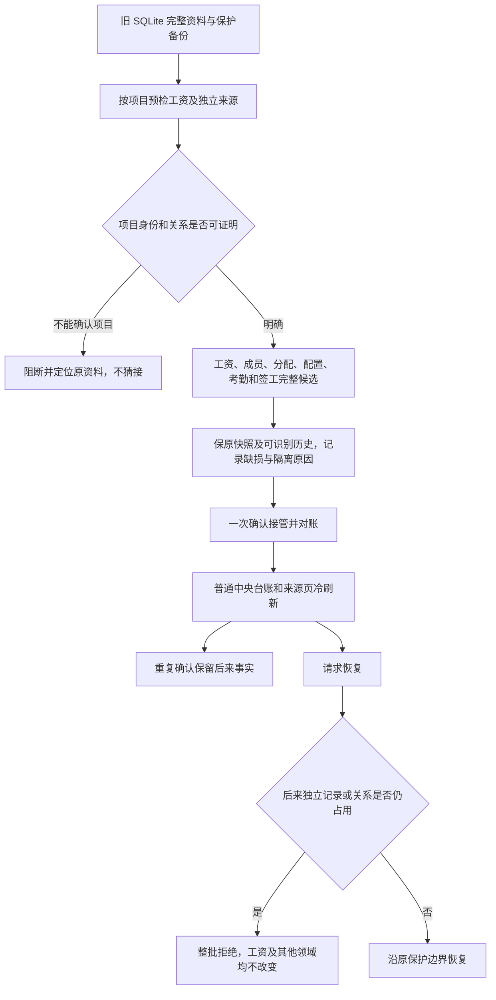
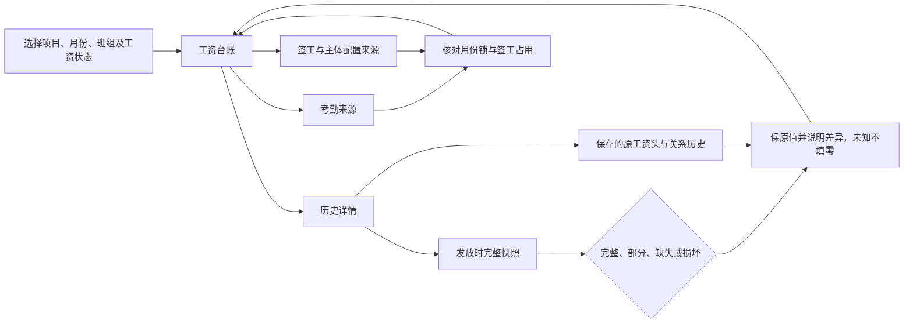
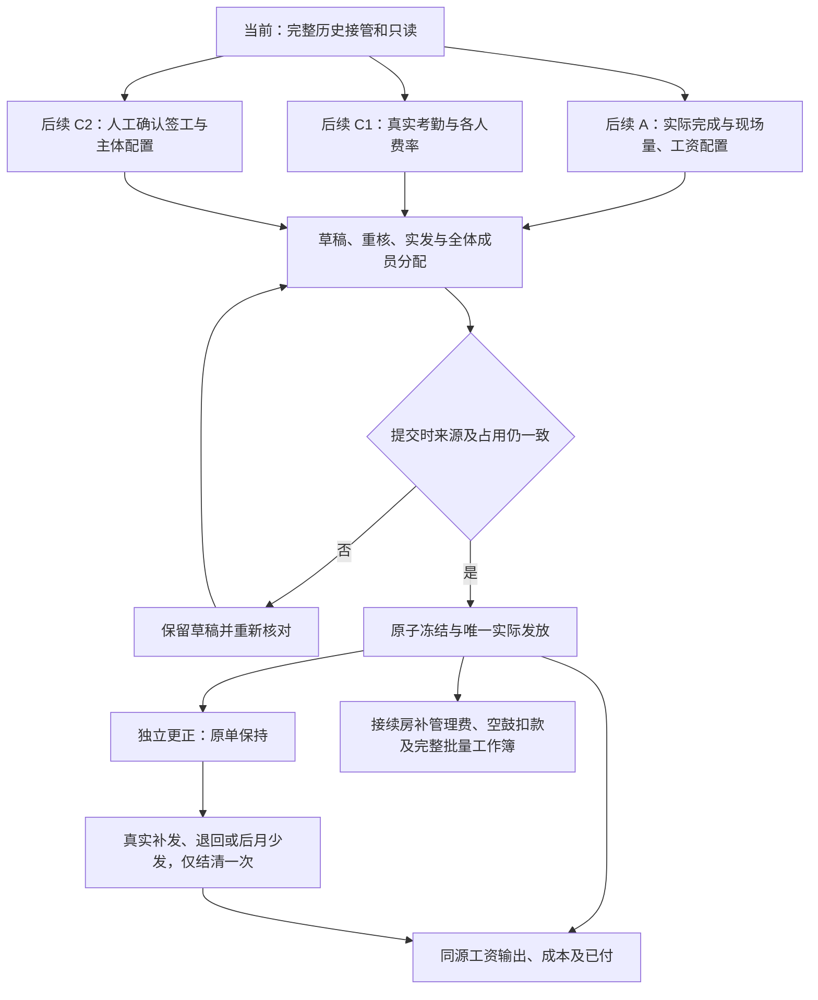

# #412：工资完整资料接管与历史只读

> 本地切片已独立提交 `1de44da2fdeb8091fb0e2cc2f3bcfd9794e07fc3`。固定开工基线 `b64d52240cb4d229dc5458b4009d5a16a982bc3c`。承接 [#412](https://github.com/zodea/crm-new/issues/412) 及[本地 P0 实施票](https://github.com/zodea/crm-new/blob/212a1cb586af9396f4e4a9dbee50eeb7333e0cf5/docs/research/issue-review-2026-09-11/payroll-tickets/00-central-history-and-sources.md)，未创建新的 GitHub 子 Issue。以下逐项记录验证范围，不将只读接管等同完整工资或上线交付。

提交后续记：正常提交检查于 2026-09-13 04:00:16 开始，600 文件、3697 项全部通过（229.72 秒），89 个验收代码的 Git 内容身份全部匹配。首次提交检查仅原页签启动顺序用例触及 5 秒超时；原断言单独 830 毫秒通过，保持代码不变后正常重跑全套通过。未跳过检查。

本阶段 341 个临时脚本、日志和重复渲染文件共 22,474,402 字节已送入 Windows 回收站，可恢复；85 张正式交互图、9 页正式 PDF 渲染证据及两份指南 PDF 保留。总览已实际刷新核对新增工资流程及图片。后续 A 工资实施见 [P1 本地实施票](https://github.com/zodea/crm-new/blob/212a1cb586af9396f4e4a9dbee50eeb7333e0cf5/docs/research/issue-review-2026-09-11/payroll-tickets/01-central-a-payroll.md)。

## 完整资料接管

## 查看历史与来源

来源页也涵盖尚无工资单的项目。零分配、没有工资行或没有工时的成员仍可受已发月份锁定；旧 B 类持续隔离。来源切换、失效深链、无权和迟到结果各自处理，不转入另一项目或改读演示资料。

## 从当前阶段继续的完整工资链

后续框是明确保留的实施义务，不是本轮已可操作画面。当前浏览器新建、核算、发放、来源修改及新输出均须明确未开放；原桌面本地适配不作为浏览器中央验证证据。

## 已建立的独立反例

Root 的 `tests/payroll/central-history-integrity.test.ts` 经普通历史读取验证：冻结行姓名来自同一原快照成员；缺/坏快照时原表金额可查，发放呈现仍未知；分配漏零成员不能冒完整；零分配且无工资行的软删成员月锁保留。损坏 C2 签工正文的反例曾真实失败，修复后首批 6 项通过（2026-09-13 02:39:56，3.16 秒）。

增量复核又发现成员/分配混入坏条目后被过滤、C2 空签工来源、原工资头金额与快照金额差异未提示，均已建立真实失败断言并修复。Root 独立重跑最终 9 项全部通过（2026-09-13 02:54:51，5.71 秒）。迁移公开接口的三项日志归属反例也先失败后通过，分别覆盖其他表、其他项目以及现存原行与伪历史归属冲突；导入拒绝时原权威和其他领域保持不变。

冻结后的类型检查、构建及 89 个本单元代码文件的规范检查均通过；覆盖账本、设计契约和运行证据契约共 32 项通过。完整 `npm test` 最终为 600 个文件、3697 项通过（2026-09-13 03:24:35，249.45 秒）。首轮完整测试发现的旧备份兼容缺陷已修复：工资图缺省与显式空数组均保持各自原来源哈希；原有合法旧备份断言没有被改成新夹具。旧桌面签工竞态测试明确宿主，原迟到、空态和 loading 断言保留。

最终四份浏览器文件整批 9 项通过（50.6 秒），其中完整真实迁入及历史/来源旅程 22.4 秒。在全新实例一次完成预检、演练、迁入、确认、台账和健康详情、零分配、月锁、独立来源、坏/缺/部分快照、B 三态、原表金额、失效及只读入口；原快照全文保持一致。来源批次及原件字节哈希见 [来源证明](./browser/source-verification.json)，此前中断及诊断轮均未计入最终成功。

85 张实际交互图覆盖 390 / 768 / 1024 / 1280 / 1440px，Root、A、B、C 分别逐张检查 15、25、25、20 张，全部通过；每张文件、视口、来源与哈希见 [截图清单](./browser/manifest.json)。[旧浏览器断言承接表](./browser-obligation-map.json)明确保留桌面验证与 P1–P3 中央写入义务，没有跳过测试或在浏览器伪装桌面宿主。

独立 Spec：A 复核 B 迁移、C 界面及 Root 文稿，未决 0；Root 用公开历史读取建立 9 项独立反例核验 A。独立 Standards：B 复核 A、C、Root，Root 复核 B，未决 0。交叉发现的班组锁范围、非法工资状态、仅有工资头的班组选项、原表头中文呈现和已知缺项诊断均已修复。

完整机器记录见 [verification.json](./verification.json)，89 个验收代码文件的字节与 Git 内容身份见 [code-hashes.json](./code-hashes.json)，具体问题及独立分工见 [review.md](./review.md)。

## 文档和环境

当前数据、读取及写入边界分别在 [DATABASE](../../../rewrite/DATABASE.md#工资完整资料中央接管412)、[READ-MODELS](../../../rewrite/READ-MODELS.md#工资中央历史与独立来源读取412)、[COMMANDS](../../../rewrite/COMMANDS.md#工资资料接管阶段的写入边界412)。旧说明冲突与已定规则处理见[本地实施票](https://github.com/zodea/crm-new/blob/212a1cb586af9396f4e4a9dbee50eeb7333e0cf5/docs/research/issue-review-2026-09-11/payroll-tickets/00-central-history-and-sources.md#本地冲突记录)。

工资指南 V2.0 和迁移指南 V2.6 已生成，3 页工资图由 Root、6 页迁移图由独立代理逐张检查通过；最终入口文字已与冻结后的实际组件核对，工资指南入口词修正后重新渲染并逐页检查。[逐页图像和哈希](./pdf/README.md)保留正式证据。浏览器使用新启动的 3188 纯内存验证实例；旧用户数据库和原件未作为测试写入目标。未推送、部署或运行云 CI，生产保存仍由 #416 承接。
