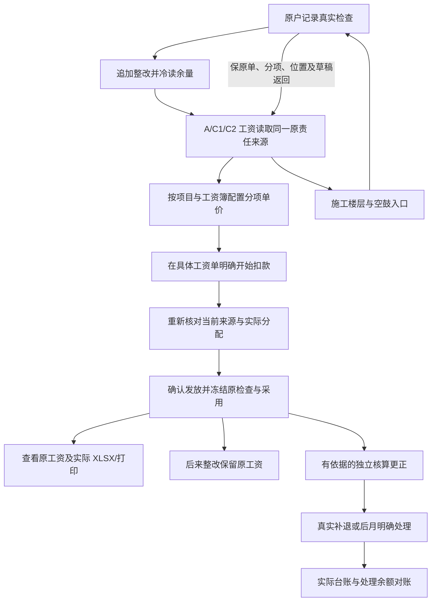

# P6 户级空鼓、整改与人工扣款

本地产品验收已通过，基线为 P5 登记提交 `e344a5444cd52bf65e78b031912d5241666fc0`。本记录只覆盖 #412 的 P6；产品提交 SHA 将由后续登记提交补入，当前不能据此宣称 #412 全部完成或生产持久化已通过。

规格见 [P6 实施票](../../../research/issue-review-2026-09-11/payroll-tickets/06-central-hollow-and-deductions.md)，操作见 [Markdown 指南](../../../guides/payroll-hollow.md)。不另生成指南 PDF；产品打印仅用于验证实际工资输出，完成后保留必要页图。

## 交付流程

## 已验证的业务反例

- 原检查 19 处，整改 4 处后余 15；真零、未检查、未填金额和关闭配置分别保留。来源记录不生成工资现金或项目罚扣。
- 工资本次请款 1000 元，明确开始 15 × 30 = 450 元扣款后，应发 550 元。扣款恰好抵完 450 元时允许明确实发 0；超额或未定部分采用不按金额猜处数。
- 原扣 450 更正为 300，只确认应补 150 时实发仍为 550；真实补发后才为 700。反向核减与后月已经包含的差额只处理一次，原签名不改。
- 三次受控迁入后，原签收 550、实际净额 700、更正待处理 0 保持一致；严格客户端读取通过。原 JSON 与可读身份投影分开，不递归改写未知字符串。
- 先发 8 月再补录 7 月，A/C1/C2 的原冻结输出均保持可读；补录早月不引用未来扣款，也不解除原记录已采用的保护。
- 原处理前缀缺更正确认、伪造处理额或改成后来链端时拒绝；可靠历史前缀不会因新确认自动失效。

## 独立复核中修复的问题

| 发现 | 修复及验证边界 |
| --- | --- |
| 同层同分项第二户返回错误完成焦点 | 按原户、责任、房间与分项选择唯一可证完成；缺失或歧义时不猜第一户。真实公开服务与实际组件链接回归通过。 |
| 补录早月实发成功但冷输出不可用 | 此前处理按本单月份截断，记录是否已采用仍查全历史。三种格式真实命令和冷读复验通过。 |
| 新建 A 未选负责人时报服务错误 | 不完整主体返回明确未知费用和空鼓诊断；严格 HTTP/Repository 保留原输入，补齐后恢复核算，不以默认值补成合法主体。 |
| 空稿诊断成功但全部字段被禁用 | 可编辑原稿与可保存核算分开；缺项仍可补选，费用及工资资格齐全才可保存。撤权、只读、读取失败和待核实原命令继续禁用。真实组件与服务的独立 10 项复验通过。 |
| 原户详情刷新后丢失工资返回 | 空鼓记录使用原户作为导航主体，记录及历史修订仍由服务逐项校验；恢复保留子视图种类和原草稿返回。第 13 轮真实浏览器已走通第二户定位、冷刷新及原稿恢复，独立复核另记。 |
| 原 C1/C2 恢复扫描不识别新源版本 | 扫描采用严格版本联合校验；原未知正文仍拒绝，旧迁移保护断言保留。 |
| 桌面可误挂载新增中央来源工作页 | 父路由及普通户详情的新增分区按宿主拦截，桌面不挂载中央来源编辑组件。 |
| 已开始扣款的行仍显示待人工开始 | 读取当前冻结启动快照，显示“本单已开始扣款 · 原采用 15 处”并提供“重新开始扣款”；不改资格或金额。 |
| 原采用更正表暴露内部 JSON，且 V3 误隐藏费用更正 | 以冻结事实显示位置、分项、单位、原责任人和价格依据；版本门禁允许 V2/V3 并继续拒绝旧 V1。两组五档最终图和正式组件回归通过。 |
| 已发单只显示冻结 15 处，后来全整改与新月份改价无法并列解释 | A/C1/C2 及迁入已发单新增只读当前来源伴随视图；冻结 19 / 4 / 15、单价 30 与当前 19 / 19 / 0、单价 45 分区显示，当前行严格绑定原冻结身份，且不重算原 450 扣款和 550 实发。 |

作者自验与非作者复验分开登记，见 [A 复核](./checks/a/independent-review.md) 与 [B 复核](./checks/b/independent-review.md)。最终生产构建、E2E、输出回读和补正图范围见 [最终运行记录](./checks/final-runtime.md) 与 [Root 逐图记录](./checks/root/visual-review.md)；不能把组件测试或文件存在当作本轮实图。

2026-09-15 04:18 的完整 `npm test` 为 780 文件 / 4308 项，其中 779 文件 / 4307 项通过；唯一失败为原费用迁入更正长链超出默认 5000ms。该项隔离原断言通过，仅为其设置 30000ms 上限后再次通过，未放宽全局超时或业务断言。该轮早于最后补正，最终全量结果以正常提交钩子为准。2026-09-21 的最终生产构建、类型检查和真实 E2E 已通过；239 个精确源码路径整体 lint 及最后 4 个补正路径 lint 均通过。

## 持续保留的边界

人工开始目前只绑定具体工资单。一次启动是否持续到后续单据、同一记录已处理后新增处数及部分实际采用，仍按 local grill 保留，不自动延续、重扣或退款。P7 继续负责批量资金与完整工作簿，#416 负责生产保存、备份恢复和部署。

新增三条来源路由的设计和运行登记仅表明集合完整：155 条生产路由、211 个路由变体、757 个页面/子视图、1227 个宿主用例。逐字比较确认原 754 个界面、1221 个宿主用例、54 项义务均未删除或改变；新增路由使用本地权威。这些计数不代表已验收数量。
