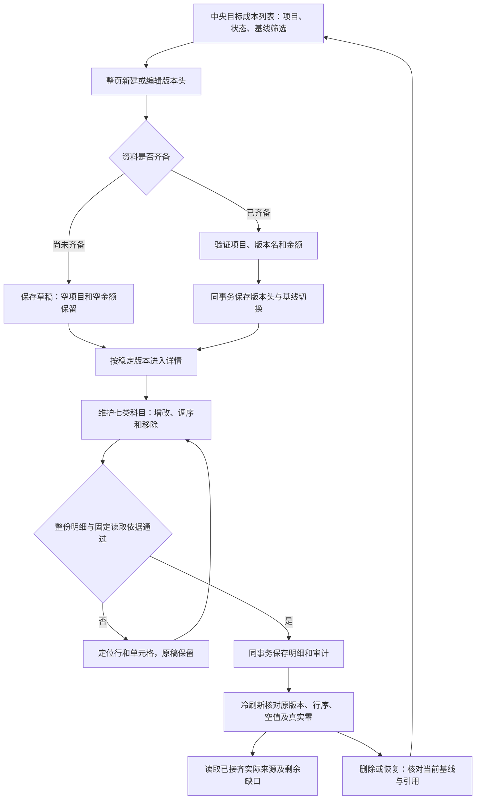
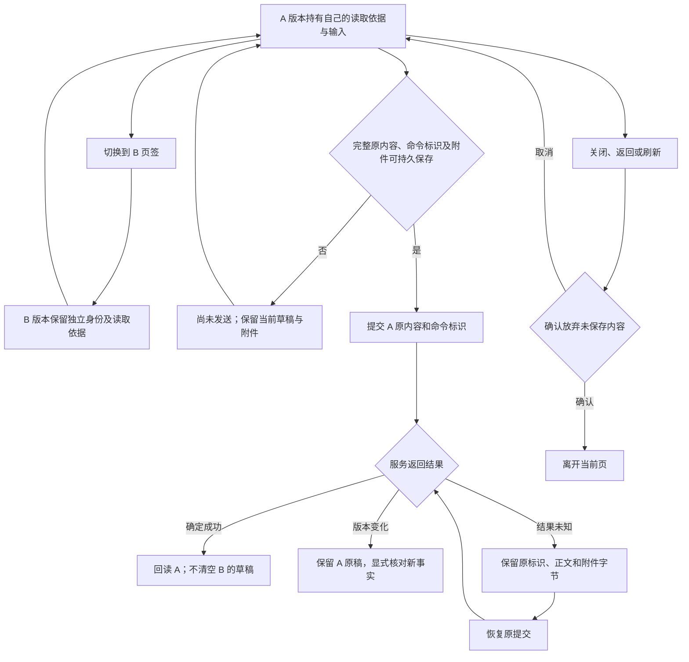
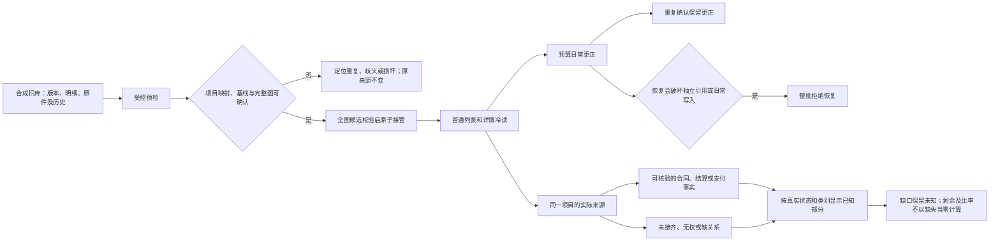

# #412：目标成本预算中央链验收

> 本地限定预算切片验收通过，待独立提交。开工基线 `59d5c735414e04b90e2cba7f2f750b6151e697bc`。2026-09-13 重读开放 #412 正文及评论；预算单独规格仍为本地审阅稿，本目录不代表已经创建或领取了新的子 Issue。母票其余范围继续开放。

本单元覆盖预算列表、整页版本头、科目明细、唯一基线、附件、软删除恢复及完整存量接管。现行业务依据为[目标成本页面](../../../rewrite/pages/target-cost.md)、[数据模型](../../../rewrite/DATABASE.md)和 [#412](https://github.com/zodea/crm-new/issues/412)。完整工资、材料和财务成本来源继续由母票及对应领域承接；生产关口属于 #416。

## 预算正常路径

下图对应本轮已实际操作的预算路径；金额来源与环境限制见下方验收范围。

## 草稿与不确定结果

## 旧资料与实际成本边界

## 验收登记

本轮按以下来源边界实现并验证，不沿用旧本地合计推断中央事实：

| 来源 | 当前可消费事实与限制 |
| --- | --- |
| 分包、材采和辅助合同 | 读取真实合同身份与明确状态；合同金额属于承诺口径，不算第二笔实际成本 |
| 分包结算 | 甲方商务共享中央单据中的 `sub_settlement`；按其真实分包合同类别归集。已付款证据须核对项目、合同、分供方及支付身份；多结算申请缺分摊时保持未知 |
| 其他支出结算 | 当前结算实例的真实结算及关联事实；支付仅取确认且归属精确的分摊，按来源及分摊身份防重复 |
| 合同与结算中的重复支付展示 | 同一支付不能分别从合同汇总、结算汇总再各计一次；累计数不能当作互相独立的单笔金额相加 |
| 旧合同事实接口中的空支付/材料结算数组 | 当前仍有未接入占位，空数组本身不能证明真实已知零 |
| 工资、报销及尚未接齐的付款或材料源 | 继续显示缺源范围；不可借空本地表填零，也不因已有部分来源而展示完整剩余预算 |

真实 HTTP 和运行实例覆盖当前权限、来源关系、完整度、版本及异步后资格复验；浏览器沿真实分包合同来源往返。尚未接齐的材料、工资和财务来源继续保留缺口，不能由这次有限来源的验收外推为完整成本链。

### 文档冲突记录：排程旧成本段落

2026-09-13 在 `schedule-progress.md` 第六节及材料参考行发现旧口径：将合同劳务与工资合并为“人工”，把甲供材和送货单叠入材料实际成本，并提出按名称或面积/工期补充分项归集。它与当前 `CONTEXT.md` 的合同劳务、工人工资、动态成本和甲供材定义、`DATABASE.md` §2.8、#412 明确继承的 #287 最终决议冲突。

本单元采用上述现行明确决定：七科目分开；合同金额、结算成本、支付和收货分别取自己的事实；直接工资只消费已发事实，甲供材和送货单不另增材料成本；未明确的分项关系或分摊不得猜造。旧排程成本段落已改为链接现行成本权威并移除冲突表述；分项联动的未完成义务继续由 #412 / #411 承接。该项是既定决定的文档一致性修正，没有新增业务 grill；当前外发说明仍待具体文稿授权，本条尚未评论到 Issue。

### 独立反例与复核

- [实际来源反例](../../../../tests/target-cost/central-actual-sources.test.ts)六项通过：未知金额不填零；同一支付跨科目冲突不重复计；相同事实去重而合法独立分摊仍累加；实际成本不全时不生成假余额；工资与报销不适用的签约额不污染适用科目汇总；部分科目可算余额也不能加成项目已知余额。新增反例曾真实失败，修复后由 Root 独立复验。
- [历史详情反例](../../../../tests/target-cost/central-history.test.ts)曾真实失败：两条原实体已缺失、但快照明确归属该预算的日志在详情中返回空集合。修复后两条历史可读，其他预算与其他领域日志仍隔离。
- [提交存储反例](../../../../tests/stores/target-cost-pending-storage.test.ts)验证真实 Storage 容量异常阻止发送，保留输入和附件；丢失响应后重建 store，仍以同一命令标识和原附件字节恢复。2026-09-13 01:39 的独立复验为上述 3 文件共 9 项通过（2.23 秒）；这不是完整测试或浏览器通过声明。
- 迁移及附件 15 文件通过 Root 独立源码及真实 V20 约束核对，另一独立 Spec 复核也为 0 项问题。10 文件 84 项定向验证覆盖空项目草稿、旧空名称、空附件元数据、原字节、软删除、可识别历史和日常/独立版本/历史项目引用的恢复保护。
- Standards 找出的后台路由、原件未知大小、项目入口权限、来源返回和筛选回灌问题均已修复。Spec 找出的新建 draftKey 复用、税价差异提示、授权演示冷恢复、全空列表汇总问题也已修复；最终独立 Standards 和 Spec 均为 0 项未解决问题，作者不自审自己的实施范围。
- 真实截图又复现来源格说明被 VXE 单行样式截断、390px 分包合同筛选被长项目名撑宽。只修当前领域格的换行和筛选最小宽度；最终右滚、五档控件边界及来源返回均复验通过。原始失败图不列入最终 70 图。
- 首轮完整测试的三个旧权限/导航断言，以及后续覆盖账本的一个旧状态断言已按新接入范围更新；其他精确白名单、未接排程和无权读取断言保留。最终完整测试另行集中执行，不以旧失败轮次或局部修复代替通过记录。

### 实际浏览器与图像

新启动的 3187 纯内存实例中，`e2e/target-cost-central.spec.ts` 和既有 `target-cost-management.spec.ts`、`target-cost-detail.spec.ts` 同一批共 **10 项通过，51.1 秒**，主旅程 35.7 秒。该批从真实 SQLite 合成迁入开始，不依赖中途恢复脚本，不调用重置或绕过迁移冲突；运行标识为 `74990341-68ed-479c-8f92-c5e0301db9cf`。

主旅程覆盖缺项目草稿、独立税价、七科目增删调序、原件下载、历史缺件、A/B 保稿、关闭取消、版本冲突、已应用但响应丢失后的同键恢复、来源与项目往返、唯一基线、删除取消和删除恢复。补拍只读取同一合成实例：增加表格下半/右滚、改进历史取景，并在两处样式修复后复验受影响画面，不再写入业务资料。

正式交互图位于 [browser](./browser/manifest.json)：**70/70 张逐张通过**，覆盖 390/768/1024/1280/1440px；Root 检查 35 张，独立 Standards 代理 25 张，UI 作者检查 10 张补充滚动图。每张的来源轮次、说明、检查者和 SHA-256 都在清单中；[滚动验证](./browser/scroll-verification.json)与[筛选边界](./browser/filter-bounds.json)保留实际测量。原件只读/下载使用合成文件，不读取用户数据库或原用户目录。

| 范围 | 本轮状态 | 需要的结果 |
| --- | --- | --- |
| 中央版本与科目 | 本轮通过 | 列表同源，版本头与明细分开保存，空值和真实零保持 |
| 唯一基线与软删除恢复 | 本轮通过 | 并发只有一个基线，失败无部分切换，恢复不覆盖后来事实 |
| 原件及历史缺件 | 本轮通过 | 原字节、元数据及所属版本一致，权限复验，无半个附件关系 |
| 完整存量图与恢复 | 本轮通过 | 真实 SQLite 图，重复确认保更正，独立引用使危险恢复整批拒绝 |
| 多版本与迟到结果 | 本轮通过 | A/B 独立身份和草稿，停用后迟到响应不改新页面 |
| 失败与原命令恢复 | 本轮通过 | 行格定位、取消保稿、未知结果保原键和原正文 |
| 实际来源完整性 | 限定来源通过 | 已知部分、真实零、无权和未知分别可见，余额不伪造；完整工资、材料和财务链未接齐 |
| 五档视口与键盘 | 本轮通过 | 70 张原图，表格局部滚动、焦点及浮层可用 |
| 独立复核和全套检查 | 本轮通过 | Standards/Spec 均 0；类型、109 文件规范及构建通过；最终完整 npm test 为 589 文件、3628 项通过（221.60 秒） |
| 指南及 PDF | 本轮通过 | [预算 V1.0](../../../guides/target-cost.md)、排程 V2.10、迁移 V2.5；[19 页逐页检查](./pdf/README.md) |

最终完整测试于 2026-09-13 02:05:26 启动，589 文件、3628 项全部通过（221.60 秒）。源码冻结后类型检查和构建均 exit 0，109 个明确代码文件 ESLint 为 0 errors / 0 warnings；正常 Git 提交钩子仍会执行仓库要求的检查。预算切片、工资待开发稿及旧工作树分别处理，提交只选择本单元明确文件。

独立提交与临时输出回收记录在提交后续记。中央可重置验证实例不证明生产持久化已完成；未推送、部署或运行云 CI。
