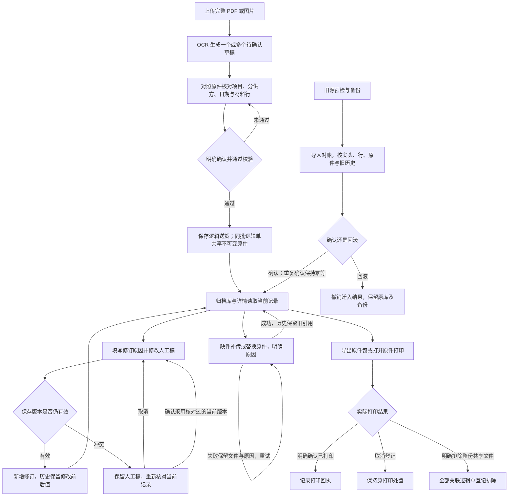

# #441 送货中央归档验收记录

日期：2026-09-12。规格：[#441](https://github.com/zodea/crm-new/issues/441)，父票 [#411](https://github.com/zodea/crm-new/issues/411)，原件协作 [#406](https://github.com/zodea/crm-new/issues/406)。

本记录对应 `main` 基线 `a05258da66a06c8e823168991823e21c16f96389` 上的送货切片。本地切片状态为 `slice-verified`：三条完整浏览器业务旅程、37 张最终截图和指南 PDF 均已验收。2026-09-12 最终整合工作树（同时包含 #442）完整 `npm test` 的 515 文件、3079 项通过（183.61 秒），类型检查与构建通过。#442 实现不属于本票；实际浏览器运行期间各代理暂停运行源码写入。最终提交 SHA 与远端发布状态以对应交付记录为准。

## 范围与样本

页面规则以[送货蓝本](../../../rewrite/pages/material-delivery.md)为准，字段与命令以[数据模型](../../../rewrite/DATABASE.md)和[命令契约](../../../rewrite/COMMANDS.md)为准。本票实现浏览器中央测试实例中的归档、不可变原件、逻辑记录修订及受控迁移；不以归档成功推导到货、库存或结算资格。

浏览器使用隔离测试会话，新项目与分供方由实际中央命令建立。输入为包含真实交叉引用表的两页合成 PDF，页面文本分别为 `Delivery original page 1`、`Delivery original page 2`。只有 OCR 回包替换成明确标注的合成识别结果；归档命令、读取、原件与迁移接口使用运行服务。识别模型准确率和真实用户单据样本不属于本票证据。

SQLite 迁移使用测试创建的独立数据库样本，包含共用 PDF、缺原件、打印处置、旧审计及未迁项目别名。没有读取或修改用户数据库，也没有执行生产旧库扫描。

## 已取得的验证

| 边界 | 实际验证及限制 |
| --- | --- |
| 中央状态和命令 | 定向测试验证稳定逻辑身份、共享资产、修订前后值、幂等重试、失败事务回滚、版本冲突和当前祖先关系。当前仅测试实例，不代表生产重启持久化。 |
| 原件读取 | 原件 Repository 校验记录、资产、owner、来源、当前项目/分供方、MIME、长度和 SHA-256；组件测试覆盖换记录、取消迟到、历史明确缺件、保存失败保留文件和原因。 |
| 迁移 | 真实 SQLite 样本的公开迁移边界验证完整头/行/原件/打印与旧历史、孤立行阻断、重复确认不覆盖后续修订及回滚；实际 HTTP 预检、对账、重复导入/确认、共享资产字节与摘要、回滚后不可读取全旅程通过。 |
| 同源读者 | 归档库、价格、旧项目读者使用显式中央适配；价格缺原件、缺数量或缺价格不冒充有效价格。原生桌面路径保留。 |
| 详情刷新 | 原先只读恢复返回 `not-connected`，新增公开失败复现后接入当前送货 context/detail 与唯一 Target Registry。测试覆盖当前单号/版本、撤权、身份与来源不符、删除及取消迟到；真实浏览器已验证当前详情冷刷新后仍读取同一记录与原件。 |
| 真实归档与原件 | 浏览器完成两张逻辑单分别人工确认，核实相同 assetId 与 uploadBatchId；通过详情冷刷新、字段与稳定材料行修订、另一张记录保持原值、原件下载字节、PDF 两页文本顺序、旧版本内容与 ZIP 共用 PDF 去重。另通过并发修订后的显式核对、取消、键盘确认保稿和再次保存。 |
| 补传、替换与打印 | 实际补传命令注入 503 后保留所选文件和原因，再次保存成功；替换生成新资产，材料行保持原值，历史仍下载原字节。打开打印窗口不自动登记、取消回执不改变处置、整份共享文件排除，以及另一旅程明确确认已实际打印均通过。 |
| 指南 PDF | 送货说明 V1.4（2026-09-12）和价格说明各 4 页，均已逐页渲染检查；送货说明新增显式冲突核对、取消保稿和再次保存流程，正文、表格与页脚可读，无裁切或叠压。 |

送货独占精确运行曾通过 29 个测试文件、217 项；另一次恢复和 Target Registry 运行 3 文件、124 项。随后独立审查的 3 项缺陷均先建立失败复现，补修后精确运行 4 文件、46 项通过，包含打印两种处置与切回表单重读失败后重试。各组有重叠，不能相加作为去重总数。补修涉及的 9 个文件精确 ESLint 通过；最终整合结果见开头。整个仓库仍有原有格式问题，不以修改范围检查通过宣称全仓 lint 通过。

实际冲突后的重新核对入口随后补齐：4 个文件、51 项定向回归通过，其中表单 17 项。此次尾差 Standards 和 Spec 独立复核均无剩余问题；真实并发修改后的核对、取消、键盘确认与五档界面均已通过浏览器运行。

2026-09-12 的最终 Chromium 结果：共享原件完整旅程 1 项通过（56.6 秒，该轮总时长 1.2 分钟）；补传/替换、真实 SQLite HTTP 迁移两项在前一轮分别用时 15.9 秒与 2.2 秒，两项总时长 30.5 秒。后两项通过后，仅重跑首条旅程补拍完整原件与消退提示后的截图，业务运行源码未变化；未把重复运行合并为额外通过项。

最终 37 张截图均已完成逐图视觉核验，其中重新采集的 36 张以文件摘要确认 11 张与前轮已验图完全相同，其余逐张重看。四张原先未绘完的原件已补拍：截图前等待 Chromium 内置 PDF 的加载成功、完整两页尺寸与可见绘制区域，再等待视口重排稳定。冲突核对和归档截图等待真实提示消退，字段、键盘焦点与主按钮可读；密集表格只在自身容器横向滚动。补传历史图保留模拟失败与下载结果提示，其用途是展示旧原件仍可下载；完整修订原因与操作者另由下方历史五档截图及实际行为断言证明。

最终汇总测试发现导航精确清单漏登记已实现的 `delivery-record:detail`。核实真实详情路由与中央恢复适配后只补齐测试清单；`npm test -- tests/kit/entity-link.test.ts tests/tabs/delivery-restore.test.ts` 的 2 文件、20 项通过，修改文件 ESLint 通过，未改运行源码。

## 完整操作流程

## 实际交互效果图

表内均为上述真实业务旅程截图。390 / 768 / 1024 / 1280 / 1440 表示视口宽度；历史截图已滚动到修订内容，窄屏的下方字段通过页面纵向滚动查看。

| 场景 | 390 | 768 | 1024 | 1280 | 1440 |
| --- | --- | --- | --- | --- | --- |
| 两页原件人工核对 | [查看](./delivery-review-390.png) | [查看](./delivery-review-768.png) | [查看](./delivery-review-1024.png) | [查看](./delivery-review-1280.png) | [查看](./delivery-review-1440.png) |
| 核对材料明细 | [查看](./delivery-review-lines-390.png) | [查看](./delivery-review-lines-768.png) | [查看](./delivery-review-lines-1024.png) | [查看](./delivery-review-lines-1280.png) | [查看](./delivery-review-lines-1440.png) |
| 编辑与修订原因 | [查看](./delivery-form-390.png) | [查看](./delivery-form-768.png) | [查看](./delivery-form-1024.png) | [查看](./delivery-form-1280.png) | [查看](./delivery-form-1440.png) |
| 冲突后重新核对 | [查看](./delivery-conflict-390.png) | [查看](./delivery-conflict-768.png) | [查看](./delivery-conflict-1024.png) | [查看](./delivery-conflict-1280.png) | [查看](./delivery-conflict-1440.png) |
| 当前详情与原件 | [查看](./delivery-detail-390.png) | [查看](./delivery-detail-768.png) | [查看](./delivery-detail-1024.png) | [查看](./delivery-detail-1280.png) | [查看](./delivery-detail-1440.png) |
| 只读修订历史 | [查看](./delivery-history-390.png) | [查看](./delivery-history-768.png) | [查看](./delivery-history-1024.png) | [查看](./delivery-history-1280.png) | [查看](./delivery-history-1440.png) |
| 归档库 | [查看](./delivery-archive-390.png) | [查看](./delivery-archive-768.png) | [查看](./delivery-archive-1024.png) | [查看](./delivery-archive-1280.png) | [查看](./delivery-archive-1440.png) |

补充证据：[键盘确认采用已核对版本](./delivery-conflict-confirm.png)、[补传及替换后下载历史原件](./delivery-supplement-history.png)。

## 失败复现与修正

- 中央 context 读取前同步观察 `canWrite` 后，原实现因来源变量不响应而缓存为 false；改为响应式来源后，成功重读重新开放操作，失败仍撤下权限与旧事实。
- 人工归档按钮的核对问题过滤条件反向：缺必填可点、仅需人工确认的问题却被阻止。公开 composable 反例先失败，修正后按既定门槛开放确认。
- 其他读取者重读失败会撤下可写能力，参考候选面板却没有同步展示该错误。现在展示共同读取失败并提供重试，不把静默不可写伪装为空结果。
- 已有价格分析未排除缺原件的有效金额行。现按现行术语与页面规则排除，并保留明确零值与缺失的区别。
- 送货详情已有读取接口，但恢复适配仍标未接入。恢复重新读取当前身份与能力，不借同名本机目标，不将版本更新误判为删除。
- 真实浏览器识别工作区刷新按 #435 写态规则回首页；测试改为通过可见菜单重进处理区。后续一次候选浮层挡住测试点击，改为先明确选中供应商候选；这两项不作为产品功能修复计数。
- 浏览器验收另校正三处测试自身问题：历史截图直接滚动到需要读取的修订原因；页面初始化只注入 HTTP(S) 顶层业务页，避免对原件 PDF 子框架写入不可用的 localStorage；关系错配按统一 HTTP 契约断言 404 及明确错误类型。上述调整保留业务和页面错误断言，不作为产品修复计数。
- 打印命令重放原先只复验最后一张逻辑单；现逐张核验整批当前归属，任何较早目标失效都拒绝重放，恢复可读后复用原结果且不重复登记。
- 客户端在明确版本冲突后仍复用旧请求，导致重读当前版本后同稿永远冲突；现只在执行接口明确拒绝版本冲突时淘汰旧命令。响应丢失或执行后回读失败仍保留原命令重试。
- 编辑页缓存停用后，其他页面的全局路由 ID 曾触发重新初始化并丢失人工稿；现只处理本页身份，返回后重新核验权限，同一身份保留草稿、原因与原始版本。读取失败时关闭保存入口，原地重试成功后保留稿件。
- 真实版本冲突后缺少重新核对入口，用户无法保稿修正后继续保存。现显示“重新核对当前记录”，只读展示最新头与材料行；用户明确采用已核对版本后保留人工稿并更新保存基准，再自行保存。取消核对不抬升基准，不自动覆盖或合并人工稿。

## 保留边界

旧项目别名仍保留原库和备份，本票不宣称其已迁入中央主数据；当前建议由已确认送货的原文和稳定项目身份派生，仍需人工选定。已能证明逻辑 owner 的历史原件随源保护保全；缺少可验证历史祖先/版本关系的原件不能凭当前权限公开，具体人工核对问题已回写 #411。

当前中央项目完整送货子表、到货头与仓库/计划行身份、库存和结算资格由后续实施承接。生产认证、完整 RBAC、多 workspace、重启持久化与 Tauri 正式交付仍受 [ADR 0020](../../../adr/0020-browser-authority-and-demo-workspace-boundary.md) 后置关口约束。
