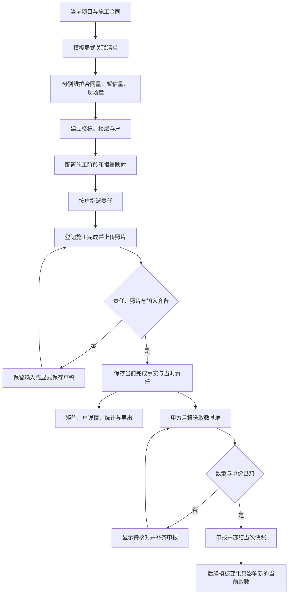

# #442 工程量中央链验收

本记录汇总 #442 的本地集成验收。工程量区域、模板、责任、完成、报量和迁移共用当前中央事实；下列切片分别提供实际证据。尚未通过的验收不由其他切片代替。

| 用户路径 | 证据入口 | 当前结论 |
| --- | --- | --- |
| 新项目 → 模板关联清单 → 三量 → 区域与户 | [界面验收](ui-verification.md) | 实际整页链与五档视口通过 |
| 阶段 → 显式报量映射 → 责任 → 照片完成 → 详情 | [界面验收](ui-verification.md) | 实际主链、照片失败保护、阶段与完成的最后补图通过 |
| 模板、责任、完成的日常表格导入 | [导入验收](import/README.md) | 三类真实 CSV、缺照片拒绝、显式草稿及拒绝文件回读通过 |
| 矩阵归档 / 解除 → 统计 → 台账与分类导出 | [界面验收](ui-verification.md)、[Excel 回读](totals/workbook-readback.json) | 旧 11 项回归、实际归档和刷新、分类文件及慢响应先选目录通过；切项目时旧准备结果不会迟到打开 |
| 当前完成事实 → 甲方月报 → 换基准 → 申报冻结 | [月报验收及七张交互图](monthly/README.md) | 实际 HTTP、表单、五档与冷刷新通过 |
| 旧库预检 → 导入确认 → 中央更正 → 回滚 | [迁移验收](migration/README.md) | 真实 SQLite 来源包及 HTTP 通过 |

独立复核已覆盖 Standards 与 Spec 两轴，无未解决发现。2026-09-12 的整合工作树（同时包含 #441）已通过完整 `npm test`：515 个文件、3079 项，耗时 183.61 秒；`pnpm typecheck` 和 `pnpm build` 均通过。首次全测发现两处旧测试需要适配：等待新的异步迁移重置、补齐已实现的送货详情注册清单；断言保留，修正后重新完整运行通过。

独立剥离 #441 后的 #442 候选也通过类型检查及完整 `npm test`：498 个文件、2942 项，耗时 172.61 秒；候选保留全部 2336 个基线文件。两票最终修改范围 280 个代码与 JSON 文件规范检查通过。整个仓库规范检查仍有其他格式问题，不能宣称全仓 lint 通过。

以上为当前前台与可重置服务实例的验证范围；生产持久化与部署仍由 #416 承接。A/C1/C2 工资、排程及目标成本继续由母票 #412 的后续工作承接，不能凭本票通过宣告这些下游全部完成。
