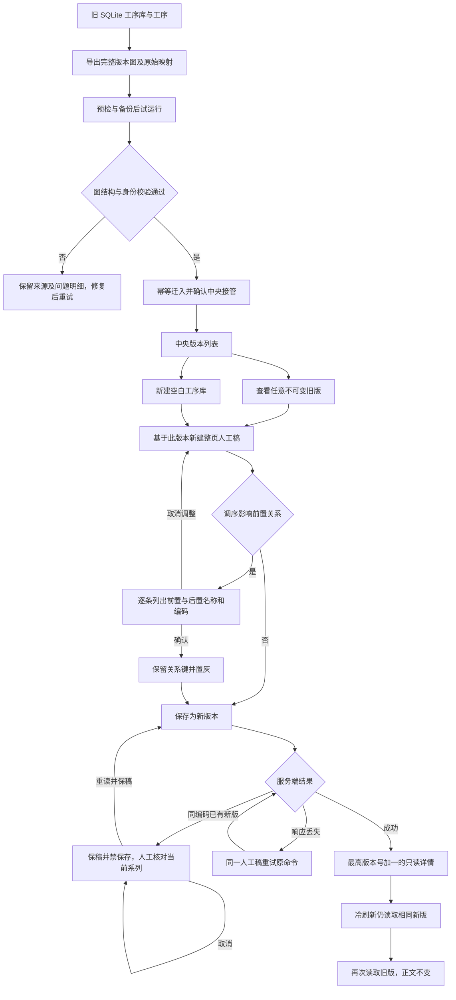
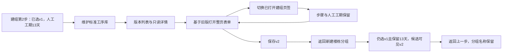

# #443 标准工序库中央版本：运行证据

> 本页保留已完成切片的实测摘要及原验收边界；日期、数量和阶段状态属于当次记录。历史多轮图片、审查与归档流水统一由[固定 Git 原始材料](https://github.com/zodea/crm-new/tree/c16869fcbf954dddd46143839afe5790f3828f1a/docs/design/evidence/issue-443)定位。当前规则以所引现行权威文档为准，保留的真实原件、源证明和产品打印不改写。

对应 [Issue #443](https://github.com/zodea/crm-new/issues/443)。本页记录运行验收，不替代 [排程指南](../../../guides/project-start-and-schedule.md)、[迁移指南](../../../guides/local-data-migration.md) 或 [ADR 0020](../../../adr/0020-browser-authority-and-demo-workspace-boundary.md)。

## 当前结果与边界

2026-09-12：源码冻结后的同一批三条浏览器实测全部通过，共 54.6 秒。主链 22.2 秒、建组往返 19.2 秒、同源刷新保表格与横滚 1.5 秒。共 43 张交互图已核验，其中 25 张与此前逐张审过的图片哈希相同，其余 18 张均逐张审看。完整测试、类型与构建已通过，详情见本页集成检查。

- 浏览器工序库列表、版本详情、保存，以及建组页的库候选和保存前复核共用中央 Repository/HTTP。读取失败不会退回另一份正式工序库。
- 可从任意旧版创建同编码下一版。已软删除的最高版本仍占版本号；示例从 v1 创建 v3，旧 v2 软删除事实保留，v1 正文前后完全相同。
- 新版保存不会更新既有 WBS 快照。浏览器 WBS 的中央写入仍属于 #444；引用数量显示“未知”，本页不宣称建组中央写入已经可用。
- 建组往返验收仅为尚未接管的 WBS 调用页安装隔离旧 SQLite 项目、合同、楼栋和清单事实。工序库始终通过真实中央接口创建、读取和保存。
- 中央服务当前为隔离浏览器测试实例，不代表生产持久化部署验收。测试合成状态清理使用仅非生产可达、须测试请求头及会话标识的端点；正常业务回滚在已有独立新版依赖迁入源时仍被拒绝。

## 本 Issue 完整流程

## 建组调用页往返

页面内往返通过安全的项目与来源返回上下文定位调用页，草稿留在原页签。切换已打开页签不触发放弃确认；关闭或返回时才保护未保存修改。冷刷新遵循通用页签安全恢复规则，不恢复未保存写态。

## 交互效果图

每行提供 390 / 768 / 1024 / 1280 / 1440px 五档真实浏览器图。窄屏表格在自身区域横向滚动，整页表单内容区纵向滚动；截图表示当前可见位置，不把屏外列压缩为不可读文字。版本冲突与返回建组图保留真实结果提示，提示位于顶栏，不遮挡人工核对、步骤、草稿内容及按钮。

| 场景 | 390 | 768 | 1024 | 1280 | 1440 |
| --- | --- | --- | --- | --- | --- |
| 中央版本列表 | [图](https://github.com/zodea/crm-new/blob/c16869fcbf954dddd46143839afe5790f3828f1a/docs/design/evidence/issue-443/01-library-list-390.png) | [图](https://github.com/zodea/crm-new/blob/c16869fcbf954dddd46143839afe5790f3828f1a/docs/design/evidence/issue-443/01-library-list-768.png) | [图](https://github.com/zodea/crm-new/blob/c16869fcbf954dddd46143839afe5790f3828f1a/docs/design/evidence/issue-443/01-library-list-1024.png) | [图](https://github.com/zodea/crm-new/blob/c16869fcbf954dddd46143839afe5790f3828f1a/docs/design/evidence/issue-443/01-library-list-1280.png) | [图](https://github.com/zodea/crm-new/blob/c16869fcbf954dddd46143839afe5790f3828f1a/docs/design/evidence/issue-443/01-library-list-1440.png) |
| 不可变旧版与完整映射 | [图](https://github.com/zodea/crm-new/blob/c16869fcbf954dddd46143839afe5790f3828f1a/docs/design/evidence/issue-443/02-immutable-old-version-390.png) | [图](https://github.com/zodea/crm-new/blob/c16869fcbf954dddd46143839afe5790f3828f1a/docs/design/evidence/issue-443/02-immutable-old-version-768.png) | [图](https://github.com/zodea/crm-new/blob/c16869fcbf954dddd46143839afe5790f3828f1a/docs/design/evidence/issue-443/02-immutable-old-version-1024.png) | [图](https://github.com/zodea/crm-new/blob/c16869fcbf954dddd46143839afe5790f3828f1a/docs/design/evidence/issue-443/02-immutable-old-version-1280.png) | [图](https://github.com/zodea/crm-new/blob/c16869fcbf954dddd46143839afe5790f3828f1a/docs/design/evidence/issue-443/02-immutable-old-version-1440.png) |
| 独立整页版本表单 | [图](https://github.com/zodea/crm-new/blob/c16869fcbf954dddd46143839afe5790f3828f1a/docs/design/evidence/issue-443/03-full-page-version-form-390.png) | [图](https://github.com/zodea/crm-new/blob/c16869fcbf954dddd46143839afe5790f3828f1a/docs/design/evidence/issue-443/03-full-page-version-form-768.png) | [图](https://github.com/zodea/crm-new/blob/c16869fcbf954dddd46143839afe5790f3828f1a/docs/design/evidence/issue-443/03-full-page-version-form-1024.png) | [图](https://github.com/zodea/crm-new/blob/c16869fcbf954dddd46143839afe5790f3828f1a/docs/design/evidence/issue-443/03-full-page-version-form-1280.png) | [图](https://github.com/zodea/crm-new/blob/c16869fcbf954dddd46143839afe5790f3828f1a/docs/design/evidence/issue-443/03-full-page-version-form-1440.png) |
| 调序受影响关系与取消/确认 | [图](https://github.com/zodea/crm-new/blob/c16869fcbf954dddd46143839afe5790f3828f1a/docs/design/evidence/issue-443/04-reorder-conflict-390.png) | [图](https://github.com/zodea/crm-new/blob/c16869fcbf954dddd46143839afe5790f3828f1a/docs/design/evidence/issue-443/04-reorder-conflict-768.png) | [图](https://github.com/zodea/crm-new/blob/c16869fcbf954dddd46143839afe5790f3828f1a/docs/design/evidence/issue-443/04-reorder-conflict-1024.png) | [图](https://github.com/zodea/crm-new/blob/c16869fcbf954dddd46143839afe5790f3828f1a/docs/design/evidence/issue-443/04-reorder-conflict-1280.png) | [图](https://github.com/zodea/crm-new/blob/c16869fcbf954dddd46143839afe5790f3828f1a/docs/design/evidence/issue-443/04-reorder-conflict-1440.png) |
| 保存 v3 后冷刷新 | [图](https://github.com/zodea/crm-new/blob/c16869fcbf954dddd46143839afe5790f3828f1a/docs/design/evidence/issue-443/05-saved-version-cold-refresh-390.png) | [图](https://github.com/zodea/crm-new/blob/c16869fcbf954dddd46143839afe5790f3828f1a/docs/design/evidence/issue-443/05-saved-version-cold-refresh-768.png) | [图](https://github.com/zodea/crm-new/blob/c16869fcbf954dddd46143839afe5790f3828f1a/docs/design/evidence/issue-443/05-saved-version-cold-refresh-1024.png) | [图](https://github.com/zodea/crm-new/blob/c16869fcbf954dddd46143839afe5790f3828f1a/docs/design/evidence/issue-443/05-saved-version-cold-refresh-1280.png) | [图](https://github.com/zodea/crm-new/blob/c16869fcbf954dddd46143839afe5790f3828f1a/docs/design/evidence/issue-443/05-saved-version-cold-refresh-1440.png) |
| 版本冲突显式核对 | [图](https://github.com/zodea/crm-new/blob/c16869fcbf954dddd46143839afe5790f3828f1a/docs/design/evidence/issue-443/06-version-conflict-review-390.png) | [图](https://github.com/zodea/crm-new/blob/c16869fcbf954dddd46143839afe5790f3828f1a/docs/design/evidence/issue-443/06-version-conflict-review-768.png) | [图](https://github.com/zodea/crm-new/blob/c16869fcbf954dddd46143839afe5790f3828f1a/docs/design/evidence/issue-443/06-version-conflict-review-1024.png) | [图](https://github.com/zodea/crm-new/blob/c16869fcbf954dddd46143839afe5790f3828f1a/docs/design/evidence/issue-443/06-version-conflict-review-1280.png) | [图](https://github.com/zodea/crm-new/blob/c16869fcbf954dddd46143839afe5790f3828f1a/docs/design/evidence/issue-443/06-version-conflict-review-1440.png) |
| 离开前的建组人工稿 | [图](https://github.com/zodea/crm-new/blob/c16869fcbf954dddd46143839afe5790f3828f1a/docs/design/evidence/issue-443/07-caller-draft-before-390.png) | [图](https://github.com/zodea/crm-new/blob/c16869fcbf954dddd46143839afe5790f3828f1a/docs/design/evidence/issue-443/07-caller-draft-before-768.png) | [图](https://github.com/zodea/crm-new/blob/c16869fcbf954dddd46143839afe5790f3828f1a/docs/design/evidence/issue-443/07-caller-draft-before-1024.png) | [图](https://github.com/zodea/crm-new/blob/c16869fcbf954dddd46143839afe5790f3828f1a/docs/design/evidence/issue-443/07-caller-draft-before-1280.png) | [图](https://github.com/zodea/crm-new/blob/c16869fcbf954dddd46143839afe5790f3828f1a/docs/design/evidence/issue-443/07-caller-draft-before-1440.png) |
| 保存新版后返回原建组稿 | [图](https://github.com/zodea/crm-new/blob/c16869fcbf954dddd46143839afe5790f3828f1a/docs/design/evidence/issue-443/08-caller-draft-returned-390.png) | [图](https://github.com/zodea/crm-new/blob/c16869fcbf954dddd46143839afe5790f3828f1a/docs/design/evidence/issue-443/08-caller-draft-returned-768.png) | [图](https://github.com/zodea/crm-new/blob/c16869fcbf954dddd46143839afe5790f3828f1a/docs/design/evidence/issue-443/08-caller-draft-returned-1024.png) | [图](https://github.com/zodea/crm-new/blob/c16869fcbf954dddd46143839afe5790f3828f1a/docs/design/evidence/issue-443/08-caller-draft-returned-1280.png) | [图](https://github.com/zodea/crm-new/blob/c16869fcbf954dddd46143839afe5790f3828f1a/docs/design/evidence/issue-443/08-caller-draft-returned-1440.png) |

另有三张 390px 精确横滚证据：[刷新挂起保原表格](https://github.com/zodea/crm-new/blob/c16869fcbf954dddd46143839afe5790f3828f1a/docs/design/evidence/issue-443/09-same-origin-refresh-pending-390.png)、[网络失败保旧数据并禁写](https://github.com/zodea/crm-new/blob/c16869fcbf954dddd46143839afe5790f3828f1a/docs/design/evidence/issue-443/10-same-origin-refresh-failed-390.png)、[重试成功恢复写入](https://github.com/zodea/crm-new/blob/c16869fcbf954dddd46143839afe5790f3828f1a/docs/design/evidence/issue-443/11-same-origin-refresh-recovered-390.png)。真实 vxe 表格先滚至右侧操作列，打开详情再返回原列表页签；三个阶段均断言原 DOM 节点及 `scrollLeft` 保持。读取期间与失败后不允许新建版本，读取成功后恢复；状态和重试入口均在表格外侧。

## 验证入口

- [真实浏览器流程](../../../../e2e/process-library-central.spec.ts)：真实 SQLite 迁入、幂等迁入/确认、软删除占号、任意旧版复制、调序键盘取消/确认、响应丢失重试原命令、并发显式重读、伪造身份/演示写入拒绝、危险回滚拒绝、建组往返保稿及同源刷新保表格/横滚。三个测试结束后，工序库与核心迁移合成会话均完成清理。
- [源导出](../../../../tests/migration/process-library-source.test.ts)、[迁移准备](../../../../tests/schedule/process-library-migration.test.ts)、[中央迁移集成](../../../../tests/schedule/process-library-core-integration.test.ts)：完整旧图与失败原子性。
- [HTTP 输入](../../../../tests/schedule/process-library-request.test.ts)、[Repository](../../../../tests/schedule/process-library-repository.test.ts)、[领域命令](../../../../tests/schedule/process-library-central.test.ts)：输入白名单、权限、来源、幂等、不可变版本和失败边界。
- [页面状态](../../../../tests/stores/process-library-central-state.test.ts)、[真实页签守卫](../../../../tests/components/ScheduleProcessLibraryFormTabGuard.test.ts)、[调序交互](../../../../tests/components/ScheduleProcessLibraryReorder.test.ts)、[返回上下文](../../../../tests/schedule/navigation.test.ts)：迟到读取/保存保护、人工稿、页面切换与关系取消语义。
- [浏览器 WBS 同源接缝](../../../../tests/stores/schedule-central-library-source.test.ts)：候选与复核只走中央库；尚未接管的中央 WBS 写入明确拒绝且不落旧库。
- [测试状态清理权限](../../../../tests/schedule/process-library-test-reset.test.ts)：生产 404、无测试证明 403、只清指定合成工作区/会话。

## PDF 核验

两份使用指南已重生并逐页检查，共 13 页：排程 8 页、迁移 5 页。渲染清单与正式 PDF 链接见 [PDF 检查记录](https://github.com/zodea/crm-new/blob/c16869fcbf954dddd46143839afe5790f3828f1a/docs/design/evidence/issue-443/pdf/README.md)。本页图像与 PDF 渲染都是本轮验收证据，日常操作以当前指南为准。

## 集成检查

基线为 `e761e9ee2d94554ed64464b19f3eba57d1655d9e`；本页随 #443 的实现独立提交，具体提交从本页 Git 历史追溯。

- 完整 `npm test`：530 个文件、3227 项全部通过，185.41 秒。
- `pnpm typecheck` 与 `pnpm build` 通过；本工作单元 64 个代码与 JSON 文件规范检查通过。未宣称整个仓库规范检查通过。
- 首轮全测发现新增详情对应的文档模板名称不在规定枚举内，以及路由数量断言未同步。已使用原有“详情”分类、增加真实路由和精确缺设计清单；入口改验证指向权威状态表的链接。32 项账本定向检查及重新完整运行均通过，未放宽原有枚举、唯一性或设计缺口检查。
- Standards 与 Spec 两轴独立复核完成，无未解决发现。页签草稿、调序完整关系清单和同源刷新保表格的发现已修复并复验；最终账本修正另经独立复核。

测试只操作隔离合成数据，未迁移用户真实业务旧库、调用云 CI、推送或部署。31 张临时 PDF 渲染图，以及 7 个 E2E 输出目录中的 135 个文件已分别移入回收站，可恢复；本页所列 43 张交互图和 13 张 PDF 正式证据保留。
