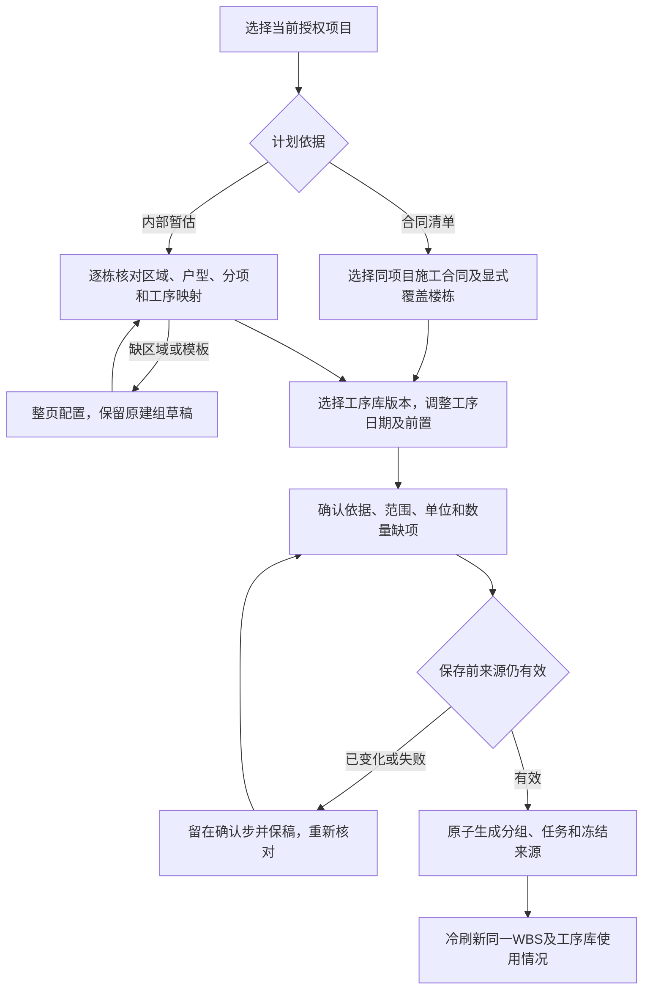
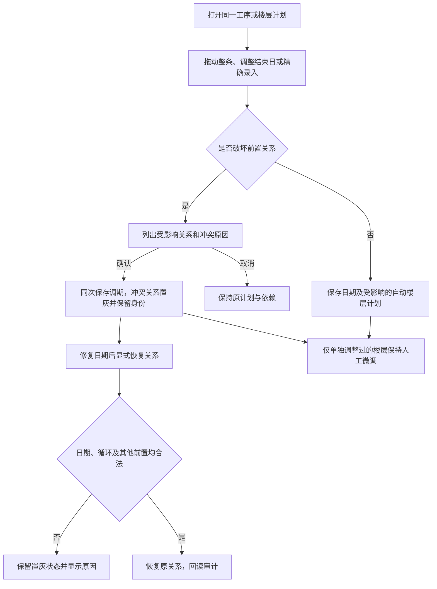
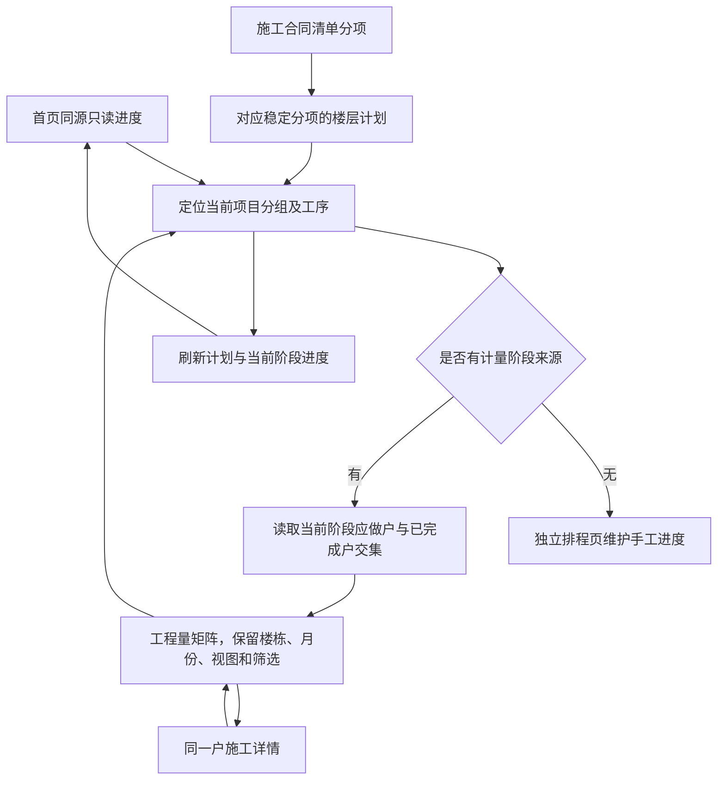
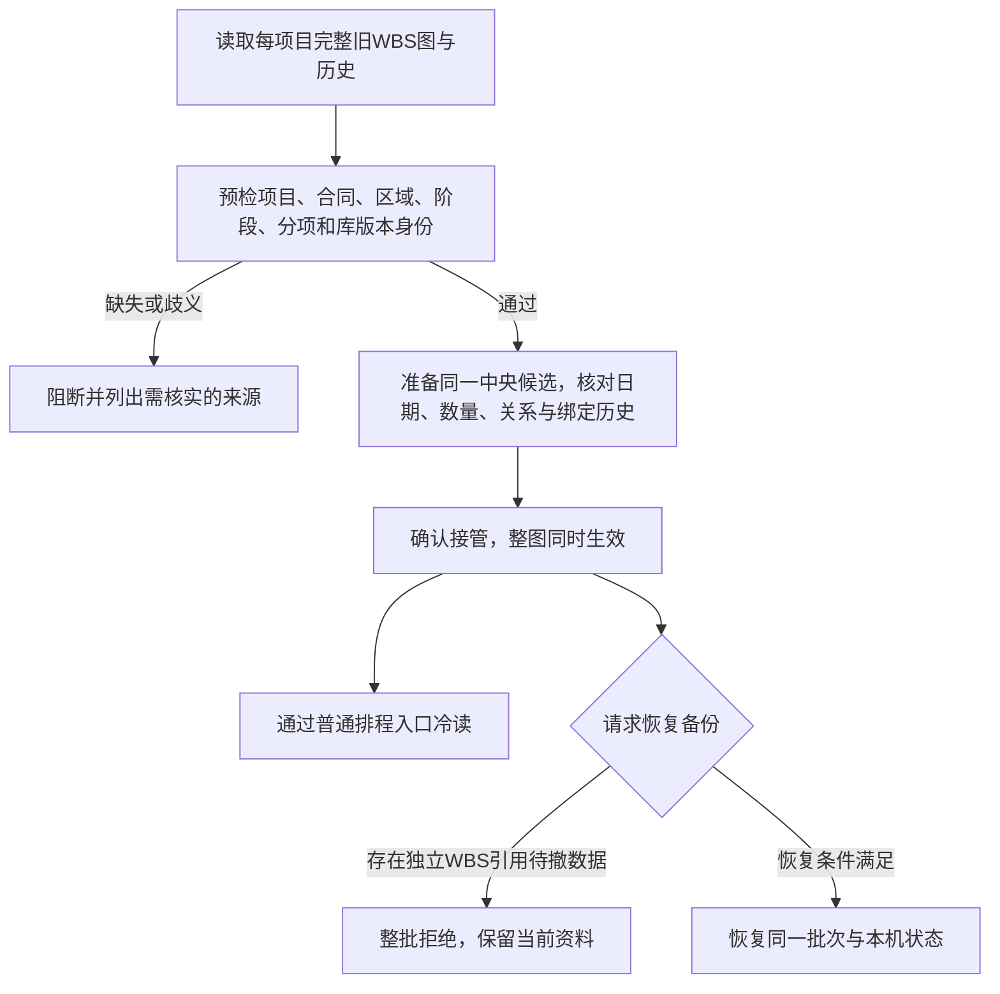

# #444 中央 WBS 建组、计划调整与阶段往返

> 本页保留已完成切片的实测摘要及原验收边界；日期、数量和阶段状态属于当次记录。历史多轮图片、审查与归档流水统一由[固定 Git 原始材料](https://github.com/zodea/crm-new/tree/c16869fcbf954dddd46143839afe5790f3828f1a/docs/design/evidence/issue-444)定位。当前规则以所引现行权威文档为准，保留的真实原件、源证明和产品打印不改写。

> 2026-09-12：本票达到本地 `slice-verified`，真实浏览器、五档截图、指南 PDF 与最后集成验证均通过；未推送或部署。以下流程依据 [#444 当前规格](https://github.com/zodea/crm-new/issues/444) 与实际行为登记。实施基线为 `77281c8d3eac755f7642bb180ab192a0f7a24191`，本目录与实现一起独立提交；前置 [#442 工程量](../issue-442/README.md) 与 [#443 工序库](../issue-443/README.md) 已分别独立验收。

## 建组及配置往返

内部暂估不借合同量或现场量补值。两户暂估 `8 / null` 保留已知部分和缺失信息，真实 `0` 仍是已知数量，平方米和米分开显示；能否建组按有效范围与工序映射判断，不用跨单位合计或正数门槛代替。

## 调期、楼层微调与依赖

主动移除依赖与冲突置灰分开记录。设置基线、增删任务和手工进度分别形成完整动作；传输结果不确定时恢复原提交，版本变化时保留草稿并重新核对。

## 阶段进度及完整上下文返回

不同阶段即使映射同一分项也不串用完成率；责任配置不算完成。只有全部应做户完成才显示实际完成日。来源身份失效时显示明确状态，不改用第一个项目、同名对象或演示资料。

## 旧图接管与恢复

旧暂估缺失的完整性无法从当前模板反推；保留历史实际值并说明缺口。既有合同绑定及对应历史在本票完整迁入；新绑定动作由 [#445](https://github.com/zodea/crm-new/issues/445) 接通。可重置中央实例不代表 [#416](https://github.com/zodea/crm-new/issues/416) 生产持久化与恢复验收。

## 实际浏览器验收

最后完整浏览器批次运行 `e2e/schedule-central.spec.ts` 与 `e2e/wbs-migration.spec.ts`：4 项通过，共 49.4 秒。随后仅调整截图等待可见弹窗动画结束，暂估旅程再次通过（27.1 秒）；未修改产品动画或业务行为。

| 旅程 | 实际验证 |
| --- | --- |
| 合同建组与计划维护 | 三步确认、真实拖动与精确调期；依赖取消不写、确认置灰、修复后恢复原关系及独立移除；手工进度、基线、任务增删、人工楼层保留、库当前引用回读、清单楼层定位 |
| 暂估建组与进度来源 | 失响应后恢复原提交且只产生一个分组；冻结楼层不随模板变更；阶段进度不串用；首页、来源页、矩阵、户详情保留完整筛选并冷刷新返回 |
| 缺区域配置返回 | 整页配置楼栋、楼层与户后返回原建组草稿；关闭保护和迟到读取；已知 8 及缺项、真实 0 和不同计量单位分别显示 |
| 完整旧图迁入 | 真实 SQLite 来源经实际 HTTP 接管；普通排程入口冷读分组、楼层、关系与历史；既有绑定迁入，重复确认保留后续更正，危险回滚整批拒绝 |

独立合成场景在本机可重置中央验证实例运行，未连接生产资料。截图中的合同、暂估与区域项目并非同一笔业务身份；合同布局补拍与早期已验收主界面也是独立重复运行，不能用截图顺序推断为一笔跨模块生产记录。

## 五档交互效果图

共 66 张正式截图：13 个场景各 390 / 768 / 1024 / 1280 / 1440px，另附合同确认页 390px 下半屏。Root 逐张检查 27 张窄屏及下半屏，UI 复核者逐张检查 39 张宽屏；页面横向边界、表格局部横滚、长名称、控件、焦点和浮层均已检查。窄屏长页面允许纵向滚动，不要求一屏展示全部内容。

| 场景 | 390 | 768 | 1024 | 1280 | 1440 |
| --- | --- | --- | --- | --- | --- |
| 合同依据与楼栋范围 | [图](https://github.com/zodea/crm-new/blob/c16869fcbf954dddd46143839afe5790f3828f1a/docs/design/evidence/issue-444/contract/contract-step1-390.png) | [图](https://github.com/zodea/crm-new/blob/c16869fcbf954dddd46143839afe5790f3828f1a/docs/design/evidence/issue-444/contract/contract-step1-768.png) | [图](https://github.com/zodea/crm-new/blob/c16869fcbf954dddd46143839afe5790f3828f1a/docs/design/evidence/issue-444/contract/contract-step1-1024.png) | [图](https://github.com/zodea/crm-new/blob/c16869fcbf954dddd46143839afe5790f3828f1a/docs/design/evidence/issue-444/contract/contract-step1-1280.png) | [图](https://github.com/zodea/crm-new/blob/c16869fcbf954dddd46143839afe5790f3828f1a/docs/design/evidence/issue-444/contract/contract-step1-1440.png) |
| 工序版本与日期 | [图](https://github.com/zodea/crm-new/blob/c16869fcbf954dddd46143839afe5790f3828f1a/docs/design/evidence/issue-444/contract/contract-step2-390.png) | [图](https://github.com/zodea/crm-new/blob/c16869fcbf954dddd46143839afe5790f3828f1a/docs/design/evidence/issue-444/contract/contract-step2-768.png) | [图](https://github.com/zodea/crm-new/blob/c16869fcbf954dddd46143839afe5790f3828f1a/docs/design/evidence/issue-444/contract/contract-step2-1024.png) | [图](https://github.com/zodea/crm-new/blob/c16869fcbf954dddd46143839afe5790f3828f1a/docs/design/evidence/issue-444/contract/contract-step2-1280.png) | [图](https://github.com/zodea/crm-new/blob/c16869fcbf954dddd46143839afe5790f3828f1a/docs/design/evidence/issue-444/contract/contract-step2-1440.png) |
| 合同确认页 | [图](https://github.com/zodea/crm-new/blob/c16869fcbf954dddd46143839afe5790f3828f1a/docs/design/evidence/issue-444/contract/contract-step3-390.png) | [图](https://github.com/zodea/crm-new/blob/c16869fcbf954dddd46143839afe5790f3828f1a/docs/design/evidence/issue-444/contract/contract-step3-768.png) | [图](https://github.com/zodea/crm-new/blob/c16869fcbf954dddd46143839afe5790f3828f1a/docs/design/evidence/issue-444/contract/contract-step3-1024.png) | [图](https://github.com/zodea/crm-new/blob/c16869fcbf954dddd46143839afe5790f3828f1a/docs/design/evidence/issue-444/contract/contract-step3-1280.png) | [图](https://github.com/zodea/crm-new/blob/c16869fcbf954dddd46143839afe5790f3828f1a/docs/design/evidence/issue-444/contract/contract-step3-1440.png) |
| 依赖恢复 | [图](https://github.com/zodea/crm-new/blob/c16869fcbf954dddd46143839afe5790f3828f1a/docs/design/evidence/issue-444/contract/dependency-recovery-390.png) | [图](https://github.com/zodea/crm-new/blob/c16869fcbf954dddd46143839afe5790f3828f1a/docs/design/evidence/issue-444/contract/dependency-recovery-768.png) | [图](https://github.com/zodea/crm-new/blob/c16869fcbf954dddd46143839afe5790f3828f1a/docs/design/evidence/issue-444/contract/dependency-recovery-1024.png) | [图](https://github.com/zodea/crm-new/blob/c16869fcbf954dddd46143839afe5790f3828f1a/docs/design/evidence/issue-444/contract/dependency-recovery-1280.png) | [图](https://github.com/zodea/crm-new/blob/c16869fcbf954dddd46143839afe5790f3828f1a/docs/design/evidence/issue-444/contract/dependency-recovery-1440.png) |
| 中央 WBS 主界面 | [图](https://github.com/zodea/crm-new/blob/c16869fcbf954dddd46143839afe5790f3828f1a/docs/design/evidence/issue-444/contract/central-wbs-390.png) | [图](https://github.com/zodea/crm-new/blob/c16869fcbf954dddd46143839afe5790f3828f1a/docs/design/evidence/issue-444/contract/central-wbs-768.png) | [图](https://github.com/zodea/crm-new/blob/c16869fcbf954dddd46143839afe5790f3828f1a/docs/design/evidence/issue-444/contract/central-wbs-1024.png) | [图](https://github.com/zodea/crm-new/blob/c16869fcbf954dddd46143839afe5790f3828f1a/docs/design/evidence/issue-444/contract/central-wbs-1280.png) | [图](https://github.com/zodea/crm-new/blob/c16869fcbf954dddd46143839afe5790f3828f1a/docs/design/evidence/issue-444/contract/central-wbs-1440.png) |
| 清单分项楼层来源 | [图](https://github.com/zodea/crm-new/blob/c16869fcbf954dddd46143839afe5790f3828f1a/docs/design/evidence/issue-444/contract/boq-floor-source-390.png) | [图](https://github.com/zodea/crm-new/blob/c16869fcbf954dddd46143839afe5790f3828f1a/docs/design/evidence/issue-444/contract/boq-floor-source-768.png) | [图](https://github.com/zodea/crm-new/blob/c16869fcbf954dddd46143839afe5790f3828f1a/docs/design/evidence/issue-444/contract/boq-floor-source-1024.png) | [图](https://github.com/zodea/crm-new/blob/c16869fcbf954dddd46143839afe5790f3828f1a/docs/design/evidence/issue-444/contract/boq-floor-source-1280.png) | [图](https://github.com/zodea/crm-new/blob/c16869fcbf954dddd46143839afe5790f3828f1a/docs/design/evidence/issue-444/contract/boq-floor-source-1440.png) |
| 失响应后原稿保留 | [图](https://github.com/zodea/crm-new/blob/c16869fcbf954dddd46143839afe5790f3828f1a/docs/design/evidence/issue-444/provisional/pending-command-390.png) | [图](https://github.com/zodea/crm-new/blob/c16869fcbf954dddd46143839afe5790f3828f1a/docs/design/evidence/issue-444/provisional/pending-command-768.png) | [图](https://github.com/zodea/crm-new/blob/c16869fcbf954dddd46143839afe5790f3828f1a/docs/design/evidence/issue-444/provisional/pending-command-1024.png) | [图](https://github.com/zodea/crm-new/blob/c16869fcbf954dddd46143839afe5790f3828f1a/docs/design/evidence/issue-444/provisional/pending-command-1280.png) | [图](https://github.com/zodea/crm-new/blob/c16869fcbf954dddd46143839afe5790f3828f1a/docs/design/evidence/issue-444/provisional/pending-command-1440.png) |
| 首页同源只读进度 | [图](https://github.com/zodea/crm-new/blob/c16869fcbf954dddd46143839afe5790f3828f1a/docs/design/evidence/issue-444/provisional/home-central-readonly-390.png) | [图](https://github.com/zodea/crm-new/blob/c16869fcbf954dddd46143839afe5790f3828f1a/docs/design/evidence/issue-444/provisional/home-central-readonly-768.png) | [图](https://github.com/zodea/crm-new/blob/c16869fcbf954dddd46143839afe5790f3828f1a/docs/design/evidence/issue-444/provisional/home-central-readonly-1024.png) | [图](https://github.com/zodea/crm-new/blob/c16869fcbf954dddd46143839afe5790f3828f1a/docs/design/evidence/issue-444/provisional/home-central-readonly-1280.png) | [图](https://github.com/zodea/crm-new/blob/c16869fcbf954dddd46143839afe5790f3828f1a/docs/design/evidence/issue-444/provisional/home-central-readonly-1440.png) |
| 首页来源返回 | [图](https://github.com/zodea/crm-new/blob/c16869fcbf954dddd46143839afe5790f3828f1a/docs/design/evidence/issue-444/provisional/home-source-readonly-390.png) | [图](https://github.com/zodea/crm-new/blob/c16869fcbf954dddd46143839afe5790f3828f1a/docs/design/evidence/issue-444/provisional/home-source-readonly-768.png) | [图](https://github.com/zodea/crm-new/blob/c16869fcbf954dddd46143839afe5790f3828f1a/docs/design/evidence/issue-444/provisional/home-source-readonly-1024.png) | [图](https://github.com/zodea/crm-new/blob/c16869fcbf954dddd46143839afe5790f3828f1a/docs/design/evidence/issue-444/provisional/home-source-readonly-1280.png) | [图](https://github.com/zodea/crm-new/blob/c16869fcbf954dddd46143839afe5790f3828f1a/docs/design/evidence/issue-444/provisional/home-source-readonly-1440.png) |
| 冻结楼层及阶段实际进度 | [图](https://github.com/zodea/crm-new/blob/c16869fcbf954dddd46143839afe5790f3828f1a/docs/design/evidence/issue-444/provisional/task-quantity-frozen-390.png) | [图](https://github.com/zodea/crm-new/blob/c16869fcbf954dddd46143839afe5790f3828f1a/docs/design/evidence/issue-444/provisional/task-quantity-frozen-768.png) | [图](https://github.com/zodea/crm-new/blob/c16869fcbf954dddd46143839afe5790f3828f1a/docs/design/evidence/issue-444/provisional/task-quantity-frozen-1024.png) | [图](https://github.com/zodea/crm-new/blob/c16869fcbf954dddd46143839afe5790f3828f1a/docs/design/evidence/issue-444/provisional/task-quantity-frozen-1280.png) | [图](https://github.com/zodea/crm-new/blob/c16869fcbf954dddd46143839afe5790f3828f1a/docs/design/evidence/issue-444/provisional/task-quantity-frozen-1440.png) |
| 缺区域的明确入口 | [图](https://github.com/zodea/crm-new/blob/c16869fcbf954dddd46143839afe5790f3828f1a/docs/design/evidence/issue-444/region/no-region-390.png) | [图](https://github.com/zodea/crm-new/blob/c16869fcbf954dddd46143839afe5790f3828f1a/docs/design/evidence/issue-444/region/no-region-768.png) | [图](https://github.com/zodea/crm-new/blob/c16869fcbf954dddd46143839afe5790f3828f1a/docs/design/evidence/issue-444/region/no-region-1024.png) | [图](https://github.com/zodea/crm-new/blob/c16869fcbf954dddd46143839afe5790f3828f1a/docs/design/evidence/issue-444/region/no-region-1280.png) | [图](https://github.com/zodea/crm-new/blob/c16869fcbf954dddd46143839afe5790f3828f1a/docs/design/evidence/issue-444/region/no-region-1440.png) |
| 区域整页配置及返回 | [图](https://github.com/zodea/crm-new/blob/c16869fcbf954dddd46143839afe5790f3828f1a/docs/design/evidence/issue-444/region/region-configuration-390.png) | [图](https://github.com/zodea/crm-new/blob/c16869fcbf954dddd46143839afe5790f3828f1a/docs/design/evidence/issue-444/region/region-configuration-768.png) | [图](https://github.com/zodea/crm-new/blob/c16869fcbf954dddd46143839afe5790f3828f1a/docs/design/evidence/issue-444/region/region-configuration-1024.png) | [图](https://github.com/zodea/crm-new/blob/c16869fcbf954dddd46143839afe5790f3828f1a/docs/design/evidence/issue-444/region/region-configuration-1280.png) | [图](https://github.com/zodea/crm-new/blob/c16869fcbf954dddd46143839afe5790f3828f1a/docs/design/evidence/issue-444/region/region-configuration-1440.png) |
| 已知部分、缺项、零与单位 | [图](https://github.com/zodea/crm-new/blob/c16869fcbf954dddd46143839afe5790f3828f1a/docs/design/evidence/issue-444/region/provisional-zero-missing-preview-390.png) | [图](https://github.com/zodea/crm-new/blob/c16869fcbf954dddd46143839afe5790f3828f1a/docs/design/evidence/issue-444/region/provisional-zero-missing-preview-768.png) | [图](https://github.com/zodea/crm-new/blob/c16869fcbf954dddd46143839afe5790f3828f1a/docs/design/evidence/issue-444/region/provisional-zero-missing-preview-1024.png) | [图](https://github.com/zodea/crm-new/blob/c16869fcbf954dddd46143839afe5790f3828f1a/docs/design/evidence/issue-444/region/provisional-zero-missing-preview-1280.png) | [图](https://github.com/zodea/crm-new/blob/c16869fcbf954dddd46143839afe5790f3828f1a/docs/design/evidence/issue-444/region/provisional-zero-missing-preview-1440.png) |

[合同确认页 390px 下半屏](https://github.com/zodea/crm-new/blob/c16869fcbf954dddd46143839afe5790f3828f1a/docs/design/evidence/issue-444/contract/contract-step3-lower-390.png)展示纵向滚动后的工序与保存区域。失响应场景 390px 图记录原稿区域，上方的恢复按钮请结合 768px 图与完整旅程断言核对。

三份正式指南合计 18 页（排程 9 页、首页 3 页、迁移 6 页）均已逐页渲染检查，文件摘要与逐页图见 [PDF 验收记录](https://github.com/zodea/crm-new/blob/c16869fcbf954dddd46143839afe5790f3828f1a/docs/design/evidence/issue-444/pdf/README.md)。

66 张最终图片的文件名、字节数与 SHA-256 见 [screenshot-hashes.json](https://github.com/zodea/crm-new/blob/c16869fcbf954dddd46143839afe5790f3828f1a/docs/design/evidence/issue-444/screenshot-hashes.json)。图片与 PDF 是正式交付证据，临时失败截图、测试来源和日志另行可恢复清理。

## 最终集成验证

| 检查 | 结果 |
| --- | --- |
| `pnpm typecheck` | 通过；工序库详情保留中央/桌面真实返回类型，当前引用字段经来源收窄后使用 |
| 本工作单元代码规范 | 100 个代码文件通过（初次 96 个，末端 4 个旧接缝测试另行检查）；修改的 JSON 与正式图像摘要通过 |
| `npm test` | 559 个文件、3476 项全部通过，179.98 秒 |
| `pnpm build` | 通过；仅本机构建，未部署 |
| 独立 Spec / Standards | 两轴末次均无未解决问题；最后详情类型修正另外只读复核通过 |
| 实际浏览器 | 完整 4 旅程通过；末端截图等待修正后的暂估旅程另通过，场景详见上表 |
| 报告与指南 | 66 张实测图、18 页 PDF 已检查；总报告已实际打开并验证 #444 过滤、步骤切换与实测图展示 |

第一次全量检查暴露了 9 项旧适配测试未同步：工程量组件缺新排程依赖、暂估绑定旧用例未明确桌面边界，以及默认会话精确权限表漏新增排程权限。均保留原行为断言，补明适配边界与浏览器禁止回落本地绑定的反例后通过；没有为测试放开尚由 #445 承接的浏览器绑定。编译子进程最初受本机沙箱限制，允许同项目编译后测试与构建完成，不属于产品失败。

## 实施期间发现并修复的问题

独立 Spec 复核累计发现并修复七项问题，末次未解决项为零。前六项后台问题如下，第七项为首页到来源页及矩阵、户详情的完整返回条件丢失，已统一专属返回白名单与上下文透传并通过真实冷刷新旅程。

| 问题 | 修复后的规则 | 对用户的影响 |
| --- | --- | --- |
| 普通撤销可绕过依赖恢复校验 | 所有动作结束前核对当前依赖图；日期、唯一前置、同组、循环任一不合法则整次回滚 | 历史撤销不会恢复出相互冲突的施工计划 |
| 合同组追加工序漏验逐栋来源 | 追加时复用当前合同显式覆盖及有效分项来源校验 | 清单失效后会明确要求修正，不生成无来源的楼层计划 |
| 原提交失响应后，通用陈旧错误会丢掉恢复编号 | 只有后台确认原编号没有回执、原动作未应用，并返回匹配编号的明确证明时才释放 | 已保存但未收到响应的动作仍按原编号恢复，避免重复记录 |
| 明确空范围误用全项目默认范围 | 排程已指定但为空的楼栋或分项范围返回零应做及缺源说明 | 旧范围失效不会突然显示其他楼栋的进度 |
| 普通详情保存把未编辑的依赖当作删除 | `dependency: null` 保留当前关系，移除只能走独立确认动作 | 只改进度或楼层日期不会悄悄删除前置工序 |
| 同日开工的有效关系阻断后续保存 | 按同日日期与实际 Lag 校验，不强制把合法同日改为不同日 | 同日计划中的手工进度可以正常维护 |

补充核验同时覆盖了无分组旧任务、祖先分组已删除时的撤销边界：历史仍可查看，普通撤销不能借无效祖先修改当前计划。当前分项映射已隐藏时，Repository 仍允许读取排程保存的冻结楼层；当前应做为零与历史计划存在可以同时成立。

Standards 复核修正首次资料加载完成前仍可输入、长名称选择器挤出窄屏的问题。后台独立复核另发现两处祖先可见性不一致：合同来源已隐藏仍计入目录及库引用，父任务或阶段已隐藏仍参与当前依赖校验。统计现复用同步后的可见分组，依赖与撤销遵循完整祖先可见性；真实来源首次读取及隐藏祖先反例先失败后通过，最终 6 文件 37 项定向测试通过，独立 Standards 终审无未解决项。旧图与历史仍保留隐藏记录，不通过删除历史修正当前可见性。
