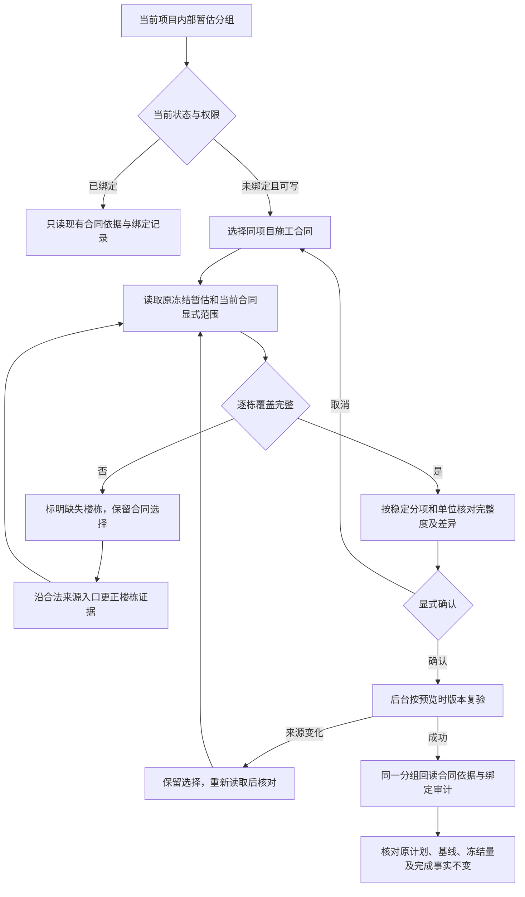
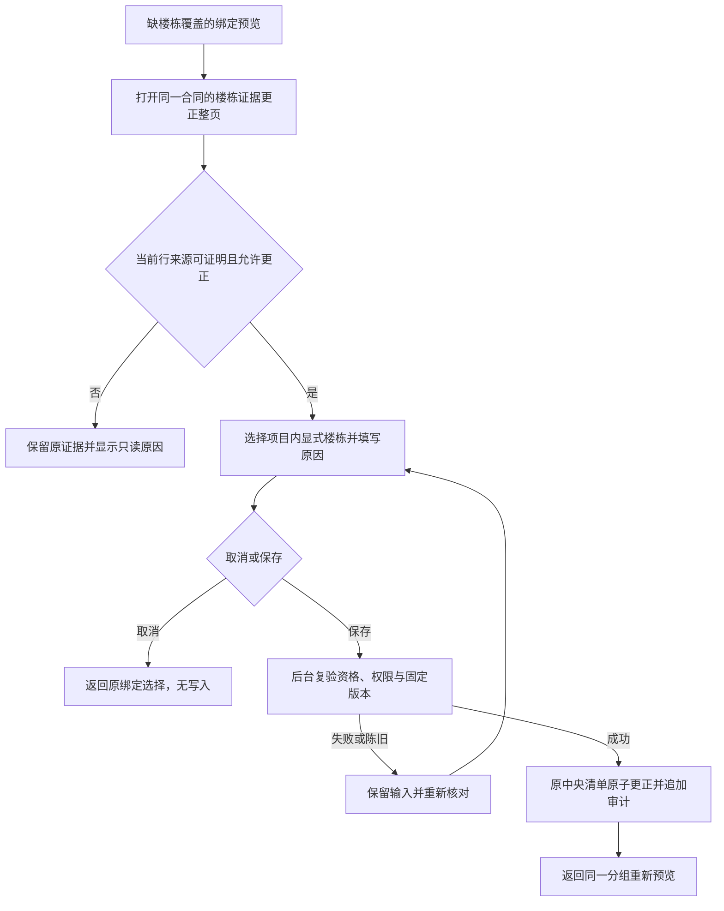
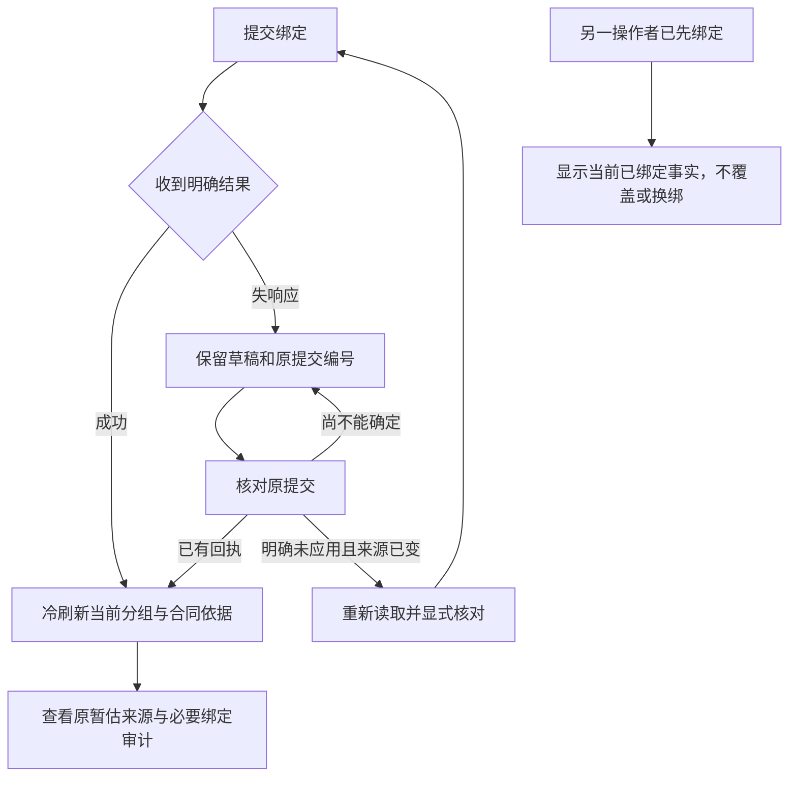

# #445 内部暂估绑定施工合同

> 本地限定切片已完成，证据随本工作单元独立提交；未推送或部署。2026-09-12 已重新查询 [#445 当前正文与评论](https://github.com/zodea/crm-new/issues/445)，无新增业务决定，2026-09-13 完成最终整体验证。实施基线为 `ab056768ebf17dd3a2713bb6bc0df37dbb118ba6`；前置 [#444 中央 WBS](../issue-444/README.md) 已独立提交并完成本地验收。本票不代表生产持久化或部署完成。

## 正常绑定与异常返回

数量差异仅在同分项、同单位且双方完整可比时给出确定值。`8 / null` 保留已知部分与缺项，真实 `0` 仍是已知值；不以差异必须为零作为新的绑定门槛，不用当前模板重建冻结量。

## 合同清单来源修正的必要接缝

只读调查确认：旧 `/contract/boq` 工作台仍使用本地清单适配，中央来源虽然已有楼栋读取，但尚无合法的楼栋更正命令。仅跳到旧页不能完成本票要求的“缺覆盖 → 修正来源 → 返回重新预览”。这属于已定流程的实现缺口，无需新增业务取舍。

独立调查依据 [ADR 0017](../../../adr/0017-provisional-schedule-before-contract.md)、[DATABASE](../../../rewrite/DATABASE.md) 的清单来源与签证保护规则，以及 [ADR 0020](../../../adr/0020-browser-authority-and-demo-workspace-boundary.md)，确定以下最小实施范围：

- 在清单原中央所属域保全导入文件、变更来源和确认资格，只对能证明属于已确认导入基准的稳定清单行开放显式楼栋更正。
- 签证新增结果及资格不明的历史行保持只读；不另建一张覆盖表绕过原行保护。
- 命令只改变楼栋证据并记录前后值、原因、操作人、时间和命令编号；项目、合同、分项、稳定行身份、量价、签证时序与既有冻结快照保持原样。
- 保存使用固定来源版本、幂等指纹、当前权限与项目—合同—楼栋关系复验，并遵守迁移互斥；成功使旧绑定预览失效，返回原分组重新核对。
- 重复来源接管不得覆盖日常更正；备份恢复须同时保护来源、当前更正与下游引用。

## 结果不确定与已绑定回读

中央主流程与异常续验已经实际执行，65 张原始交互图按五档视口逐张检查通过。已有 #444 图片不作为 #445 已完成的证据。

## 实施时消除的规格冲突

旧排程蓝本将缺覆盖的处理写为“移除、拆分或补齐”，并只提单个冻结数值。当前 #445 定稿明确不能新造拆分能力或隐式移除楼栋，且必须保留逐户数量与单位完整性。此次按当前开放 Issue 修正蓝本和数据说明，接通合法的原清单楼栋证据更正；不把旧文字作为新增业务范围，也不用单个数值推断完整历史。

早期反例另确认并修复：合同独有分项不能从差异表消失；损坏的旧绑定比较不能使真实已绑定关系整页无法读取；冻结快照计数与逐户内容矛盾时不得显示完整量。对应中央读取和命令回归已通过。

## 本票实现范围

- 绑定预览使用原冻结来源和当前合同稳定身份；提交固定预览版本，同一中央队列和事务内复验并保存原分组、审计和回执。
- 原绑定历史缺少可信比较时显示历史证据不足，保留真实绑定事实；不以当前模板或合同重建历史。
- 新增合同楼栋证据更正整页，对原中央确认导入行保存更正原因和前后值；签证新增及无法证明资格的历史行只读。
- 绑定记录沿稳定清单行、楼层计划和任务身份返回原楼层；冷刷新保留项目、分组、工序和筛选。不按同名分项猜配。
- 重复迁入保留日常绑定和楼栋更正；危险备份恢复即使审计或回执缺损，仍以可信迁入基线保护后续真实关系。
- 独立复核已修复确认途中切换缓存页签后永久忙碌、同合同不同行草稿串用、下拉换行后页签丢稿等问题；实际错误态的已选合同名、取消回焦点和多来源可达也完成补验。

## 验收来源与范围

运行环境为本项目本地 Nuxt 中央可重置测试实例，端口 `3187`。使用明确合成源 `1c033b0d-5fc1-46ee-9014-bd1b98e9df3b`，项目为 `core-projects-9d5874967d096dc117e4ce1e`，施工合同为 `core-construction_contracts-4391e514d1b675b866074875`。不涉及参考站写入、线上数据或生产部署。

验收按同一来源分段续行：首段完成预检、迁入与建组；续段完成原清单楼栋更正、取消与确认绑定；后段完成已绑定冷读和原楼层返回。后段独立通过的时间只表示该段，不冒称一次从空环境贯穿的完整旅程。异常段在当前来源下通过正式工程量命令建立独立验收楼栋及新暂估分组，覆盖来源变化与失响应恢复。

首次测试因同名清单候选无法区分而停止，产品候选已增加楼栋及原数量；后续部分停止由测试文字或查询参数顺序假设不符引起，保留为排查过程，不列作全成功证据。尝试清空测试实例曾被自动审批拒绝，实际未执行；之后沿保留来源续验，未重启规避。

## 使用指南

[排程指南 V2.9](../../../guides/project-start-and-schedule.md)和[迁移指南 V2.4](../../../guides/local-data-migration.md)已经更新，正式 PDF 共 15 页完成逐页检查。页面图、版本、最终 PDF SHA-256 及核验范围见 [PDF 验收记录](pdf/README.md)。

## 交互效果图

每种状态都有 390 / 768 / 1024 / 1280 / 1440px 原图。下表给出代表图；全部 65 张图的实际宽高、逐图 SHA-256、来源轮次及审图分工见 [浏览器证据清单](browser/manifest.json)。数量表下部和横滚画面使用 720px 高度，其余主要页面为 960px；不把首屏截图当作页面所有内容。

| 场景 | 实际结果 | 代表图 |
| --- | --- | --- |
| 旧绑定历史 | 保留真实绑定，缺比较明确提示，不补造 | [390px](browser/legacy-bound-readonly-390.png) |
| 楼栋缺覆盖 | 阻止确认并保留选择，指出原来源修正入口 | [390px](browser/coverage-blocked-frozen-390.png) |
| 原清单楼栋更正 | 同一确认导入行维护楼栋及理由后返回 | [768px](browser/building-evidence-draft-768.png) |
| 冻结差异下部 | 8/null、真实零及单位分别核对，确认按钮可达 | [1440px](browser/comparison-lower-and-confirm-1440.png) |
| 横滚后的来源列 | 只在表格内横滚，完整说明及来源入口可达 | [390px](browser/comparison-horizontal-sources-390.png) |
| 陈旧预览 | 显示原合同名称，保留选择并要求重新核对 | [390px](browser/stale-preview-retained-390.png) |
| 失响应恢复 | 显示保留的合同及原提交恢复入口 | [768px](browser/unknown-command-retained-768.png) |
| 新绑定冷读 | 回读绑定时保存的比较、经办身份和时间 | [1440px](browser/bound-cold-read-1440.png) |
| 已绑定差异下部 | 可继续核查冻结依据，不能重复绑定 | [390px](browser/bound-differences-lower-390.png) |
| 绑定清单来源 | 只读原稳定行，可打开绑定时原楼层计划 | [768px](browser/contract-source-readonly-768.png) |
| 原冻结楼层 | 只读同一工序与楼层，冻结量及原计划保留 | [390px](browser/original-floor-readonly-390.png) |
| 签证新增 | 明确只读原因，不能直接更正基准楼栋 | [768px](browser/signed-addition-readonly-768.png) |
| 四条来源及长说明 | 键盘到第四条并打开精确原行，长说明可滚至末尾 | [390px](browser/multiple-sources-long-reasons-390.png) |

前 12 类共 60 张来自实际合成迁入来源及公开命令的 `release-verified` 轮；最后 5 张是通过真实页面、Repository 解码、Pinia 与 VXE 的明确读取夹具微验，未执行迁入或写命令，不能作为真实四行迁入证据。

## 验证与独立复核

- 中央绑定 22 项 SQLite/HTTP 反例通过，含合同独有分项、损坏旧比较、冻结完整度、陈旧版本、权限变化、原键回执和下游不变；迁移与存储回归另覆盖危险恢复及可信原始绑定基线。
- 楼栋证据所属域联测 9 个文件、91 项通过，覆盖原行资格、量价及签证保护、事务失败、排队撤权、回执及重复迁入。
- 最新状态组件 2 个文件、17 项及多来源组件 3 项通过，实际 KeepAlive 与真实来源参数分别覆盖草稿保留和路由切换。
- 业务续验 `release-verified` 1 项通过（18.9 秒），四来源读取夹具浏览器微验 1 项通过（4.4 秒）。先前 6.1 秒只证明绑定后续读，不与上述各轮相加冒称独立全流程数量。
- 类型检查通过；首轮全部 65 个修改代码文件规范检查通过。元数据联测发现新增路由未填设计归属原因、旧路由计数及旧 PRG 状态断言，已按实际范围补齐；对应 3 个文件、32 项复验通过，没有放宽缺口检查。
- **Standards**：交叉审查非本人实现，先后确认并关闭页签忙碌、行草稿身份及多来源裁切，最后增量剩余 **0**；Root 补充复核原 BOQ 所属域，未发现额外标准问题。
- **Spec**：独立审查非本人编写的楼栋证据与界面，草稿错配修后剩余 **0**；Root 核查中央绑定发现的合同独有项、损坏旧比较及冻结完整度三个问题均已修复并有回归。工资、目标成本与生产关口没有被提前计为完成。

最终完整 `npm test`：**569 个文件、3543 项全部通过，191.30 秒**。`pnpm typecheck` 与 `pnpm build` 均通过；累计 67 个修改代码文件规范检查通过（初轮 65 个，最后元数据增量 3 个中 2 个为新增检查文件）。修改范围内差异格式检查通过。未调用 GitHub Actions、未新增生产依赖；提交继续执行仓库正常检查。

新增清单楼栋来源页的设计覆盖仍为 `design-pending`，已登记 #445 和缺少直接 DC 页的原因；实际视口验收不冒称设计源码已经补齐。全仓当前索引为 140 个生产路由、196 个路由变体、600 个子视图与 1067 个宿主案例，计数仅表示盘点范围。
