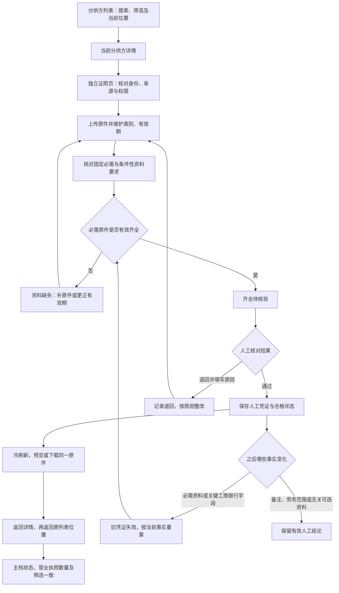
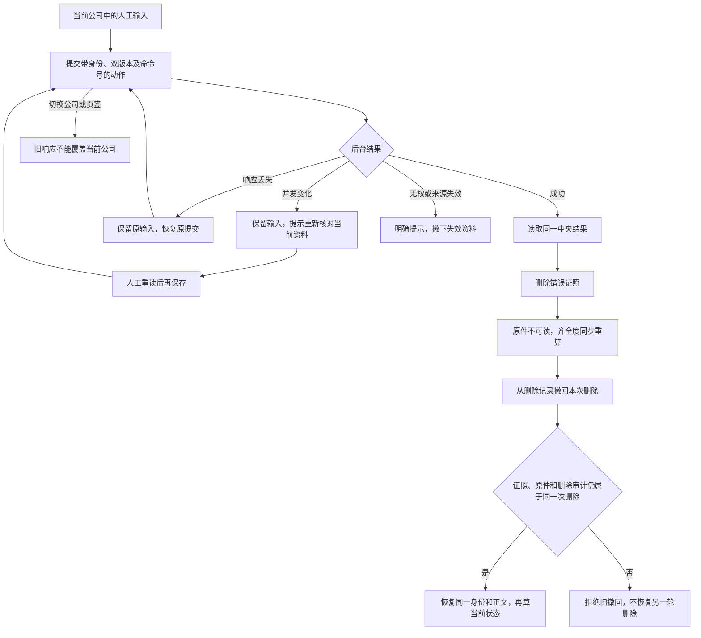
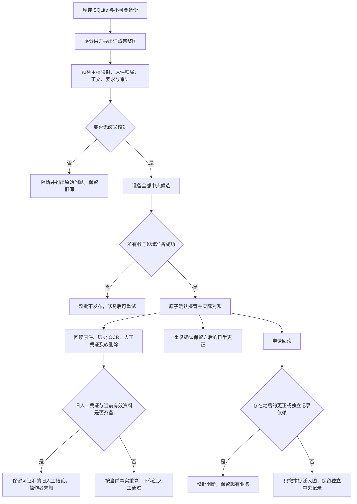

# #446 分供方证照中央链：运行证据

对应 [Issue #446](https://github.com/zodea/crm-new/issues/446)。本页记录当前切片的验收范围，不替代[证照指南](../../../guides/supplier-credential-review.md)、[分供方页面蓝本](../../../rewrite/pages/base-supplier.md)或 [ADR 0020](../../../adr/0020-browser-authority-and-demo-workspace-boundary.md)。

## 当前结果与边界

2026-09-12：本切片达到本地 `slice-verified`。两条证照旅程及七条受影响的主档回归共九条全部通过；同一生产源码下，素材复验两条通过（54.0 秒），最后日常旅程再次通过，并在五档视口断言营业执照表头与同列原件入口左右边界误差不超过 2px。78 张交互图已逐张检查，完整测试、类型、构建和本票规范检查均通过。

- 浏览器正式证照、主档资料状态与营业执照列消费同一中央领域。原件、证照、要求和人工凭证一起验证并保存；主档关键字段变化在同一事务内使旧凭证失效。
- 上传当前无需 OCR 即可完成人工核验。浏览器中央 OCR 和税务官网人工确认由 #447 接通；Tauri 保留既有本地适配。
- 文件只有原路径或元数据、没有正文时明确提示缺失，不读取用户旧路径，也不计入齐全度。删除后不能通过旧地址取回当前原件；撤回仅恢复能核实的同一次删除。
- 测试身份须后台授权且只读。当前中央服务仍是可重置验证实例，#416 的生产持久化、备份与部署不由本票代验。

## 本 Issue 主流程

营业执照、法人身份证和银行账户资料始终必需；条件资料改为“需提供”必须填写原因。有效齐全只进入待核验，不自动通过。过期按上海业务日期重新计算。

## 保存异常与删除撤回

切换已打开页签保留该页人工输入。主动离开有未保存修改时提供保护；冷刷新恢复已保存的证照页身份和来源，不把未保存输入当已落库事实。

## 完整旧图受控迁入

每个物理分供方行导出一个完整图节点，包含没有证照但存在主档/人工审计的分供方及软删除分供方。旧核心身份包若不含可选证照图，只表示迁入主档，不能据此声明证照已接管。缺原件正文保留线索；旧文件路径不用于恢复正文。

## 交互效果图

每个主状态提供 390 / 768 / 1024 / 1280 / 1440px 五档真实浏览器图。窄屏资料要求与原件清单沿内容区纵向排列，宽表仅在自身区域横向滚动；另附滚到原件区域后的 18 张图，避免只看到上方资料要求而误判原件没有入口。取图等待结果提示自然消失，不隐藏提示或修改业务页面来取图。

| 场景 | 390 | 768 | 1024 | 1280 | 1440 |
| --- | --- | --- | --- | --- | --- |
| 当前分供方真实空态 | [图](01-empty-current-supplier-390.png) | [图](01-empty-current-supplier-768.png) | [图](01-empty-current-supplier-1024.png) | [图](01-empty-current-supplier-1280.png) | [图](01-empty-current-supplier-1440.png) |
| 上传原件与类别、有效期 | [图](02-original-upload-dialog-390.png) | [图](02-original-upload-dialog-768.png) | [图](02-original-upload-dialog-1024.png) | [图](02-original-upload-dialog-1280.png) | [图](02-original-upload-dialog-1440.png) |
| 响应丢失后恢复原提交 | [图](03-lost-response-retained-draft-390.png) | [图](03-lost-response-retained-draft-768.png) | [图](03-lost-response-retained-draft-1024.png) | [图](03-lost-response-retained-draft-1280.png) | [图](03-lost-response-retained-draft-1440.png) |
| 齐全后等待人工核验 | [图](04-complete-awaiting-review-390.png) | [图](04-complete-awaiting-review-768.png) | [图](04-complete-awaiting-review-1024.png) | [图](04-complete-awaiting-review-1280.png) | [图](04-complete-awaiting-review-1440.png) |
| 人工通过后冷刷新 | [图](05-qualified-after-cold-refresh-390.png) | [图](05-qualified-after-cold-refresh-768.png) | [图](05-qualified-after-cold-refresh-1024.png) | [图](05-qualified-after-cold-refresh-1280.png) | [图](05-qualified-after-cold-refresh-1440.png) |
| 当前原件预览与键盘关闭 | [图](06-controlled-original-preview-390.png) | [图](06-controlled-original-preview-768.png) | [图](06-controlled-original-preview-1024.png) | [图](06-controlled-original-preview-1280.png) | [图](06-controlled-original-preview-1440.png) |
| 撤回后仍需重新核验 | [图](07-restored-original-requires-review-390.png) | [图](07-restored-original-requires-review-768.png) | [图](07-restored-original-requires-review-1024.png) | [图](07-restored-original-requires-review-1280.png) | [图](07-restored-original-requires-review-1440.png) |
| 返回原列表条件与行位置 | [图](08-list-same-status-and-original-count-390.png) | [图](08-list-same-status-and-original-count-768.png) | [图](08-list-same-status-and-original-count-1024.png) | [图](08-list-same-status-and-original-count-1280.png) | [图](08-list-same-status-and-original-count-1440.png) |
| 迁入的人工凭证与 OCR 历史 | [图](09-migrated-manual-proof-and-ocr-history-390.png) | [图](09-migrated-manual-proof-and-ocr-history-768.png) | [图](09-migrated-manual-proof-and-ocr-history-1024.png) | [图](09-migrated-manual-proof-and-ocr-history-1280.png) | [图](09-migrated-manual-proof-and-ocr-history-1440.png) |
| 撤回可核对的历史删除 | [图](10-migrated-deletion-restores-same-original-390.png) | [图](10-migrated-deletion-restores-same-original-768.png) | [图](10-migrated-deletion-restores-same-original-1024.png) | [图](10-migrated-deletion-restores-same-original-1280.png) | [图](10-migrated-deletion-restores-same-original-1440.png) |
| 旧路径缺正文的明确提示 | [图](11-legacy-path-is-not-a-readable-original-390.png) | [图](11-legacy-path-is-not-a-readable-original-768.png) | [图](11-legacy-path-is-not-a-readable-original-1024.png) | [图](11-legacy-path-is-not-a-readable-original-1280.png) | [图](11-legacy-path-is-not-a-readable-original-1440.png) |
| 营业执照筛选消费真实原件 | [图](12-business-license-filter-uses-current-originals-390.png) | [图](12-business-license-filter-uses-current-originals-768.png) | [图](12-business-license-filter-uses-current-originals-1024.png) | [图](12-business-license-filter-uses-current-originals-1280.png) | [图](12-business-license-filter-uses-current-originals-1440.png) |

| 已滚至原件清单 | 390 | 768 | 1024 |
| --- | --- | --- | --- |
| 齐全待核验 | [图](04-complete-awaiting-review-originals-390.png) | [图](04-complete-awaiting-review-originals-768.png) | [图](04-complete-awaiting-review-originals-1024.png) |
| 人工通过后刷新 | [图](05-qualified-after-cold-refresh-originals-390.png) | [图](05-qualified-after-cold-refresh-originals-768.png) | [图](05-qualified-after-cold-refresh-originals-1024.png) |
| 撤回后待核验 | [图](07-restored-original-requires-review-originals-390.png) | [图](07-restored-original-requires-review-originals-768.png) | [图](07-restored-original-requires-review-originals-1024.png) |
| 迁入的原件与历史 | [图](09-migrated-manual-proof-and-ocr-history-originals-390.png) | [图](09-migrated-manual-proof-and-ocr-history-originals-768.png) | [图](09-migrated-manual-proof-and-ocr-history-originals-1024.png) |
| 旧删除撤回后 | [图](10-migrated-deletion-restores-same-original-originals-390.png) | [图](10-migrated-deletion-restores-same-original-originals-768.png) | [图](10-migrated-deletion-restores-same-original-originals-1024.png) |
| 旧路径缺正文 | [图](11-legacy-path-is-not-a-readable-original-originals-390.png) | [图](11-legacy-path-is-not-a-readable-original-originals-768.png) | [图](11-legacy-path-is-not-a-readable-original-originals-1024.png) |

预览图展示经真实中央上传、保存和读取的合成 PNG 原件。PDF 另外验证当前授权原件下载字节一致、预览容器可见、Esc 关闭及回到触发按钮；无界面浏览器的原生 PDF 阅读器内部渲染未作为完成证据。逐 Issue 报告中的交互示意继续单独标注，不替代本页实际图像。

## 验证入口

- [真实浏览器旅程](../../../../e2e/supplier-credentials-central.spec.ts)：合成身份上传、响应丢失恢复、人工核验、冷刷新、字节一致下载、删除撤回、列表往返与筛选；真实 SQLite 完整图迁入和缺正文分支。
- [源导出](../../../../tests/migration/supplier-credential-source.test.ts)、[迁移准备](../../../../tests/supplier/credential-migration.test.ts)、[中央迁移集成](../../../../tests/supplier/credential-core-integration.test.ts)：完整旧图、坏关系阻断、失败原子性、重复确认与回滚边界。
- [领域命令](../../../../tests/supplier/credential-central.test.ts)、[HTTP 输入](../../../../tests/supplier/credential-request.test.ts)、[Repository](../../../../tests/supplier/credential-repository.test.ts)：双版本、权限、来源、原件正文校验、人工凭证失效与恢复同一提交。
- [页面状态](../../../../tests/stores/supplier-credential-state.test.ts)、[中央界面](../../../../tests/components/SupplierCredentialCentralPanel.test.ts)、[页签恢复](../../../../tests/tabs/supplier-credential-restore.test.ts)：人工输入、迟到结果、错误恢复及专用证照页冷刷新。

## PDF 核验

三份使用指南已重新生成并逐页检查，共 16 页。正式文件和逐页渲染见 [PDF 检查记录](pdf/README.md)。

## 集成检查

固定基线为 `f11bfc534cd7981b9f5829e92f1c9655050893c1`，本记录与 #446 实现一同独立提交，提交号从本页 Git 历史追溯。

- 最终完整 `npm test`：541 个文件、3350 项全部通过，186.28 秒。
- `pnpm typecheck`、`pnpm build` 通过；本票 63 个修改文件规范检查通过，未据此宣称整仓规范检查通过。
- Standards 初审发现文件政策重复，现已抽成共享纯规则；各入口仍独立复验正文、类型和大小。修后剩余 0 项。
- Spec 初审发现旧图可绕过固定必需资料，以及同类别另有有效原件时新过期未撤销旧凭证。均已建立失败用例并修复；活跃非法要求预检阻断，软删除历史原义保留；重新人工核验后不因已过期历史反复失效。修后剩余 0 项。
- 浏览器验收发现并修复证照页冷刷新、主档返回上下文、标题与预览关闭焦点；旧导航登记和桌面错误提示断言已同步。原件表使用可见品牌按钮，提示消失后取图；表头与表体在五档宽度下实际对应。

未迁移用户真实业务旧库、调用云 CI、推送或部署。#447 的中央 OCR 与税务确认、其他主档义务及 #416 的生产部署继续单独验收。
