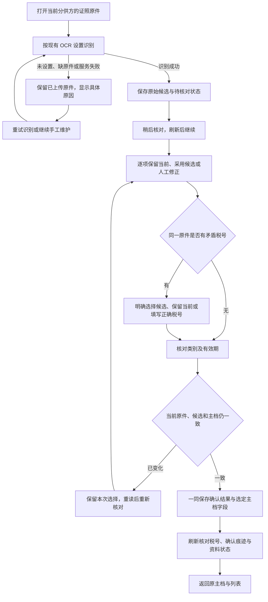
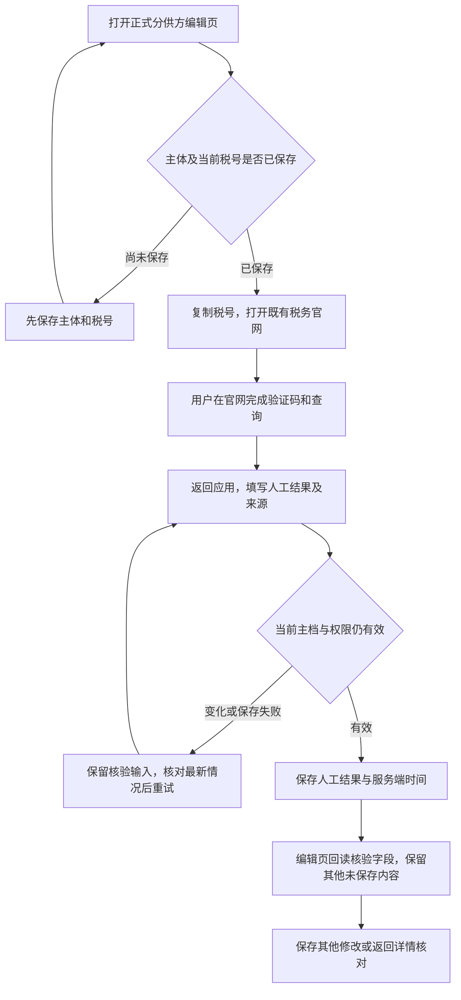
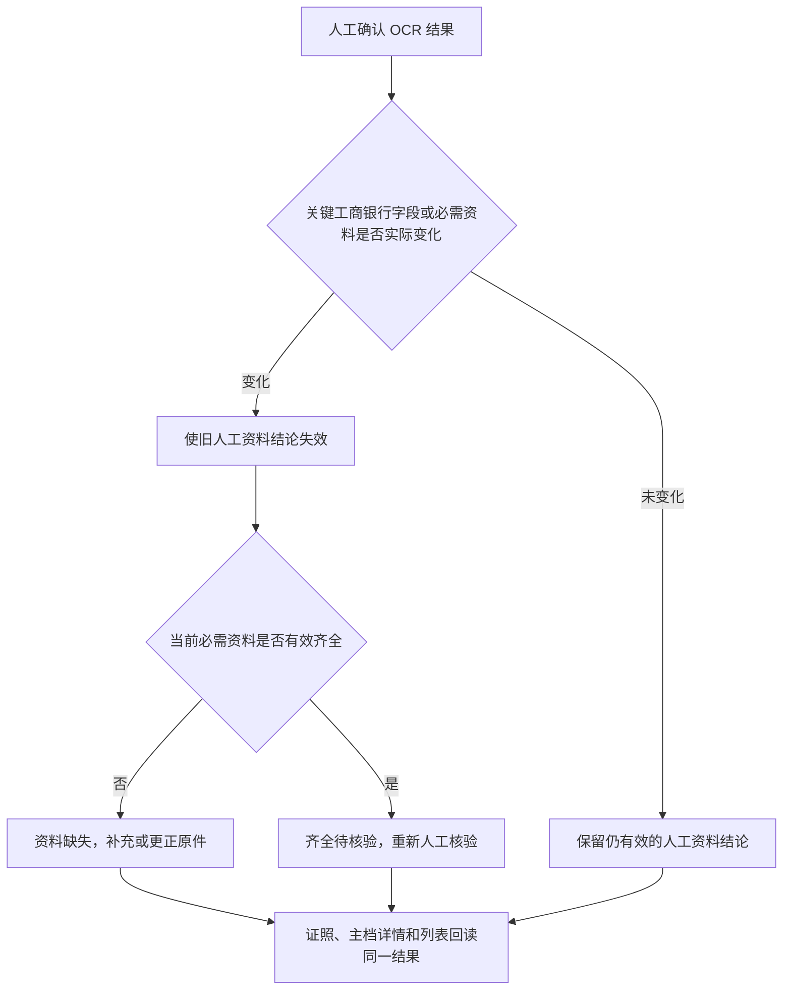
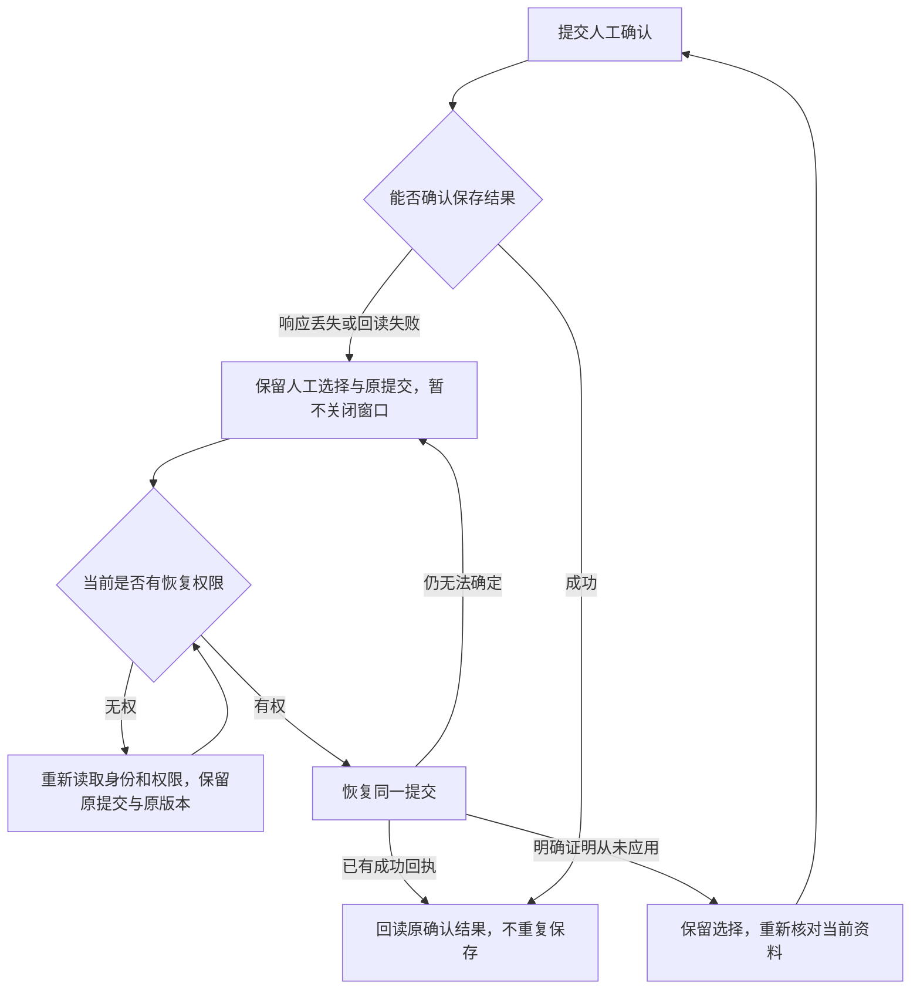

# #447 证照 OCR 与人工税务核验

> 2026-09-12 本地运行态验收记录。现行规格见 [#447](https://github.com/zodea/crm-new/issues/447)，前置原件与资料核验见 [#446](../issue-446/README.md)。本票建立于已提交基线 `376ff398e3551bd2232c6bb44ea95a5b69790881`；最终实现、测试与本页证据随同一独立提交保存，其提交 SHA 可由本页 Git 历史追溯。未推送或部署。

## 证照识别、稍后核对与主档回读

统一社会信用代码和纳税人识别号的目标是税号 `taxNo`；内部唯一识别码 `uniqueCode` 单独维护。历史候选保留原义，不根据长度或旧标签自动搬值。原始识别和人工确认各自保留，再识别不抹去上次确认事实。

## 人工税务核验与未保存表单

“未查到”只表示待确认，不自动判为小规模纳税人。应用提供查询入口并记录人工结果，不抓取官网或代做验证码。

## 确认后的资料状态

## 提交结果不确定时的恢复

权限暂时被撤回不能证明原提交失败；只有后台确认该命令未写入，才允许基于最新资料重新确认。切回页签后仍可刷新权限并恢复原提交。

## 验证结果

以下检查已通过。领域、HTTP、状态及组件回归覆盖后台与异常分支；真实浏览器另外操作两条新完整流程及九条受影响既有流程，不将单测或界面提示当成实际保存证据。

| 场景 | 已验证结果 |
| --- | --- |
| 旧字段目标错误 | 新识别信用代码写入税号候选；内部码和历史候选不自动搬值 |
| 重复及矛盾税号 | 显示不同候选并要求人工处理，不能静默采用第一项或最后一项 |
| 原件识别及失败重试 | 只读取当前授权原件；无配置、缺正文、无权与服务错误分别反馈 |
| 稍后核对与冷刷新 | 原始候选、置信度和待核对状态仍在，已确认痕迹不丢失 |
| 并发与结果不确定 | 旧版本拒绝并保留人工选择；同一提交恢复不重复产生确认 |
| A/B、来源与权限切换 | 迟到结果不能修改另一个主体，测试来源不可写 |
| 人工确认与主档 | 确认事实和选定主档字段一同成功或一同失败；重复税号仍被阻止 |
| 税务核验 | 结果失败保输入，未查到保持待确认，其他未保存表单内容保留 |
| 五档视口 | 390 / 768 / 1024 / 1280 / 1440px，局部滚动、焦点和浮层正确 |
| 指南与 PDF | 更新用户流程，正式 PDF 逐页检查后归档渲染图 |

- 完整 `npm test`：549 个文件、3406 项通过，178.53 秒；类型与构建通过，本票 49 个代码与测试文件规范检查通过。
- 新增 OCR 与人工税务两条浏览器流程最终同批通过，24.1 秒；九条既有证照/分供方回归此前全部通过。最后只调整窄屏截图定位，税务单旅程另一次通过，25.9 秒，生产源码未再改变。
- OCR 实际提交成功后中断返回，再恢复同一命令；矛盾税号和主档并发修改后保留选择。税务流程同样验证失响应、陈旧版本、未查到不判小规模、保留其他未保存备注、冷载详情后显式编辑回读凭证。
- 14 个状态 × 5 档宽度共 70 张最终交互图已逐张检查；字段区域键盘横滚、页面不横移、浮层边界、焦点环及关闭后焦点返回均有运行断言。修正税务入口原生按钮样式、历史记录难读及过早截图后重新采证。
- 独立 Standards / Spec 复核剩余 0 项；发现的待恢复命令丢失、重新读取权限入口、类别与期限决定留痕均已修复并建立反例回归。最终展示修正另经 Standards 定向复核，剩余 0 项。

测试只使用隔离合成资料；真实外部 OCR 识别质量不在合成服务验收范围内。可重置中央验证实例不代表 [#416](https://github.com/zodea/crm-new/issues/416) 的生产持久化与部署已完成。

## 运行画面索引

视口为 390 × 844、768 / 1024 / 1280 / 1440 × 960；窄屏图片按对应步骤滚动到当前操作。字段表与原件表只在自身区域横向滚动，整页不横移。OCR 原文来自本机合成识别服务，上传和返回的 PDF 字节已核对；税务场景只模拟人工录入，不访问真实税务查询结果。

| 实际步骤 | 390px | 768px | 1024px | 1280px | 1440px |
| --- | --- | --- | --- | --- | --- |
| 当前授权原件及识别入口 | [图](01-current-original-390.png) | [图](01-current-original-768.png) | [图](01-current-original-1024.png) | [图](01-current-original-1280.png) | [图](01-current-original-1440.png) |
| 识别失败保留已上传原件 | [图](02-recognition-failure-retains-original-390.png) | [图](02-recognition-failure-retains-original-768.png) | [图](02-recognition-failure-retains-original-1024.png) | [图](02-recognition-failure-retains-original-1280.png) | [图](02-recognition-failure-retains-original-1440.png) |
| 稍后核对与刷新后候选 | [图](03-pending-candidates-after-refresh-390.png) | [图](03-pending-candidates-after-refresh-768.png) | [图](03-pending-candidates-after-refresh-1024.png) | [图](03-pending-candidates-after-refresh-1280.png) | [图](03-pending-candidates-after-refresh-1440.png) |
| 矛盾税号逐项人工选择 | [图](04-conflicting-tax-number-choices-390.png) | [图](04-conflicting-tax-number-choices-768.png) | [图](04-conflicting-tax-number-choices-1024.png) | [图](04-conflicting-tax-number-choices-1280.png) | [图](04-conflicting-tax-number-choices-1440.png) |
| 陈旧版本拒绝并保留选择 | [图](05-stale-confirmation-retains-choices-390.png) | [图](05-stale-confirmation-retains-choices-768.png) | [图](05-stale-confirmation-retains-choices-1024.png) | [图](05-stale-confirmation-retains-choices-1280.png) | [图](05-stale-confirmation-retains-choices-1440.png) |
| 主档税号回读，内部码不变 | [图](06-confirmed-master-readback-390.png) | [图](06-confirmed-master-readback-768.png) | [图](06-confirmed-master-readback-1024.png) | [图](06-confirmed-master-readback-1280.png) | [图](06-confirmed-master-readback-1440.png) |
| 再识别保留上次人工确认 | [图](07-rerecognition-preserves-confirmation-390.png) | [图](07-rerecognition-preserves-confirmation-768.png) | [图](07-rerecognition-preserves-confirmation-1024.png) | [图](07-rerecognition-preserves-confirmation-1280.png) | [图](07-rerecognition-preserves-confirmation-1440.png) |
| 人工填写税务核验结果 | [图](08-taxpayer-manual-dialog-390.png) | [图](08-taxpayer-manual-dialog-768.png) | [图](08-taxpayer-manual-dialog-1024.png) | [图](08-taxpayer-manual-dialog-1280.png) | [图](08-taxpayer-manual-dialog-1440.png) |
| 税务响应丢失，恢复原提交 | [图](09-taxpayer-lost-response-retains-input-390.png) | [图](09-taxpayer-lost-response-retains-input-768.png) | [图](09-taxpayer-lost-response-retains-input-1024.png) | [图](09-taxpayer-lost-response-retains-input-1280.png) | [图](09-taxpayer-lost-response-retains-input-1440.png) |
| 主档其他未保存备注仍保留 | [图](10-taxpayer-proof-and-unsaved-note-390.png) | [图](10-taxpayer-proof-and-unsaved-note-768.png) | [图](10-taxpayer-proof-and-unsaved-note-1024.png) | [图](10-taxpayer-proof-and-unsaved-note-1280.png) | [图](10-taxpayer-proof-and-unsaved-note-1440.png) |
| 并发核验拒绝后保留输入 | [图](11-taxpayer-stale-input-390.png) | [图](11-taxpayer-stale-input-768.png) | [图](11-taxpayer-stale-input-1024.png) | [图](11-taxpayer-stale-input-1280.png) | [图](11-taxpayer-stale-input-1440.png) |
| 冷刷新详情后显式编辑，回读已存凭证 | [图](12-taxpayer-cold-proof-390.png) | [图](12-taxpayer-cold-proof-768.png) | [图](12-taxpayer-cold-proof-1024.png) | [图](12-taxpayer-cold-proof-1280.png) | [图](12-taxpayer-cold-proof-1440.png) |
| OCR 确认响应丢失，禁止丢弃原提交 | [图](13-ocr-confirmation-lost-response-390.png) | [图](13-ocr-confirmation-lost-response-768.png) | [图](13-ocr-confirmation-lost-response-1024.png) | [图](13-ocr-confirmation-lost-response-1280.png) | [图](13-ocr-confirmation-lost-response-1440.png) |
| 未查到保持未核验，来源已保存 | [图](14-taxpayer-saved-proof-390.png) | [图](14-taxpayer-saved-proof-768.png) | [图](14-taxpayer-saved-proof-1024.png) | [图](14-taxpayer-saved-proof-1280.png) | [图](14-taxpayer-saved-proof-1440.png) |

使用指南及全部 12 页渲染检查见 [PDF 验收记录](./pdf/README.md)。
