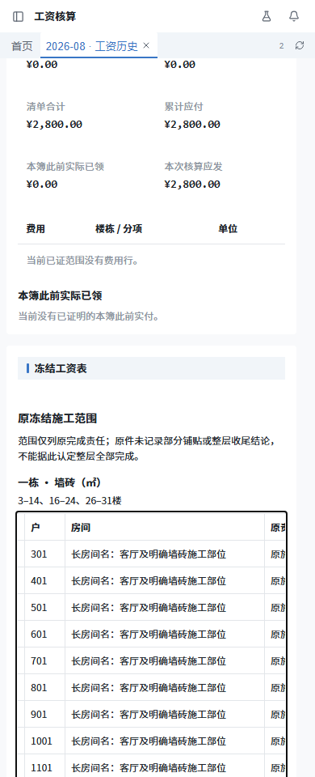
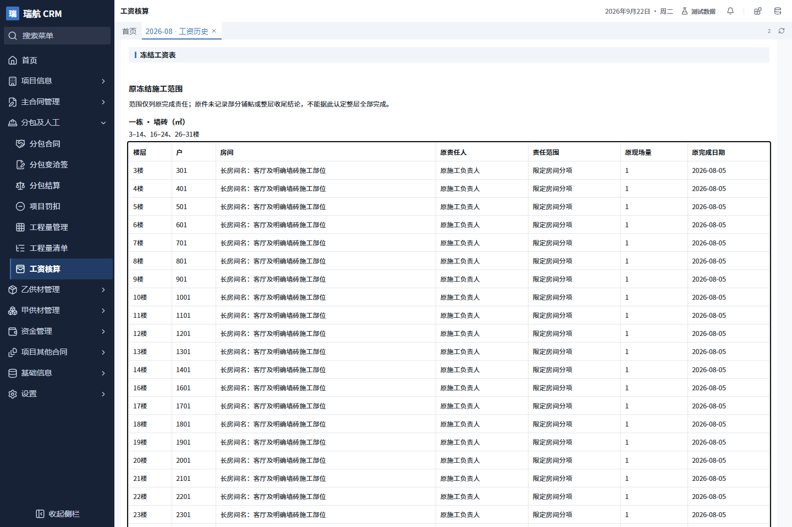
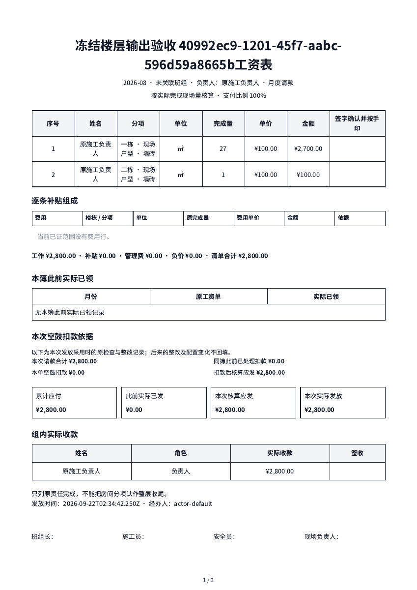
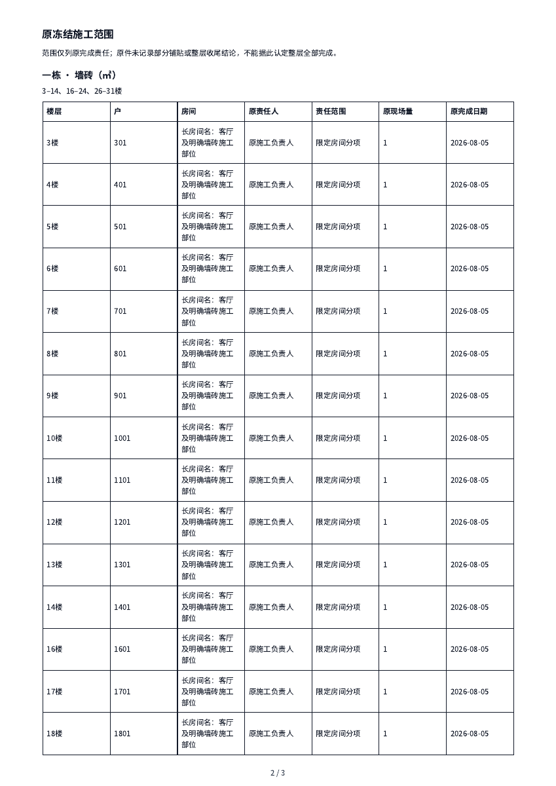
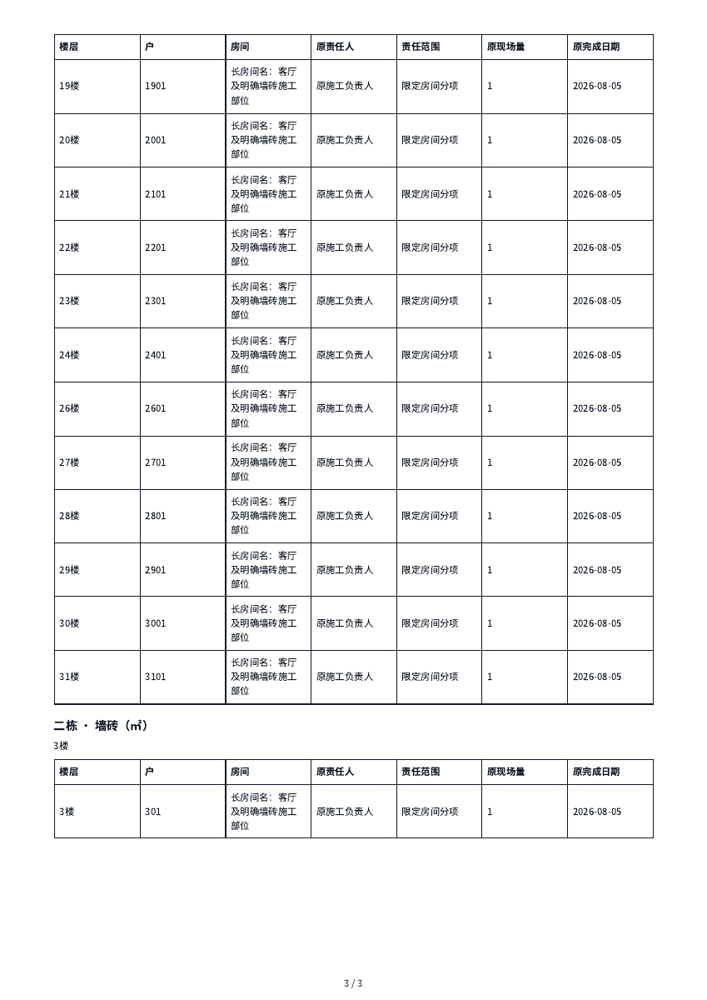

# #478 冻结施工范围输出

2026-09-22，产品基线 `99d617bb275ee32bdd0e3bd158f6585c5e53e614`。本切片只补 A 已发原件的位置投影及输出，不改变工资命令、金额、权限、责任事实或生产持久化。

## 行为与依据

- 同一冻结投影供预览、Excel、打印和文件名使用；按稳定楼栋/分项/单位分组，原户、房间、责任、完成身份及日期完整保留。普通工资使用原工资行，管理费使用原费用组成；投影不能编辑。
- `3–14、16–24、26–31楼` 保留15/25断层，跨栋同层不合并；不明确层名、同名异身份保留原标签。没有部分铺贴或整层收尾证据时明确提示，不能从单个完成责任推出整层完成。
- 原工资量价金额及签字位置不动，明细附施工范围、追加原施工范围和缺口说明；原范围不能从当前工程量补齐。名称非法字符清理、长名截断、稳定原件标记消歧；标记只用于文件名，不替代原件摘要证明。

权威行为只维护于[工资页面](../../../rewrite/pages/subcontract-payroll.md#a-冻结施工范围输出478)和[Markdown 使用指南](../../../guides/payroll-attendance.md#十核对已发-a-工资的原施工范围)。正式编号与完整名册由 #477/#479 组合。

## 验证

- 新投影回归先因缺实现失败；定向4文件8项通过（6.78秒）。覆盖断层、同名不同层、跨分项/单位、未知日期/位置、超长非法及同名文件、实际 XLSX 回读。
- 真实公开工资服务分别发放普通1000、管理费300，再修改当前楼层/房间及现场量999；重读冻结文档、位置工作表及文件名保持一致，管理费用不借用普通工资行。
- 实际浏览器从真实 SQLite 合成来源受控迁入，经公开配置/新建/核对/发放命令形成两栋28条完成责任、原实发2800；冷重开、预览、真实下载及 XLSX 回读通过。390/768/1024/1280/1440均无整页横滚，390明细聚焦及方向键实际局部横滚通过，页面错误0。最终场景31.2秒、总33.6秒。
- 产品打印实际生成3页，逐页渲染检查：首张原金额和签字区完整；第二页显示区间和前段明细；第三页重复表头、31楼末行和二栋均完整，未裁切。PDF文本的兼容汉字/短横线仅在断言中规范化，产品原文不改。保留下面必要截图，临时PDF不作为文档交付。
- 先前测试中断及重复向同一实例迁入被既有迁移锁拒绝；最终使用重新启动的专用3131验证实例。未修改用户3100实例。
- 精确 ESLint、类型检查及差异检查通过。最终集成 SHA `0673dc44c5a3f1545df4d4901f79aef37255867b`（含 #477）完成全量汇总：810 文件/4420 项中 807 文件/4417 项通过，仅 3 项历史登记预期失败；修正后精准复验 3 文件/6 项通过，最终类型检查和生产构建退出 0。全量 worker 退出后主进程被停止，退出码 -1，因此不写成整轮 PASS。没有因登记预期变更重跑全部业务测试；完整边界见 [共用验收](../issue-477-official-numbering/README.md#验证边界)。
- 独立 Standards / Spec 审查通过：冻结纯投影、管理范围分离、金额不变、断层和缺证、名称消歧均符合 #478；审查不替代本次实际文件和视口检查。

## 运行证据

