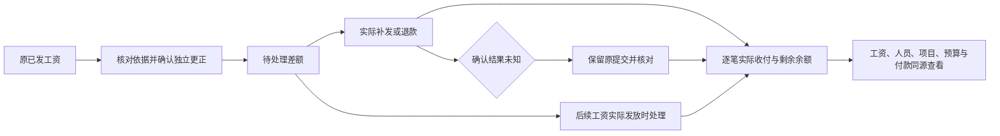

# 工资更正与实际收付

> 本指南沿用 [P4 已确认规则](../research/issue-review-2026-09-11/payroll-tickets/04-central-adjustments-and-actual-payments.md)。OPT-02 接入正式磁盘、原编号恢复与冷读；核算更正仍只产生待处理差额，真实补退另行确认，原签名与实际原发放均保留。

原工资怎样核算和发放，见[工资与考勤工作台](./payroll-attendance.md)。本流程处理已发 A、C1、C2 工资的核算错误及其后续收付，保留原工资、原成员和原签收金额。

## 1. 先确认核算差额

1. 从原已发工资详情选择“发起独立核算更正”，核对原项目、负责人、月份、格式、成员和原签收金额。历史证据不完整时先查看缺口，不能用今天的名册或费率补成原凭据。
2. 对照“更正前的完整依据”修改本次新依据。A 核对完成责任对应的量、价和比例；C1 核对逐日工时及个人标准；C2 核对原签工和主体单价。系统按新旧依据计算差额，不能直接填写一个无依据的负数合计。
3. 填写更正原因和人工核对依据，点击“按当前资料核对本稿”，查看更正前、后核算及有符号差额。
4. 保存更正草稿，再明确确认核算更正。草稿没有处理效力；确认后保留该次依据，需要再纠错时从详情追加续更正。

确认核减 100 元，只表示待退或待抵扣 100 元。未真正退钱或在后续工资中处理前，原实际支出仍保留。

## 2. 登记确已发生的补发或退款

1. 在更正详情查看当前待处理差额，进入实际补退整页。
2. 明确选择补发或退款，填写真实发生日期、金额和人工核对依据。补发填正数，退款填负数。
3. 按真实情况填写原成员本次收付金额。未参与的人留空，确有零金额时填 0；分配方向与总额一致，合计精确到分。
4. 核对本次对各项原更正的处理金额。可以分次处理，合计须等于本次实额，且不能超过各项剩余额度。
5. 重新核对并确认实际收付。成功后查看独立确认记录及剩余额度，可打印或导出该次记录；原工资签字表保持原金额。

这里登记工资实际收付，不生成普通付款申请或银行支付记录，也不要求编造银行流水号。

## 3. 在后续工资中少发

建立并核对真实的后续工资后，在实际发放步骤选择要处理的原更正，明确填写本次有符号处理额，同时填写该工资真实发放额和全员分配。

只有后续工资真正确认发放，关联的待处理金额才结清。草稿、尚未发放或确认失败都不会提前扣掉余额。处理关系说明本次工资为何少发，不再生成第二笔退款。

| 操作 | 工资实际净支出 | 原更正剩余 |
| --- | ---: | ---: |
| 原工资已发 1000 元 | 1000 元 | — |
| 确认原工资核减 100 元 | 1000 元 | 待处理 100 元 |
| 实际退回 40 元 | 960 元 | 待处理 60 元 |
| 下月核算 1000 元，关联处理 60 元，实际发 940 元 | 1900 元 | 0 元 |

两张原工资的签收金额仍分别是 1000 和 940 元。A 的来源修订若已包含同一差额，会逐项核对包含关系；退款也不会重新增加一份可领额度。

## 4. 只有确认钱未发生，才登记错记冲销

从具体工资收付事实进入错记冲销，核对原事实并明确确认“原登记的收付实际没有发生”，填写核查日期和依据。系统保存独立反向记录、原引用及对应处理关系，原记录仍可追溯。

已经把钱付给工人、后来收回，属于实际退款。不能用错记冲销消除已经发生的支付。冲销本身又记错时，也须引用原记录追加纠错。

## 5. 查看各页面的同一笔钱

工资详情的更正历史分别显示核算差额、分次处理和实际事实。工资收付台账按项目查看逐笔原发放、补发、退款和错记冲销。

一笔收付涉及不同月份时，各原工资范围只计入登记给它的处理金额。例如八月已发 1000 元、九月已发 2000 元，合并退款 150 元并明确分为八月 40 元、九月 110 元，则各月净额为 960 元和 1890 元，全周期为 2850 元。范围明细会标明“按原工资范围计入”，点击收付名称可查看完整的 150 元原记录；需要核实错记冲销时，从完整详情继续。

两人共同退款但没有逐人逐月的分配记录时，各月退款总额仍可核对，个人范围金额显示未知。系统不会自动平摊，也不会用整笔个人退款代替某个月的个人退款。

工人、班组、项目的“工资实际收付”分区及付款管理中的工资分区读取同一来源。个人显示可证明的本人分配，班组按原归属核对；改名、转组或停用不会把旧事实改挂给当前名册。缺个人分配时说明未知，不能拿整张工资代替个人已收。

目标成本中的工人工资成本和已付指标读取工资有效实际净额，可进入工资收付台账，再返回原预算版本。核算更正和成员分配不会再次增加一份成本；其他成本来源未齐时，总成本仍会说明缺口。

## 6. 失败、重复提交与迁移

- 输入修改后重新核对；来源、权限或剩余额度变化时保留原稿，按当前资料重新检查。
- 确认结果未知或成功后读取失败时，保留同一次原提交并使用“核对原提交”，不要新建一笔补退。
- 两个窗口同时处理同一剩余额度时，过期的一次会被拒绝，不会重复清余额。
- 完整迁移保留原工资、更正、实际收付及回执原文，并以稳定身份核对。缺原凭据或关键处理引用时保留缺口，不能当作零或重新可退。
- 重复接管不覆盖日常修改；恢复旧批次会破坏后续事实时，先显示依赖并拒绝整批恢复。

## 7. 费用和管理簿的更正

新 A 费用单可在独立更正中查看原费项、原完成量及负价依据，修改允许更正的数量、单价与说明；不能换成另一费项、另一负价行或另一管理簿。原签字金额始终保留。具体建单与适用范围见[费用指南](./payroll-fees.md)。

普通施工工资和独立管理费各自补退、各自核对后月包含关系。同一人两种用途的更正不能合并成一笔处理。房补 130 更正为 100 时，差额为 -30；真实退回 30 后原签名不变，后月也不能重新领取这 30。当前来源若既不对应原值也不对应确认值，先显示无法证明的依据，不能仅比较总额后自动扣减。

户级空鼓原采用的处数、单处金额更正及 P6 验收状态见[空鼓指南](./payroll-hollow.md)。批量资金建议及整月/全周期工作簿由 P7 分别交付。
