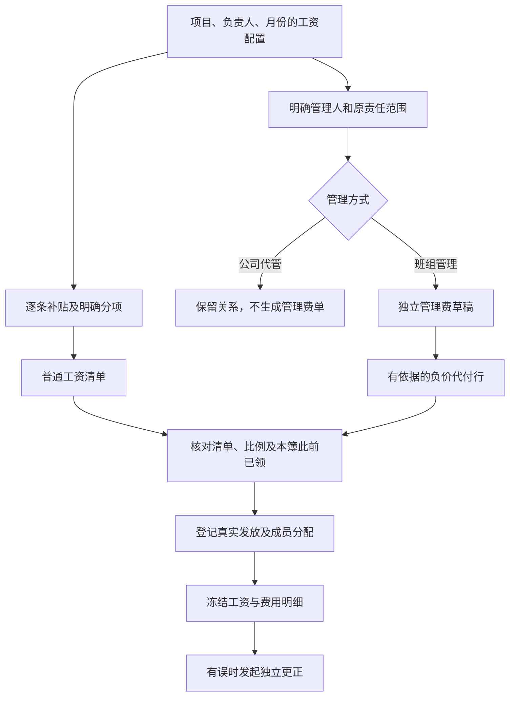

# 房补、其他补贴与独立管理费

> 规则见[工资页面第五节](../rewrite/pages/subcontract-payroll.md#五费用与独立管理簿p5)，额外取舍待 #472–#475 裁定。OPT-02 保全正式工资的费用修订、管理簿与冻结引用；新的 A 来源和新采用必须有真实上游，当前待 Q-OPT02-02 答复，下文新建步骤仍仅用于既有中央验证实例。部署另行验收。

本流程沿用 [A 工资的核对和实际发放](./payroll-attendance.md)。普通施工工资可以配置多条补贴；管理费使用管理人自己的独立请款簿，各自计算此前已领。管理人也领取普通工资时，两本单据仍分别核对。

## 1. 配置多条补贴

1. 从工资草稿或详情进入“工资配置”，核对项目、负责人和月份。在“项目主体费用与管理簿”选择普通施工工资。
2. 点击“新增费用”，填写名称，选择房补或其他补贴，明确启用状态、单价、单位和生效月份。每条补贴保留独立记录，两个补贴名称相同也不会自动合并；编辑完毕后统一点击“保存费用配置”。
3. 勾选真实分项，选择当前主体所选分项的已证完成，或逐个选择户内位置。未选择范围不会自动当成全项目；平方米、米、套不能混在同一基数中相加。
4. 房补可在确认所选墙砖、地砖及确认依据后采用 1.30 元/㎡。班组默认需明确采用才成为当前项目配置；未记录、空值和明确 0 分别显示，0 不会自动回填为 1.30。
5. 点击“保存费用配置”，统一保存本分区的新增、修订和待移除项；任一项未通过核验时都不会保存。修订、关闭和移除都会保留原记录；已发月份的本簿费用不能倒改，后续新月份可保存自己的修订。移除生效后，此前为该费用安排的未来修订也不再自动启用；移除未来配置不会提前改变其生效月之前的核算。

墙砖 100㎡、原工资价 36 元，房补单价 1.30 元时，普通工资为 3,600 元、房补为 130 元。若房补同时适用地砖 50㎡，房补为 195 元；再加一条仅墙砖适用的 0.20 元补贴，总补贴为 215 元。淋浴板的套数不会加入平方米基数。

## 2. 建立独立管理簿

1. 在同一配置页点击“新增班组管理范围”，选择真实管理人、生效月份和首月比例，填写管理关系确认依据。
2. 选择原施工责任及其明确细格，有相应查看权限时可点击“核对户内工程量”，查看原户内位置和原人员，再点击“返回原工资”回到原项目、月份、负责人、请款簿及未保存输入。管理人不必冒充施工执行人；原执行身份仍保留。
3. 保存管理关系，在“费用请款簿”切换到该独立管理簿，配置管理费的分项、完成量范围和非负费率。
4. 选择月度、结算或尾款档位，点击“生成或打开本期管理费草稿”。重复发起会定位已有合法草稿。月度比例按本管理簿沿用，结算和尾款遵循 A 原档位规则。
5. 普通工资和管理费各自核对、发放。同一人同月普通工资已领 1,000 元，不会从管理费的此前已领中扣除。

公司代管使用“新增公司代管范围”保存明确关系，该范围不生成管理费单。原已发管理记录继续保留。换管理人需另建管理簿；原已领及原责任的领取归属不会随改名、换月份、退款或软删而释放。

## 3. 录入负价代付清单

1. 从管理费草稿进入“编辑工资草稿”，在“负价代付清单”新增一行。
2. 填写名称、数量、单位和负单价，选择对应原责任细格，并填写具体事由与经办确认依据。30 套淋浴板应选择对应淋浴板位置；未完工位置可以作为依据，无需先标成已完成。
3. 已有对应真实收付时，可读取可关联的已有实际收付并选择已证记录。关联只保存原事实引用；未关联时明确显示“未关联实际收付”，不会自动生成另一笔现金或结清余额。
4. 先“保存负价清单”，再重新核对工资。未保存负价输入会阻止直接核对、发放或无提示离开；修改或移除未发负价行会追加修订。

管理费原清单 1,500 元，负价行 30 套 × -20 元 = -600 元，先得清单 900 元，再按 80% 得 720 元，扣本管理簿此前实际已领 200 元，本次核算为 **520 元**。负价不在比例后再次扣除。

## 4. 核对、发放与冻结

核对时分别查看工作金额、补贴、管理费、负价行、清单合计、比例、本簿逐期已领与本次应发。只有真实完成量进入正向费用；历史负价仍沿原行进入本簿后月累计，不能因为换月而重新可领。

确认实际发放时填写真实总额和成员分配，零收款成员保留 0，分配合计须一致。取消确认会保留已填金额并回到原按钮。若配置、责任、量价、此前收付或权限在提交期间变化，先保留输入并重新核对。

已发后可下载和打印冻结工资表。Excel 包含费用组成、原量依据、负价清单、本簿此前实际已领和费用冻结汇总；普通工资与管理费各自保留原实际金额及签字内容。完整月份或全周期整册工作簿由 P7 另行验收。

## 5. 失败恢复与已发更正

提示“原提交尚未确认”时，使用“核对原提交”，系统沿原编号核实结果。成功后读取失败也保留原稿和原提交，不能另建一份重复工资或费用配置。切换页签、取消关闭和来源返回都会保留对应原稿；重新采用当前资料需要明确操作。

已发金额或费用依据有误时，从原单进入[工资更正与实际收付](./payroll-adjustments.md)。费用更正保留原簿、费项、责任、负价原行及原签字金额，只核对允许修改的量价与依据。普通簿和管理簿不能合并补退，后月已经包含的差额只处理一次，退款不会重新开放原金额领取。

按人固定额、按月固定额、金额百分比等额外基数，以及跨主体代付清偿和管理权交接时的未领转移，仍需具体业务裁定。本页提供的明确分项与责任范围可独立使用，不自动推定这些额外政策。
