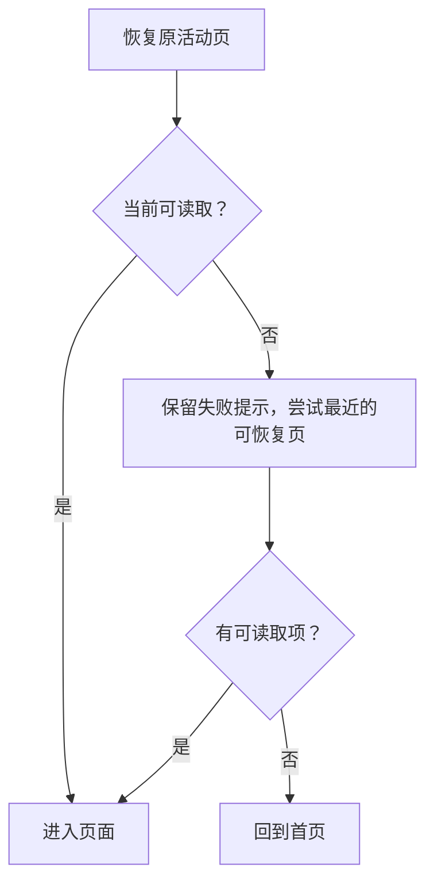

## 一、当前已可用

浏览器按用户和工作区记住已登记的列表、工作台及可读取的只读详情。首页固定保留，最多另开 15 个业务页签；后台页签先恢复位置，点击后才读取内容。

## 二、两种刷新的区别

| 操作 | 结果 |
| --- | --- |
| 页签栏“刷新当前页” | 重新加载当前页面，保留其他页签和其中尚未保存的输入 |
| 浏览器刷新或关闭后重新打开 | 恢复可读取的页签位置，不恢复未保存输入；关闭浏览器前先保存 |
| 在地址栏直接打开新的页面链接 | 优先打开本次指定页面，不被旧活动页覆盖 |

新建、编辑、导入映射和发票校对等写态不写入恢复记录；在这些页面刷新浏览器时，返回最近可恢复的只读页，没有则回首页。

| 未保存内容与并行编辑 | 处理方式 |
| --- | --- |
| 切换页签 | 当前会话保留表单输入 |
| 关闭或刷新当前表单 | 确认后执行；取消保留页面与输入 |
| 批量关闭页签 | 任一页面取消，本批全部保留 |
| 同时编辑 A、B 两条记录 | 各自保留身份与版本；切回 A 保存只更新 A |
| 版本冲突 | 明确选择保留本地内容或使用服务器最新版 |

草稿保护覆盖主数据、合同、甲方单据、财务与材料表单、送货单归档及新建工资草稿。独立编辑身份与版本已覆盖项目、客户、分供方、班组、工人及三类核心合同。

## 三、页签较多时

| 场景 | 操作或结果 |
| --- | --- |
| 页签超出可视宽度 | 横向滚动或用两侧按钮；活动项自动进入可视区域 |
| 打开操作菜单 | 右键或聚焦后按 Shift+F10；Escape 关闭并返回原按钮 |
| 关闭当前、其他、左侧或右侧 | 按菜单所选范围关闭业务页签。已关闭项下次刷新不再恢复 |
| 关闭全部 | 关闭所有业务页签并回到固定首页。只打开一个业务页签时也可用 |
| 达到 15 项上限（不含首页） | 先关闭旧页再开新页 |
| 启动时旧记录超限 | 保留最近使用的 15 项；新直达链接需要位置时整理最早旧项并提示 |

## 四、恢复失败如何处理

恢复时重新核对身份、来源与权限，正式资料和已授权测试资料分别处理，旧名称不代替当前数据。

| 提示 | 可采取的操作 |
| --- | --- |
| 原记录已不存在 | 确认记录是否已删除；可关闭原页签 |
| 当前没有查看权限 | 权限恢复后点击“重试恢复”，或关闭页签 |
| 页签身份或来源与当前记录不一致 | 从当前列表重新进入正确记录 |
| 该详情的只读恢复尚未接入 | 从业务列表按当前流程重新进入，也可关闭旧页签 |
| 原页签恢复上下文已失效 | 从当前列表重新进入 |
| 读取失败，可重试或关闭页签 | 网络恢复后点击“重试恢复” |

失败提示提供“重试恢复”和“关闭页签”；重试仍核验当前权限。也可从列表或关系入口直接重开同一记录，无需先关旧页：成功后清除旧提示，取消则保留。读取中切换页签，以新选择为准，旧响应不会切回页面。

旧记录整理提示可关闭；浏览器无法保存位置或暂时读不到会话时会单独提示，仍可使用当前页面。

## 五、已定稿待开发与适用范围

本指南描述上述版本的浏览器行为。部分详情尚缺只读恢复入口；全域后台订阅暂停及完整通知、洞察接入仍待开发。

清除浏览器存储会清除页签位置。位置恢复不提供业务备份，也不证明生产部署、服务重启后的持久化或备份恢复已完成。

公共规则统一见[公共详情与交互契约](../rewrite/PUBLIC-SURFACES.md#5-业务页签恢复与性能)。
