# DC 设计稿问题台账（2026-10-07）

> 临时评审材料：汇总本轮补齐 27 个待补设计界面时发现的视觉、组件与业务逻辑问题，供用户逐项裁定。裁定后按项转为 Issue 或直接在设计稿实施；本文不定义业务规则，规则权威仍以各文档为准。
>
> - 设计稿分支：`design/fill-pending-screens`（未提交）
> - 运行对比页：本地起服务后打开 `http://127.0.0.1:8710/.dc-review/proposal.html`（可交互，现状 vs 建议）
> - 红圈参照截图在 `红圈系统/`（含真实业务数据，已 gitignore，仅本地可看）
> - KitAtoms 原语问题已登记 [#496](https://github.com/zodea/crm-new/issues/496)，本文 C 组引用不重复

## 0. 总览

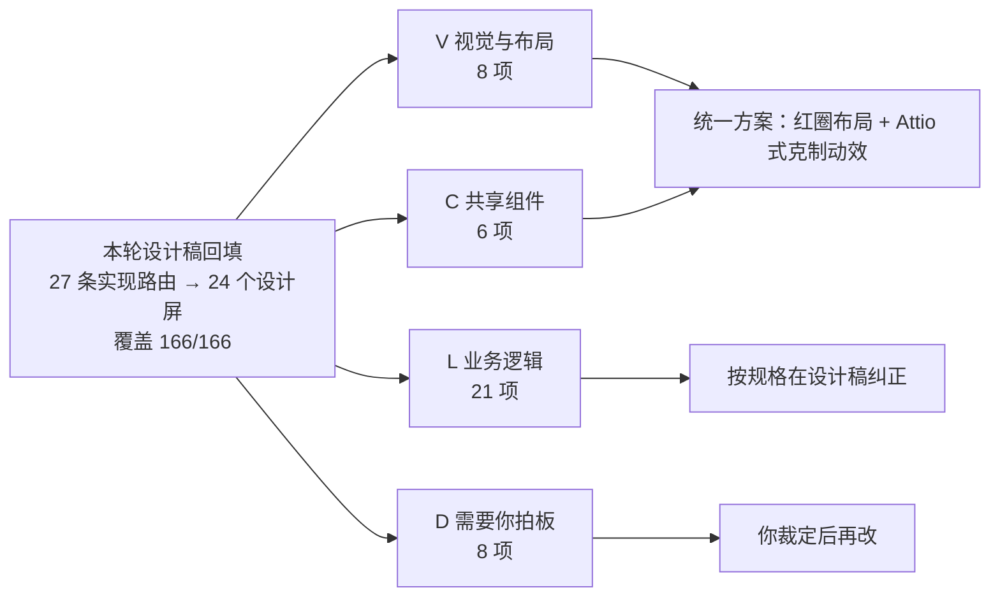

**怎么回复最快**：每条最后一列「决定」填 `改` / `不改` / `暂缓` / 其他说明即可；D 组需要你选方案。

| 状态说明 | 含义 |
|---|---|
| ✅ 已改 | 本轮已在设计稿改动（可在对比页或运行稿查看） |
| 🟡 待改 | 已有明确依据，你同意后即可改 |
| 🔴 待裁定 | 规则冲突或业务取舍，需要你决定 |

---

## 1. V 组：视觉与布局（布局按红圈，动效参考 Attio / Twenty）

### 1.1 列表页

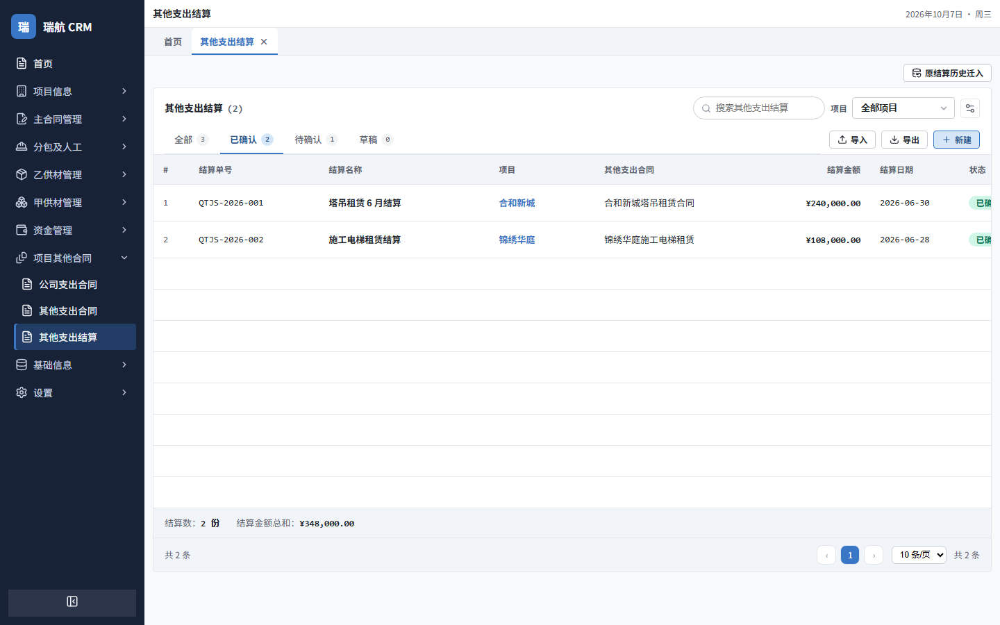

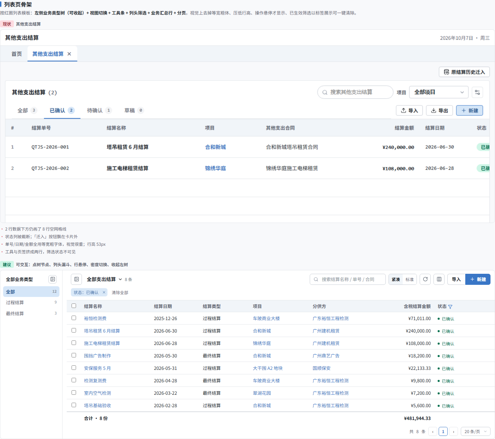

红圈参照：`红圈系统/11-项目其他合同/其他支出结算-列表页.png`

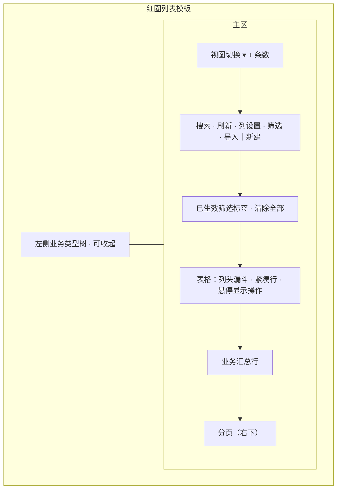

| ID | 问题 | 现状 | 建议 | 状态 | 决定 |
|---|---|---|---|---|---|
| V-01 | 空行网格 | KitTable 按每页条数补齐空行，2 行数据也画满 10 行网格 | 有几行画几行，下方留白；无数据只留表头 + 居中空态 | 🟡 |改 |
| V-02 | 字体过重 | 单号、日期、金额全用等宽粗体 | 正文用常规字重；金额右对齐 + 等宽数字（`tabular-nums`），不换字体 | 🟡 | 改|
| V-03 | 行高与密度 | 固定约 53px | 默认紧凑 36px（同红圈），可切「标准」44px | 🟡 | 同红圈|
| V-04 | 工具条结构 | 页签、筛选、按钮挤成两行；「迁入」按钮飘在卡片外 | 按红圈：视图切换 + 一行工具条，导入/新建合并为分段按钮，次要入口进「更多」 | 🟡 | 改|
| V-05 | 列截断 | 其他支出结算「状态」列被截在可视区外 | 表格自身区域横向滚动，首列与操作列固定 | 🟡 | 改|
| V-06 | 筛选不可见 | 筛选结果看不出生效条件 | 列头漏斗 + 筛选标签条，可单个移除 / 一键清除 | 🟡 | 改|

### 1.2 空表格与状态

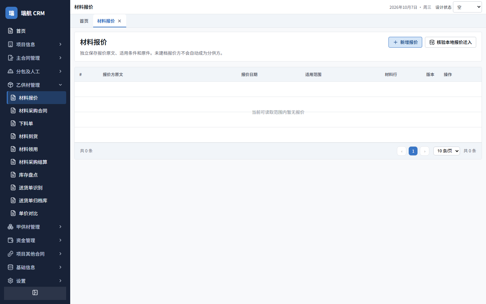

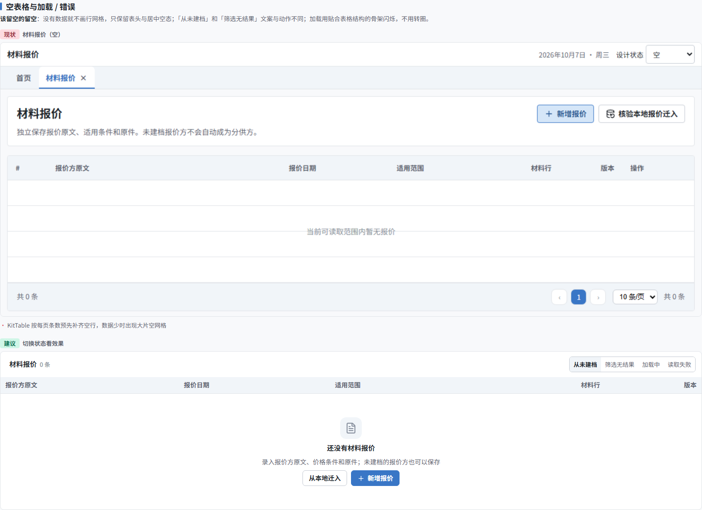

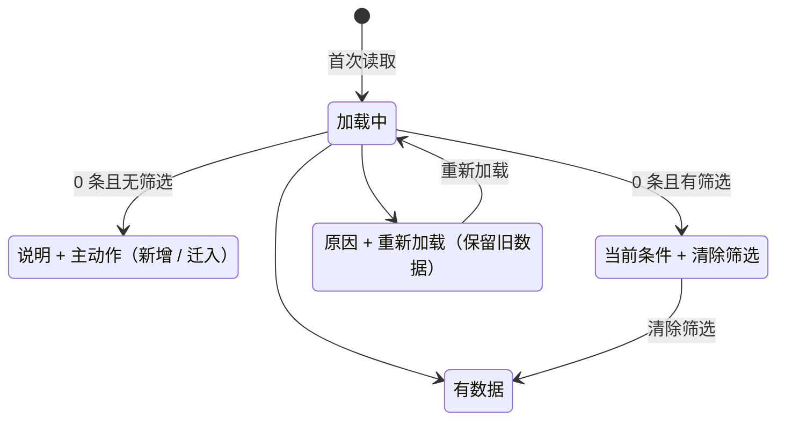

| ID | 问题 | 建议 | 状态 | 决定 |
|---|---|---|---|---|
| V-07 | 空态画网格、加载用转圈 | 不画行网格；加载用贴合表格结构的骨架闪烁；「从未建档」与「筛选无结果」文案和动作分开（规格 §09 已定，设计稿未落地） | 🟡 | 改|

### 1.3 输入框与选择框

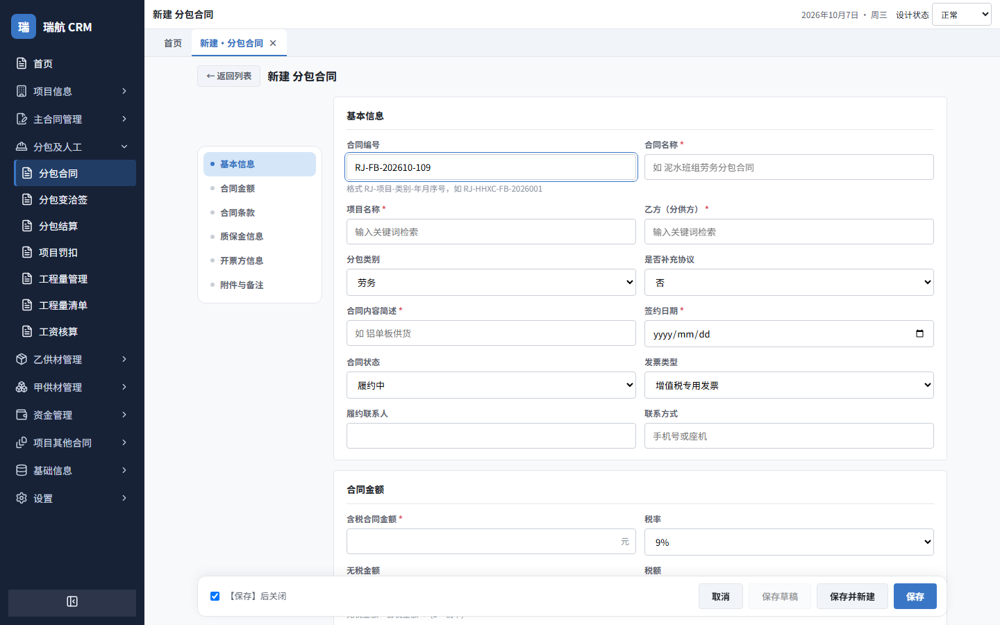

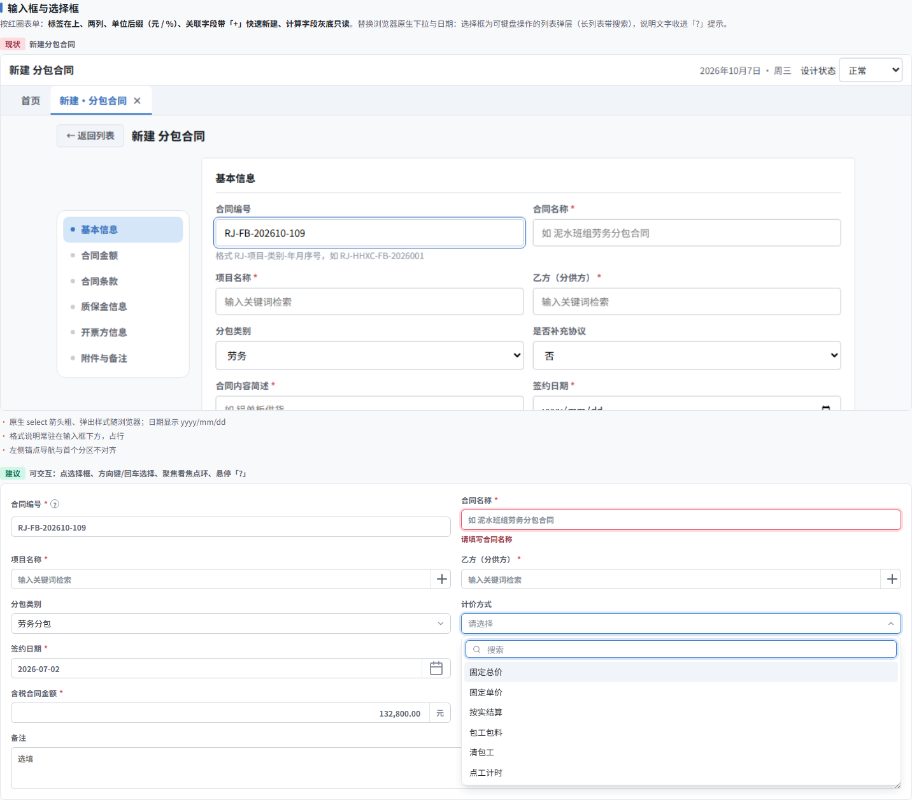

红圈参照：`红圈系统/07-分包及人工/分包合同-新建表单-劳务分包.png`

| ID | 问题 | 现状 | 建议 | 状态 | 决定 |
|---|---|---|---|---|---|
| V-08 | 原生控件 | select / date 用浏览器原生样式，日期显示 `yyyy/mm/dd`；考勤页项目/月份/班组下拉为空白 | 统一控件：选择框为列表弹层（键盘可操作，长列表带搜索、选中打勾）；日期带日历图标；单位后缀（元 / %）；关联字段带「+」快速新建；计算字段灰底只读；焦点环 3px 品牌浅色；错误态红框 + 下方提示 | 🟡 | 改，reka-ui是有对应的组件的，按他的来即可|
| V-09 | 常驻说明文字 | 格式说明、口径解释常驻在输入框下方或页头 | 收进标签旁「?」提示（鼠标、键盘、触摸都可打开）；校验错误、权限、未保存等必要反馈仍常驻（#404 已确认方向） | 🟡 | 说明的位置没有问题，但是校验错误导致了排版错位要解决。请填写合同名称这个校验就导致了输入框错位了|
| V-10 | 锚点导航错位 | 表单左侧锚点导航与首个分区不对齐 | 锚点导航顶部与首个分区对齐、吸顶 | 🟡 | |

### 1.4 详情页

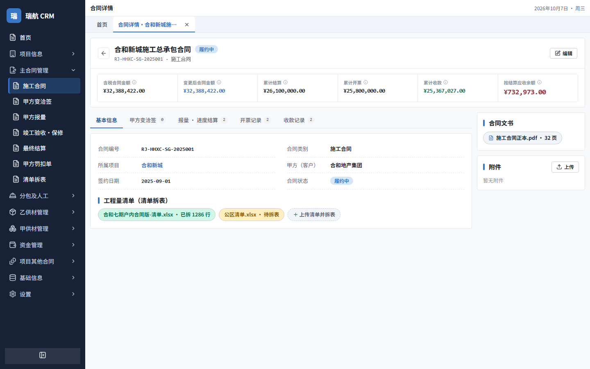

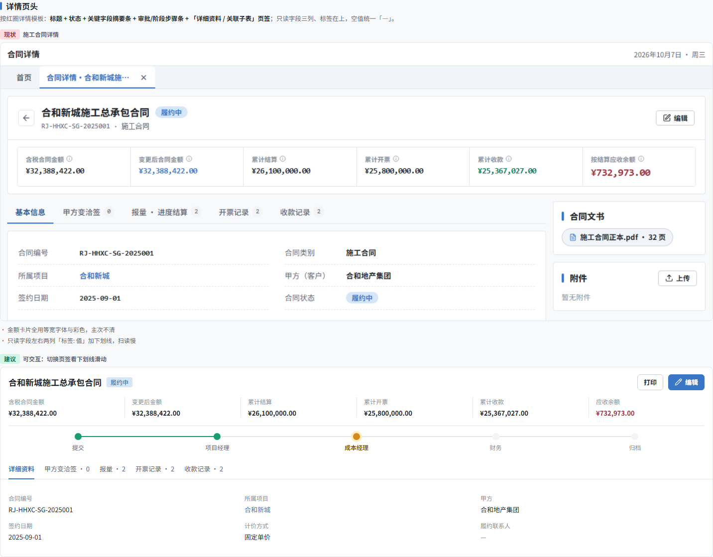

红圈参照：`红圈系统/07-分包及人工/分包合同-详情页.png`

| ID | 问题 | 建议 | 状态 | 决定 |
|---|---|---|---|---|
| V-11 | 摘要区主次不清 | 金额卡片全彩色等宽 → 一行摘要条，只有异常值（如应收余额）着色 | 🟡 | 改，目前没有审批流程，可以先不放审批流程框|
| V-12 | 只读字段扫读慢 | 「标签: 值」两列加下划线 → 标签在上、三列、空值统一「—」 | 🟡 | 改|

### 1.5 动效清单（可在对比页试）

| 场景 | 效果 | 时长 |
|---|---|---:|
| 行悬停 | 行底色淡入，操作按钮淡入（平时隐藏） | 100–120ms |
| 弹出层（选择框 / 筛选 / 菜单 / 提示） | 自上方 4px 渐显 + 0.98→1 缩放 | 140ms |
| 筛选标签 | 新增弹入，可单个移除 | 140ms |
| 页签切换 | 下划线滑动 | 200ms |
| 加载 | 骨架闪烁，不整页转圈 | 1.2s 循环 |
| 保存成功 | 右下轻提示上滑，3 秒消失 | 200ms |

全部遵守系统「减少动态效果」设置。

---

## 2. C 组：共享组件

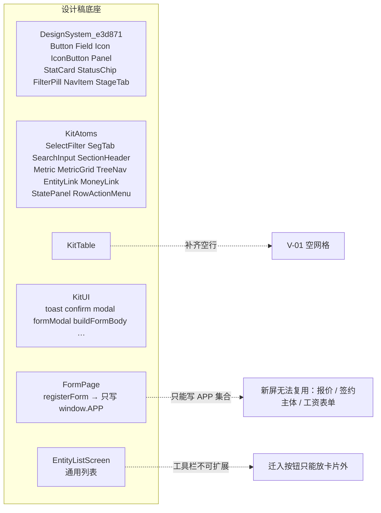

| ID | 组件 | 问题 | 建议 | 状态 | 决定 |
|---|---|---|---|---|---|
| C-01 | KitAtoms | 11 条缺陷与组件库重叠，见 #496 | 随 V 组统一方案一并处理；`Metric` 与 `StatCard` 合并、`RowActionMenu` 去留在 #496 裁定 | 🔴 | 我需要一个可以直接操作的组件部位可以查看效果后再做修改|
| C-02 | KitTable | 补齐空行（V-01）；无密度档；无列头筛选与筛选标签；操作列常驻 | 按 V-01~V-06 升级 KitTable，调用参数保持兼容 | 🟡 |升级后也提供一处可以查看组件的地方 |
| C-03 | 表单控件 | 设计系统缺 select / textarea / date 原语，`Field` 无隐藏标签模式；各屏借 `.dc-fields` 样式类 | 设计系统补「选择框 / 多行文本 / 日期 / 带后缀输入 / 关联选择」原语（V-08） | 🟡 | 大部分都是reka-ui已有的组件，按它有的提供做一下样式即可|
| C-04 | FormPage | 只能写 `window.APP` 集合；吸底固定五按钮；无自定义分区与分步动作（核对→草稿→确认） | 增加「自定义存储 + 自定义分区 + 自定义动作」扩展，报价 / 签约主体 / 工资 7 张自定义表单回收进 FormPage | 🔴 改组件契约 | 需要展示一下效果图，现在不够清晰你要改的方向|
| C-05 | EntityListScreen | 工具栏不可加按钮、通用「导入」不可关闭、无行打开详情配置 | 加 `toolbarExtra`、`importMode`、`onRowOpen` 配置 | 🔴 改组件契约 | 需要展示一下效果图，现在不够清晰你要改的方向|
| C-06 | 设计状态下拉 | 原只有 5 档 | ✅ 已加「结果未知 pending」档 | ✅ | 参考看红圈有哪些档位|

---

## 3. L 组：业务逻辑（按规格应纠正的）

### 3.1 工资：发放、更正与实际收付

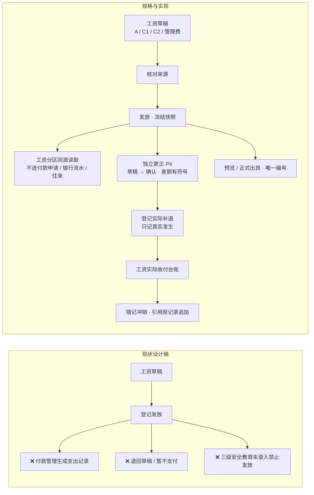

| ID | 位置 | 问题 | 依据 | 状态 | 决定 |
|---|---|---|---|---|---|
| L-01 | PayrollDetailScreen | 发放提示「付款管理已生成支出记录」 | subcontract-payroll.md §六；guides/payroll-adjustments.md §2 | 🟡 | 不够清晰，补充流程图和效果图|
| L-02 | PayrollDetailScreen | 「退回草稿」「暂不支付 / 恢复支付」实现状态机没有 | 实现 PayrollAStatementWorkspace | 🟡 | 不够清晰，补充流程图和效果图|
| L-03 | PayrollScreen / Detail | 「三级安全教育未录入禁止发放」「暂不支付 = 滚存」无规格依据 | 规格与实现均无 | 🔴 是否要这条业务规则 | 这个没有三级安全教育做一个提示。暂不支付的也还是需要保留，后续就不用重新计算了|
| L-04 | PayrollDetailScreen | 发放弹窗缺：分配合计 = 实际总额、零应发不可发、实发 ≤ 本次应发、后月应用 | §一.10、§六 | 🟡 | 不够清晰，补充流程图和效果图|
| L-05 | PayrollDetailScreen | 草稿也能看 A4 并导出 PDF | §一.12 只有证据完整的已发单可打印/导出 | 🟡 | 草稿可以看，但是打印调起前判断是否所有必填项都已经写入|
| L-06 | PayrollScreen | 建档弹窗可新建已退役 B「清单直报」；新建用弹窗而非整页 | §一.2；ADR 0014 | 🟡 | 根据最新的应该都是整页的，需要提供一下具体的文件路径|
| L-07 | PayrollScreen | C1 写「日薪逐人自设」 | §一.6 档案日薪优先、配置兜底 | 🟡 | 需要提供一下具体的文件路径|
| L-08 | PayrollScreen | 批量发放按「应领−已领」权重分摊再取整 | §八 P7（见下图） | 🟡 |需要提供一下具体的文件路径，现在的文件太多了，我也有在做文件优化。还有md文件是否看不到你说的mermaid格式，是否需要直接插入图片链接好点 |
| L-09 | PayrollDetailScreen | 已发详情缺「更正与逐次处理」区（入口已加按钮，区块未做） | §六 | 🟡 |不够清晰，补充流程图和效果图|

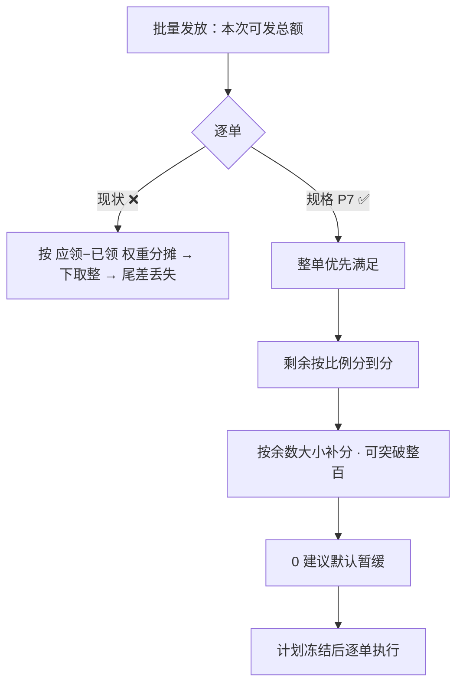

### 3.2 工资考勤

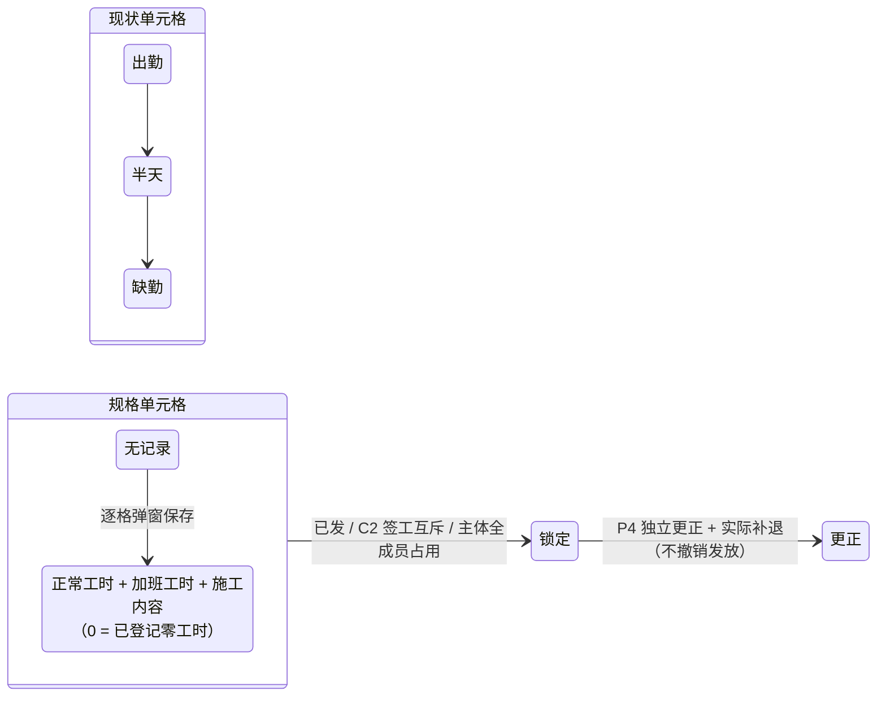

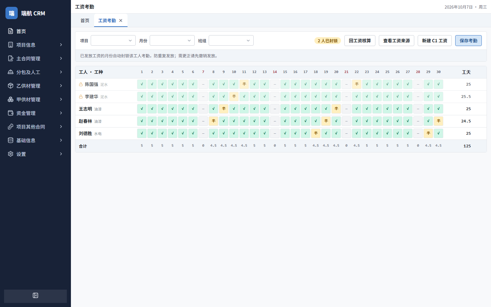

| ID | 问题 | 依据 | 状态 | 决定 |
|---|---|---|---|---|
| L-10 | 单元格是出勤/半天/缺勤三态 + 工天，应为正常工时 / 加班工时 / 施工内容，空 ≠ 0 | CentralAttendanceGrid.vue；§考勤.3 | 🟡 | 效果图我看了，对于部分班组打卡只是用于判断是否有上班。对于按真实上班时间计算的，这里就会涉及到上午，下午在勤，晚上加班多少小时，通过小时计算，而不只是半天一天的模式|
| L-11 | 提示「需更正请先撤销发放」 | 已发锁定，更正走 P4 | 🟡 |不够清晰，补充流程图和效果图 |
| L-12 | 全局「保存考勤」 vs 实现逐格保存；锁定原因缺 C2 签工互斥与全成员占用 | §考勤.5 | 🟡 | 不够清晰，补充流程图和效果图|
| L-13 | WageConfig 单价是全局分项，缺「负责人分项基准 + 个人例外 + 生效月份 + 修订」 | PayrollAConfigScreen | 🟡（新屏 payrollConfig 已按实现做，旧 WageConfig 待处理） |不够清晰，补充流程图和效果图 |

### 3.3 签工（✅ 已改，请确认）

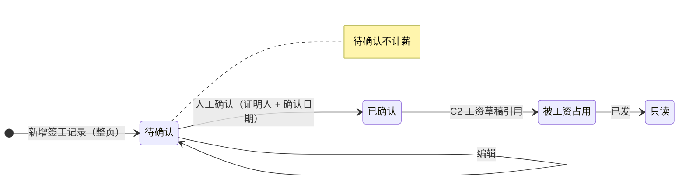

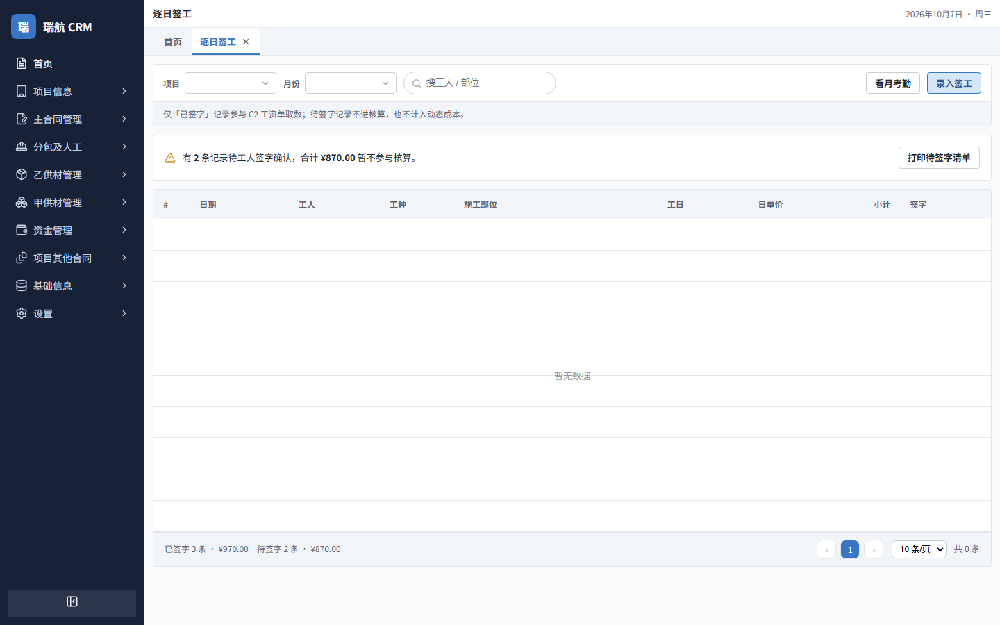

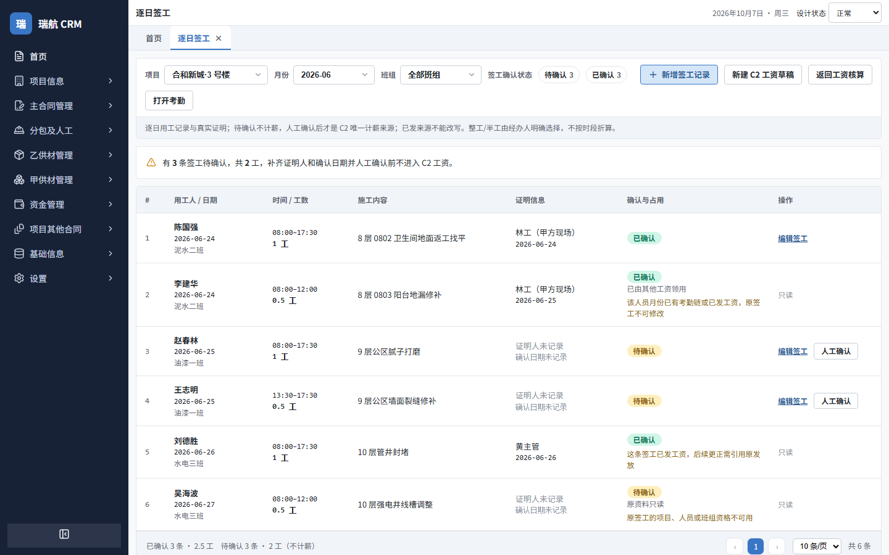

| ID | 内容 | 状态 | 决定 |
|---|---|---|---|
| L-14 | DayworkScreen 整屏按实现重写：已签字/待签字 → 待确认/已确认；去掉单价金额；新增整页编辑与人工确认；修复原表格参数错误导致的空表 | ✅（在「问题先登记」规则前完成） | 保留，但是界面的效果太差了，整个界面没看到多少东西，非常的冗余。需要你再看一下优化一下，如果一个界面只是用于展示清单页的，详情页可以新增一个界面，要按这个思路去优化 |
| L-15 | PAGE 标题「逐日签工 / 签字后方参与工资取数」应为「零星签工 / 待确认不计薪，人工确认后计薪」 | 🟡 | 按零星工时即可|

### 3.4 工程量户详情

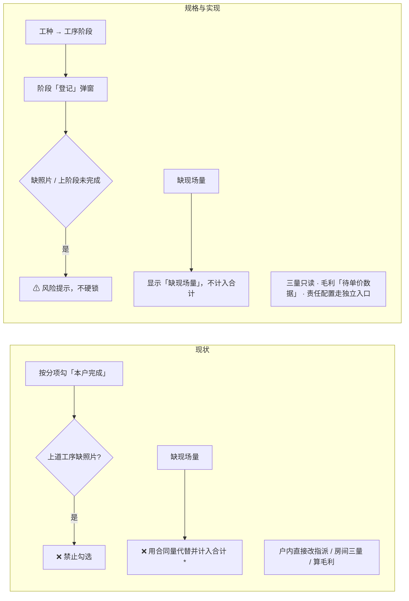

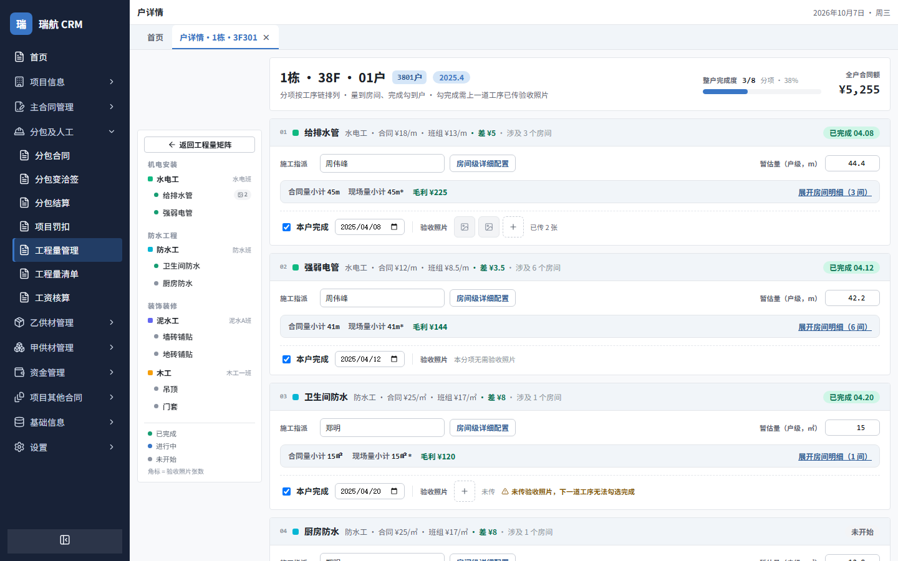

| ID | 问题 | 依据 | 状态 | 决定 |
|---|---|---|---|---|
| L-16 | 缺验收照片硬锁勾选完成 | subcontract-quantity.md §五 | 🟡 | 不够清晰，补充流程图和效果图|
| L-17 | 缺现场量静默回退合同量并计入合计 | §一 A 类、§六 读模型空值契约 | 🟡 | 不够清晰，补充流程图和效果图|
| L-18 | 整体结构与实现「工种→工序阶段→登记」不同 | §三、§四 | 🔴 建议整屏重设计 | 重新设计，还是有点太拥挤了，界面不够美观|

### 3.5 其他支出结算与单价对比

| ID | 位置 | 问题 | 依据 | 状态 | 决定 |
|---|---|---|---|---|---|
| L-19 | OtherSettleScreen | 缺「分供方」列；金额应为「含税结算金额」并带奖罚扣款、累计已付等投影列；默认视图「已确认」应为全部；搜索不含合同/分供方；点行无详情落点（实现已有 `/contract/other-settlement/:id`）；通用「导入」打开 Excel 映射而实现只有原库迁入 | contract-forms.md §二、AX05 | 🟡 | 不够清晰，补充流程图和效果图|
| L-20 | PriceScreen | 「价差对比」按 +5% 自动标红，规格与实现均无此阈值；单位/税费/运费条件未核实时不应输出价差 | material-management.md §三；ContractPriceTable.vue | 🟡 | 不够清晰，补充流程图和效果图|
| L-21 | PriceScreen | 数据来源只写「送货单识别」，实现是询价 / 合同约定价 / 实际送货价三来源 + 官方信息价；缺合同约定单价表、官方价格面板、趋势厂家 ≤ 4 | material-management.md §三 | 🟡 | 不够清晰，补充流程图和效果图|

---

## 4. D 组：需要你拍板

| ID | 问题 | 选项 | 决定 |
|---|---|---|---|
| D-01 | 清单月度报量状态：实现 `adjusted` 标「已申报」，core-contracts.md 写「草稿调整不推进申报/审定」，两处冲突 | A 以文档为准，实现改名「已调整」 / B 以实现为准，改文档 |月度报量需要流程，草稿和提交不同。提交了就是有推进，没有提交的就没有推进，按现实来 |
| D-02 | 清单拆表 BoqListScreen 与实现差异很大（三页签、列、逐行弹窗编辑、变更单状态类型） | A 按实现整屏重画 / B 保留设计稿的整表编辑与三量切换，反推实现 |我都需要你提供一下效果图，我好定夺用哪种 |
| D-03 | OCR 设置：设计稿多引擎 + 浏览器填密钥 + 可调阈值；实现单引擎 PaddleOCR 官方 API、Token 只在服务端 | A 按实现重画（下图右） / B 保留多引擎作为后续规划 | 目前PaddleOCR单引擎都够用了，用其他引擎要另外收费。配置还是需要有，可以调整识别的精度等，只是不用切换模型啥的|
| D-04 | 工人详情：设计稿五个页签、证书上传、三级安全教育、改指派，实现中央详情都没有 | A 删 / B 保留为待开发 | 根据红圈的对比一下，这个应该就是左侧有个小导航吧|
| D-05 | 单价对比：设计稿独有「项目汇总」视图和比价矩阵拆分/排除工具，实现没有；三处叫法（材料价格分析 / 单价对比 / 材料单价分析） | 保留哪些、统一叫什么 | 没找到项目汇总在哪里，不够清晰，补充流程图和效果图|
| D-06 | 三级安全教育是否作为发放拦截（L-03） | 要 / 不要 | 不要|
| D-07 | 签工整屏重写（L-14） | 保留 / 回退 | 要重写|
| D-08 | C-04 / C-05 共享组件契约扩展 | 同意 / 不同意 |同意，但不够清晰，补充流程图和效果图 |

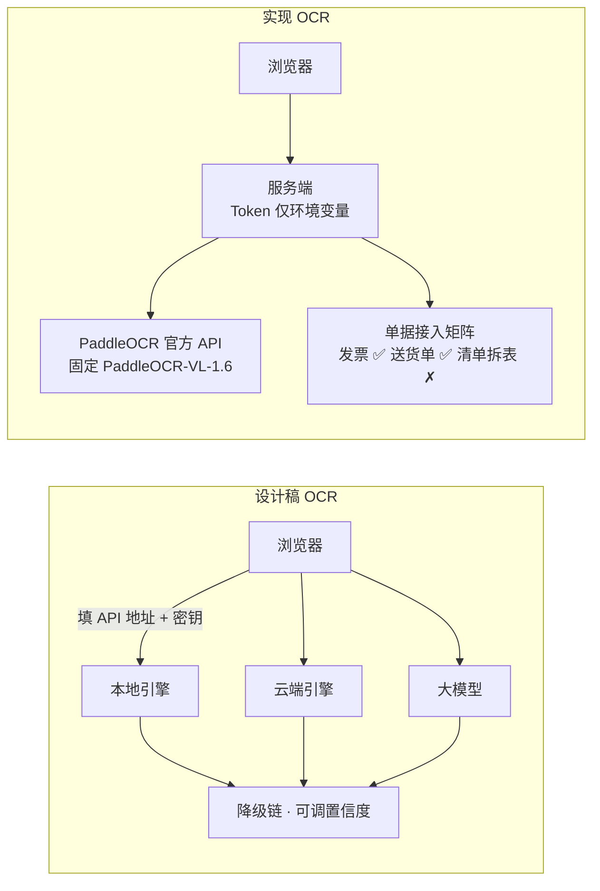

---

## 5. 本轮已完成的改动（供核对）

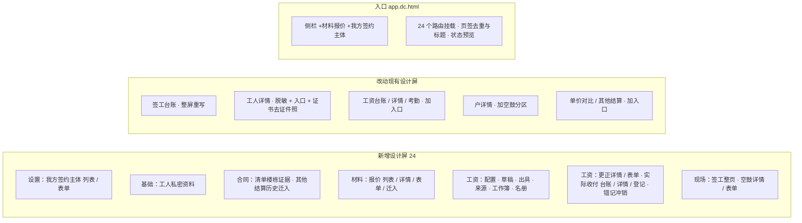

| 验证 | 结果 |
|---|---|
| 设计覆盖契约测试 `tests/ui/design-token-contract.test.ts` | 15/15 通过；覆盖 166/166，待补设计 0 |
| 浏览器冒烟（1440 宽，24 个新路由 + 6 个改动屏） | 无运行时报错、无整页横向溢出 |
| 未做 | 视觉方案落地前的多视口验收；V / L 组尚未实施 |
