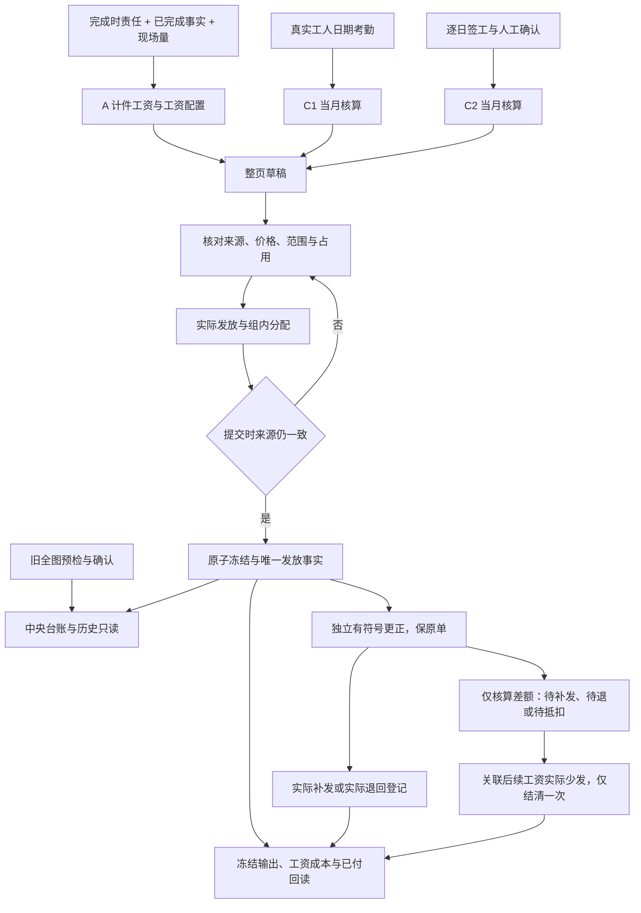

# 工资中央链实施规格草稿：来源、发放冻结与独立更正

> 非权威源，未发布、未创建实施票；2026-09-12 本地准备稿。当前承接为开放 [#412](https://github.com/zodea/crm-new/issues/412)。调查基线为 `ab056768ebf17dd3a2713bb6bc0df37dbb118ba6`，#445 同期独立验收，本稿不混入其完成结论。本次只读核对代码、文档与 Issue，没有运行工资浏览器、写业务数据或执行测试。
>
> 事实入口：[实施前事实核对](payroll-central-facts.md)。有效决定以 [#287 最终决议](https://github.com/zodea/crm-new/issues/287#issuecomment-5294862416)、#412 明确继承的 [#301](https://github.com/zodea/crm-new/issues/301)、[#350](https://github.com/zodea/crm-new/issues/350)、[#351](https://github.com/zodea/crm-new/issues/351)、[#352](https://github.com/zodea/crm-new/issues/352)、[#353](https://github.com/zodea/crm-new/issues/353)、[#354](https://github.com/zodea/crm-new/issues/354)及未被取代的 [#117 最终评论](https://github.com/zodea/crm-new/issues/117)为准。现行权威入口为[工资页面](../../rewrite/pages/subcontract-payroll.md)、[DATABASE](../../rewrite/DATABASE.md)、[术语](../../../CONTEXT.md)、[ADR 0010](../../adr/0010-quantity-matrix-and-construction-record-model.md)和[ADR 0020](../../adr/0020-browser-authority-and-demo-workspace-boundary.md)。本稿记录已可直接作出的实施判断，不重新询问上述已定决定。

## Problem Statement

2026-09-13 实施续记：P0 完整接管与中央历史只读已提交为 `1de44da2fdeb8091fb0e2cc2f3bcfd9794e07fc3`，范围见 [P0 实施票](payroll-tickets/00-central-history-and-sources.md)及[逐项证据](../../design/evidence/issue-412-payroll-history/README.md)。[P1 A 工资](payroll-tickets/01-central-a-payroll.md)正在本地实施；以下问题保留实施前基线，P1–P7 的日常核算、费用与完整工作簿不由 P0 的只读验收替代。

工资已有本地 A/C1/C2 草稿、核对、发放、分配、打印及考勤/签工入口，但正式浏览器仍直接使用本地数据库。工资全图没有受控中央迁移；来源变更、跨单据占用、恢复及实际发放也没有覆盖所有入口的中央原子边界。班组、工人和成本消费者尚不能据此回读同一中央工资事实。

A 新草稿仍允许暂估量，且该分支不要求完成施工；现场分支会漏掉全部为真实零的分项。A 单价初始零、C1 缺省费率零以及已发缺金额回填零，混淆了尚未配置、已知零和历史缺失。现有“调整原因”只有备注字段，无法完成原单冻结后的独立补差、扣回或冲销，更不能证明实际资金没有重复扣减。

## Solution

接管完整旧工资图，复用中央项目、班组、工人及工程量责任身份；三种来源均经同一工资 Repository、命令和事务生成、核对、发放并冷读冻结结果。实际工资成本、已付及成员收款解释消费同一来源，未发生的收付只显示待处理，不凭调整文字改变已付。保留现有页面和输出结构，按下列纵向切片完成，不把 API 存在或本地回归通过当作中央闭环。

## User Stories

1. 作为经办人，我希望在中央台账建立 A/C1/C2 工资，并通过刷新回读相同记录，以便确认数据已保存。
2. 作为已有本地数据的用户，我希望完整接管头、行、成员、分配、配置、考勤、签工、关联和已有快照，以便历史不会只剩一张工资头。
3. 作为历史数据核对人，我希望看到 B 类及缺关系、缺金额、缺分配的原值和隔离原因，以便不把它们自动解释成新的可发工资。
4. 作为 A 类经办人，我希望从工程量进入对应项目、月份和责任范围，只读取完成时的责任和现场量，以便未施工、暂估和合同量不能形成工资。
5. 作为核对人，我希望分辨现场量缺失、真实零、工资价格未配置和明确零价，以便系统不会代填金额或漏掉零数量行。
6. 作为 A 类经办人，我希望在工资域维护分项基准价及个人例外，明确生效月份并返回原单，以便改价只影响对应未发月份，不改旧快照。
7. 作为 C1 经办人，我希望从真实名册录入正常和加班工时，使用各人工资标准及明确兜底值，以便精度、零工时和空考勤都可核对。
8. 作为 C2 经办人，我希望先配置主体费率和规则，再登记及人工确认签工，以便只有已确认、尚未被其他有效工资占用的记录参与核算。
9. 作为经办人，我希望考勤、签工、工资与来源恢复共同检查同人同月互斥和占用，以便两个窗口或不同负责人不能重复计薪。
10. 作为核对人，我希望上游数量、完成、责任、价格、签工内容或成员改变后看到需重核，以便旧确认不能直接发放新事实。
11. 作为发放人，我希望确认实际金额并分配至负责人及全部成员，保留零分配且精确到分，以便个人核算参考不会被误当作第二笔支付。
12. 作为发放人，我希望重复提交、响应丢失、撤权或冲突后保留原提交和输入，以便核实结果时不重复发钱，也不会作用到新打开的工资单。
13. 作为已发工资查看人，我希望姓名、责任、量价、金额、规则及分配均来自当时快照，以便后续人员转组、资料删除或来源更正不会改写历史。
14. 作为更正经办人，我希望从原单建立独立补差、扣回或冲销，分别说明核算差额和已经发生的收付，以便待退金额不会被当成已经收回。
15. 作为跨月核对人，我希望将一次扣回明确关联至后续工资少发，或登记一次实际退回，以便同一差额不会同时从原月与下月再扣一次。
16. 作为成本查看人，我希望工资成本与已付直接定位到同一工资发放或实际更正来源，区分合同劳务和工资，以便原单、分配、付款展示和调整历史不会重复计费。
17. 作为现场经办人，我希望已定的房补、管理费、空鼓扣款与批量资金建议分别接入真实来源，以便核心工资接通后这些旧义务有明确后续，而不是消失。
18. 作为资料使用人，我希望从已发快照下载实际 XLSX、打印既定格式并回到来源范围，以便输出与页面核对一致，C2 不生成虚构考勤表。

## Implementation Decisions

### 来源、身份与已定排除

- 现场直接工资和合同劳务是互斥事实链。工资只接受其领域内可核验的责任、考勤和确认签工；不得从甲方 BOQ、劳务合同或结算生成，不新增合同/清单桥，也不按名称猜接直接用工关系。旧来源无法证明资格时保持可诊断隔离，不自动授予直接工资资格。
- A 以完成记录所存责任身份和当时个人细分范围追溯；责任替换、转组或离职不把旧施工量交给当前同名人。按稳定完成/责任/分项/范围去重；允许同一本请款簿在后续累计月再次展示其完成量，但不得由另一本簿将同一已计薪施工责任重新当作未付款事实。
- A 只接受截至工资月份末已完成的有效报工阶段与现场量；新草稿、重核和发放最终验证一致。阶段适用范围、个人范围或数量详情缺损须明确定位，不以查询少返回几行掩盖缺失，不回退暂估或当前同名模板。
- C1/C2 均只开放月度，C2 固定确认工数 100%。C1 沿已定日薪及加班算法和 100% 直付规则；A 月度比例属于单据参数，沿用同主体上月有效月度单据保存的比例（draft/checked 也算，released 取冻结比例），没有上月月度记录时采用明确首月配置。上月结算不覆盖月度比例；结算默认 95% 可改，尾款固定 100%，不恢复预排递增比例计划。
- B 退役永久有效：新建、改价、核对、发放、新工资输出及成本投影均拒绝；迁入保原状态、金额、来源和快照，不改 A/C1/C2、不静默删除。

### 数值与工资配置

| 输入或情形 | 必须呈现和处理 |
| --- | --- |
| A 相同分项现场量为 `8、null、0` | 显示已知 8、缺 1 项及可定位的真实零；整体来源不完整，不能核对通过或发放，不以 8 或 8+0 冒完整总量 |
| A 所有适用量均为真实 `0` | 保留适用事实及零数量行；不得变成“未施工/没有来源”；应发零不能执行发放 |
| 单位缺失或同分项存在不同单位 | 保留缺单位证据、按单位分组；不能以当前单位补历史，不把不同单位加成一个数量 |
| 工资单价未配置 | 显示待配置、定位工资配置入口；不能由默认零、BOQ 单价或演示值补齐 |
| 经办人明确录入零价 | 保留已知零及配置来源；按该类型合法性校验。不得把零改称缺值；当前 C2 单价须大于零的门禁保留，零应给明确字段错误，不静默接受 |
| C1 工人无档案日薪 | 使用经办人明确提供的该工资兜底费率；未提供仍为未配置。档案日薪为零不触发兜底 |
| C1 正常 7 小时、日薪 400、加班 1.5 小时、时薪 50 | 正常工资 350、加班 75；正常天数 `7/8` 和时薪中间值不先舍入。金额按既有行级规则落到分后汇总 |
| C1 无任何考勤与有一条零工时考勤 | 两者在来源证据上不同；真实零记录不凭空产生应发，但不能用“工时和大于零”冒充记录存在性。只有存在真实考勤才可生成，零应发仍禁止发放 |
| 历史已发缺实际金额/分配/完整快照 | 显示对应未知/历史未记录；不填零、不默认全部给负责人、不从当前源重建旧快照。成本/已付完整性同步反映缺口 |

A 工资配置由工资域承载，保留项目、责任主体、稳定分项、单位、适用范围、生效月份、基准或个人例外及修订审计。统一改与单独改复用 #117 D4 的已定入口，不复活已退役的班组项目价格幽灵表。已发月份只读；当月及以后未发单重新核对当前适用配置。C1 各人工资配置和可改加班时薪、C2 主体单价和规则文字都进入版本依据；不能把一个负责人费率静默广播给有各自配置的成员。

### 草稿、来源锁定与中央命令

1. 工资头、行、成员、来源关联和审计同事务保存；工人、班组、项目、责任范围和来源资格在服务器复验。单据仍按项目、负责人、月份、格式与档位保持有效唯一性；恢复也须重验。
2. C1/C2 同项目、同人员、同月份互斥。考勤保存、签工草稿/确认及状态更正、工资建单/重核、软删恢复均使用同一互斥窗口。C2 草稿签工虽不计薪，仍是既有考勤互斥依据，不能由降为草稿绕过。
3. 每条 C2 签工只归属一个有效工资单，不能靠换负责人、移月份、软删关联再恢复绕过。C1 同一考勤事实跨负责人亦不得重复结算；恢复旧工资或来源必须检查当前占用。C1/C2 发放后锁定负责人及所含成员的当月来源，补录通过独立更正完成。
4. A 累计应付按当前合法核算依据、档位比例及已实际发放重新核对，发放事务内再次读取此前已发，覆盖两个已核对单先后发放的情形。C1/C2 不减上月工资，按本月事实检查重复；不得套 A 累计公式。
5. 来源版本覆盖具体来源集合、稳定身份、内容、量价、规则、占用和工资自身修订，不只使用最大更新时间或合计。相同时间戳、相同金额但换责任、改签工内容、改证明人或换分项均失效。
6. 读取和确认明确项目、数据来源、工作区、操作者与能力；客户端提交固定预览/核对版本。服务器必须在最后一次异步等待之后、提交前复验身份、能力与关系。不能把新读取版本悄悄套到旧草稿。
7. 命令标识与正文指纹绑定，重放不重建头、行、来源锁、分配、发放或调整。结果未知时保存原标识与原正文；一般的过期、未找到或验证错误不能单独证明原命令未应用。只有可信未应用结果才释放原提交；成功后回读失败仍可查同一回执。
8. 工程量日常写、工资源核对/发放和全图迁移共用串行候选或等价原子协调器；持有队列时不能再调用普通入队读取造成自锁。其他中央主档不得在异步等待前冻结旧 Map 并覆盖其后日常修改。
9. 正式浏览器无本地回退、默认空态不种演示；显式演示沿既有授权只读适配，缓存、草稿与待确认命令按来源/身份/实体隔离。旧 Tauri 适配保边界，不冒称桌面交付。

### 发放冻结和实际分配

- 发放前必须已核对；正数实际发放不超过事务内当前可发金额，零应发及零实发不能用“发放”记账，暂不支付仍留未发状态。按分校验后再比较，不能先用未经规范化的浮点数判断合法。
- 实际分配包含负责人和全部成员，允许成员为零，整数分之和严格等于实发。核算行的工人工资参考、组内收款分配和付款管理展示不各生成一笔成本。
- 来源变更时拒发并持久保留需重核标记，不能抛异常回滚掉标记。人工重核展示新旧依据，不静默改原确认。
- 一次提交冻结责任及细分范围、来源记录与版本、数量及单位、工资配置与规则、比例、累计和此前已付、本次应发与实发、成员与分配、当时名称、操作者和时间。原始事实 ID 与显示名称同时保留；之后改名、转组、离职、删配置不重算旧单。
- 已发原单及确认更正不可原位编辑、删除或通过通用撤销恢复为可编辑草稿。当前业务可见性与冻结追溯分开；上游软删除不能令已发生工资无声消失，历史只读按权限说明来源已停用，成本仍保其有效事实。
- 冻结输出复用同一读模型。C2 只有签工记录表和工资表，不造考勤；缺旧分配继续显示未记录。工资表按手印和四方签名栏承载现行确认，不新增五级电子审批或第二张审批表。

### 独立有符号更正：核算与实际收付分别留证

沿 #287/#354，新更正必须有独立稳定 ID、原工资单引用、原因、操作者、时间、固定依据版本及有符号差额，保原快照。需区分以下事实，不由负号自动推断已经收回现金：

- **核算更正**说明少计、多计或错记了多少，得到待补发、待退或待在后续工资中抵扣的余额；没有实际收付时不改变“工资实际成本/已付”。这只是工资核对和待办余额，不引入新的会计应收账款产品。
- **实际补发/实际退回**登记本次已经发生的正/负金额、对应实际收款人或退款人及分配，形成唯一工资收付事实并关联更正与原单。成员金额之和精确等于该次有符号实额；不能将预计金额先标为已付/已退。
- **以后工资少发**必须关联被抵扣的更正和本次工资实发事实，结清对应待处理余额；本次工资成本和已付仍只取本次实发。原单更正不得同时再生成同额“实际退回”。这不是新增自动跨月扣款政策，只记录经办人已确认的实际处理，默认不自动执行。
- 同一更正的已补、已退及后续抵扣必须互斥或按尚未处理余额拆分，不能重复结清；并发、重试、重核和恢复均重验。原单列表、调整历史、成本页、付款展示使用同一来源类别和稳定事实 ID，不能每个展示入口再各登记一笔。

下列金额是实现必须通过的业务反例，不是新增税务、权责发生或会计分录规则。表中“实际成本”特指 #287 已定义的工资实际成本。

| 已有事实及本次处理 | 原单 | 工资实际成本 / 实付净额 | 待处理及禁止的双计 |
| --- | --- | --- | --- |
| 7 月已发 1000，查明多计 100，只确认核算更正 `-100`，尚未退款或抵扣 | 原实发仍 1000，原快照不改 | 仍为 1000 | 待退/待抵扣 100；不能马上把实际成本变成 900 |
| 上例后在 8 月核算 1000，明确关联该差额并实际少发 100，即实发 900 | 7 月仍 1000；8 月冻结核算和实发差异及关联 | 两月合计 1900 | 原差额已处理 100；不能再减原单 `-100` 变 1800，也不能再显示待退 100 |
| 上例改为工人实际退回 100，后续未抵扣 | 原单仍 1000，独立实际退款 `-100` | 净额 900 | 待退清零；以后工资不得再次少发同一 100 |
| 已发 1000，确认少计 100，仅建立补差 | 原单不改 | 实际补发前仍 1000；实际补发 100 后为 1100 | 待补发由 100 变 0；核算调整和实际补发不能各加 100 变 1200 |
| A 上游现场量已纠正，新的累计核算已自然减少 100，又存在同原因 `-100` 更正 | 历史快照保留；新核算标明已包含该次来源修订 | 仍由真正的实发/退款事实决定 | 同一次来源更正只能在核算依据中体现一次；不能在新累计量已减少后再叠加一次差额。退款也不能因只减“此前已付”而在下一张 A 单重新变成可领款 |

账务错记与实际退款亦须分辨：更正“重复登记了一笔未真实发生的付款”可冲销错误登记事实并保其链路，不能伪造工人退款。反之只发现核算多计而款项确已付出时，不可用账务冲销直接降低实付。页面须让经办人看见本次纠正的是哪类事实及其证据；不提供无来源的随意负数总额修改器。

### 全图迁移、删除与恢复

- 旧源范围包括工资主体配置、工资头、工资行、成员、分配、考勤、签工、工资—签工关联，以及源中真实存在的已发快照、审计和可识别附件引用；已软删和不再可维护的历史同样盘点。不能只导入当前可见行、只迁工资头或把快照中的旧 ID 留作当前可写身份。
- 项目、班组、工人、工程量责任和范围必须通过中央 ID 映射。已有历史 B、缺来源资格、悬空关系及结构损坏进入可诊断报告，保原值；无历史分配、缺实际金额或缺附件正文不以当前资料补造。
- 先完整预检候选，校验身份、单据唯一性、来源互斥、关联占用、金额分配和快照可解析性，再一次发布。原旧库不回写，确认后从普通工资列表、详情及历史报告冷读，而不是只能从迁移 SQL 检查。
- 重复确认同一批次保留接管后日常改价、考勤/签工、发放和独立调整；不得用旧快照重建覆盖。新阶段增加的配置、来源锁、工资收付及更正关系同步进入完整图保护。
- 草稿或来源的恢复重新检查当前项目/人员关系、唯一性和互斥；已发封锁不因软删链接、停用配置、改确认状态或删除父对象失效。历史读保全与当前写资格分开处理。
- 恢复旧备份若会删除日常新发放、更正、下游成本/资金事实，或令它们引用消失，必须整批拒绝且所有域状态不变。保护依赖可信命令审计、迁移所有权和实际关系，不能只比对可改的操作人显示名或日志文字。

## 纵向分期与依赖

下列是实施顺序建议，尚未发布子 Issue。每期包含领域、中央命令、真实 UI、旧图兼容、正常/边界/失败验证、独立提交及对应指南/PDF；不是先把后端做完再另开一张“接 UI”票。P0–P4 完成后也不能据此关闭保留 P5–P7 的工资总范围。

| 切片 | 可独立演示的闭环与最小验收 | 真实前置 | 对应义务 |
| --- | --- | --- | --- |
| P0 工资全图受控接管与中央只读 | 旧 A/C1/C2 三态及 B → 预检/隔离报告 → 确认 → 台账与完整详情冷读 → 重复确认 → 危险恢复拒绝；正式空态和演示隔离可见 | 当前中央项目/班组/工人；#442 责任与完成 ID 图。迁移协调接缝需与同期预算唯一作者协调 | WAGE-02、06、12；保留 WAGE-01/07 的本地证据，补中央适配 |
| P1 A 来源、工资配置到核对发放 | 完成/现场量入口 → 确切范围与缺量说明 → 基准价/个人例外 → 整页 A 草稿 → 重核 → 实发分配 → 冻结输出 → 原工程量/班组/工人往返；月度、结算、尾款各验一次 | P0；复用 #442 中央现场事实。共用发放/来源锁/回执基础在本期实际使用，不做空壳 | WAGE-03、06、08、09、11、12；#117 D1/D3/D4/D6/D7及比例决定 |
| P2 C1 真实考勤到工资发放 | 工人日期矩阵 → 工时及各人费率 → C1 草稿/重核 → 发放 → 当月考勤锁 → 冷读、真实工资/考勤输出；与迁入 C2 双向互斥 | P0、P1 的工资事务与冻结；中央工人日薪和身份。C1 不依赖 A 的施工量是否存在 | WAGE-04、06、07、09、11、12 |
| P3 C2 主体配置与确认签工到发放 | 主体费率/脚注 → 逐日整工/半工及人工确认 → 唯一工资来源 → 重核发放 → 锁签工 → 两种冻结输出；与当前中央 C1 双向并发互斥 | P0–P2 的共用工资及考勤互斥；不等待新的合同或 BOQ 关系 | WAGE-05、06、07、09、11、12 |
| P4 独立更正、实际收付与跨域核对 | 原已发单 → 带依据更正 → 待处理或真实补发/退款/后月少发 → 冷读追溯 → 工资实际成本/已付及班组/工人/项目同源；通过上节全部数值反例 | P1–P3 各格式冻结事实；目标成本预算中央读用于对比；实际劳务结算来源需使用其已接管能力。其他成本域缺源仍为 unknown，不阻塞工资来源明细 | WAGE-09、10、11、12；PRG-08/09/10 的工资部分，不代验其他成本域 |
| P5 房补与管理费独立核算 | 工资配置明确启用项/金额/基数 → A 分项房补（墙/地砖默认开，其他默认关）→ 管理人独立管理费单及明确负价代付行 → 核对实发 → 原完成范围与费用组成追溯；公司代管不生成管理费单 | P1 的分项、责任、单位与生效配置；P4 的 signed 组成/收付防重复约束。复用班组现有默认值但新增工资域项目/个人具体配置，不读幽灵关系 | #117 D8-3/4、核对④最终确认；归 #412 后续纵向票，不能以本地核心完成勾掉 |
| P6 户级空鼓记录到人工扣款 | 户/楼层/分项真实空鼓及整改销记 → 工资只读汇总/楼层高亮 → 进度月仅列示 → 人工开始扣款 → 按尚未整改数×当前配置价进入请款合计后、取整前 → 发放冻结与后续更正；离职未整改只提示 | #442 的真实户/完成范围、中央名册离职事实，P1/P4。当前工程量领域未找到可用空鼓事实入口，须在本切片先补最小户级记录与整改，不冒用项目罚扣单；与 #410 既有扣罚核对只做防重复及真实来源衔接 | #117 D5/D8-1/2、核对⑥/⑨；已废“暂扣→返还”不恢复，归 #412 明确承接 |
| P7 批量资金建议与完整工作簿 | 项目/月选择多本可发工资 → 输入真实资金总额 → 按各簿当前未付应领权重建议、按既定取整规则处理、逐行可改 → 逐单确认实发/分配并展示批次每项确定结果 → 冷读对账/下载；同批重试不再发已成功项。公式应付总额与实际支付总额分列核对；负责人全周期工作簿与按月工作簿分别验收，详见下文 | P1–P6 的当前应领、实际已付、费用组成与逐单幂等。取整配置、名册入退场/附件和工资输出格式依 #117/#407 真实来源接入；无效或零分母不能伪造分摊 | #117 核对⑧、D2/D8-5/6/8/9/10、D9，跨格式输出与工资总范围最终联验 |

P5–P7 是对 #117 仍有效 A/C1/C2 决定的明确承接；#287 只取代 B 及其冲突来源，不撤销这些已确认能力。批量发放可复用逐单原子命令并逐项报告结果，不能以界面“一次点击”暗示整批都成功；任何尚未确认结果仍用该项原命令恢复。取整、房补或管理项只改变明确的核算组成，最终成本仍取实际发放一次。

P7 的工作簿验收必须覆盖 [#117](https://github.com/zodea/crm-new/issues/117) 的两项原义务，现有单张冻结单据导出不算完成：

1. **D8-9 应付与实付对账**：页面与导出同时呈现公式计算的应付总额、实际支付总额及差额；均能追溯到原工资组成与实际发放/收付事实。按该格式既定周期逐行与合计核对，不能用应付替换实付，也不能用批量资金建议值作为实际支付。
2. **D9 输出组织**：亚运城按负责人一册积累完整周期，包含月度与结算；未来印按月一册，并按月文件夹组织。各自从同一冻结工资与真实收付来源构建，下载后核对月份、负责人、结算页、明细及合计完整且不重复。不得用多份孤立单据冒充完整工作簿，也不得混用两种项目组织方式。

## 历史提案的明确去向

| 旧内容 | 裁定与去向 |
| --- | --- |
| A 月中按暂估生成、B 按合同清单生成、B 必须关联合同 | 被 #287 最终决议取代；P1 纠正 A，P0 隔离 B，不保留未来启用承诺 |
| 统一/个人工资改价、房补多条及分项适用、管理费单/负价代付、人工空鼓扣款 | #117 最终确认且 A/C1/C2 继续有效；分别进入 P1/P5/P6，不以现行代码尚无表当作需求取消 |
| 比例预排计划、每月空鼓暂扣再返还、独立工资进度款工具页、重复审批表 | #117 后续评论明确废除；不恢复。比例留单据级、工具能力分别归工资单/配置/批量发放，工资表签字栏作为现行确认载体 |
| 工人楼层可视化、在班/离职人数、名册登记和真实工作簿格式 | 保留到 P6/P7；P7 明确承接 #117 D8-9 的应付/实付对账及 D9 的全周期/按月两种工作簿组织。名册资料只引用 #407 的工人事实及文件，不另造人员系统 |
| “发放后自动在付款域生成支出记录”旧建议 | 按 #287 与现行术语修订为工资发放即支付事实，付款管理可投影/关联同一来源；不能再独立生成可重复计成本的付款金额，也不要求工人逐笔银行回单才能计已付 |
| C2 两天确认/逾期免费/虚报双扣文字 | 已定为可编辑确认规则脚注并冻结；没有自动处罚或自动改工资金额的采纳依据，不据文字创建处罚引擎 |
| C1 真实样本的“借支”字样 | 仅有样例描述不足以定义新增借支域或自动扣款来源；不伪造借支金额。若现有 #413 支付事实能明确提供该来源，按稳定事实核对和追溯；否则保留为缺源，不能从备注推算 |

## Testing Decisions

最高接缝为真实浏览器页面 → Repository → HTTP → 可重置中央实例 → 冷刷新/来源往返。先构造失败反例再修；旧本地测试是行为参考，不足以证明中央接管。

- **A 来源**：未完成且暂估非空不得生成；已完成 `8/null/0` 阻断并定位；全零保行；工资月份后完成不计入；相同阶段多个映射不倍增；责任替换、旧范围、同名人、跨项目、软删分项及损坏来源都不重接。
- **价与精度**：未配价与已知零分别返回；C1 档案价优先、明确兜底、独立加班时薪；微小工时变化即使同时间戳也使指纹变化；统一/个人价从指定月生效，旧已发不改。
- **来源互斥**：并发考勤与签工只能一方成功；C2 草稿/确认转换、跨负责人抢同记录、恢复已被占用记录、工资恢复、月锁涉及零分配成员都复验。用真实事务及最终行集合断言，不只测错误文案。
- **状态与发放**：两个先核对的累计 A 单随后发放重算已付；来源改变持久 needs-recheck；已发原单不能通过普通改价、删除、恢复或通用撤销变可写；C1/C2 已发源锁仍存在。
- **并发与未知结果**：确认等待期间改量/价/人员或撤权；成功但响应丢失后源又变化；同 ID 同正文重放及不同正文拒绝；切项目/来源/单据后迟到结果不覆盖新页面，异单恢复不自动完成当前单。
- **金额**：分配少一分、多一分、漏零成员、重复成员、跨单据成员拒绝；实发与成本只登记一次；上一节 5 组调整数值全部执行，覆盖分次处理、先退款再抵扣、重试和同一源更正已被 A 新累计包含。
- **迁移**：完整三态、旧 B、soft-delete、缺快照/分配/金额/附件、关系错配、旧身份原文保全；重复确认保日常变化；已发/更正/后续引用使危险恢复整批失败，SQL 和其他中央 Map 均未改变。
- **跨域**：真实工资单及实际更正 → 工人/班组/项目/目标成本/付款展示回读同一来源；B、草稿、checked、核算调整、组内分配不额外计成本；工资尚缺历史金额或其他成本域未接齐时明确部分/未知。
- **扩展纵向路径**：P5 房补适用项/关闭项/零及缺基数，管理代管与负价代付；P6 先记录/销记再扣款、并发整改与确认、已扣后更正；P7 零权重、超预算输入、取整余数、部分成功和响应丢失逐项恢复，不创造新的工资事实副本。
- **页面与文件**：保项目、月份、班组、工资状态及安全 returnTo；工程量额外保楼栋/户/分项实际范围。390/768/1024/1280/1440px 逐屏、表格局部横滚、键盘焦点、浮层、未保存草稿和只读权限；实际 XLSX 内容/样式回读及 PDF 逐页目检，不以输出函数返回对象代替下载验证。

各期冻结后由统一窗口执行所需定向、完整测试、类型/规范/构建及 Standards/Spec 独立复核。使用指南与 PDF、单票流程图/交互证据及全链图随每期状态更新；不得提前将本稿标作“当前可用”。

## Further Notes：实现入口与最小所有权

此处是已核实现定位，供开工分配文件，接口字面量尚未冻结；不要求复制旧函数缺陷。

| 唯一作者范围 | 已有入口与可复用接缝 | 要避免的冲突 |
| --- | --- | --- |
| 工资领域/后端/Repository/store | `app/lib/payroll/statements.ts` 的来源构造、核对与发放；`daywork.ts`、`attendance.ts`、`detail.ts`、`output.ts`、`export.ts`；`app/stores/payroll.ts`、`attendance.ts`、`signed-daywork.ts`、`payroll-statement-detail.ts` | 先冻最小 read/command DTO、固定来源版本、需要重核及未知结果协议；复用事务形态和纯计算，移除源默认零、A 暂估及手写可见范围问题，不再写另一套算法 |
| 全图迁移/数据库与跨域候选 | `app/lib/migration/core-contract.ts`、`core-local-source.ts`；`server/utils/core-migration-test-instance.ts`、`core-migration-preparation.ts`；`quantity-database.ts`、`quantity-test-instance.ts` 的同库队列与 prepare/commit/abort | 与预算迁移及 #445 共用文件必须单人维护。`withSchedule` 现有能力/查询含义是工程量/WBS，工资应暴露明确领域上下文接缝，不为工资读写强借排程权限；持锁时消费候选 SQL，不重新入队读工程量 |
| UI/交互/输出 | `app/components/payroll/`、`app/pages/subcontract/payroll/`、考勤/签工页面、`app/lib/payroll/navigation.ts`、相应 composable、真实浏览器测试 | 草稿、详情及来源返回分离身份；异步确认捕获原单快照；新主体/工资配置/调整用独立整页表单，确认与行级轻任务复用 KitUI |
| 来源投影与最终联验，由 Root 指定单人 | `server/utils/crew-worker-command-test-instance.ts` 提供中央人员/默认配置；`crew-worker-read-test-instance.ts` 当前正式工资事实未接入；`app/lib/project/cost-control.ts` 当前本地工资求和；预算 Repository、付款/结算既有中央来源；`app/plugins/repositories.ts` | 外部源先给受控只读 facts/版本，不让工资直接改人员或合同 Map。工资事实一份投影给多个消费者；当前本地成本查询未排 B，不能直接包成中央正确口径 |
| 文档与证据，由 Root 收口 | `CONTEXT.md`、`DATABASE.md`、工资及班组/工人/成本页面、`docs/guides/`、`output/pdf/`、现有覆盖账本 | 现行“三量可用于工资暂估”、页内 A 暂估及“单独配置尚无”的状态与最终实现同票纠正；术语/数据/页面各归自己的权威源，不把本草稿升级为第二份权威 |

当前重要代码反例位置：`statements.ts` 的 A 暂估分支、`HAVING` 去零、初始零价及 C1 `hasAttendance` 按正数判断；`detail.ts`/`output.ts` 对旧已发实际金额回填零；`daywork.ts` 的 C2 正价、双向互斥和发放源锁须移入共同中央事务；已有 `adjustmentReason` 不等于更正实体。相关本地 `tests/payroll/` 与 store 范围/迟到测试可复用意图，新增中央契约和真实浏览器反例才是接管证据。

## 未决清单与范围

本稿所覆盖已继承业务规则的**新增业务未决为 0**。工资调整与实收实付分离、跨月不双扣、恢复保护和缺值处理可由现有工资/支付事实及最终决议直接判断；数据库组织、版本哈希、串行窗口和 API 命名由实施者决定，不制造业务 grill。

P5–P7 的真实来源或局部配置尚不存在属于待实施前置，已经明确承接，不等于需求未定或允许搁置。若实施时发现与有效决定直接冲突的新事实，记录具体来源和最小冲突再处理，不能仅因难实现重新询问整个工资方案。

本稿不扩展税额及税务处理、人员账号/RBAC、多公司切换、完整电子审批、通用借支/会计应收系统、B 新建、合同清单工资桥、生产持久化/备份部署或新的处罚引擎。其他成本来源的接管、真实外部文件能力和上线关口分别保留原母票；工资各期完成不能代验这些范围。发布本稿和创建后续票仍需本次具体文稿授权，当前没有外发。
