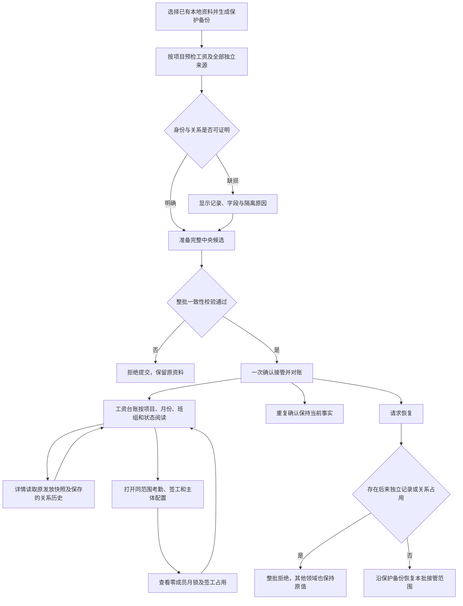

# 工资完整资料接管与中央历史只读

> 本地实施票，未发布到 GitHub。承接开放 [#412](https://github.com/zodea/crm-new/issues/412)，属于[工资实施规格](../payroll-central-spec-draft.md)的 P0。固定开工基线 `b64d52240cb4d229dc5458b4009d5a16a982bc3c`。本票是可验证工作范围，不是已经实现或上线的声明。

## 问题与目标

正式浏览器工资、考勤和签工还使用本地资料。已有受控迁移不包含工资完整关系；只迁工资头会漏掉没有工资单的项目配置、考勤及签工，重新序列化旧输出模型还会丢失发放快照字段。本票接通完整旧资料预检、确认、中央台账和来源阅读，保留原值、原快照、可证明关系和历史缺口。

## 用户路径

## 验收

- 使用经过真实迁移升级的合成 SQLite 来源，按项目保存工资头、行、成员、分配、主体配置、考勤、签工和签工关联八表；没有工资头的独立配置、考勤以及待确认/已确认签工也能迁入并通过普通来源页冷读。
- 原始工资图和 `snapshot_json` 全文不可变；已发资料不从当前人名、费率或来源补齐。快照中的月份、档位、比例、来源版本、配置规则以及未知扩展字段均保留。缺失、坏 JSON、部分字段及表与快照不一致分别可诊断。
- 旧 A/C1 缺少来源行 ID 时不按名称或汇总值猜接；B 类及损坏关系保留原状态、原金额和隔离原因，不转换格式，不给新核算资格。只接可证明归属的审计，不凭空生成工资附件。
- 实发空值和真实零分别呈现；旧分配缺失不解释为全给负责人；软删成员、行和关联可追溯。月锁由工资状态和全部相关成员决定，包括零分配、没有工资行或没有工时的成员；C2 另保留唯一签工占用。
- 预检和实际提交消费同一映射候选；与工程量、排程和预算复用同一工作区事务。重复确认不覆写后来更正；独立工资、来源、软删关系或可识别历史使危险恢复整批拒绝，不留下其他领域的部分回滚。
- 正式浏览器走中央只读 Repository，空态不种样例。无权、数据不存在、来源变化和读取失败给出明确反馈；同 ID 的演示资料不能替代正式资料，切页后的迟到响应不能覆盖新目标。
- 台账、详情与考勤/签工来源之间恢复项目、月份、班组和工资状态。失效的中央项目深链显示原因，不自动切换到另一项目；来源页的签工确认状态与工资状态分别保存。
- 390/768/1024/1280/1440px 检查实际画面、表格局部滚动、键盘焦点与浮层；归档逐屏交互图，更新工资和迁移指南并逐页检查 PDF。

## 分期边界与前置

当前中央项目、班组、工人及 #442 的工程量身份已经接通；预算完整迁移和事务接缝已在上述固定基线提交。本票不依赖新的业务裁定。

此阶段不开放浏览器新建、改价、核对、发放、考勤/签工修改或新打印/XLSX 生成；这些能力分别由 P1–P3 从相同中央来源接续。完整快照只读不等于新输出已验收。旧桌面本地适配保留既有边界，不宣称桌面中央交付。

工资更正和实际收付归 P4，房补管理费、空鼓扣款和批量资金/完整工作簿归 P5–P7；全部范围都继续承接，P0 通过不能关闭工资总范围或 #412。生产持久化、备份和部署仍归 #416。

## 验证与关闭条件

沿受控迁移、Repository/HTTP、store 和实际浏览器公开边界建立失败反例后修复；验证普通冷读结果，不以仅存在 API 或直接查表代替用户流程。固定源码范围后完成类型、定向检查、完整 `npm test`、构建和独立 Standards/Spec 复核，再精准提交。源码、现行页面/数据/读写契约、指南及图像证据在同一工作单元交付。外发仍等待具体文稿授权，本地实施继续。

## 本地冲突记录

2026-09-13 对照 #412、#287 最终决议和当前代码：旧工资蓝本及 V1.3 指南没有区分本地可操作与浏览器中央可用，并要求失效项目回落默认项目。中央读取需要稳定来源身份，因此本单元将浏览器失效深链改为明确不可用，旧桌面入口保留原适配；同时分开“当前只读接管”与“后续核算发放”的说明。该选择沿现行来源隔离契约，不是新增业务裁定。

同日重读 #287 最终决议与 #117 比例评论（`5015356993`），确认 A 暂估取数和固定 95% 结算的旧文案冲突。术语和页面现行规则已按明确决定修正；旧本地计算代码的差异仍由 P1 随 A 中央核算实现纠正，不因本次文档一致性修正或 P0 只读而冒称计算已完成。房补、管理费、空鼓和完整工作簿也改为明确后续义务，不再笼统称未定历史设想。此记录尚未外发，具体文稿授权仍待处理。
