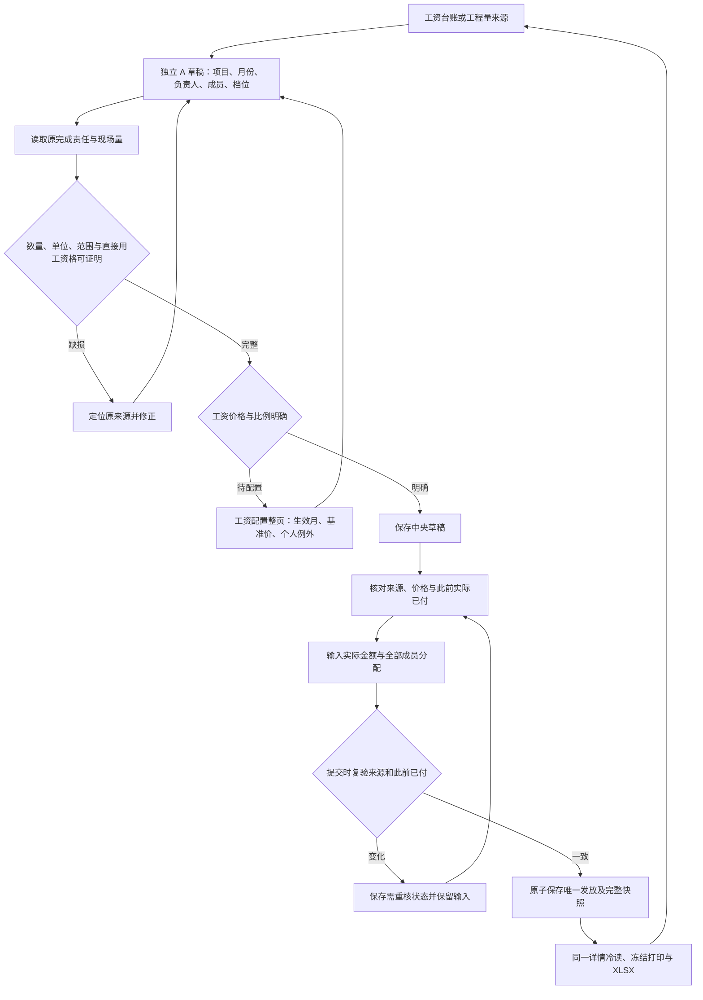

# P1：从已完成现场量到 A 工资核对、实发及冻结输出

> 本地实施票，尚未外发。承接开放 [#412](https://github.com/zodea/crm-new/issues/412)；完整分期及其他义务见[工资中央规格](../payroll-central-spec-draft.md)。本票不替代母票，也不把 P0 的历史接管扩称为日常工资已完成。

实施及独立复核基线固定为 `1de44da2fdeb8091fb0e2cc2f3bcfd9794e07fc3`，P0 正常提交检查为 600 文件、3697 项通过；其 89 个代码内容身份已逐项与该提交核对。

## 交付路径与依据

经办人从工资台账或工程量进入独立 A 草稿页，核对完成时责任与现场量；缺少明确比例或工资单价时进入工资配置，返回后继续原草稿。中央保存、核对和确认实际发放使用同一工资事实与当前来源，成功后冷刷新查看完整冻结结果，打印及下载真实 XLSX。

有效规则以 [#287 最终决议](https://github.com/zodea/crm-new/issues/287#issuecomment-5294862416)、[#117 比例决定](https://github.com/zodea/crm-new/issues/117#issuecomment-5015356993)、#412 明确继承的 #301/#351/#354，以及[工资页面](../../../rewrite/pages/subcontract-payroll.md)为准。P0 资料接管及隔离说明见[已验收证据](../../../design/evidence/issue-412-payroll-history/README.md)。A/B/C 本次只读重读现时 Issue，没有新增业务未决。

## 已作判断、影响与验证

| 判断 | 依据与影响 | 验证 |
| --- | --- | --- |
| A 只取已完成施工与现场量 | #287 明确取代暂估工资；保留工程量三量比较，移除暂估可发工资的旧说明 | 未完成暂估有值仍不得建单；8/null/0 不冒完整合计；全零保行 |
| 完成责任使用物理历史身份 | ADR 0010 和 #287；责任替换、转组或同名人不能重新分配旧量 | 原 assignment/scope/完成 ID 可追溯；跨项目及另一请款簿重复责任拒绝 |
| 工资配置与合同价分开 | #117 D4 与 #287；基准和个人例外从明确月份生效 | 缺价不默认 0，明确零保真；旧快照不随当前改价变化 |
| 首月比例必须有明确来源 | #117 比例决定；迁入时生成的默认 0.95 不是已配置事实 | 缺配置、明确 0、明确 0.95 分别读取；月度沿同主体上月有效月度单据保存的比例，draft/checked 也可作为来源，released 取冻结比例；上月结算不能覆盖月度比例，无上月月度记录才使用主体首月配置。结算默认 95% 可改，尾款固定 100% |
| 发放重新核对真实已付 | 已定累计公式与 #287 防双计；前一笔实际少发按实际金额累计 | 两张预先核对单先后发放，第二张重新核对；历史实发未知不能默认为 0 |
| 需重核是持久结果 | 来源变更不能被事务抛错撤销；不自动将新来源套进旧确认 | 返回后冷读仍需重核，金额输入保留；再次明确核对才能继续 |
| 结果未知恢复原提交 | 复用当前 command/receipt 规则，不另造离线队列 | 丢响应后源改变、撤权、换单、缓存页签均不能新键重发；同键异文拒绝 |
| 新 A 输出只消费完整冻结 | P0 历史原文不证明新来源资格；已发不可普通编辑/删除绕过 | 缺源、B 和坏快照仍只读；实际下载与页面金额、全成员含零一致 |

## 实施边界与所有权

- A：工资 DTO、配置与核算、读写 Repository、服务/事务、命令回执、工资 store、冻结输出适配及其行为测试。先冻结公共合同再接 UI。
- B：同一事务内量事实与原责任诊断、中央名册明确比例来源、原配置迁入保全，以及完整恢复的后续配置/来源/发放/回执保护。不得再次入队读取造成自锁。
- C：独立草稿与配置、来源核对、受控实发确认、冻结打印/XLSX与量/户/人/组往返；原单目标、读取版本、输入和待确认命令分别保全。新建复用 `/subcontract/payroll/new`，编辑使用专属 `/subcontract/payroll/form/:id`，覆盖原商务通配的 404；不将新建与编辑身份混在 query 中。
- Root：独立数值和并发反例、权威数据/页面/命令文档、旧义务账本、指南/PDF、逐票和总图、独立审查与精确提交。

临时文件仅在 `.tmp/remaining-issues-20260910/payroll-a-central/` 各自子目录；不推送、不部署、不调用云 CI，不外发本票。

## 最小充分验收

最高验收入口为真实页面 → Repository → HTTP → 中央事务 → 冷读与返回；领域计算通过公开核算/命令接口验证，预期来自独立算例。使用现有隔离合成数据，不触碰业务原库。

1. 无数据不要求迁移、不种演示；有旧资料先完整接管，B/不可证明的旧来源保持隔离。
2. 未完成、晚于工资月完成、缺责任/范围/单位/现场量、不同单位和重复映射逐项验证；真实零保留，缺一项整单不能核对通过。
3. 原显式比例、统一改价和个人例外按生效月取值；配置来回不丢草稿；已发月份与旧快照不被改写。
4. 中央保存、核对、实际分配到分、零成员与总额一致；核算 1000、实际发放 900 时已付只增加 900，不能因成员分配再加一次。
5. 两张已核对单依次发放、相同时间/合计却换源、提交前撤权、同键重放/异文、响应丢失和读回失败全部复验。
6. 配置/迁入重复后保留新日常修改；已有新配置、来源、回执或独立发放时危险恢复整批拒绝，不留下半批结果。
7. 列表、详情、配置、草稿、量来源、工人/班组与实际输出统一身份；按 390/768/1024/1280/1440px 验证局部横滚、焦点、浮层及长内容。
8. 实际 XLSX 下载后回读各表与金额，打印内容和使用指南 PDF 逐页检查。更新单票正常/异常流程及完整总览，实测图与交互示意明确区分。

本票完成后 C1、C2、独立更正/实际补退与成本投影、房补管理费、空鼓人工扣款、批量资金建议及完整工作簿分别继续 P2–P7，不在此提前关闭。生产保存及备份部署仍由 #416 承接。
