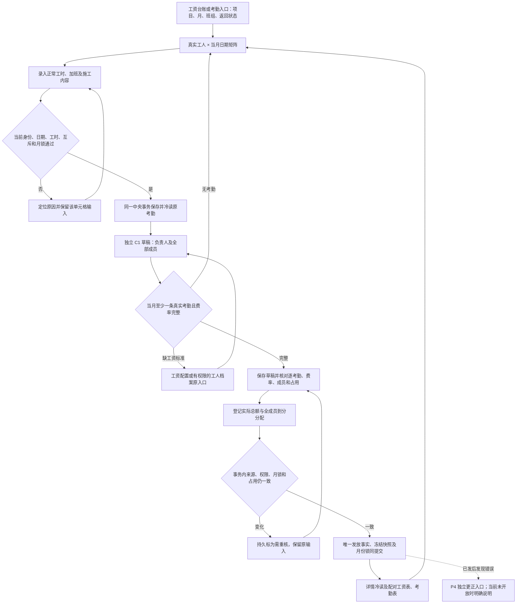

# P2：真实考勤矩阵到 C1 工资核对、实发与冻结输出

> 本地实施票，非权威源，尚未外发、尚未实施或验收。2026-09-13 独立准备；承接开放 [#412](https://github.com/zodea/crm-new/issues/412)，不替代母票。P0 已提交 `1de44da2fdeb8091fb0e2cc2f3bcfd9794e07fc3`；P1 已独立提交 `c4c5b9f2e8398cc6e4dc6b51bd6f844dff9cb91d`，本票以此为固定实施及复核基线；尚未开始产品实施。

**交付行为：**经办人在当前项目、月份、班组的真实工人日期矩阵登记考勤，明确每人的日薪与加班时薪，进入独立 C1 草稿，核对来源后登记实际总额及全体成员分配。发放后按同一冻结事实回读工资与配对考勤表；原月份锁定，后补工时或已发更正不能改写旧单。

**Blocked by：**[P0 全图接管](00-central-history-and-sources.md)、[P1 共用工资事务、命令回执及冻结发放](01-central-a-payroll.md)最终提交。C1 不依赖项目存在工程量、BOQ、施工完成或 A 工资价格，也不等待 P3 新签工写入、P4 更正、P5–P7 费用与完整工作簿。

## 有效依据与旧义务去向

本次已重新读取 #412 正文及当前四条评论、被替代的 [#352](https://github.com/zodea/crm-new/issues/352)全文、[#117](https://github.com/zodea/crm-new/issues/117)全文及九条评论、[#287 最终决议](https://github.com/zodea/crm-new/issues/287#issuecomment-5294862416)和 [#433](https://github.com/zodea/crm-new/issues/433)限定验收。关闭旧票只表示换承接者。

长期业务和字段以[工资页面](../../../rewrite/pages/subcontract-payroll.md)、[DATABASE 工资完整资料](../../../rewrite/DATABASE.md#工资完整资料中央接管412)、[术语](../../../../CONTEXT.md)、[ADR 0020](../../../adr/0020-browser-authority-and-demo-workspace-boundary.md)为准。完整工资分期见[母规格](../payroll-central-spec-draft.md#纵向分期与依赖)，本票不复制字段表。

| 原义务 | 本票落实或明确去向 |
| --- | --- |
| #352 AC1：C1 只消费真实考勤与工资配置 | 从原考勤行和人员工资事实核算；禁止量、合同或姓名推导的记录及价格 |
| #352 AC2/4：来源、草稿、分配、版本、迁移经中央 Repository/command 完整闭合 | 本票矩阵保存、费率、草稿、重核、发放、读取和输出同源；浏览器无本地正式写入旁路 |
| #352 AC3 与 #433：四项上下文及 C1 文案 | 原项目、月份、班组及工资状态含多选完整往返；“真实考勤／考勤数量／重新核对考勤”，不能将兼容存储值 `field` 显示为现场工程量 |
| #352 AC5/6：先失败、运行视口、完整验证、独立双轴与提交证据 | 本票最后验收段全部保留；当前准备不勾选完成 |
| #117 D6/D7：负责人请款簿、三态、实际发放与组内分配 | 一个负责人及其全成员组成工资单；个人核算参考与实际收款分开，零分配成员保留；原单已发只读 |
| #117 核对④及收口：逐人日薪、加班时薪默认日薪÷8且可改；C1 无比例无取整 | 独立费率来源与精度验收；C1 只开放月度，固定 100% 当月核算，不套 A 的累计、结算或尾款规则。依据 [配置决定](https://github.com/zodea/crm-new/issues/117#issuecomment-5015242817)、[确认收口](https://github.com/zodea/crm-new/issues/117#issuecomment-5015296973) |
| #117 D9、核对⑤/⑧：C1 工资表与考勤表成对，工资表即签字载体 | 本票完成单份 C1 已发工资与对应月考勤的真实打印/XLSX；工人签字按手印和四方签字位保留，不新造电子审批或重复审批表。C2 不出考勤表 |
| WAGE-04/06/07/09/11/12 的 C1 部分 | 分别对应来源核算、完整迁移、往返与互斥、冻结、防双计、全部中央验证；其他格式和跨域范围不因本票自动完成 |
| #117 D8-9/D9 完整月工作簿、批量资金建议、房补/管理费/空鼓 | 仍由 P5–P7 承接。P2 单据配对输出不能冒充按月整册、月文件夹或全周期工作簿验收 |
| #287 已发更正与唯一成本 | P2 冻结并提供同一实发来源；P4 补差/退回/后月抵扣仍待实施。本票不开放直接修改已发、通用撤销或负数总额编辑器 |

## 用户路径与失败返回

来源 query 只恢复界面范围，工资实体始终由路由稳定 ID 和 origin 读取。考勤或签工中改范围后，返回列表使用当前范围与原工资状态；从已有工资进入来源再返回该工资仍读取原 ID。未知项目、人员或 origin 不替换为默认对象。

## 已核代码事实与实施判断

| 真实接缝与当前差异 | 最小实施判断及影响 |
| --- | --- |
| [attendance.ts](../../../../app/lib/payroll/attendance.ts) 已有工人日期 upsert、真实日期及总工时 ≤24 校验；当前写入由 Native store 调用 | 保留单元格语义和稳定记录身份，将浏览器写入接中央命令。默认 8 小时只是未保存输入，不自动生成考勤，也不把未记录空格改成 0 |
| [NativeAttendanceScreen](../../../../app/components/payroll/NativeAttendanceScreen.vue) 与 [AttendanceGrid](../../../../app/components/payroll/AttendanceGrid.vue) 已有当月天数、工人固定列、局部横滚和保存失败输入；[AttendanceScreen](../../../../app/components/payroll/AttendanceScreen.vue) 浏览器目前分流到 P0 只读来源 | 复用经过验证的矩阵交互，把正式数据和 mutation 归中央 store；Native 保留其当前适配。中央旧入口不能绕过 capability 或写本地库 |
| [statements.ts C1 来源](../../../../app/lib/payroll/statements.ts#L1374) 当前先 SUM 后按正工时判断有考勤；未配置费率默认 0 | 改为逐考勤行读取和真实记录存在性。全零记录仍是考勤，可保留零草稿并核对；零应发不可发放。缺费率保持 unknown，不用初始 0 冒充明确零价 |
| 同一 C1 分支有档案日薪时固定使用日薪÷8；无考勤成员保留各自正常/加班零行 | 保留档案日薪优先于未配置时的兜底标准；加班时薪的人工配置独立保存，只有未配置时才以该人的有效日薪÷8建议。不能因为有日薪而丢弃明确加班时薪；后补成员考勤不得继承负责人价 |
| [core-local-source.ts](../../../../app/lib/migration/core-local-source.ts#L804) 的工人来源当前没有导出 `daily_wage`；[工人 owner](../../../../server/utils/crew-worker-command-test-instance.ts) 普通投影虽有 dailyWage，工资 runtime 当前身份事实未包含它 | 补原 owner 受控工资标准/资格事实及内容版本，受控导出/服务器白名单保存原日薪。旧包无字段保持未配置，不拿表单默认或 SQL mirror 默认值补来源。工资不能借 worker:write 才能读取自身已授权核算事实 |
| 旧 C1 来源指纹只含汇总行与更新时间，没有逐日关联；P0 已原样保存旧快照和缺口 | 新 C1 保存所用考勤 ID、人员/日期关系、原正常与加班工时、内容、费率来源及版本。旧 C1 不反解 source_version、不补造 attendance ID，不因接通新 C1 变成可重新核算历史 |
| [central-read.ts 的来源锁](../../../../app/lib/payroll/central-read.ts#L150) 保留负责人、全体成员及冻结身份；旧 Native 锁查询主要过滤当前未删头/成员 | 新写入共享 P0 可信月锁事实，已发头、成员或链接后来软删不能解除封锁。不能把旧 Native 查询原封包成中央安全边界 |
| [旧输出](../../../../app/lib/payroll/output.ts)、[Excel](../../../../app/lib/payroll/export.ts) 未冻结 C1 逐日考勤，导出只有汇总/明细/分配 | P2 冻结逐日考勤及费率依据，正式 C1 输出工资与考勤成对；已发输出不得临时读取当前矩阵或补当下姓名，缺原证据明确不可生成新输出 |

### 工时、费率与费用来源

- 正常工资按原正常工时 ÷ 8 × 该人的有效日薪，加班工资按原加班工时 × 该人的有效加班时薪；各人分别计算并按现有金额到分规则保存。工时、天数和日薪÷8结果不提前舍入，显示格式也不能把 7.51 隐成只能核对 7.5 的事实。
- 工人档案日薪是当前已有来源；只有档案缺值才使用明确保存的个人/建单兜底。工资配置应让用户看清本人的取值与来源。需要更正档案时走其合法原入口及原权限；工资来源缺值也可在工资域填写既定兜底。保存的个人加班标准优先于未配置时的日薪÷8默认推导，明确 0 与缺值分别呈现。
- 每个入选成员保留自身费率和正常/加班零数量行，即使其尚无当月考勤。成员随后补录考勤时重新核对，不切换为负责人或全组统一价格。
- 同一工资按当前月考勤计算，月与月独立；前一月 C1 实发不从本月再扣。A 与 C1 可同人同月并存，C1 与 C2 不得重复消费同范围同人同月事实。
- #117 样例的“借支”文字不是新增借支来源授权。没有可证明的实际资金来源时不生成借支扣项，不从备注或工资差额猜借支；若引用现有资金事实，须经其 owner 的稳定来源、资格及防重复验证，不复制第二笔收付。房补、管理费、空鼓仍按 P5/P6 处理，不能为凑齐样表自行加金额。
- 工人工资实际成本与资金流出只取本次 released 的 actualAmount 一次。分配不再加一笔成本；不新建另一份工资付款申请或借合同劳务结算抵扣。跨域完整消费者接管仍按 P4，不用局部工资总额假装项目完整成本。

### 资格、互斥与历史保全

- 工人须属于当前项目：有效档案当前项目或可证明的有效现场责任可以提供资格；没有施工量但档案项目明确的时工必须能登记。班组从工人原档案取得，全部班组视图不让请求任意改归属；服务端复验失效项目、人、班组及跨项目/串组请求。有效直接用工身份不从合同乙方、BOQ 或名字匹配生成。当前 worker/crew 没有到 supplier 的明确映射，`project_suppliers` 仅表达项目与分供方；不能为自动识别乙方内部工资新造标签，或按同项目、同名关联合同。
- 当前登记资格与历史阅读分开。工人转组、改名或离场不改写已存考勤的项目/人员/日期及原班组证据；矩阵须显示当前筛选内可证明的旧记录及失效原因，不能因当前名册 JOIN 消失就表示没有考勤。不可证明的行不进入新的可发核算，但仍可读原证据。
- 同一事务复验当前项目、工人和月份下的考勤/签工互斥及工资占用。C2 待确认记录也已表示选择签工链；C2 有效草稿/已核对主体成员与已发月锁、独立未领用签工均不能被新考勤绕过。错误范围不能因传错班组而隐藏锁。旧原图已并存冲突的情况保留诊断，不自动删一方。
- C1 新单保存逐考勤来源和成员锁依据，跨负责人/不同工资簿不得重复计薪。同一日期单元格后续合法重存或重建 ID 不能把已经发放的同人日期变成可再次领用事实。核对不等于发放冻结：未发考勤可合法修正，工资持久需重核；发放后负责人和全部成员整月封锁，包括真实零、无工资行或无工时成员。
- P2 不提前开放新的 C2 界面写入。现有迁入 C2、其恢复以及 P2 考勤/C1 必须消费同一互斥检查；P3 日常签工命令再接该检查。P0 冲突历史阅读不因此被破坏。

## 公共合同与建议所有权

字段字面量在 P1 提交后由唯一作者冻结；以下约束是可实现接缝，不另写一份数据库字段表。

| Owner 建议 | 可共享与需要扩展的内容 |
| --- | --- |
| A 工资领域/API/Repository/store | 复用 P1 workspace 事务、身份复验、同键回执、确认未应用/结果未知协议、金额到分/全成员分配及冻结读。扩 C1 草稿/个人费率/核对/发放和 attendance read/upsert DTO；按明确格式分派，不能把 C1 塞进 A 数量/价格/累计公式。公共 freeze 输出需有 C1 考勤证据分支 |
| B 考勤事实、人员标准与迁移保护 | 在同一 SQL 事务读逐日完整考勤，不二次入队；原 owner 提供原日薪、项目/班组资格及内容版本。原工人日薪受控导出/迁入，新增个人费率、逐考勤来源、月锁/占用与回执关系在危险恢复删除前检查。完整 P0 八表图和原 snapshot_json 不裁剪 |
| C 矩阵、整页 C1 草稿/配置、发放与输出、来源返回 | 复用现有矩阵的日期/固定列/局部滚动，输入留组件或页面草稿，领域 mutation 归 store action。整份工资/配置用独立整页，日期单元格是现有行级轻任务。复用 P1 unknown 恢复但按 C1 目标分桶，真实配对输出及所有视口逐图验收 |
| Root 权威文档、账本及集成收口 | 更新现有页面、DATABASE、COMMANDS、READ-MODELS、ADR 0020/路由适配状态、指南/PDF与旧义务证据；统一最终 full/type/build、独立 Standards/Spec 及本票提交。各格式读写能力分开统计 |

新增来源版本覆盖原逐日行内容、工人/班组与资格、所采用个人标准/兜底、完整成员和已发/占用关系；不能只取 MAX(updated_at)、合计工时或金额。最后一次外部 owner 读取后同步复验身份版本再提交，不能在持锁 SQL 中调用相同队列的普通入口。考勤与工资并发只允许合法的一方基于当前事实成功，不制造第二套可见“已保存”。

固定命令保留 workspace、actor、origin、当前实体或单元格稳定目标、读取版本、正文指纹和 commandId。响应未知、成功后冷读失败、撤权和换页均保存原命令；明确未应用才允许重新读取后重新确认。scope、工资 ID 和 pending 提交不能因 query 或 KeepAlive 被互相替换。

## 最小真实 SQLite 夹具与公开测试接缝

先建立失败反例再改实现。夹具使用真实迁移 DDL 和公开考勤/工资命令生成；经实际 SQLite 导出字节、哈希、preflight/dry-run/import/confirm 后由普通 Repository/HTTP 读回，不手拼“健康已发”快照。P0 的缺损历史夹具单独保留。

最小非空项目不需要区域/BOQ：项目甲的直接班组含负责人、普通组员、无考勤组员、明确零价组员；另有同名异 ID、项目乙工人及转组历史人。日薪分别含 480、481、null 和明确 0。真实日期含 7.5 小时、7.51 小时、8+2、正常 0/加班 0，另以同总时长互换日期/内容构造指纹冲突。一个项目只有独立考勤、没有工资，另一个工资历史包含迁入 C2 待确认/已确认签工、三态主体、软删已发头及零成员月锁。

已有行为接缝保留其断言意图：[attendance-safety.test.ts](../../../../tests/payroll/attendance-safety.test.ts)、[workbench.test.ts](../../../../tests/payroll/workbench.test.ts)、[signed-daywork.test.ts](../../../../tests/payroll/signed-daywork.test.ts)、[release-safety.test.ts](../../../../tests/payroll/release-safety.test.ts)、P0 [controlled-migration.test.ts](../../../../tests/payroll/controlled-migration.test.ts)和来源往返测试。它们的 Native 通过不计为中央新验收。新增最高边界为真实浏览器 → Repository → HTTP → 同库事务 → 冷读及来源返回；领域公开服务负责精确金额、并发和整库不变断言。

## 验收清单

- [ ] **真实空态：**无项目、无当前工人、没有一条考勤、全零考勤、历史记录因人员失效不可核算、读取失败分别显示；不种演示记录，不因有工资或施工量才允许打开矩阵。
- [ ] **登记：**28/29/30/31 天按真实月份生成；非法日期、负值、非数、无限值、单项或合计超过 24 均拒绝；0 与小数有效，同日重存保稳定身份与审计。全部班组按档案归属保存；错项目、错班组、同名异 ID、失效人/祖先均经服务拒绝。
- [ ] **核算与精度：**7.5÷8×480=450；481 日薪、8 正常+2 加班默认时薪 60.125，合计 601.25；独立加班价 55 时同一数据为 591。每人独立费率，真实零价与缺价分开；无考勤成员先固化本人零行和标准，补考勤后重新核对仍用正确个人配置。
- [ ] **边界：**全零真实考勤可保留零草稿，0 应发不可发放；没有记录不能建空 C1 单。只月度、100%、无 A 结算/尾款/累计扣前月与取整。A 与 C1 同人同月不互相误锁；C1 与 C2 互斥，合同劳务内部人员不能借名字进入直接工资。
- [ ] **来源完整：**同更新时间微小工时变化、合计相同但日期/内容/人员/物理来源替换均改变版本；旧缺日薪迁入保持未知，明确 0 保真。当前名册、比例或 A 数量改变不被错当 C1 唯一工资事实，未知来源不以 0 补齐。
- [ ] **重核：**核对后改考勤、工资标准或成员，发放被阻止且冷读仍需重核；旧确认不自动接受新源。未发更正可返回同单重新核对，原输入与来源链保留。
- [ ] **唯一发放：**多窗口同记录重试、同键异文、不同负责人重复来源、两张先核对单先后发放、确认期间改源/撤权均测试；实发 900/核算 1000 时只有 900 一次成为工资实际成本和已付。少一分、多一分、漏零成员、重复或异单成员分配拒绝。
- [ ] **互斥与月锁：**新考勤与迁入/恢复签工抢同一人员月份、既存 C2 草稿/已核对/已发、独立待确认签工及 C1 已发月分别拒绝违法写入；零成员、没有工时、删除头/成员/关联不能释放已发锁。P3 接入后沿同一公开互斥反例扩日常双命令并发。
- [ ] **历史与恢复：**旧 C1 缺逐行来源、坏/缺快照继续只读原文；新 C1 不回填其身份。repeat 保留后来的个人标准、考勤、工资与回执；危险恢复会丢日常配置、来源、独立已发或其审计时，在删除前整批拒绝，所有 SQL 表、revision、receipts、owner 状态及迁移权威不变；不相关事实不构成笼统禁恢复。
- [ ] **界面状态：**工资/考勤/签工/个人配置及详情往返保四项筛选、原工资 ID 与 origin。全班组、空/非法状态、同路径新 query、冷恢复、KeepAlive、读取中换范围、确认中离开、拒权及丢响应逐项检验；矩阵单元格保存失败保稿，换单元格或范围不偷偷丢稿，迟到结果不写新目标。
- [ ] **界面可达性：**390/768/1024/1280/1440 五档看实际原图；31 天表只在自身横滚且首列固定，正常/加班/合计、锁定原因和失效来源可读。键盘进入编辑、滚到月末、错误焦点、确认取消回焦点及真实滚动边界验证；长姓名和施工内容不撑开根布局。
- [ ] **冻结与输出：**由真实 create/check/release 产生健康快照；发放后改名、转组、日薪/加班价或修改当前月份来源，原单与输出不变。工资表及同一已发成员范围的考勤表成对打印、实际 XLSX 下载并回读日期/小数/金额/零成员/签字位；只读历史坏快照不生成伪完整输出，打印不改状态。
- [ ] **职责及交付：**browser 读写只走中央源；Tauri 继续 Native；无权只读、演示隔离、未知结果恢复和所有旧 B 只读保护回归。同步权威页面/数据/命令/读取、工资及迁移指南/PDF并逐页目检，维护流程图与实际截图证据。最终完整测试、类型、规范、构建及独立 Standards/Spec 无未决，再由 Root 精确提交并登记限定范围。

## 范围与准备结论

本票没有新增业务未决或新政策。实际工时、个人费率、空值、冻结和互斥均沿用已确认口径；API/表名、事务组织和复用深度由实现者按现行架构决定。发现新的证据冲突时记录具体出处，由 Root 在本工作单元纠正现有权威源，不重新询问已定 A/C1/C2 方向。

本票不新增借支产品、税务、工人账号、完整 RBAC/审批、工时倍数或加班处罚规则、自动签工确认、合同工资桥、批量考勤导入/填充、通用来源删除面板、B 新建、生产数据库或部署。已发补差/扣回归 P4；房补/管理/空鼓与完整工作簿仍按 P5–P7。当前所有验收框均未完成，P1 全量与浏览器整合继续由 Root 独立进行。
