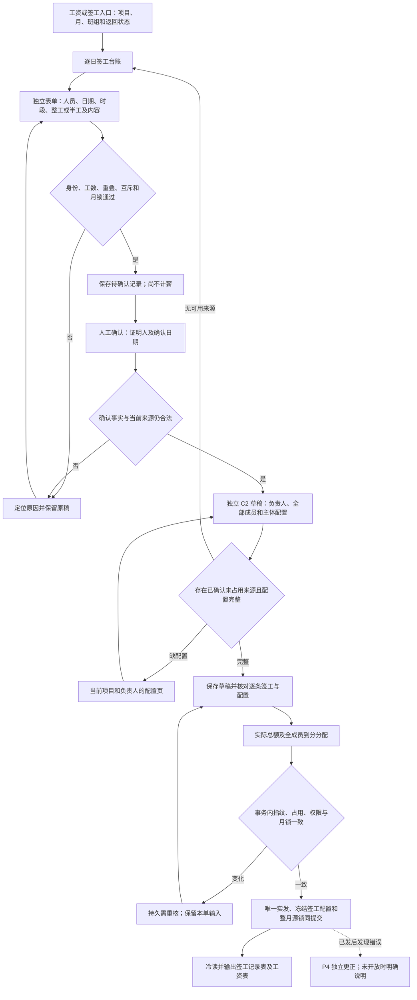

# P3：主体配置、人工确认签工到 C2 唯一发放与两种冻结输出

> 本地实施票，非权威源，尚未外发。2026-09-14 已通过本地限定验收，提交登记待完成；承接开放 [#412](https://github.com/zodea/crm-new/issues/412)，不替代母票。P0/P1/P2 已独立完成本地限定验收；P2 产品为 `fd0a7b6b4ab58eb177eea1db86a069067be92a4a`，最终验收登记为 `4738be98730955cd63832c8df04fc6f1d855caff`，后者为本期固定比较基线。本期已取得独立运行证据，详见末尾验收索引；不以准备合同或上期结果替代 C2 验证。

**交付行为：**经办人配置当前项目请款主体的大工单价及规则文字，登记逐日整工/半工，在真实证明人确认后将指定签工记录纳入 C2 工资。核对和发放均复验配置、每条来源及占用，实际总额和全体成员分配一次保存。发放后只能按当时事实读取和输出零星用工记录表与工资表；待确认签工不计薪，原已发签工不可移走、降状态或补录改写。

**前置依赖已满足：**[P0 完整历史及独立来源接管](00-central-history-and-sources.md)、[P1 共用工资事务、回执及冻结发放](01-central-a-payroll.md)、[P2 中央考勤/C1 与共享互斥](02-central-c1-attendance.md)均已提交。C2 不依赖 BOQ、合同单价、工程量完成记录或新的合同人员关系；不等待 P4 更正及 P5–P7 费用/完整工作簿，但必须保留其后续义务。

## 有效依据与旧义务去向

本次重新读取 #412 正文及当前四条评论、被替代的 [#353](https://github.com/zodea/crm-new/issues/353)全文、[#117](https://github.com/zodea/crm-new/issues/117)正文及九条评论；继续按 [#287 最终决议](https://github.com/zodea/crm-new/issues/287#issuecomment-5294862416)确定真实来源、唯一实发成本及 B 退役边界。旧票关闭不是验收取消。

长期业务与字段以[工资页面](../../../rewrite/pages/subcontract-payroll.md#c2-零星签工)、[DATABASE](../../../rewrite/DATABASE.md#工资完整资料中央接管412)、[ADR 0020](../../../adr/0020-browser-authority-and-demo-workspace-boundary.md)为准；分期见[母规格](../payroll-central-spec-draft.md#纵向分期与依赖)，调查见[事实记录](../payroll-central-facts.md)。本票只记录纵切行为和接缝，不复制字段表。

| 原义务 | 本票落实或明确去向 |
| --- | --- |
| #353 AC1：只消费已确认签工及工资配置 | 服务端逐条核对原记录、确认事实、项目/月份/人员、主体配置及占用；待确认、无效或不可证明记录不能建成可发工资 |
| #353 AC1 中“驳回签工” | 当前合法状态只有 `draft/confirmed`。任何未确认或旧非法状态均不可计薪，原证据仍可读；不据旧措辞新增驳回状态、审批引擎或自动确认 |
| #353 AC2/4：签工、工资、分配、来源版本完整中央闭环 | 配置、签工保存/人工确认/未发修改、工资建单/重核/发放及输出全部经中央 Repository/HTTP/command；浏览器不保留 Native 写入旁路 |
| #353 AC3 与 #433 限定来源验收 | 项目、月份、班组、工资状态和受控 returnTo 完整恢复。签工确认状态另存，可多选；不能与工资三态相互覆盖。旧来源往返通过只算其限定证据 |
| #353 AC5/6 | 测试先行、精确定向、五档真实视口、最终全量/类型/构建、独立 Standards/Spec、单票提交及证据登记全部保留；准备阶段不勾完成 |
| #117 核对④及收口：配置作用于请款主体 × 项目，大工单价、半工 0.5 工 | 复用真实 C2 主体配置；不改成全班组价格，也不套 A 分项价或 C1 个人日薪/加班价。依据 [配置决定](https://github.com/zodea/crm-new/issues/117#issuecomment-5015242817)、[确认收口](https://github.com/zodea/crm-new/issues/117#issuecomment-5015296973) |
| #117 “两天内确认／逾期免费／虚报双扣” | 可编辑确认规则脚注进入配置版本和已发快照；没有自动罚扣依据，不由确认日期、备注或证明人名称改变金额 |
| #117 D6/D7：负责人及全成员、三态、实发分配 | 同人可为本簿负责人及他簿成员，来源仍只能结算一次；默认全额给负责人但可分配，保留零分配成员。核算参考与实际收款分开 |
| #117 核对⑤/⑧、D9：C2 签工表 + 工资表 | 本票实际打印两种表及下载对应 XLSX；C2 不生成考勤。工资表含签字按手印及四方签字位，不新造电子五级审批或重复审批表。依据 [签字载体](https://github.com/zodea/crm-new/issues/117#issuecomment-5015310897)、[C2 输出收口](https://github.com/zodea/crm-new/issues/117#issuecomment-5018217081) |
| WAGE-05/06/07/09/11/12 的 C2 部分 | 本票来源、迁移、往返与互斥、冻结、防双计及中央验收逐项登记；不因此提升未做的费用或其他格式状态 |
| #287 更正与唯一成本；#117 后续费用及整册 | 实发 actualAmount 只计一次，分配不再加成本。已发补签/补差/退回/后月抵扣归 P4；房补、管理/空鼓、资金建议及完整月工作簿归 P5–P7。单份输出不冒充完整整册验收 |

## 用户路径与失败返回

具备证明人和合法确认日期时，允许经办人在一次明确保存中登记并确认，不强制增加两次提交或另一审批人账号。图中分步用于说明待确认也必须可独立保存。规则脚注、经过天数或页面默认状态都不能代替用户的确认行为。

来源 query 恢复界面范围，不替代实体身份。工资详情按路由工资 ID 和 origin 读取，进入签工时按回读工资的真实范围；在来源改范围后回台账用当前范围，回原工资仍读取原 ID。失效项目/人员/配置明确不可用，不自动选第一个对象继续保存。

## 已核代码事实与最小实施判断

| 真实接缝及当前差异 | 实施判断及影响 |
| --- | --- |
| [daywork.ts](../../../../app/lib/payroll/daywork.ts) 已有 `upsertC2SubjectConfig`、逐行保存、日期/时段/工数/证明信息校验及双向互斥；[schema](../../../../app/lib/db/schema.ts) 已有 C2 主体配置、签工和工资关联表 | 复用现有领域事实，不建第二套 C2 配置或签工表；浏览器命令增加同库事务、版本、权限、审计及回执。历史读取宽容与新写合法性分开 |
| `validateParticipant` 从有效工人当前项目或有效现场责任取资格；当前保存从档案取班组，但配置 upsert 使用请求 crewId，旧写入未完整检查班组祖先 | 中央受控 owner 提供当前人员/项目/班组事实；配置与记录均复验真实关系，全部班组不代表可任填 crewId。无工程量但档案项目明确的直接时工必须可登记 |
| 旧签工表单内嵌台账；[SignedDayworkEntryForm](../../../../app/components/payroll/SignedDayworkEntryForm.vue) 新增 emit 后立即清内容，尚未等保存成功；[store](../../../../app/stores/signed-daywork.ts) 浏览器被 `requirePayrollNative` 禁写 | 不直接解开旧 Native 守卫。中央新增/多字段编辑按 [ADR 0014](../../../adr/0014-full-page-entity-forms.md)用独立整页，配置和工资也用整页；单行补证明人/日期的确认可作为轻量任务。只有确认保存及冷读完成后清稿 |
| [statements.ts C2 来源](../../../../app/lib/payroll/statements.ts) 已按所选负责人/成员读取当月 confirmed 原行，按人合计工数；配置及记录内容、时段、证明人等已进入旧 sourceVersion | 保留其实际来源依据，不误称为仅月汇总指纹。中央来源合同保逐条 stable ID 和完整关系/正文，再汇总用于工资显示，补配置资格、成员、状态和占用版本；客户端不得提交任意行冒充来源 |
| 旧 `replaceDayworkLinks` 有唯一占用并软删当前旧关联；其他工资占用在来源预览中被过滤；旧锁多只查未删头/成员/链接 | 使用 P0 [中央来源锁](../../../../app/lib/payroll/central-read.ts)和 P2 共用互斥事实，已发软删不能释放来源。界面区分没有签工、仅待确认、已被其他工资占用及缺损来源，不把被过滤的真实记录显示为普通空态 |
| 旧 C2 重核更新当前配置价及规则，发放原文保存 `subjectConfig`、完整签工、成员和分配；旧通用 parser/output 仍可能裁字段或把未知实发补 0 | 新 C2 输出消费自己的完整已发证据分支，不能用旧裁剪 DTO 重组冻结事实。P0 的缺/坏/部分原快照继续原样只读，不用当前记录、姓名或配置补完整 |
| [旧打印](../../../../app/components/payroll/PayrollPrintSheet.vue) 已有 daywork/wage 两类页面，[旧 XLSX](../../../../app/lib/payroll/export.ts)有额外“零星签工”sheet | 保留两种真实输出和签字语义，接中央同一冻结读模型，C2 数量明确“用工数/工”。长内容分页和真实下载另验，不能只测生成配置对象；不生成虚构考勤 |

### 签工、配置和金额

- 日期须是真实日历日期；起止时间为合法 `HH:mm` 且开始早于结束，沿现行单日记录，不新增跨午夜、加班倍数或时长折工算法。用工数仅 1 或 0.5；半工不是从时段小时数除以 8 自动算出。
- 同项目、同人员、同日的有效记录全部参与重叠与工数上限检查，包含待确认。前条结束等于后条开始不算重叠，两条半工合计 1 合法，第三条半工或一条整工再加半工拒绝。编辑排除自身原行，移动时同时复验旧、新范围。不会仅按班组过滤其他同人记录，也不借本票新增未定跨项目工时产品。
- confirmed 必须有非空证明人和合法确认日期，确认日期不能早于签工日期；待确认可先无证明信息。超过两天但人工确认事实合法仍可确认，不自动归零/双扣。工资不能靠直接传 `confirmed`、随意 source ID 或客户端合计绕过后台逐条核验。
- C2 主体配置是项目 × 负责人下的有效 C2 配置，保存正数大工单价和可编辑规则。不存在、停用、跨项目/负责人、失效身份或未知价阻断新核算；明确 0 仍按 C2 正价规则报字段错误，不伪装成未配置。不继承 A 比例/分项价格、C1 个人日薪或 BOQ 价，不为同一成员另造未定 C2 个人价。
- 沿 [#117 合同关联决定](https://github.com/zodea/crm-new/issues/117#issuecomment-5015356993)，C2 的合同关联可选；若保留该关联只走现有稳定身份与原权限，不变成必须先有合同才能签工/建单，也不从合同提取工资价。
- 当前 C2 按本请款主体所选成员的已确认工数逐人汇总，再乘本次采用的主体单价，100% 月度核算。1 工与另一成员 0.5 工、350 元/工合计 525 元；同人两个相邻半工为 350 元。下一月另 1 工仍按该月配置计算，不扣前月实际发放，不开放 A 结算/尾款、累计比例或取整规则。
- 无已确认可用记录不能建空工资；仅待确认时保留来源及去确认入口。C2 正价和合法正工数不沿用 C1 的全零考勤建单场景；零分配成员仍合法且必须保存。实际总额须沿既定发放门禁，分配按整数分与实际总额完全相等。
- 实际工资成本只由 released 的 actualAmount 产生一次，例如核算 525、实发 500，分配 350+150+0 时只形成 500 的工资实发事实。分配、签工原价或另建工资付款不能再计一次成本；房补/管理/空鼓/借支不从规则文字、备注或差额猜金额，其他费用按后续分期。

### 占用、未发更正和已发冻结

- 人员资格使用稳定工人及班组关系，不能从合同乙方名称、同项目供应商或 BOQ 猜直接用工身份。当前 worker/crew 没有到 supplier 的明确映射，不为合同劳务互斥临时发明标签；已有直接工资与合同劳务真实来源边界仍保留。
- C1/C2 同项目、同人员、同月份互斥。C2 待确认记录虽不计薪，仍阻止同范围考勤；考勤真实 0 行、C1/C2 有效工资主体和全部成员、独立未领用签工及已发月锁都参与。签工确认/降为草稿、改人/日期/范围、建单/重核、迁入/恢复不能只检查新输入范围或某个页面当前筛选。
- 一条签工记录至多归属一张有效 C2 工资。不同负责人或并发窗口抢同 source ID，只有满足事务内当前占用的一方可保存。已有未发工资占用不是可以忽略的历史；不得由第二张工资直接抢占或删除关联。合法重核替换当前单关联时保留软删历史与审计，不能将仍被当前有效工资占用的记录悄悄转给另一簿。
- 尚未发放的签工可按现有规则修改内容、时段、工数、证明信息或确认状态；旧、新项目/人员/月范围及当前占用均须重新验证。受影响工资的旧核对不能继续有效，至少发放前发现变化后持久标记需重核，冷读仍能看到原因；不以只锁 confirmed 的新规则取消合法未发修正。
- 配置改价/改规则及成员变化同样改变核算依据。重核采用当前合法配置和来源；已发只使用当时采用的配置及完整签工原文，之后改名、转组、费率/脚注变化不改旧单。缺损迁入记录继续显示原事实及诊断，不凭当前人名、配置或合计推回旧 source ID。
- 发放后负责人和全部成员整月来源锁定，包括零分配、没有签工工资行和当月尚无签工者。已发原关联不可移动、改状态或修改；软删头/成员/关联、重建另一来源 ID 或恢复旧批次均不能解锁后重新计薪。补签、更正沿 P4 独立引用原发放，未开放时说明不可操作，不开放原单改写或通用撤销。

## 公共合同与建议所有权

具体 DTO 和文件名在 P2 最终提交后由唯一作者冻结；复用公共机制不等于将 C2 强转为 A/C1 合同。

| Owner 建议 | 可共享与需要扩展的内容 |
| --- | --- |
| A 工资领域/API/Repository/store | 复用 P1/P2 的 workspace 事务、身份/来源复验、固定命令与同键回执、需重核协议、金额/全成员分配和冻结读取。拥有 C2 配置/签工 read+command、C2 草稿/核对/发放及显式格式分派；不将 C2 塞入 A 累计量价或 C1 考勤/个人费率算法 |
| B 逐签工事实、共用占用及迁移保护 | 在调用方持有的同一 SQL 事务读原签工、主体配置、全部成员、确认及既有占用；与 P2 唯一 owner 共同确定互斥 helper 后由一方改共用文件。补配置/签工日常更正、C2 来源/关联/快照/receipts 对重复迁入和危险恢复的保护；P0 八表原图、未知字段和原 snapshot_json 不裁剪 |
| C 签工台账、独立登记/配置/C2 工资、人工确认与输出 | 中央页面草稿和固定 pending 按 workspace/actor/origin/实体及范围分桶；mutation 只经 store action。配置/多字段业务表单用独立路由，证明信息确认和发放使用既有轻量底座。维护工资/签工状态分离、来源精确往返、真实签工与工资输出、五档截图及键盘/滚动验收 |
| Root 权威文档、设计账本与整合 | 同步页面、DATABASE、COMMANDS、READ-MODELS、ADR 0020 与适配状态、工资及迁移指南/PDF，分开标注 browser C2 与 Tauri。统一最终 full/type/build、独立双轴审查、本票精确提交和旧验收证据登记 |

逐行来源合同至少表达原 stable record ID、项目/班组/工人、日期/时段/工数/内容、证明人/确认日期/状态/备注及其原版本，另含实际采用的配置身份/价/规则/资格、负责人/全部成员、占用与月份锁依据。金额汇总用于展示，不能代替完整原事实。指纹不能只用合计工数、价格、MAX(updated_at)，同总量换记录、相同更新时间改证明人或规则仍须失效。

签工写入、C1 考勤及工资领用共享同一 workspace SQL 事务和队列；facts loader 不再调用会二次入队的公开 read。外部 owner 当前资格读完后按 P1/P2 接缝最终复验身份/版本再提交。两窗口并发和迁入/恢复应以最终表、关联及回执验证互斥结果，不只比较错误文案。不得借 quantity:read 作为签工可用前提。

固定命令包含身份、origin、稳定目标、读取版本和正文指纹。未知响应、成功后冷读失败、离页及撤权保留原 commandId/正文；仅明确未应用后允许用户重新读取并重确认。等待旧命令期间不能将其内容套入另一工人、日期、配置或工资；同路径 query 与 KeepAlive 均遵守草稿及迟到隔离。

## 最小真实 SQLite 夹具与公开验证接缝

先建立失败反例，再改产品。使用真实迁移 DDL、公开旧签工/工资 create/check/release 或新的中央命令产生健康事实；通过真实 SQLite 导出字节、哈希、preflight/dry-run/import/confirm 后普通 Repository/HTTP 冷读，不手写“完整已发”快照。P0 缺损原图样本继续独立存在。

最小项目甲只有直接工人及班组也应可用，不要求建筑/BOQ。包含负责人甲、普通成员乙、零分配且无签工的成员丙、同名异 ID 工人；另有项目乙和转组/失效历史人员。为不同项目/负责人建立独立 C2 配置，价 350/360，另构造已迁入的停用、缺值/坏值配置供只读诊断。

记录包含：甲整工 1；乙不同日两条相邻半工；独立待确认记录；迟于两天但有真实证明的合法确认；无工资项目的独立已确认来源。健康工资以甲 1 工及乙 0.5 工构成 525，应发登记 500 并分配 350/150/0；重核两次留下旧关联/明细软删历史。发放后另用合法新范围改名和配置，旧输出必须不变。并列已有 P0 健康已发、部分/坏/缺快照、软删已发头及零成员锁、另一簿占用和 C1 真实零考勤。

保留现有测试的行为意图：[signed-daywork.test.ts](../../../../tests/payroll/signed-daywork.test.ts)覆盖证明、时段、日工数、互斥、占用、重核及规则冻结；[attendance-safety.test.ts](../../../../tests/payroll/attendance-safety.test.ts)、[release-safety.test.ts](../../../../tests/payroll/release-safety.test.ts)及 P0 [controlled-migration.test.ts](../../../../tests/payroll/controlled-migration.test.ts)保留锁与恢复反例。Native 通过不算中央验收。新增最高边界为真实浏览器 → Repository → HTTP → 同库事务 → 冷读、来源返回及实际输出；领域公开服务承担并发、金额和整批无变化断言。

## 验收清单

- [x] **真实入口与空态：**无项目/人员、无配置、只有待确认、全部被占用、独立可用签工、历史资格失效和读取失败分别可辨。没有工资或工程量仍可保存合法签工；无有效 confirmed 来源不能建空 C2。未配置价、明确 0、停用配置和非法原事实分别说明，不补 Mock 或默认成功。
- [x] **登记与人工确认：**有效日期/时段、必填内容、工数 1/0.5，非法日历/时间、开始等于或晚于结束、0/其他数拒绝。待确认可保存，confirmed 缺证明人/日期或确认早于签工拒绝；超过两天人工确认仍合法，脚注不自动罚扣。伪造状态、异项目/班组/人员及失效祖先由服务拒绝，错误保稿。
- [x] **日内边界：**同人同日 08:00–12:00 半工与 12:00–16:00 半工允许；10:00–14:00 与首条重叠拒绝，第三半工或整工再加半工拒绝。待确认同样参与，上限不因改负责人或状态筛选丢失；编辑自身不重复累加，跨日期/人员修改同时验旧新范围。
- [x] **配置与月核算：**项目甲/负责人甲配置不能给项目乙/负责人乙使用；350×(1+0.5)=525，350×(0.5+0.5)=350。只月度、100%、无 C1 加班/个人价和 A 比例/累计扣前月；下月新 1 工按当月价全算。姓名相同不串配置，合同/BOQ 改价不成为 C2 工资价。
- [x] **逐行唯一来源：**只取该月入选成员的真实 confirmed 记录；一条 stable ID 只能被一有效工资占用。跨负责人抢同一记录、伪造 sourceRecordIds/金额、旧链接软删/恢复、错月份及异人记录都不能绕过。没有来源与来源已占用分别显示，不能悄悄丢记录再宣称完整核对。
- [x] **指纹与更正：**同合计换来源 ID、同更新时间改内容/时段/证明人/确认日期/状态/备注、配置价/脚注/资格和成员变化均进入核对。未发合法修改可成功，但旧确认不能直接发放，需重核状态冷读保留；重核采用当前合法配置且保旧关联审计，确认弹窗停留期间改源也阻止旧确认。
- [x] **双向并发互斥：**新签工待确认/直接确认与新考勤同时抢同人员月，最多一方合法成功；真实零考勤、既有 C1/C2 三态、独立迁入来源和恢复均走相同窗口。A 与 C2 同人同月不误锁；C1/C2 不靠换班组、人员显示名或降为 draft 绕过。
- [x] **发放与全成员锁：**核算 525、实发 500，只形成 500 一次实发；350+150+0 完整分配保存，漏零成员、重复/异单成员、差一分、超核算实发拒绝。同键重试只一回执，同键异文拒绝；双窗口领用/发放后检查最终所有表和回执。已发无签工成员也整月封锁，改人/日期/状态、软删头/成员/链接及重建来源不能放开补签。
- [x] **历史与恢复：**迁入独立配置、待确认/confirmed 来源和所有旧关联保真；坏/缺/部分原快照只读，不自动补当前费率/姓名/来源。repeat 不覆盖后来配置、签工、关联和回执；危险恢复会丢日常变更、独立发放或其来源/审计时删除前整批拒绝，SQL/revision/receipt/owner 及迁移权威完全不变。不相关项目事实不能笼统禁止恢复。
- [x] **草稿与来源往返：**工资和签工的各自状态含多选分别恢复；项目/月/班组及合法 returnTo、原工资 ID、origin 完整保留。同路由新 query、冷恢复、KeepAlive、换记录/范围放弃确认、读取时切目标及确认后迟到、撤权、未知响应和成功冷读失败逐项检验。失败不清内容/证明信息，不将旧 pending 套入新记录；确认取消回原触发焦点。
- [x] **视口与可达性：**390/768/1024/1280/1440 五档实际原图逐张目检。表只在局部横滚；长内容/证明人/脚注、占用及只读理由完整可达，不撑根宽度。键盘到表内最右列、编辑/确认和错误焦点可操作；状态不以颜色单独表达，草稿提示与需重核提示不遮住原输入。
- [x] **两种冻结输出：**真实发放后冷读完整配置、签工与成员；之后改名/转组、配置或当前记录不改旧单。实际打印零星用工记录表和工资表，长表分页/重复表头/签字按手印及四方签字位不裁切；真实 XLSX 下载回读签工时段/半工/证明人/规则及工资、实发、零分配。明确保存的空规则不能被当下默认脚注冒充。C2 不含考勤表；未发、B 或不完整旧快照不能生成伪完整新输出，打印不改状态。
- [ ] **职责与交付：**browser 正式写入只经中央，Tauri 维持 Native 边界；无权只读、演示隔离及旧 B 防写回归。更新权威文档、路由/设计覆盖及工资/迁移指南，PDF 逐页渲染目检；运行定向和 Root 最终完整测试/类型/规范/构建，独立 Standards/Spec 无未决后精确提交并登记实际证据，不自动宣称 P4–P7 完成。

## 范围与准备结论

本票没有新增业务未决。人工确认、正价、工数、唯一占用、月锁、配置版本及两种输出均有已定口径；API/表名、现有 helper 的复用与文件拆分由实施者按当前架构决定。遇到新的证据冲突记录具体出处，由 Root 在本工作单元修正文档，不重新询问已经确认的 A/C1/C2 方向。

不新增电子审批、驳回状态、自动两天确认/处罚、工时折算或跨午夜算法、个人 C2 价格政策、工人账号、完整 RBAC、合同工资桥、附件 owner/原件图、批量导入或通用来源删除/撤销面板、B 新建、生产数据库与部署。没有已证附件 owner 不造工资附件。已发补签与差额通过 P4；房补/管理/空鼓及完整月工作簿由 P5–P7 承接。本票已通过本地限定运行验收，独立提交完成后再勾选最终交付；逐项运行结果归档至 [P3 验收目录](../../../design/evidence/issue-412-payroll-c2/README.md)，未取得的证据不提前标为通过。
