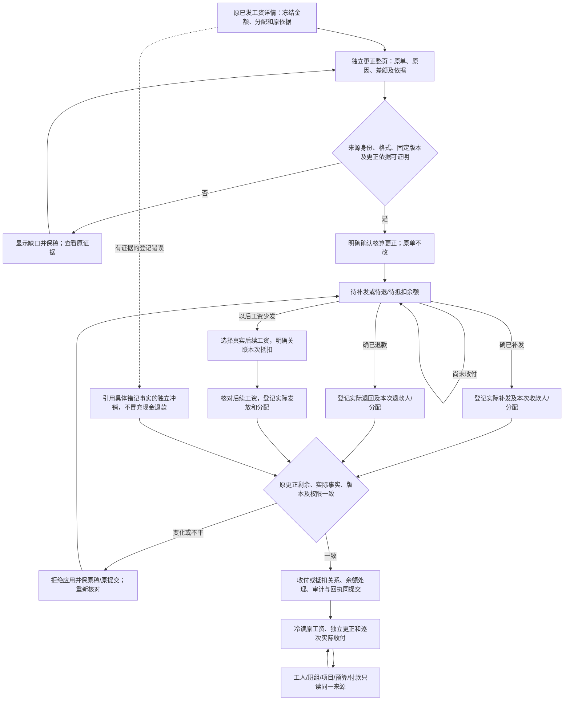

# P4：独立工资更正、实际补退与跨域同源核对

> 本地实施票，非权威源，尚未外发；2026-09-14 完成本地限定验收，已独立提交 `74f831f7da0dc37f7ec031279223649a6f32fbee`。承接开放 [#412](https://github.com/zodea/crm-new/issues/412)，跨域协作 [#413](https://github.com/zodea/crm-new/issues/413)。P0–P3 已分别完成本地限定验收及独立提交，P3 产品为 `f39d8106579ea09cd1335119701ba6105cd22846`，后置登记为 `c5caede8d55f117ededcff7354ce2b1af1872d90`；以后者固定为本期比较基线。开工重新读取两票正文及全部评论，更新时点与交接一致。P3 后置完整 npm test 682 文件/3964 项通过，正常提交的类型及全量检查再次通过；[原始钩子日志](../../../design/evidence/issue-412-payroll-c2/checks/closeout/commit-closeout.log)不代替本期验证。

**交付行为：**从原已发 A/C1/C2 工资发起带依据的独立核算更正，明确区分尚待处理、实际补发、实际退款和以后工资少发。每次处理均引用原工资、更正与真实处理事实，事务内核对尚未处理余额，原工资快照及签名金额不改。工资详情、工人/班组、项目、目标成本与付款展示冷读同一工资实际收付来源，不重复加减。

**Blocked by：**[P0 完整原图](00-central-history-and-sources.md)、[P1 A 冻结及共用命令](01-central-a-payroll.md)、[P2 C1](02-central-c1-attendance.md)、[P3 C2](03-central-c2-daywork.md)最终提交，以及已交付目标成本中央读取。A 更正需要 P1 完整责任/范围/价格证据，C1/C2 更正分别需要逐考勤/签工和成员锁；共用收付不能代替各格式依据。有效合同劳务结算使用其已接管 owner。其他成本域尚缺源不阻止工资明细，但项目总成本不能因此伪完整。P5–P7 费用与整册仍有独立义务。

## 有效依据与旧义务去向

本次重新读取 #412 正文及四条评论、被替代 [#354](https://github.com/zodea/crm-new/issues/354)全部六项 AC、[#287 最终决议](https://github.com/zodea/crm-new/issues/287#issuecomment-5294862416)、#413 正文及三条评论。更正的金额反例沿[母规格“独立有符号更正”](../payroll-central-spec-draft.md#独立有符号更正核算与实际收付分别留证)及本任务明确要求，不从有符号数自行推导现金已经发生。

字段与长期职责以 [DATABASE §10.3/10.4](../../../rewrite/DATABASE.md#103-工人工资与费用报销)、[工资页面](../../../rewrite/pages/subcontract-payroll.md)、[ADR 0015](../../../adr/0015-form-persistence-and-payment-reconciliation.md)、[ADR 0020](../../../adr/0020-browser-authority-and-demo-workspace-boundary.md)为准。付款侧见[付款申请](../../../rewrite/pages/finance-payment.md#五与工资进度款边界)和[支付记录](../../../rewrite/pages/finance-records.md)，成本见[目标成本](../../../rewrite/pages/target-cost.md)，个人/班组归属见[工人](../../../rewrite/pages/base-worker.md#工资)、[班组](../../../rewrite/pages/base-crew.md)。本票不复制表字段清单。

| 原义务 | 本票落实或明确去向 |
| --- | --- |
| #354 AC1：已发实额只计一次工资成本；合同劳务只取有效结算 | 工资实际收付投影具有明确类型、稳定来源 ID、原单及处理关系；预算的成本/已付两指标同源但不能相加成两份成本。合同额、结算、银行支付与票据各守其口径 |
| #354 AC2：原已发不可覆盖，独立有符号调整/冲销 | 核算更正、实际补退、后月抵扣关系和有证据的错记冲销分别留证；确认后不原位改金额或用删除/撤销消除事实 |
| #354 AC3：冻结、成本来源、调整历史、返回及并发幂等 | 原工资签名金额与调整后累计实额并列、可逐笔下钻；正文/版本/回执固定，分次处理和竞争同余额在事务内复验 |
| #354 AC4：模型/迁移/中央命令/Repository/UI/文档闭合 | 新更正及收付关系同库保存，迁移与危险恢复保护完整；跨域只有受控只读投影，没有另一份正式工资或付款写源 |
| #354 AC5/6 | 红例先行、公开服务/HTTP/组件/真实浏览器五档、最终全量/类型/构建、独立 Standards/Spec、精确单票提交和证据回写保留。本地准备不勾完成 |
| #287 两条互斥事实链与 B 退役 | 直接工资仍只从 A/C1/C2 来源产生；不把合同/BOQ 变为工资，不按项目、班组或名字接乙方内部工资。B 只读，不借“更正”改成可发 A/C 类或引入动态成本 |
| #117 已发确认即支付、签字载体、分配 | 原工资表及签字金额冻结；实际补退独立呈现其本次确认金额和收付人，分配只解释同一金额。不是新增五级审批、税务或逐人工资银行回单要求 |
| WAGE-09/10/11/12 与 PRG-08/09/10 工资部分 | 冻结更正、同源成本、来源精度及跨域返回逐项验收；完整财务、其他成本、生产部署及其他格式未做部分不自动提升 |
| #117 房补、管理/空鼓、资金建议、全周期与月度工作簿 | 继续由 P5–P7 承接。P4 提供可复用有符号组成/收付/处理关系，不能据此宣告费用功能或完整工作簿已交付 |

## 用户路径与失败返回

更正金额不是实际补退金额输入的默认已确认结果。用户可以只确认核算差额并保持待处理，也可以分次处理；不按月自动扣款，不从“核算比实发少 100”反推已经退款。更正及实际收付确认不可悄悄合并，若界面提供连续操作也须让两种事实、金额和结果明确可核对。

从项目/预算/班组/工人或付款展示进入时，实体读取始终使用原工资/更正/收付稳定 ID 与 origin；query 只恢复来源界面范围。更正来源链接返回原单和相关核算依据，工资列表保项目/月/班组/工资状态；预算保版本及入口，人员页保其原筛选/详情。无权或关系失效不换成同名对象，也不默认切到当前月。

## 已核事实与最小接缝

| 现状证据 | 本票实施判断 |
| --- | --- |
| 原 `wage_statements.adjustment_reason` 只是旧文本字段，当前 [central-schema](../../../../app/lib/payroll/central-schema.ts)有版本/回执及 A 依据，没有独立更正或实际补退表 | 新增工资域受控事实及关系；不能把备注、负数工资行、另一普通 released 单或软删日志当作完整更正。准确 schema/DTO 由唯一作者开工冻结 |
| [P1 service](../../../../server/utils/payroll-a-service.ts)的 `priorPayments` 和 `releasePayrollA` 当前读取同主体 released 实额；`paymentSourceVersion` 参与核对 | 在 P4 扩为同源实际收付及核算处理依据；保原签名金额和历史支付清单，不把“原发放累计”“净现金”“已处理核算差额”“当前可领”压成一个加减数。退款不能只扣此前已付后重新产生额度 |
| [预算来源](../../../../server/utils/target-cost-actual-sources.ts)仍将工人工资 `settledAmount/paidAmount` 标 pending；[聚合器](../../../../server/utils/target-cost-actual.ts)已支持稳定 identity 去重、冲突/缺额、完整/部分状态 | 接入工资已发及实际补退/有效错记更正；核算调整、处理关系、组内分配不作为另一个成本事实。工资已签金额继续不适用；材料/报销仍缺源时保留其 pending，不宣布项目总额完整 |
| [target-cost-service.detail](../../../../server/utils/target-cost-service.ts)已在 `withWorkspaceTransaction` 内调用 `options.actual` | 给 actual 接缝传同一 tx 与已核身份，工资事实用不入队的纯读取 helper。不得在此 await 普通 payrollService read 再次进入同一队列自锁；外部 owner 版本与权限仍复验 |
| [班组/工人 read instance](../../../../server/utils/crew-worker-read-test-instance.ts)正式主档已受控，但 wages 当前只有 demoWages；[工资关系 DTO](../../../../app/lib/crew-worker/read-contract.ts)尚无更正/实际补退和完整性 | 注入同源中央工资事实及版本；整单实发、核算行参考、个人实际分配、退款/补发分别显示。零分配成员不消失，缺个人分配不能拿整单金额或当前名册推份额 |
| [payment-management store](../../../../app/stores/payment-management.ts)是付款申请/支付分摊读取；[项目资金 facts](../../../../app/lib/project/finance-facts.ts)是往来/银行支付读取，无工资 canonical 外键 | 付款管理和项目资金区域增加独立、只读的“工资收付”来源分区/入口，消费工资 Repository。其金额不灌入申请待付、银行流水或往来款；不伪造银行号/分供方，不宣称其他财务已接中央 |
| [分包结算事实](../../../../app/lib/owner-document/subcontract-settlement.ts)以 project+supplier+contract 关系核验，当前预算按真实 subKind 分类；多结算申请的支付若无结算级分摊会保持未知 | 保留有效劳务结算为合同劳务成本，已确认支付为资金指标；同支付稳定 ID 去重，不按比例猜多结算归属。`project_suppliers.settlements` 合作终态也不是劳务过程结算来源 |
| 当前没有 worker/crew 到劳务 supplier 或具体结算施工事实的 canonical 映射 | 不按名字、同项目或金额做自动去重/抵扣，不新增 B 桥。工资只接受既定直接来源，合同劳务只接受原 owner 合格事实；有明确重复来源证据时阻断并报告，没有证据不能编造匹配或误合并两个合法来源 |

## 核算、收付和处理关系

### 四种事实须明确区分

1. **核算更正：**独立引用原已发单、原原因与固定新旧依据，有符号差额。确认 `-100` 表示多计 100，`+100` 表示少计 100；未收付时只形成待处理余额，不改变原已发金额或工资实际成本。无依据的自由负数总额不能确认。
2. **真实补发/退款：**工资域明确登记已经发生的实际额、发生时间、稳定收款人/退款人及本次分配，引用原单和更正。补发为正、退款为负，所有成员行的有符号整数分合计须等于该次实际额；未知不补 0，非零总额不能含相反方向的掩盖性分配。沿工资支付例外，不要求生成 `payment_records` 或逐人银行回单。
3. **以后工资少发：**明确选择实际后续工资及本次处理的原更正余额，和该工资最终实际发放、分配一起冻结。抵扣关系只结清对应待处理额，不是第二次现金退款；后续草稿或未发确认不算处理完。真实发放失败、来源变化或结果未知时不能先结清原更正。
4. **有证据的账务错记冲销：**引用被错误登记的具体工资收付事实，保存为什么确认其未真实发生的核对依据，独立抵销错误记账效果并保持原记录、操作者及确认历史。它与工人实际退款是不同种类；仅多计但实际已付不能选错记冲销。已确认更正/冲销再发现错误仍新增有原引用的纠错，不编辑、删除旧事实或假造退款。

配置、量/考勤/签工修订及“实际没发生”均须有能回读的明确证据。已有 `sourceVersion`、稳定来源、审计及确认记录可作为依据；没有已证附件 owner 不额外造工资附件图。原历史不完整时显示具体缺口，不能从当前姓名、当前价格、银行备注或合计重建签名事实。历史总额可证明而个人分配未记录时，整单与个人指标分别声明完整度；个人已收不能均分或默认负责人。

### 最小余额与原子要求

- 每个更正的待处理额由确认差额和明确成功的处理关系派生，界面不能直接改余额。按剩余量分次补发/退回/抵扣，单次和累计均不可重复或超额；同一处理事实不能被两个更正当作全额使用，确有拆分时保留明确分摊并守恒。
- 实际补退只登记其真实方向及人员；更正不是把钱从旧成员自动分摊到当前班组的功能。保持原单成员、当时名称及原分配独立，新处理所指人员也必须以可证明的稳定身份和实际处理关系记录。
- 固定同一 workspace、原项目和可证明的主体/人员关系。跨项目、跨主体代扣或第三方代退没有已定映射时不自动接线；返回缺失关系说明。这里不发明跨项目结算、借款或第三方追偿政策。
- 核算更正、实际事实、分配/处理关联、审计、版本和同键回执在同一队列/SQL 事务内提交；最终核对原单、剩余额度、后续工资来源、权限和所有权。确认期间另窗退款或抵扣应使旧确认失效，不留下半笔收付或已清零余额。
- 正常工资仍遵守 P1–P3 正数发放及全成员到分校验。独立退款是受控的有符号操作，不能借放松普通 `release` 的金额限制实现。0 元“不支付”保持待处理，不伪造实际收付记录。

### 必须通过的金额反例

下表是已定义结果，不是新会计分录或自动扣款政策。实际成本/实付净额均指工资域有效实际事实；待处理额与原签名金额各自保留。

| 场景 | 冷读结果及禁止重复 |
| --- | --- |
| 7 月已发 1000，只确认核减 100，无退款 | 原单 1000，工资实际成本/实付仍 1000，待退/待抵扣 100；不能直接变 900 |
| 上例 8 月核算 1000，经办人关联抵扣 100、实际发 900 | 两月真实支出 1900，原更正待处理 0，8 月冻结核算/实发及抵扣关系；不能再减原更正变 1800，不能再提示退 100 |
| 上例改为真实退回 100，未在后月抵扣 | 原单仍 1000，独立退款 -100，净额 900，待处理 0；再次抵扣同一 100 拒绝 |
| 已发 1000，确认核增 100，但还未付 | 原单及实际仍 1000，待补 100；实际补发 100 后净额 1100、待处理 0，不能把更正与补发都加一遍变 1200 |
| 核减 100，先实际退 40，再后月少发 60 | 分次处理合计 100，待处理 0；退款和后月真实实发分别计现金，抵扣关系不再减 60。并发两个窗口各处理剩余 60 只能合法成功一份 |
| A 原量已在新累计计算中减少同原因 100，同时有核减 -100 | 新核算明确哪一来源修订/更正已经包含；同一差额只体现在核算依据一次，不再减 100。原单及实际收付仍照原事实 |
| A 核减 -100 已实际退款，新现场量未变或已经同步改正 | 两种路径均不能仅将“此前已付”减 100 从而重新形成 100 可领。核算更正是否已包含和实际退款各留关系，以现行有效应领与已处理事实核对；后月重核、价格版本变化及重试也不能重新领同一 100 |
| 有证据证明重复登记了一笔未实际发生的工资付款 | 原错误记录仍可见，独立错记冲销引用该事实；净记账效果只冲一次，不显示为工人实际退款，也不能拿同一依据另冲真实已付那一笔 |

A 的“已包含”不能只比较更正前后总额、月份或一个全图 hash。保留更正指向的稳定施工责任/范围、采用的新旧数量/价/比例依据及关联核算版本；新累计已经体现时不重复加 signed 差额。若旧历史缺少这些依据，不能自动宣布已包含或可继续发，显示具体待核实项。以后版本再次变化也要复验已有包含/处理关系；不要用退款后的净现金直接替换原 `previouslyPaid` SQL SUM 而遗漏核算侧约束。

## 跨域读取、权限和签名金额

- 建立一个工资实际 facts 入口，输出来源类型与唯一 ID、原工资/更正/处理引用、原项目/人员/班组证据、实际发生时间、有符号实际额及完整性版本。原 released 可直接投影为其唯一初始支付身份，不批量复制一行“工资付款”；新增实际补退有各自 ID。核算更正和抵扣关系另作历史/余额事实，不混进现金集合。
- 工资动态成本和工资资金流出读取同一有效实际集合。目标成本的 settled/paid 对工资可以显示相同净额，但这两个指标不相加。预算科目、项目、班组按事实 ID 去重；工人按已记录的个人收付分配查看，不能再将个人合计加在整单之上。
- 工资原快照、签名表的实发 1000 永远仍是 1000。独立退款后可显示“原发放 1000、后续退回 100、实际净额 900”；不得把原表签名金额改成 900。更正/实际收付详情显示各自确认者、时间、金额和与原表关系，输出附更正历史时也区分原件与后来记录。
- 当前上游停用、人员转组或原头软删不消灭实际发生；历史权限下显示当时关系与停用说明。已确认冲销改变有效记账效果需有明确独立依据，而非通用可见范围过滤。B/草稿/checked、无资格隔离来源不混进实际额；金额冲突/未知保留部分或未知，真实零可区分。
- 预算已有 sources 合并方法只证明已接来源的完整性。工资接通后仍须保留材料/报销等缺口，项目剩余预算/效益不从部分科目推完整。合同劳务取有效劳务结算，不把合同额、该结算付款及票据都算成本；工资与劳务并列但类别不同。
- 付款展示使用工资收付的独立只读区域或入口，明示来源为工资发放/补退，点击到真实工资/更正；不能进入付款申请或银行支付编辑器。既有银行/合同页职责和 #413 待接范围不因新增工资区域改变，不能冒称完整财务收付或银行对账已完成。
- 按目的页面权限与来源授权读取；内部纯 facts helper 本身不是绕权公开接口。保留缺权/不可用/未接/真实空的区别，不能为预算能看工资而开放所有人员目录，也不能为工资登记强借 quantity、预算或合同写权限。最后一次异步 owner 等待后复验来源与身份。

## 建议所有权与实际依赖

| Owner | 建议唯一范围与共享边界 |
| --- | --- |
| A 工资领域/API/Repository/store | 更正、补退、错记冲销和后续工资处理的封闭 DTO/命令，余额/金额守恒、确认及幂等；扩 A/C1/C2 release 对处理关系与来源重复包含的校验；冻结只读及实际 facts 公共合同。原单 status/snapshot 不作为可写参数 |
| B 来源事实、迁移和跨域受控投影 | 同 tx 工资原图/更正/实际/关联事实 loader；原图与日常关系的完整迁移/恢复保护；预算 actual 接缝、工人/班组/项目事实提供器的稳定身份与完整性。共享 read 实例或 schema 单人维护，开工先与 A 冻字段；不通过普通 read 二次入队 |
| C 更正整页、实际处理、历史与来源返回 | 独立路由编辑更正草稿，轻量明确确认实际补退或抵扣；待处理/已处理/未知响应可见、保稿与迟到隔离，原单签名金额分区，工资/预算/人员/付款的真实冷读往返。实际原表与更正记录输出区分，不改签名快照 |
| Root 权威文档与最终集成 | 更新 DATABASE 原 SUM 口径为含独立实际处理的来源规则，COMMANDS/READ-MODELS、工资/预算/项目/人员/付款页面及 ADR 0015 旧“生成支出记录”的歧义，保工资例外；设计账本/指南/PDF，统一 full/type/build、独立双轴、本票提交与证据 |

事务接缝复用 P0–P3 同库队列，不新增数据库或生产依赖。已持有 tx 的预算读取应向工资 loader 传 tx；从工人/项目进入的外层普通 read 可在单次 workspace 事务取得受控 facts。来源集合版本包含完整实际事实、冲销/处理关系及其资格，不能只取最新时间或金额合计。

迁移应扩独立更正、实际补退、处理关系、原核算包含关系、审计和 receipts，保原单/旧更正 immutable 原文及稳定映射。重复迁入保接管后新事实；危险恢复在删除前检查全域含软删、零成员、独立工资/收付及其他批次引用。任何会使实际记录或处理依据消失的恢复整批拒绝，SQL、其他 owner、revision 与回执均不先变化。要用真实日常命令再恢复的反例，不能只手塞单表引用冒充完整集成。

## 真实夹具与验收

先红后绿，沿 P1–P3 公开命令生成真实 A/C1/C2 已发及签名快照，含负责人、普通成员、零分配成员；另建两个负责人簿、另项目同名人、无旧分配/未知实额/原表与快照冲突、B 隔离样本。真实 SQLite 导出/哈希/迁移后从普通 HTTP 回读。A 使用已完成责任及明确现场量，C1 实考勤，C2 confirmed 签工，不手写健康快照或用 BOQ 替代。

复用 [A 金额完整性](../../../../tests/payroll/central-a-amount-integrity.test.ts)、[A 事务](../../../../tests/payroll/central-a-transactions.test.ts)、[工资受控迁移](../../../../tests/payroll/controlled-migration.test.ts)、[预算来源完整性](../../../../tests/target-cost/central-actual-sources.test.ts)的断言意图；开工以 P3 冻结文件为准。新增真实合同劳务 confirmed 结算、已确认支付及缺结算级分摊样本，经过原 owner 接口读取；不伪造 worker↔supplier 名称桥。

- [x] **原单资格及冻结：**A/C1/C2 原单经真实 release 后可进入独立更正；草稿/checked/B/不可证明隔离源拒绝。任何更正确认、补退、冲销及恢复后，原头金额、原分配、snapshot_json 和签名表保持原事实；不存在普通编辑/删除/撤销回草稿通路。
- [x] **只更正未收付：**已发 1000 核减 100 后实际仍 1000、待处理 100；核增 100 未支付仍 1000。保存草稿/预览不改变余额或成本，明确确认才产生核算更正。无来源自由负数、缺理由、串原单、同键异文拒绝。
- [x] **实际补退：**真退 100 净 900，真补 100 净 1100；成员有符号分配守恒且可回读当时人，方向错、差一分、重复/未知人员或超剩余额度拒绝。待处理不变成已付/已退，错误登记冲销和真退款的类型/证据不可互换。
- [x] **后月抵扣：**7 月 1000，8 月核算 1000 实发 900并关联抵扣100，合计1900且待处理清零；不能1800。先退40再抵60、先抵再退款、两个窗口同时清剩余、跨簿尝试重复处理全测。后续工资发放失败/需重核/未知不提前清余额。
- [x] **A 不重复更正或重领：**新累计量已包含同原因-100不再减一次；上游尚未变与已同步变两种退款路径均不重新产生100可领。后月/结算/尾款、改价或比例版本、来源重建和同键重放复核同一更正的包含及处理关系，不把净现金 SUM 直接当全部可领依据。
- [x] **各格式及来源锁：**C1/C2 补差/退回不解除原月锁及 sourceID 唯一占用，不新建重复考勤/签工或移原事实；A 原责任/细分范围保留。补退不能借另格式、另项目或同名成员隐藏处理关系；未知旧来源保持诊断，不补造身份。
- [x] **跨域一致：**工资原单/调整史、工人、班组、项目、预算工人工资成本及付款只读区冷读同一来源ID和净额。整单/个人分配不双加，个人无分配保持未知；已停用工人/软删头仍保真实已发生。只有工资完整时其他成本仍 pending，项目总余额不从部分来源计算。
- [x] **合同劳务分域：**有效劳务结算只计合同劳务成本，合同额/付款/票据不另计成本；同一银行支付的多入口只计一次，缺真实分摊保持未知。工资不得从合同/BOQ产生或按名抵扣，两个合法不同事实同项目可分别归集，有明确同源冲突须报告。
- [x] **公开原子与恢复：**并发确认更正/退款/抵扣/发放、最终等待时撤权或改源、部分持久化失败、重复命令均检查最终所有表/版本/回执。实际 save→confirm→补退 后重复迁入不覆盖；危险恢复有日常/独立/软删引用时删除前全域不变，不相关事实不一概阻断。
- [x] **错误与草稿：**独立页面的原单、draftKey、actor/workspace/origin固定；读取期间换原单、同路径新query、KeepAlive、返回/关闭放弃确认、拒权/断网/未知响应/成功冷读失败均保原稿或原 pending。仅可信未应用结果释放原提交，旧迟到结果不清另一更正。
- [x] **界面与返回：**五档390/768/1024/1280/1440逐图核对冻结金额、signed差额、待处理、实际净额和完整性。表只局部滚动，长理由/多次处理可键盘读全，错误焦点与确认取消回焦点正确；预算版本、人员详情及工资/来源四项筛选往返不串身份。
- [x] **实际输出：**原 A/C1/C2 正式输出仍用原签名快照，C2仍为签工+工资，不因更正重算。独立更正/实际收付的可读确认记录及实际下载文件标明原单、本次差额/实额、收付人、处理历史，PDF/打印逐页无裁切；完整月工作簿仍归P7，不以函数返回对象代验下载。
- [x] **交付：**无浏览器本地正式回退，无新增银行/往来/工资副本；演示和Tauri边界分别验证。权威数据/命令/读模型与页面、Markdown 指南同工作单元更新；按用户要求不另生成指南 PDF，产品打印仍验收；Root最终全量/类型/规范/构建及独立Standards/Spec无未决后精确提交，登记限定范围，不替代#413或P5–P7全域验收。

## 已可决定与确切未决边界

上述工资更正、实际补退、明确后月少发及金额反例已有授权口径，不需要重新 grill。独立表与引用、金额到分、共享队列、typed facts、只读工资收付分区及输出分开都是实现接线，不创造新业务政策。

当前缺少合同劳务施工事实到 worker/crew 的 canonical 映射是来源缺口，不能以姓名补齐，也不是重问工资退役方向的理由。本票只接合格独立来源；若真实样本提出“替别的主体/项目代退、跨主体抵扣”或无法证明 A 修订是否已包含，先给出具体缺失关系/依据，不能按目前未定义政策自动处理。新增这类能力须由对应权威决定，基础更正和同源成本继续实施。

已存在的具体财务 grill 是 [#413 历史批复为含义不明的0时如何确认新银行支付](https://github.com/zodea/crm-new/issues/413#issuecomment-5616431545)。它仍未定，但工资明确不走该申请/银行链，故不构成 P4 工资收付前置；本票不替其选择上限政策。

不新增会计应收账款、税额/票据、银行对账或工资回单强制上传、乙方内部工资、自动扣款政策、跨项目追偿、全电子审批、生产数据库/部署。准备仅形成本地实施票；所有验收未完成。完成本票准备后停止扩展，等待 Root 最终复核安排。

最终验收与限定边界见[P4 证据](../../../design/evidence/issue-412-payroll-adjustments/README.md)。完整 715 文件、4062 项通过；两条真实浏览器同轮通过，独立两轴无未决。全库规范受旧工作树配置缺失影响，本期 196 个代码文件单独通过。按用户要求以 Markdown 指南交付，产品实际打印仍逐页验证。
