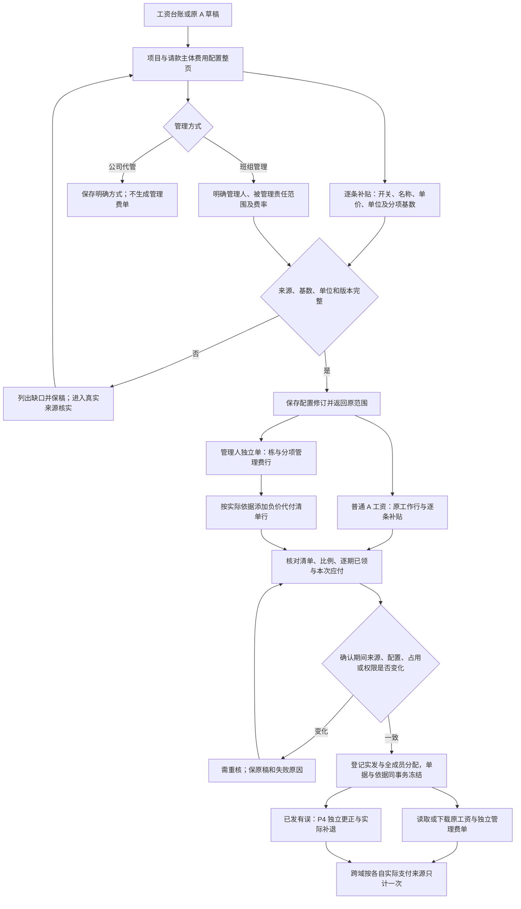

# P5：分项多条房补、独立管理费单与负价代付依据

> 本地实施票，非权威源，尚未外发、尚未实施或验收。2026-09-13 独立准备，承接开放 [#412](https://github.com/zodea/crm-new/issues/412)。P0 已提交 `1de44da2fdeb8091fb0e2cc2f3bcfd9794e07fc3`；P1 仍在整合，P2–P4 目前为本地准备票。正式实施以 P4 最终提交为基线，不将设计稿运行或当前工作区视为中央验收完成。

**交付行为：**经办人为当前项目请款主体明确配置多条补贴的开关、金额及适用分项/基数；A 工资按原完成责任和实际现场量逐项计房补。明确存在班组管理时，按该管理关系覆盖的真实施工范围生成管理人自己的管理费进度款单，逐栋、逐分项、逐单位核对，可登记有依据的负单价代付清单行；公司代管不生成管理费单。核对时看清普通工资、补贴、管理费及负价行，发放后各单冻结，实际支出及后续更正沿同一来源计一次。

**Blocked by：**[P0 完整原图与独立来源](00-central-history-and-sources.md)、[P1 A 实际量/责任/工资价/固定版本发放](01-central-a-payroll.md)、[P4 更正及实际收付](04-central-adjustments-and-actual-payments.md)最终提交；P4 的共用发放与跨域链继承 [P2 C1](02-central-c1-attendance.md)、[P3 C2](03-central-c2-daywork.md)。C1/C2 为各自来源及输出回归依赖，不作为房补平方米基数。P6 户级空鼓与 P7 批量资金/整册输出仍另有义务，本票不提前实现或取消。

## 有效依据与旧义务去向

本次实时读取 [#117](https://github.com/zodea/crm-new/issues/117)正文及九条评论、[#198](https://github.com/zodea/crm-new/issues/198)正文及四条评论、[#287](https://github.com/zodea/crm-new/issues/287)正文及四条评论。#412 开放状态及四条评论由 Root 同期复核。方向按 [#287 最终决议](https://github.com/zodea/crm-new/issues/287#issuecomment-5294862416)，具体费用义务沿 [#117 配置深化](https://github.com/zodea/crm-new/issues/117#issuecomment-5015242817)、[配置收口确认](https://github.com/zodea/crm-new/issues/117#issuecomment-5015296973)与正文 D7/D8/D9；关闭旧 Issue 不取消仍有效义务。

长期口径见[母规格 P5](../payroll-central-spec-draft.md#纵向分期与依赖)、[工资页面](../../../rewrite/pages/subcontract-payroll.md)、[班组页面](../../../rewrite/pages/base-crew.md)、[DATABASE](../../../rewrite/DATABASE.md#工资完整资料中央接管412)、[ADR 0020](../../../adr/0020-browser-authority-and-demo-workspace-boundary.md)、[ADR 0014](../../../adr/0014-full-page-entity-forms.md)。本票链接真实接缝，不复制字段表。

| 已定要求 | 本票实现或保留去向 |
| --- | --- |
| #117 ④：请款主体 × 项目建档，逐项开关、金额自定、补贴可多条、基数可选 | 工资域保存主体费用配置及修订；每条独立身份、适用范围和依据，不用一个班组房补开关代替全部配置。已证默认房补 1.30 元/㎡，可修改，不将默认值冒充旧明确配置 |
| D8-3：墙砖/地砖计房租，岩板/窗台/脚线/淋浴板/管理单无；37.3=36+1.3 | 分项级适用标志，墙/地砖按已确认语义默认开，其他默认关；汇总能拆明工资价与房补价。管理费单不再叠房补，不能对所有清单量收一遍 |
| D7：公司代管没有管理费；D8-4：管理人自己的进度款单 | 管理关系明确管理人稳定 ID、范围及费率；每一实际管理费簿独立核对、发放和累计已领，不塞到班组长普通工资上，不因同人为负责人而混合两本 |
| D8-4：栋 × 分项汇总量 × 自定费率，支持 -20×30套负价代付 | 基础管理费来自原完成事实及适用管理范围；负价行是有明确数量、单位、原因和责任依据的独立清单组成，不能将所有普通工资单价校验改为允许负数 |
| D3/D4/D6：当月起配置/价格修订、变化重核、已发冻结、实际为准 | 费用配置、适用基数、责任和每条费率纳入核对版本与冻结依据；旧月不从当前默认值重算。未支付不发放、不写实际0；单据比例沿 P1/P7 既定行为 |
| D8-1/D9：A 进度请款链及管理费格式、原工资表签字 | 管理单按 A 的进度款结构独立输出，逐月实际已领行、比例、取整及实发分别展示；费用组成先进入其应有的清单合计，不能把负价清单行混成 P6 空鼓扣项。原审批表被工资签字载体取代的决定继续适用 |
| #117 ⑧：工具页退役、取整/房补/管理费归建档配置 | 不复活 WAGE/PAYSLIP 双源、旧工具页或另一套工资账。整册、项目序号与批量资金建议在 P7 验证，本票提供可组合冻结输出数据 |
| #287：直接工资来源、B 退役、成本只计有效实际一次 | 甲方 BOQ/劳务合同价不生成费用；普通工资与管理费是各自有依据的实际工资支付，不能再把其核算组成、个人分配、负价行和 P4 调整逐项另记成本 |
| #198：真实量入口、页面闭环及界面矩阵 | 费用配置、核对、量/责任返回、冻结输出走真实中央边界；无阶段/坏来源不退到全工种全项目。五档局部横滚、确认焦点、错误原稿、指南/PDF与独立双轴保留 |

#117 设计实施评论与本地 [DC 请款簿样例](../../../../DC重构设计源码/kit/data.js)证明独立管理费单及费用呈现意图，不证明中央实现。原 Excel 样本路径当前工作区不存在；本次没有声称检查原工作簿。实施须用真实源和下载文件复验，不能拿设计种子代替原件或把原文件中未查证细节提升为业务规则。

## 用户路径、异常和回退

“自动生成”指从明确管理配置和范围派生单据草稿/核对内容，不是读列表即写库、自动创建 released，或每次返回创建另一张管理单。相同配置/期间重复发起定位同一合法草稿；不同命令竞争也必须经服务器唯一性判断。公司代管使本期无管理费资格，不删除原已发管理单或历史记录；已有未发管理稿显示范围变化需处理，不能默默发空单。

从工资进入配置/现场量时保工资 ID 或新稿 draftKey、项目、负责人、月份、档位、origin 和返回列表范围。返回重新读取权威事实，明确显示变化后才能核对；query 不替代实体身份，不因同名管理人或相同显示标题换簿。配置/管理单为独立整页，行级负价依据编辑可沿轻量行对象交互；放弃、确认取消、未知结果、KeepAlive和冷恢复均沿共用状态协议保稿。

## 实际代码接缝与必要补齐

| 本次核得现状 | 最小合法实施接缝 |
| --- | --- |
| [真实迁移 v19](../../../../app/lib/db/migrations.ts)只给 crews 加默认比例、房租与管理提成的开关/非负单价；[主档表单](../../../../app/lib/master-data/forms.ts)启用时要求单价 | 保留主档 owner 及校验。班组默认不是项目/请款主体费用事实，不能只读取当前班组字段就直接影响所有历史工资；0、null、未导出分别保存 |
| [中央班组 DTO](../../../../app/lib/crew-worker/read-contract.ts)已有上述默认值；[迁入 source](../../../../app/lib/migration/core-local-source.ts)当前 crews 仅导 id/name/default_pay_ratio/deleted_at | P5 补受控导出、decoder、迁入 owner 的费用默认与已知来源保全；旧缺字段是 unknown，不能用表单 false/null 或新默认1.3声称原来明确关闭/配置。工资只消费带版本的受控 facts |
| [P1 schema](../../../../app/lib/payroll/central-schema.ts)的主体配置只有初始比例，价格修订是原分项工资价；无多条补贴、管理关系、费用角色或代付组成 | 工资域新增/扩展有稳定 ID 的费用配置修订、管理范围及冻结组成，准确 schema/DTO 由 A/B 开工一次冻结；不复用已退役的幽灵班组项目表，也不建立第二份工程量或工资主表 |
| [P1 量 facts](../../../../server/utils/payroll-quantity-facts.ts)以完成时物理 assignment、scope 和现场量提供原工人/班组；[计价器](../../../../app/lib/payroll/central-a-calculation.ts)只认该责任及有效工资价 | 补贴沿对应原工作行；管理费通过明确的管理关系覆盖这些事实，原执行人与收管理费的人分开。管理人不是施工执行人也不能伪造 assignment；不以当前成员、当前楼栋完成数或月汇总替代历史范围 |
| P1 的去重与此前已付均按 A/负责人，原唯一键是项目/负责人/月/格式/档位；见 [command](../../../../app/lib/payroll/central-a-command.ts)及 [service](../../../../server/utils/payroll-a-service.ts) | 增加可证明的请款簿用途/费用角色关系，使同一管理人普通 A 与管理单可分别存在、累计各自已领。管理费仍是 D9 的 A 衍生单，不直接把设计稿 MGR 字符串变成新的工资事实族；唯一键、读取、比例沿用、来源锁和付款历史一起处理 |
| [P1 工资价格](../../../../app/lib/payroll/central-a-prices.ts)禁止负数，当前冻结输出只覆盖普通 A 工作行 | 负价代付只由封闭的管理费清单组成命令进入；工资正常基准价、补贴正向费率、班组默认校验不放宽。冻结输出明确分别呈现工作、补贴、管理费及代付组成，不把负值截成0 |
| DC `linesMgr` 按姓名排除本人/名单、使用默认2.5及每户量×完成层数；配置界面实际只放一条房租 | 仅用作视觉和负价示例，不复制名称匹配、缺人回填负责人、`rate || 2.5`、全楼层乘法或单补贴限制。当前分项没有已证房补语义标志时，由明确项目分项配置确认稳定 ID；不能永久硬编码中文名称来决定待遇 |

## 原责任、费用组成与计量

### 多条补贴

- 每条有稳定配置/修订身份、显示名、启用状态、非负单价、计量单位、明确分项与范围、所用基数及生效依据。两个不同补贴可以合法作用于同一量；同一补贴 ID 的重复请求/重复连接不能计两次。不能按名称合并两个独立补贴，也不能因为同量重复出现就删除另一已配置补贴。
- 已定默认是墙/地砖房补1.30元/㎡，其他分项默认关，管理单无房补；逐项可配置不是给所有平方米行默认待遇。初始化只提供可核对的建议，必须落到当前项目真实 item ID 和明确适用标志。名称变化不重置开关，同名不同分项不自动继承。无法证明墙/地砖分类时显示待确认分项，不能猜后发放。
- 已证可实施基数是当前主体明确选定分项/细分范围内的真实完成现场量，单位相同方可相加。每条可选不同分项集合；空集合、缺 scope、停用来源或读取失败不代表“全项目”。其他基数类型见末节 local grill，不能把尚未列明的金额百分比、按人固定额或按月金额默默加进公式。
- 原工资价与房补价分开保存和展示。36+1.3=37.3 可用于汇总核对，但不得写回基础工资价37.3再另加一次房补。未知量/未知单位不补0；已知0保留依据与0金额。关闭项不扣旧月已发房补，发放前改变配置使关联已核对单重新核对。

### 独立管理费单

- 先证明管理人稳定身份、项目及实际被管理责任范围，再按原完成事实聚合为“楼栋×分项×单位”管理费行；行下保 completion、assignment、scope、unit/room/item 及费率版本。费率2.5是已定实例，金额允许自设；不能缺配置就隐式按2.5计薪。
- 普通工资领取同一施工责任的互斥规则继续有效。管理费引用该施工事实作为管理费基数，必须附独立管理关系/费用用途，不能冒用管理人为原执行人再领一遍普通计件工资。重复管理单、换月份/重建完成记录/拆分展示行不能重复领管理费。普通工资和管理费可共享原量证据，但没有两笔实际发放就没有两笔实际成本。
- 同一负责人兼任管理人时，两本的累计核算、逐期已领和 P4 更正/收付处理分别按真实簿及用途核对；人员收款视图可按该人实际分配汇总，但不能把普通工资已领1000扣进管理单应领500。原旧 A 没有用途证据时保原身份，不推断所有该管理人的历史 A 都是管理费。
- 公司代管只影响其明确范围；不能因项目中有一个代管簿取消其他合法管理费，也不能把一个班组当前所有成员自动纳入同一管理关系。后续转组、改名、管理人变更不改已发归属；改管理范围后历史占用及更正关系仍须可追溯。

### 负价代付清单行

- 已批准的例子是“淋浴板未收尾代付，30套×-20元=-600元”。保存数量、单位、负单价、有符号金额、原管理单/管理范围、具体事由和经办确认依据；如存在已接管的对应处理事实则保稳定引用，不能只存自由负总额。条目可以因未收尾产生，不能要求先伪造该处已经完成，或将30套灌进普通已完成现场量。
- 负价行纳入管理单清单合计，沿原 A 请款结构计算；它不同于 P6 位于请款合计之后的空鼓扣项。不得一面减少单价一面再扣一次同一600，也不因通用金额格式拒显负号。
- 负价计算本身不证明现金已经代付给另一人。若真实代付另有 P4/其他 owner 的实际支付事实，只通过原事实回读且只计一次；不自动生成银行付款、合同劳务成本、第三方借款或收款人分配。无 canonical 对方关系时说明未关联，不按备注姓名串账；额外跨主体现金政策见 local grill。
- 行级资料错误可在未发草稿中修订并重核；已发后只能 P4 独立更正及实际收付。删除原负价行、普通编辑原工资、软删整张管理单都不能当作冲销或退款。

## 数字反例与防双计

下表默认金额为元；采用整数分与项目既有精度规则，不以二进制浮点容差放过半分。比例/取整只用于所列示例，不能把示例值强制为配置政策。

| 输入 | 必须能解释的结果 |
| --- | --- |
| 墙砖100㎡，工资价36，房补1.3，另有不计房补的淋浴板30套 | 墙砖工资3600、房补130，汇总墙砖3730；30套不进入130的基数。不得37.3×100后又加130得到3860 |
| 墙砖100㎡、地砖50㎡；房补1.3适用二项，另独立补贴0.2仅墙砖 | 房补195、另一补贴20，共215；不是两个补贴都乘150，也不能因第二条共享100㎡而删掉它。关闭第二条后新核算195，已发215的旧快照不改 |
| 房补范围同时误含墙砖100㎡及窗台10m | 明确单位/适用错误，不能算110×1.3；null现场量不算0，真0㎡算0且保行。配置价0仍为已配置，不回填1.3 |
| 管理范围1栋墙砖400㎡、地砖200㎡，费率2.5 | 独立管理费1000+500=1500；普通工人原计件工资不因创建管理单重复增加，管理人普通 A 的既往实发不扣进本单 |
| 上例有30套×-20的明确负价行，比例80%，此前本管理簿已领200，不取整 | 清单合计900，比例后720，扣本簿已领200，本次核算520；不能遗漏负号、把600扣两次，或按空鼓位置改成1500×80%-200-600=400 |
| 管理配置改成公司代管；另一范围仍明确由管理人管理 | 新公司代管范围不生成管理费；其他范围继续按其配置。既有已发管理单仍可读并计原实际，不软删历史冲账 |
| 原管理单实发1000，发现负价漏计100，只确认核减，无退款 | 原签名1000，实际仍1000、待处理100。次月实际发900后合计1900，关联抵扣不再减100；真退100则净900。两条处理路径不能同时清同一余额 |
| 已发房补少计100，核增但还没补；随后真补100 | 未补时实际不增加，补后从1000到1100，不能更正和补发各加100。新 A 累计量/费用已包含该更正时不叠加，退款不重新生成已处理领取额 |
| 管理人实际领500，原工人工资实际合1000，负价行只是500内的核算组成 | 实际工资成本1500；不再加“管理费核算额”、个人分配或负价处理金额。若另有真实代付，按其唯一事实单独判断，不从本行推一笔未知现金 |

## 配置版本、发放冻结与恢复

- 配置按项目/请款主体和明确用途读取；保存使用原 baseVersion、费用修订 ID 及 commandId，来源读取时同时核 manager/成员/项目关系。班组默认只能在建档建议中解释来源，不能因后续默认变动无审计改所有工资；已采用的项目配置保持自己的修订。
- 核对指纹包含费用开关、逐条费率/基数/单位/适用分项、管理人及管理范围、负价行全文、实际完成责任和 P4 已领/已处理版本。内容变化即需重核，不只比较金额总和；对换两条同额补贴、重命名之外的责任变更、同额负价原因更换都不能漏过。
- 检查当前可用来源与保留历史是两种用途。新配置/发放不能使用已失效的当前目录关系；原完成责任和已发费用事实允许读取其历史稳定关系，不能因祖先停用把已发实际清零。缺链诊断限定受影响的原主体和范围，不以当前名册替代旧施工人。
- 所有费用事实、单据组成、来源占用、分配、审计、版本和回执同一 workspace 队列/SQL 事务提交。量 facts 同 tx 读取，不在队列内调用普通服务再次入队；最后一次异步 owner 等待后复验权限、项目/管理人/原责任及内容版本。失败不能先发布 owner Map 或留下已创建管理单半图。
- 已发冻结管理关系、原执行人、费用配置版本/基数、逐条正负组成、量价、比例、实际及全成员分配、当时名称与输出内容。另窗改变配置后重试旧 command 保原正文恢复结果，不改写成当前版本的新命令；未知或成功读回失败保原 pending，明确未应用才允许原稿修正。
- 迁移扩费用配置、管理关系、组成/处理关联和已发来源图，兼容缺字段旧批次。原 P0 snapshot_json 全文及不可证明历史不裁、不补造管理人/分项ID；映射另存，不递归替换未知扩展。旧默认0/null/缺字段、有多条费用原文但无稳定身份、历史负价及独立管理单均有诊断保全样本。
- 重复迁入不覆盖接管后配置/费率修订或独立管理单；危险恢复删除前检查全域日常配置、receipt、普通/管理工资、负价引用及 P4 更正/补退，含软删、零成员、另批次、独立来源和跨项目真实引用。失败整批及 revision/回执/其他 owner 不变；无关项目不能一概阻断。保留 [现有引用解析](../../../../server/utils/payroll-a-migration-references.ts)的明确合同和 [原图入口](../../../../app/lib/migration/payroll-source.ts)的归属审计门禁。

## 输出、范围返回及所有权建议

普通 A 输出列清工作金额和逐条补贴及基数，能验证36+1.3；独立管理费进度款单显示管理人、范围、栋/分项/单位、正费率行、负价代付行及理由，再列比例、逐期实际已领、取整和实发。各自工资签字表只用自己的冻结实际及人员分配，不加另一张审批表，不把管理员出勤从工人工作量造出来。费用明细跨页仍读全，负号/单位/理由/页码不得裁掉；下载须是实际可打开的 PDF/打印和 Excel 文件。

P1–P3 已有输出格式继续回归，C2 始终为签工记录+工资表，不因本票费用组件改成考勤表。P7 完整月度/全周期工作簿、序号、名册整册与批量资金建议仍未验收；P5 只交付可组合的费用与管理单冻结部分，不能凭一个管理单页面宣告整册完成。

| Owner | 建议唯一范围与开工接口 |
| --- | --- |
| A 工资领域/API/Repository/store | 费用配置修订、管理关系/簿用途、清单组成封闭合同，普通 A 与管理单唯一性/领取边界，核对指纹、发放、P4 处理及冻结输出DTO；统一预算/工资实际来源身份，不新增普通价格负值通道 |
| B 来源、迁移与受控 owner 接缝 | 班组默认明确来源投影及迁入保全，原实际量/责任/管理范围 facts 同 tx读取，全部新图/审计/回执与日常引用恢复保护；负价已有事实引用跨域时只接真实 owner，不改量或编造现金关系 |
| C 页面、状态与真实浏览器 | 配置多条编辑、原稿/版本恢复、管理人独立单、逐条来源返回与诊断、输出实际下载；公共原语和领域状态按现行归属，五档布局/长文/多来源/键盘焦点逐图验收 |
| Root 集成与独立复核 | 开工冻结A/B/C接口和真实前置SHA；对确切local grill更新权威决定，文档/指南/PDF/元数据、最终全量/类型/构建、独立两轴、限定范围证据和单票提交 |

## 真实验收夹具与未完成 AC

从真实 SQLite 建两个项目及同名不同ID的人，原完成个人/班组责任、细分scope、墙/地砖/其他单位分项、null和0现场量；管理人同时有自己的普通施工簿，另有公司代管范围。用公开主档/工资配置保存默认与多条补贴，再公开核对、发放普通A和管理单；不要手写健康已发快照。保留旧未知分类/缺费用字段/部分snapshot、原负价历史与 B 隔离样本；真实导出bytes、hash、dry-run、confirm后从公开 read/command 验证。

- [ ] **多条配置闭环：**独立项目/主体配置能保存、增删未发配置行、逐条开关、改金额及选分项基数，冷读保持稳定ID/修订。默认墙地砖1.3、其他关，分类无证据明确待确认；已明确0不回填，空/未知不变成0或关闭事实。
- [ ] **分项及单位：**100㎡墙砖36+1.3得到3600+130，第二补贴0.2仅墙砖及50㎡地砖样本结果215；淋浴板/管理单不计房租，㎡/m/套不能混量。缺量、缺scope、坏日期、真实0及多阶段/重建completion均保原事实诊断，不扩大全项目。
- [ ] **原责任管理范围：**管理费按原完成assignment/scope和明确管理关系派生栋×分项×单位行；改名、转组、换责任/管理人不改历史。公司代管范围不生成管理单，其他范围不误取消；管理人不必冒充原执行人，同名/异项目/合同劳务不能被接入。
- [ ] **独立簿和唯一领取：**同一管理人的普通A与管理单可分别发放、输出及累计各自已领；重复草稿发起、双窗生成/发放、软删头、月份变化、责任/完成重建均不重复领取。合法管理费引用原量不会被当普通工资抢占，也不能借用途切换绕过原工资互斥。
- [ ] **负价依据：**30套×-20=-600清晰可回读；1500-600后×80%-200=520，负号及单位保留，不转为P6空鼓位置。缺理由/串管理范围/只填自由总额/伪完成源拒绝；普通工资基准价仍拒负数。负价行不会自行生成第三方实付或预算抵扣。
- [ ] **配置与固定版本：**改开关/同额不同基数/管理关系/负价原因/原量/费率触发需重核，确认期间变化拒绝且保稿；初始班组默认与项目已采用配置独立。两个窗口旧版本不覆盖，同键异文拒绝，同键重放不多一份配置或管理工资。
- [ ] **冻结与更正：**真实release后原责任、费用组成、原文、实际、分配与签名输出不变；只走P4独立更正。1000核减100无退仍1000，后月900总1900、真退净900、核增后真补到1100；已纳入新累计更正不再加减，退款不重开领取额。
- [ ] **实际来源一次：**普通工资实发1000、管理实发500成本1500，成员分配/补贴行/负价行/更正不另计；预算、项目、人员/班组、付款只读来源一致。存在真实代付时只按其已证实际ID处理；未知对方或其他域缺源仍显示未关联/部分，不按名称归并。
- [ ] **公开事务及权限：**无工资写权限、来源无权/停用、最后owner等待后撤权、并发更正/恢复、SQL故障均检查头/行/来源/审计/receipt/revision无半写。只读历史不强借全部工程量或人员目录权限，链接按目标授权和当前真实关系开放。
- [ ] **迁入与危险恢复：**旧省略费用属性/显式null/真0/关闭、多条原文及独立管理单保真；真实日常save→核对→发放/更正后重复迁入不覆盖。含软删、零成员、独立配置/receipt、跨批次/项目引用的恢复删除前整批不变，不相关引用不误挡，不能只合成单表假装集成。
- [ ] **页面状态与返回：**工资/管理单/配置/量来源往返保原实体ID、费用行目标、draftKey、项目/月份/负责人/档位/origin和列表筛选。路由复用、冷恢复、KeepAlive、放弃确认、迟到读、断网/坏响应、未知及成功读回失败均保对应原稿/pending，不放开新写覆盖未知结果。
- [ ] **五档与实际输出：**390/768/1024/1280/1440逐图验证多条补贴、同人两簿、零/未知、长原因/≥4来源、负价及错误态；表仅局部滚动、键盘可读全、确认取消回焦点。普通A与独立管理单实际下载/打印逐页无截断，Excel数值和冻结签名金额一致，C1/C2原输出不回归。
- [ ] **交付状态：**全部定向红绿及最终全量/类型/规范/构建通过、独立Spec/Standards无未决；权威数据/命令/读模型/页面、使用指南及PDF同工作单元更新。浏览器中央验证与Tauri本地边界分别明确，无本地正式回退/新工资副本/生产依赖；P6/P7及其他成本缺口不标已完成。

## 已可决定与 local grill

已定的多条补贴、分项开关及自定价、管理人独立单、公司代管无费、负价清单行、真实量来源、三态冻结与成本防双计无需再问。稳定ID、费用组成与配置修订、用途隔离、同事务复验和只读跨域facts属于必要接线；数据库暂未有表不是取消旧义务的理由。

以下仅保存本地具体缺口，不向用户发起新问卷、不擅自用设计种子作政策。可先实施已证路径，但最终完整验收不得把这些未决写成已关闭：

| 缺口与证据 | 可先实施范围及必须保留的裁定点 |
| --- | --- |
| “基数可选”已确认，但现存评论没枚举所有基数；DC只演示选定分项工程量 | 多条补贴先具备真实分项/范围选择和单位核验；需要金额比例、每人/每月固定额等额外基数时，须有具体样本决定单位、发生期间及叠加关系。不能把“可选”缩成永久只读一个合计，或擅造任意公式引擎 |
| DC管理费实现排除管理人本人及额外免管理费名单，正文只明确公司代管无费及管理人独立单，未找到该自动名单的最终决定 | 明确配置的被管理责任范围和公司代管可落实；管理人本人施工、跨多个负责人簿范围、未配置时自动取哪些分项/人，须据具体管理关系裁定默认规则。不能按当前名字/名单自动排除或扩全班组，也不因缺默认策略阻止明确范围内的合法管理费 |
| 负价代付行已批准，但原示例未提供实际对方收款/付款事实ID，当前无工人/班组与劳务supplier的canonical映射 | 先保清单数量×负价、原范围与经办依据，不能自动推现金。若要联动跨项目/跨主体代付结清或借款追偿，需具体真实对方、原收付和承担关系；P4既定同源补退可复用，但不能把负价本身当已退款或给乙方内部工资造桥 |

不新增C1按工时或C2按工数套用平方米房补的公式，不恢复B，不提前实施空鼓自动扣罚、整册资金分摊、银行对账或生产部署。准备交付仅本票；所有 AC 未勾。完成 P5 准备后停止扩展 P6。
