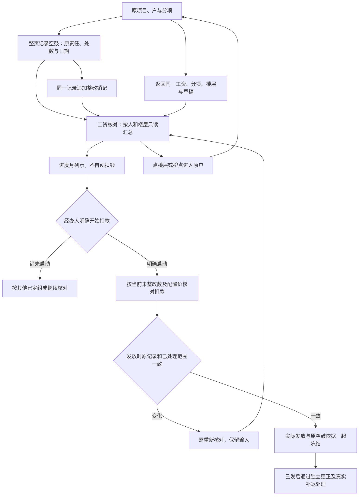

# P6：户级空鼓、整改销记与人工工资扣款

> 本地实施中，尚未外发；所有交付验收项仍未完成。承接开放 [#412](https://github.com/zodea/crm-new/issues/412)，从 P5 后置登记 `e344a5444cd52bfeb65e78b031912d5241666fc0` 开始；该基线正常提交检查为 741 文件、4192 项通过。P0–P5 及工程量、名册已完成的限定能力继续沿用，不恢复 B 类或已废除的每月暂扣、返还机制。

## 当前依据与交付路径

2026-09-13 重新读取 #412、[#442](https://github.com/zodea/crm-new/issues/442)、[#407](https://github.com/zodea/crm-new/issues/407)、[#410](https://github.com/zodea/crm-new/issues/410)及 #412 明确继承的 [#117](https://github.com/zodea/crm-new/issues/117)。当前工程量有区域、户、分项、原责任和阶段完成事实，但应用及服务器中没有可用的户级空鼓记录与整改销记命令。项目罚扣已有整改、分包结算抵扣，却没有证据证明它就是工人的户级空鼓来源，不能直接借用其金额或同名事由。

本票贯通：现场经办人从原户记录空鼓并销记整改 → 工资核对页只读聚合原位置及数量 → 人工开始扣款 → 复验当时未整改数量及配置 → 实际发放冻结 → 之后通过独立更正处理差异。补齐原来源是本票必要前置，不将工资手填总额包装成户级事实。

已采纳决定：

- [D5 户级来源及 D8 行序](https://github.com/zodea/crm-new/issues/117)：记录归楼栋、楼层、户和分项，工资按原责任人聚合，整改及维修统计消费同一记录。
- [配置深化](https://github.com/zodea/crm-new/issues/117#issuecomment-5015242817)及[配置收口](https://github.com/zodea/crm-new/issues/117#issuecomment-5015296973)：分项开关及单处金额可配置，默认 30 元/处；后续更具体的人工启动决定优先于早先默认扣款时点。
- [核对⑥](https://github.com/zodea/crm-new/issues/117#issuecomment-5015344952)：进度月仅列示；人工“开始扣款”后，按仍未整改处数乘单处金额，置于本次请款合计之后、取整之前。离职且仍未整改只提示经办人启动，不能把提示当成确认。已整改不扣，暂扣返还废除。
- [核对⑨](https://github.com/zodea/crm-new/issues/117#issuecomment-5018217081)：A 核对页显示本簿实际施工楼层，区分往月完成、本月新增与未涉及；未整改楼层显示橙点，清单行高亮对应分项楼层，点空鼓位置进入真实户记录。C1/C2 不造楼层视图。
- 已发冻结、独立更正与实际收付沿 [P4](./04-central-adjustments-and-actual-payments.md)；未发生现金退回不改历史实际成本，后期少发与原更正须有真实处理关联，不能双扣。

## 已作判断与实现边界

| 判断 | 依据及结果 | 必须验证 |
| --- | --- | --- |
| 空鼓是数量事实，罚扣是另一个业务来源 | D5 与 #410 各自有明确归属；同名事由不足以合并 | 户级记录不生成项目罚扣或分包结算抵扣，已有罚扣不被自动重复计薪 |
| 原责任和可见祖先要可证明 | #442、ADR 0010 与 P1 已冻结原 assignment/scope | 后来转组或替换责任不把旧空鼓移给当前姓名；缺原身份保诊断，不能扩全户/全分项 |
| 整改保留事件与余量 | 核对⑥要求同源销记，不是删除旧记录 | 原记 19 处、整改 4 处，余 15；再整改 16 拒绝，重复命令不再减 4，真余 0 保留 |
| 先列示，确认后才参与扣款 | 人工启动取代早期自动扣款时点 | 19 处未启动应发不变；启动且余 15、单价 30 时扣 450，位于本次请款合计后、取整前 |
| 未整改与已实际处理必须分别可追溯 | P4 防双计、后续更正不能改旧实发 | 同一处在结算及尾款不可重复扣；后期整改不能直接删除已发扣款或产生假退款 |
| 冻结与当前事实并列读取 | P1/P4 已发不可修改 | 发放后改处数、整改、改价或转组不改原工资和输出，当前页面仍可说明后来变化 |
| 楼层视图只用真实施工事实 | 核对⑨，完成不能由责任分配替代 | 跨楼栋同层不同身份、同簿多分项及同月新旧完成分别标识；点第二户返回保持自己的位置 |

数据字段的最终权威写入 [DATABASE](../../../rewrite/DATABASE.md)，动作和读取写入 [COMMANDS](../../../rewrite/COMMANDS.md)、[READ-MODELS](../../../rewrite/READ-MODELS.md)；本准备票不先复制一套表结构。最小来源需要稳定记录 ID、真实项目/户/分项及原责任关联、发生日期和数量、追加整改事实、来源版本及经办历史。按“处”记录，不允许负数或未知值被默认为零；是否有原检查记录决定“暂未排查”与“已记录零处”，空列表本身不能证明已检查。

新增/编辑业务记录沿 ADR 0014 使用独立整页；确认整改或启动扣款是明确的小动作。每次命令重新核验当前权限、项目及关系、版本、原提交身份，来源与工资共同进入已有串行事务边界，不在持有事务时二次入队。最后确认后冷读同一事实，失败保输入，结果未知恢复原键原正文。

历史原件或旧空鼓文字没有稳定户/责任时保留原文并提示，不能从“37楼19处”猜唯一户。若旧库没有相应结构，本票只迁入可解释的原数据，不造演示空鼓。所有新增来源、整改、已采用扣款、冻结/更正及回执引用纳入危险恢复保护；重复迁入保留后来修改，失败整批不变，软删或零余量不能解除已有引用。

## 工资呈现、返回与输出

工资页显示原位置、记录数、已整改、当前未整改及扣款是否已人工启动；多栋同层不可只显示一个楼层数。需要修正时进入对应原户记录，返回原工资或未保存 draftKey，保项目/月/负责人/分项/原楼层及输入；读取失败不显示旧总数冒充当前结果。

楼层格子依据该簿原完成事实区分往月与本月，月份之后完成不混入；缺合法日期或责任时给明确诊断。空鼓橙点既有文字说明，也支持键盘到达，不能只靠颜色表达。原记录不可见时给原因，不借链接暴露另一项目的姓名或房间。

冻结工资表按既定行序显示逐月已领、本次请款合计、处数×单价扣款、取整及实际发放；未启动则只列示。导出的数量、负号、位置及整改截止事实与冻结数据相同，不能用打印时的当前整改数重算。P7 负责完整工作簿组织，本票输出须能组合进入 P7。

## 验收条件

- [x] **来源闭环：**公开工程量入口记录真实户/分项/原责任空鼓，保存后冷读；追加部分与全部整改，原记录和事件可追溯，未知排查与已知零不同。
- [x] **原身份：**同名人、跨项目相同楼层、当前转组/换责任、软删原关系、缺失 scope 与不适用分项都不误归属；有原证据则保留合法历史来源。
- [x] **计数和启动：**19 处整改 4 处余 15；未启动不扣，启动按 30 扣 450；明确零价与缺价区分，非法处数/超额整改拒绝。离职提示取消不写入。
- [x] **并发与复验：**核对后新增整改、改价或另一单处理同来源时，旧确认持久需重核并保原输入；双窗、同键重放、同键异文、最后授权变更和 SQL 故障不产生重复处数或半写。
- [x] **冻结和后续：**真实发放后变更当前记录不改原工资、扣款依据及输出；已扣来源不能在尾款再次扣，同源 P4 更正/少发/真退款守恒，不恢复自动暂扣返还。
- [x] **楼层交互：**本人实际楼栋/楼层，往月/本月/未涉及状态及橙点符合手算；点清单联动分项范围，第二楼层/第二户往返保持自己的定位，C1/C2 不显示该能力。
- [x] **迁入与恢复：**原文字、缺关系、真零及后来日常数据分别保真；恢复删除前识别空鼓/整改/采用/更正/回执完整引用，全库及版本失败不变，无关范围仍可合法恢复。
- [x] **页面状态：**整页取消、脏稿离开、冷刷新、KeepAlive、路由复用、迟到读、撤权、断网和成功读回失败分别保实体与 pending；只读页不给新写资格。
- [x] **实际视觉与文件：**390/768/1024/1280/1440px 的多层、多分项、长位置、未知/零及确认态逐图检查；仅领域表格滚动、键盘焦点可达。真实打印/Excel 回读数量、金额和原位置并逐页检查。
- [x] **同单元交付：**定向、最终类型/完整测试/规范/构建、非作者 Standards/Spec 均通过；权威源与工程量/工资 Markdown 指南同步更新，单票与总图附实测图，精确提交不提升生产等级。产品打印只按实际输出逐页验收，保留必要页图，不另批量交付指南 PDF。

## 留待业务裁定的最小问题

“开始扣款”已明确为人工动作，但现有最终评论没有明确一次启动对后续单据的持续范围，也没有给出同一批空鼓部分实际处理后的后月算例。实施先接齐户级记录、整改、只读楼层及明确单据上的人工确认；发布持续自动继承或结算/尾款重复处理之前，需用一个具体例子裁定：结算时 15 处已扣、尾款时原 5 处仍未修且另增 2 处，尾款是否只由经办人确认新增未处理的 2 处，还是采用另一种明确余额规则。无论选择哪一种，都不能把已处理的 15 处重复扣，也不能因后期整改自动退款。

这是局部取舍，继续保留 local grill，不阻断已完成的原来源、整改、只读楼层及具体工资单人工启动；不重新询问已定的人工动作、行序、默认单价或 B 类退役。P6 限定产品提交为 `edc03faba20e0c5c665b7fc2011e2a4120d8428f`；正常提交钩子类型检查及完整 `npm test` 782 文件 / 4312 项通过（326.16 秒），240 个源码 Git 对象与冻结清单一致，非作者 Standards/Spec 无阻断。P7 继续承接批量资金建议、全周期/按月工作簿和整体工资联验。
