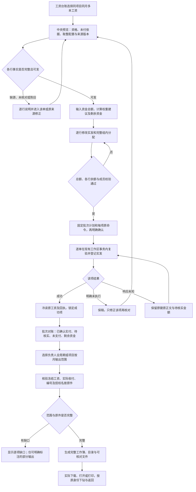

# P7：批量资金建议、逐单发放与完整工资工作簿

> 本地实施准备票，非权威源，尚未外发、实施或验收。2026-09-13 重读开放 [#412](https://github.com/zodea/crm-new/issues/412)正文及四条评论、其继承的 [#117](https://github.com/zodea/crm-new/issues/117)正文及九条评论。P0 已提交 `1de44da2fdeb8091fb0e2cc2f3bcfd9794e07fc3`；P1 正在最终整合，P2–P6 为本地实施/准备票。当前单张输出或设计稿演示均不代表本票完成。

**交付行为：**经办人在工资入口按项目和月份选择多本可发工资，输入本期资金总额，看清各簿当前未付应领的来源、权重、取整建议和未分配资金；逐行修改实际金额及组内分配，确认后逐单得到确定成功、确定未执行或结果待核实。成功项不再发，未知项按原命令恢复。由同一冻结工资、实际收付和授权名册生成负责人全周期工作簿与按月工作簿，保留正式编号、真实文件组织、每种格式的原表、公式应付与实际支付对账。

**Blocked by：**[P0 原图、隔离与来源](00-central-history-and-sources.md)、[P1 A 工资与逐单事务](01-central-a-payroll.md)、[P2 C1 考勤](02-central-c1-attendance.md)、[P3 C2 签工](03-central-c2-daywork.md)、[P4 更正与实际收付](04-central-adjustments-and-actual-payments.md)、[P5 房补与独立管理费](05-central-housing-and-management-fees.md)、[P6 空鼓与人工扣款](06-central-hollow-and-deductions.md)的相应中央链最终提交。P7 不重定其公式、收费范围或扣款时机。名册与照片原件的中央 owner 接缝是本票必须补齐的真实前置，不能以当前没有表/API 为由取消义务；没有证明归属的旧原件也不能补造。

## 有效决定与承接范围

方向沿 #412 明确继承的 [#287 最终决议](https://github.com/zodea/crm-new/issues/287#issuecomment-5294862416)，本票只承接 A/C1/C2，B 永久退役只读。母规格的 [P7 与两类完整工作簿义务](../payroll-central-spec-draft.md#纵向分期与依赖)、[工资页面](../../../rewrite/pages/subcontract-payroll.md)共同限定范围；本票引用依据，不另复制数据字段表。

| 有效依据 | 本票必须交付或明确保留的结果 |
| --- | --- |
| #117 [核对⑧](https://github.com/zodea/crm-new/issues/117#issuecomment-5018217081) | 工资域单入口；项目×月选择多主体，输入资金总额，以各簿“应领−已领”权重建议，逐行可改，批量登记固化。取整、房补、管理费配置留在各自建档入口；不恢复工具页和第二本工资账 |
| D3/D6、[比例最终决定](https://github.com/zodea/crm-new/issues/117#issuecomment-5015356993) | 来源变化需重核；实际发放固定，未支付不执行发放、不固化假零；比例是单据参数，无预排阶梯。结算默认 95% 可改、尾款固定 100%；批量建议不能替经办人改比例 |
| D7、D8-4 | 按请款簿稳定身份区分负责人、组员及管理角色；同人为别簿组员或另一簿负责人不合并。普通工资与独立管理费不因负责人同名而混账，保完整零分配成员 |
| D8-1/5/6 | 原请款链行序；分组小标题、“部分铺贴”行；从原完成位置生成保留断层的楼层区间。分组标题是显示结构，不能另加金额、另生来源或复活 B |
| D8-8 | 全项目递增请款序号和包含项目、楼栋/分项、月份、负责人等真实范围的文件名；不是每人重新编号、当前筛选行号或下载计数 |
| D8-9 | 页面与输出分列公式应付、实际支付及差额，能下钻各自原事实。原决定记录过差额 33291.76；该数字是旧实证，不是本票可照抄的演示汇总 |
| D2、D8-10 | 名册登记表含性别、籍贯、身份证号、劳动合同签订、进退场日期、证件照与银行卡照；在班/离职人数来自真实名册日期。资料归 [工人 owner](../../../rewrite/pages/base-worker.md)与 [#407](https://github.com/zodea/crm-new/issues/407)，不建工资私有人事档案 |
| D9 | 亚运城：负责人一册积累全周期，含月度、结算、尾款；未来印：按月一册并按月文件夹组织。A 普通/管理费保持各自归属；C1 工资与考勤成对；C2 工资与零星用工记录成对，明确不出考勤表 |
| [核对⑤](https://github.com/zodea/crm-new/issues/117#issuecomment-5015310897) | 工资表就是签字载体：签字按手印及班组长、施工员、安全员、现场负责人签字位。旧 D8-11 另附五级审批表已被取代，不能顺带新建审批流或银行付款指令 |

[#117 设计实施汇报](https://github.com/zodea/crm-new/issues/117#issuecomment-5018392493)可佐证表现意图，不能把其中 B、自动补档或演示资金刚好分完当成现行中央规则。[DC 批量原型](../../../../DC重构设计源码/kit/PayrollScreen.jsx)使用默认分母、默认取整档和演示安全教育门禁；这些分支不是无效数据、零权重、真实权限或发放资格的业务依据。

本轮本机未找到 #117 指向的 `参考文件数据/工资发放格式/亚运城C1/`、`未来印/` 原 Excel 目录，因此没有声称重新目检这些原件。已定内容按 Issue 保留；实施时取得真实样例用于版式比对，或按已确认字段/流程生成两份真实数据输出供验收，不能拿 DC 假数字冒称历史原件复刻。

## 正常、失败与恢复路径

批量核对沿 D6 保留：允许从所选草稿逐单核对并报告结果；有来源问题的行不能因其他行通过而自动变为已核对。发放确认是明确小任务，可使用弹窗；创建或修改工资实体仍按 [ADR 0014](../../../adr/0014-full-page-entity-forms.md)使用整页，不把未完成的建档塞进批量弹窗。

## 已核实的接缝与最小扩展

| 当前真实实现 | P7 所需接线 |
| --- | --- |
| [中央工资台账](../../../../app/components/payroll/CentralPayrollScreen.vue)与 [Native 台账](../../../../app/components/payroll/NativePayrollScreen.vue)当前没有正式批量资金计划；P1 [store](../../../../app/stores/payroll-a.ts)已有固定命令、持久化后发送和未知原键恢复 | 复用各格式逐单领域命令。批次状态只保存选择、输入、计划及结果引用，不新增第二套实际工资事实；浏览器不能调用 Native 代发 |
| [P1 服务](../../../../server/utils/payroll-a-service.ts)的 sourceVersion 含工资域 revision，并在事务内重新算资格与余额 | 首项成功会推进版本；不能把预览时构造的整组旧版本命令直接循环发送，也不能自动把旧输入抬到新版本。须新增有明确计划身份的批量协调接缝，逐项重新核验已确认计划依据，并区分本批此前提交与外部改变 |
| [A 发放动作](../../../../app/lib/payroll/central-a-command.ts)要求实发为正数、精确到分且不超过当前应发，分配完整等于实发；[schema](../../../../app/lib/payroll/central-schema.ts)已有逐单回执与 command_json | 批量不放宽现行各格式条件。每行原命令、实际金额、成员、调用者/来源和结果保持可追溯；缺旧命令正文仍是缺失，不补造有效回执 |
| [A 输出](../../../../app/lib/payroll/a-export.ts)目前只生成一单的四个 sheet；[旧输出](../../../../app/lib/payroll/export.ts)与[投影](../../../../app/lib/payroll/output.ts)不能代表全周期，旧缺实发转零分支不能进入新输出 | 以经中央校验的冻结输出为组合单元，补跨月/多簿目录、两种组织模式、原格式表、编号及公式/实际对账。工作簿组装不再读当前量价重算旧月 |
| [名册 read](../../../../app/lib/crew-worker/read-page.ts)公开详情脱敏；[工人 command](../../../../server/utils/crew-worker-command-test-instance.ts)未接中央附件正文；[file_refs](../../../../app/lib/forms/file-refs.ts)有 owner 文件读取边界 | 在工人 owner 补合法名册输出和所选照片原件读写接缝，工资只消费授权且同源的版本化资料。不能从详情脱敏字符串拼完整身份证，也不能绕回浏览器本地库或读任意 filePath |

### 批次身份、事务与迟到结果

批次预览至少绑定工作区、actor、origin、项目、月份、所选工资及各自书簿/角色、当前核对依据、资金输入、适用取整配置和成员分配；这是封闭业务计划，不是通用任意命令列表。SQL 字段与契约由实现时更新权威源，本票不先复制一套表。

正常多单成功必须成立。可采用逐单事务的协调服务：服务端保留经用户确认的计划，每次在同一工作区队列内复验该行真实事实；只有前项本批提交导致技术版本变化、且未改变本行被确认的余额/来源/成员/配置时，才可按显式计划继续。若前项本身影响另一簿可领取额、同一完成责任占用或成员互斥，后项必须停止重核；外部操作改变来源也一样。不能移除版本校验、静默重算已确认金额或持事务后二次进入同一队列自锁。

在该行首次发出前持久化其最终原命令正文及唯一键，之后任何超时、断网、关闭弹窗、撤权、刷新或未知响应都只恢复该键/正文；不能为了采用新版本换键重放。已知成功不再提交。只有服务端明确证明该项未执行，才允许保留输入并重新预览生成后续命令。服务端即使按顺序处理，批次仍报告每项结果，不能把“一次点击”或 HTTP 成功当作整批实发成功。

每个事务沿现有权限、当前祖先可见性、稳定关系及源版本检查，最后跨 owner 读取后复验身份再提交；跨项目、跨 origin 或换 actor 的迟到响应不得覆盖当前批次。批次会话状态放 Pinia action，纯分配算法放 util；页面草稿、确认状态和下载状态不得直接写领域实体。输出读取失败不清发放回执，打印/下载不触发发放。

## 资金建议、取整和数字反例

权重消费各格式已经核准的“当前未付应领”，不拿页面累计大数做通用减法。A 若返回值已扣此前实际，不能再扣一次；C1/C2 沿当期事实，不能套 A 的跨月累计。P4 补退、P5 负价行、P6 人工扣款按各自原事实进入当前余额，建议值不是新增收付。缺金额、缺配置、无合法源与真零分别显示；不采用 `Number(null)`、分母 `|| 1`、按姓名合并或无依据平均分配。

| 反例 | 必须得到的结果 |
| --- | --- |
| 两簿合法未付 600、400，资金 500；均无整元档限制 | 权重 60%/40%，建议 300、200；A 的 600 若来自累计 1000−此前实际 400，不能再减成 200；另一月 C1 不扣 A 或前月工资 |
| 三簿等权、资金 1000，均有明确向下取整至 100 的配置 | 初始建议各 300，剩余 100 明示；不得因某个演示样例刚好分完而默认把 100 塞给最后一行。自动余数分配见 local grill；用户合法修改与重新确认可独立实现 |
| 一簿取整关闭，另一簿明确整百；输入恰在档位边界及半分附近 | 保留关闭与明确规则的差异，C1 不套 A 取整；金额计算使用既有精度规则及整数分处理，不能浮点误少一档。小于一档的建议可为 0，但该行仍是暂不支付，不能发成已发 0 |
| 全部合法未付为 0；或其中一行未付未知 | 全零不生成支付；未知行显示来源缺口，不能当零加入“完整批次”。不以分母 1 或均分兜底。明确移除缺口行后只能称为所选可发子集 |
| 资金 1500，可发余额合计 1000 | 显示可发上限及多出的 500，不把多余资金变为未来预支或突破各行上限。经办人可降低输入或明确保留未分配资金，不能静默更改原输入 |
| 建议 300/200，改为 350/150 | 在两行各自余额及组内分配合法时可确认，合计仍 500；改后超过资金总额、漏成员、分配差一分须停留原稿。调整资金输入须明确重新核对，不能隐式把资金总额改大 |
| 首项 300 已确定成功，第二项 200 响应丢失 | 确认实付先为 300、待核实为 200；待核实金额不能挪给第三项，但也不能冒称已实付。原键恢复后确认总实付 500，重复恢复仍 500 |
| 两窗口选中同单或不同簿引用同一完成责任；批次间同时确认 | 由逐单唯一来源/回执和同库事务拒绝重复；前项成功不授权后项重复领取。不能靠本页禁用按钮替代后台验证 |

更正与现金对账直接沿 [P4 数字反例](04-central-adjustments-and-actual-payments.md)：已付 1000 核减 100、未退款，实际仍 1000；次月真实支付 900 合计 1900；真退款 100 才净 900；核增未付仍 1000，补付 100 才 1100。A 累计量已修正时不叠加同一调整，退款不重新打开领取容量。批次建议、原分配、费用行、独立更正不再各记一次工资成本。

## 完整工作簿、正式编号与名册边界

### 两种组织方式都是真实交付

输出先明确项目、组织模式、负责人/请款簿、月份或周期截止范围及所包含的已发单；不能仅导出当前表格页或当前勾选行就标“全周期”。亚运城负责人一册积累其月度、结算、尾款及合法收尾记录，保留同人不同簿/角色来源；未来印按月一册收入该月合法工资及配套表，并形成实际按月归档结构。项目模式由明确选择或保存配置确定，不能根据包含“亚运城”的名称分支猜规则。

工作簿目录列明每张单的稳定身份、编号、月份、负责人、格式与款项档位及相应 sheet；相同姓名、相同月份多档、多本管理/普通簿不覆盖。Excel sheet 名截断、禁用字符替换及重名消歧只能影响显示名称，必须仍可由目录找回原单。文件名沿 D8-8 组合真实项目、楼栋/分项、月份/档位、负责人及序号；例“亚运城C1-2栋岩板、窗台2025年4月进度款（何先进）”表达语义，不能硬编码项目或姓名。浏览器必须交付能验证目录结构的归档文件或受支持的选目录输出；仅在页面画月份文件夹不算已归档，也不能擅写用户路径。

全项目序号使用中央唯一序列及原子分配，跨负责人、格式、结算档和并发窗口保持唯一。刷新、重试、重复下载不另领号；草稿排序和本地 `MAX+1` 不能作为发号依据。正式发号时点与旧号接续见 local grill，未定前不得回填旧单的“官方编号”。已证旧号保留原号及项目关系；重复旧号或缺号明确诊断，不按文件名或导入顺序猜。输出集目录和版本是原工资引用的快照，不能成为可修改金额的第二账本。

A 保留逐月已领明细、比例、本次请款、空鼓处数×单价、取整与实际支付的既定顺序；管理单单独成表，负价代付与房补适用沿 P5。C1 同一单的工资和考勤表成对；C2 为工资和签工记录，不生成考勤，不把待确认签工补进已发依据。分组标题、“部分铺贴”、已收尾/未收尾等只使用有依据的行分组；旧 B 的拆除/安装示例不授权新 B 核算。

楼层备注从该单冻结的原完成责任与位置生成，例如 `3-14,16-24,26-31楼`，保持空缺 15/25 层、不同楼栋、房号、单位和分项边界；不能仅用最小最大层或当前责任范围压缩。无合法完成日期/位置只显示原文及诊断，不伪造完整层数。长项目名、项目特征、施工内容、分组标题和签字位在实际打印与 XLSX 中可读；工资表保签字按手印及既定四个签字位置，不附第二套五级审批流程。

### 公式与现金不能混算

单张、月份及周期输出分别声明合计口径，公式应付、原实发、后续真实补退、净实际和差额可追溯；未知历史金额不能显示为零。A 的各月累计应付不是可相加的独立费用：首月累计 1000、实发 800，次月累计 1600、此前实际 800、本次核算 800、实发 700，周期累计依据为 1600、实际合计为 1500、对应差额 100；不能将累计 1000+1600 算成应付 2600，也不能把滚存进入下期的未付额再累加一次。单月核算/支付差额仍各自显示，不冒充周期新增债务。

C1/C2 各自独立期间的合法应付按其格式汇总；A 普通簿与管理簿各算一次，再按有明确定义的范围组合。取整、比例、未扣/已扣空鼓、P4 有符号核算调整与真实补退必须有可解释列，不用一条“差额”掩盖混算。尚未支付的资金建议、结果未知及草稿不进入已确认实际合计。部分旧资料缺损可输出明确的缺口清单/原文，但不得产生伪完整工资或“总额已对平”结论。

### 名册来自工人 owner，历史不能补造

名册使用本输出范围内真实负责人及成员稳定身份，保留零分配人员、离职成员、转组历史及同名异 ID。姓名/银行卡等当前 master 不能替换工资已发时的原展示或成员关系；当前 `worker.crew_id/current_project_id` 也不能单独证明过去月份属于该项目。在班/离职人数用已证项目与进退场日期计算，缺日期给未知，不因工资为零或当前离职而删历史名册。

补齐工人 owner 的名册输出授权投影及证件照/银行卡照语义关联、原件正文能力，复用既有文件存储和原件读取边界；文件必须有稳定 ID、明确 worker owner 与来源、正文可用性及版本。不能按文件名猜照片用途，不能把普通附件列表的缺失当成已有照片，不能借工资写权限开放完整人员目录或绕过现有脱敏读取。名册输出所需未脱敏字段的最小授权与旧登记时点见 local grill；不是要求重做完整 RBAC。

新输出记录实际采用的名册资料时点和原件版本；归档后重开不得偷偷换成后来照片。原工资未冻结的旧资料可作为明确标注“当前补充”的附件，并保原历史缺口，不能称为当时已保存的名册。照片缺正文、已删除、来源不明、无权或关系失效分别提示；不以缺照片否认已有真实支付，也不能把该册标成附件齐全。名册修正走工人整页及其版本/幂等命令，返回同一工资/批次/输出范围后重新预览，工资页不直接改姓名、银行或照片。

## 迁入、恢复与真实验收夹具

沿 P0 完整原图不可变、已知身份另存映射、坏/缺历史原文可读的规则，新增批次计划/结果引用、正式序号、输出目录及所引用的名册/原件版本纳入受控迁入与恢复图。没有已证 owner 的旧工资附件不新增假图。重复迁入不覆盖日常配置、已发、补退、批次回执、编号和归档原件；危险恢复在删源前检查跨项目、跨簿、独立收付/输出、软删历史、零成员与唯一回执引用，坏引用不静默忽略，不相关事实不构成笼统禁恢复。失败时整批 SQL、revision、回执、owner 状态和迁移权威不变；旧 NULL 正文/未知编号不自动升级为可发或可归档证据。

最小夹具从真实 SQLite 及公开中央命令建立，经原导出字节/哈希和 preflight/dry-run/import/confirm 冷读，健康已发不手拼快照。项目甲有同名异 ID 的两位负责人、普通/管理两个合法簿、零分配组员、转组与离职历史、跨断层完成位置和跨单位分项；项目乙含同人但不冲突的 A/C2 与独立 C1 主体，按 P2/P3 验证互斥来源。A 样本覆盖多月、结算和尾款，C1/C2 只用各自已定月度规则；另含真实半分边界、取整关闭/整百、长名称、P5 负价与 P6 未启动/已启动样本。分别生成足以覆盖“负责人全周期”和“按月多主体”的真实输出，不能从两份不同文件名但相同孤立单据冒充两种模式。

名册夹具含有证明用途的两类真实图片原件、缺正文旧附件、旧缺资料名册、同名异人、真实零收入成员；在冻结后改名、转组和更换照片，原工资与已归档输出不变。并发用两窗口或公开服务竞争构造，网络代理分别丢首项/中间项/末项响应，重启冷恢复每项原键。工作簿实际写出并用读取库重新打开核对目录、sheet 数、原单 ID、月份/档位、公式/实付/差额及文件夹路径，再检查实际打印页面，不能只断言生成器调用过。

## Ownership 与实施顺序建议

- **A：工资领域纵切。** 定义批次预览/协调与逐单结果、适用格式的未付权重/精度契约、项目序号及输出目录、公式/实际对账投影；沿原逐单命令和 SQL 回执落事务。封闭 decoder、权限、来源版本与错误结果协议一起提供，先证明两单正常成功及一项未知恢复。
- **B：来源、文件与恢复。** 在工人 owner 补本票必需的授权名册/照片原件和版本化输出来源，与 A 约定单一 DTO；维护完整来源及历史保全、序号/输出/收付引用的受控迁移和危险恢复。继续共用 workspace 事务，不能另起工资私库、读取本地附件兜底或递归替换历史未知 ID。
- **C：真实 UI 与输出。** 工资台账批量选择/核对/资金弹窗、各行金额与分配、确定/未知状态和冷恢复；名册修正来源往返；两模式目录、实际文件生成、A4/原件展示、五档视口与键盘验收。共享状态经 store action；领域批量弹窗不扩通用表格业务。
- **Root：权威源与整合。** 根据 local grill 的具体决定更新 [CONTEXT](../../../../CONTEXT.md)、[DATABASE](../../../rewrite/DATABASE.md)、[COMMANDS](../../../rewrite/COMMANDS.md)、[READ-MODELS](../../../rewrite/READ-MODELS.md)、[工资页面](../../../rewrite/pages/subcontract-payroll.md)、[工人页面](../../../rewrite/pages/base-worker.md)及 [ADR 0020](../../../adr/0020-browser-authority-and-demo-workspace-boundary.md)必要边界；同步 [工资指南](../../../guides/payroll-attendance.md)、[迁移指南](../../../guides/local-data-migration.md)、PDF、路由与设计覆盖。组织独立两轴、最终全量与精确提交，不把 P7 局部通过标成生产部署完成。

先贯通“两个真实可发单→资金建议→逐项实发→丢响应恢复→冷读”，再用同一来源生成两类完整工作簿和名册原件；不是先独立铺一套批量表再等 UI。既有 `xlsx` 与导出底座优先复用，新增生产依赖仍须按根规则处理。

## 验收清单（全部待实施）

- [ ] **来源与空态：**无项目、无可发单、全部零余额、未知余额、需重核、读取失败及无权分别可辨；未选择、跨项目/月/origin、同名异 ID、B 历史均不能自动成为批量可发对象。批量核对逐行报告，失败行不升级状态。
- [ ] **建议算法：**600/400、500 资金得到 300/200；各格式使用真实当前未付，A 不二扣此前实际、C1/C2 不套累计逻辑；明确取整关闭、整百及合法精度都覆盖，无默认分母/默认 100/假平均。
- [ ] **余数与超额：**三等权整百留下 100 可解释，自动规则按已裁定契约；资金超过余额、分配超过输入、输入为空/负数/非有限/超精度分别反馈。剩余资金可见，不能化为预支、付成零或绕单行余额上限。
- [ ] **逐行可改：**金额、完整成员及零分配保留；少一分、多一分、漏人、重复/外部成员拒绝且保稿。修改资金、取消确认及换行不偷偷覆盖人工分配，未支付行保持未发。
- [ ] **同批正常成功：**两单真实核对后一次明确批次确认均成功；首单推进全局版本不造成正常路径死锁，也不以跳过版本/自动接纳外部变化达成。关联来源被前单占用的后单必须重核。
- [ ] **部分成功与未知：**首/中/末项分别确定失败、撤权、丢响应；逐项显示已付/待核实/未执行，未知资金不可再次分配。刷新、KeepAlive、关闭重开与冷启动按该项原键原正文恢复，已成功项不再发，坏/缺正文不补造。
- [ ] **并发与权限：**两个批次/单笔入口竞争同一工资或完成责任、同键异文、来源/配置/成员/比例/空鼓在确认间改变、期间换 actor/project/origin 均由后台拒绝不合法变化；迟到响应不污染新目标。
- [ ] **实际防双计：**P4 的 1000−100 未退款、次月 900、真退 100、核增后补 100、累计量已修正及退款不重开容量全部经真实命令与预算来源回读验证；建议、分配、核算调整、费用组成不另计一次现金成本。
- [ ] **两份完整工作簿：**实际生成并重新打开负责人全周期一册和按月一册/月份归档结构，包含月度、结算/尾款及对应主体；目录与全部原单逐一对账，不只当前页、不漏月、不重复、不混项目/普通管理角色，未知缺月不造零表。
- [ ] **格式及表内表现：**A 普通/管理各自真实清单和原请款行序；C1 工资+考勤；C2 工资+签工且无考勤。分组标题、“部分铺贴”、负价、长文、逐月实领、签字按手印与四签字位在 XLSX/打印可读，B 不重新参与核算。
- [ ] **楼层与编号：**断层 `3-14,16-24,26-31楼`、跨栋同层、部分铺贴、跨单位不被合并；只原完成依据可生成区间。全项目并发序号唯一，重试/下载不增号；旧缺号/重号诊断、长文件名/sheet 重名消歧及稳定目录关系验证。
- [ ] **公式/实付对账：**各张、月度及周期分别显示合法公式口径、实际与差额；A 1000/1600 累计与 800/700 实付案例周期为 1600/1500/100，不累加滚存；C1/C2 独立期间与 P4 补退各算一次。unknown/null 不输出假 0 或已对平。
- [ ] **名册与附件：**负责人/组员/零分配/离职/转组/同名异 ID，性别、籍贯、身份证、劳动合同签订、进退场、证件照、银行卡照及人数状态均来自授权 owner；真实正文下载核对、缺正文/无权/失效可辨。不能用当前名册补写历史或工资权限读取整个名册目录。
- [ ] **冻结与受控恢复：**发放后改量价、费用、名册与照片，旧单/旧目录/归档原件不变；repeat 保日常配置/批次/回执/编号/输出；危险恢复包含软删、零成员、独立支付与文件引用，删除前整批拦截且全库/owner/权威不变，不相关记录不误阻。
- [ ] **来源往返与界面：**批次→单据→量/考勤/签工/费用/空鼓/名册→返回同项目月、原单、行焦点及原稿；同路径 query、冷恢复、失效来源与读取失败验证。390/768/1024/1280/1440 实际图，金额表仅自身横滚、长理由局部可读，键盘到末行、取消确认回焦点、下载错误与关闭保稿可用。
- [ ] **交付边界：**Repository/HTTP/真实 SQLite 冷读及实际文件输出证据齐全；browser 中央与 Native/演示边界回归，local grill 影响项明确解决后才勾对应 AC。权威文档、使用指南/PDF逐页、设计/模块账本、独立 Standards/Spec、最终测试/类型/规范/构建按固定提交验收；不以设计稿或单张输出通过关闭全部 #412。

## Local grill：仅保留实际未定项

这些问题不阻断已定的逐行建议、原键恢复、读取和目录接缝准备；也不在本票准备阶段外发或向用户重复询问已定规则。

1. **自动分完余数的政策。** 已定权重建议、适用取整和逐行可改；未找到当三簿整百、1000 资金只初分 900 时，最后 100 应按何种排序、是否可突破某簿取整档、资金少于所有档位时如何自动给谁的最终决定。本票先明确展示未分配额并允许合法手工调整，不把 DC 实施汇报的单例 30000 等式当成通用最大余数法。若要求自动用尽，须定合法取整约束与并列顺序后补独立数值用例。
2. **正式编号接续时点。** 全项目递增已定，但没有证据规定首次建草稿、核对、发放还是正式出具时占号，以及已有纸质号的中央起点/重复号处理。技术上必须原子、稳定、可追溯；不得自行规定按年重置、无缝补号或依据文件名回填。实施前仅对这组编号动作作具体裁定。
3. **名册完整资料的归档时点和最小授权。** 原决定要求实名登记页及两类照片，当前公开工人详情要求脱敏且旧工资未保存全部名册快照。需明确正式工作簿采用工资发放时已存资料，还是另有带日期的名册登记/归档版本，以及读取该完整资料的现有能力边界。无论选择哪一种，旧缺原件不补造、当前补充有明确标签、照片留工人 owner、不扩大完整目录读取范围均已确定。

P5 的费用适用基数/管理关系/第三方代付与 P6 的人工扣款处理范围沿各自 local grill，不在 P7 重设计。除上述实际取舍，批次契约、表名、目录组织实现、错误恢复和原件读取由作者按现行架构作例行选择；不新造贷款/借支产品、付款审批、自动转账、电子签章、合同劳务姓名映射、B 新工资或生产部署。本票全部 AC 未勾选。
