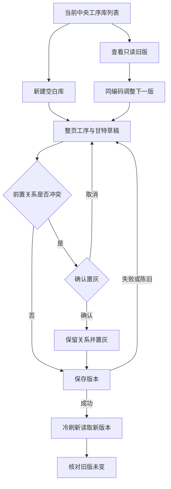

# 01：接通标准工序库中央版本维护与回读

> 已发布到 [#443](https://github.com/zodea/crm-new/issues/443)。本文件是发布时的本地审阅快照；当前规格、状态与决定以该 Issue 为准。

## Parent

[复核工程量、排程、目标成本与 A/C1/C2 工资模块 #412](https://github.com/zodea/crm-new/issues/412)，直接规格为 [2026-09-12 排程中央链定稿](https://github.com/zodea/crm-new/issues/412#issuecomment-5644612132)。承接 Story 6，以及 Story 13/15/16 中工序库部分。

## What to build

工序库维护人在独立列表读取当前中央版本，进入整页表单新建空白库或基于旧版调整，编辑工序、工期和前置关系，保存后冷刷新仍能读取同一新版，旧版保持只读。此票交付工序库完整领域的迁移、读取、命令及实际页面，不以单独的数据接口替代可演示结果。

## Blocked by

- [#442 工程量中央链](https://github.com/zodea/crm-new/issues/442) 中候选已包含的正式来源和目录协议；沿用已验证实现，不重做其区域、模板或完成流程。这里是来源协议前置，不要求先为某项目配置工程量事实；新建全局空白库不要求已有项目区域、户或完成记录。合入候选必须包含实际依赖提交，不能仅凭 Issue 的 open/closed 判断是否可开工。
- 不依赖中央 WBS 写入、暂估绑定合同、目标成本、工资或生产部署。工序库版本读取是后续 02 的前置；02 的独立只读调查可并行。

## Acceptance criteria

- [ ] **当前来源。** 正式浏览器的工序库列表、版本详情、保存后回读及已有选择器使用同一中央 Repository/HTTP/领域命令；同时核对建组和新增任务执行前的库读取校验，不让可见选择与保存前复核分属新旧目录。空列表显示未维护；读取失败可重试，不切换到本地旧库、同名版本或演示模板。演示与桌面边界按 ADR 0020 保留。
- [ ] **版本生命周期。** 新编码的空白库保存为 v1；查看任意既有版本只读；“基于此版调整”锁定原编码，生成该编码下一版本。禁止原地改写和跨编码复制。版本名称、说明、工序顺序、工种、默认工期、阶段/分项映射及前置关系保存后冷刷新一致。不得因版本升级改写已经生成的项目快照。
- [ ] **整页编辑与来源返回。** 从独立列表以及已有施工进度/建组入口进入整页表单；甘特和精确表格共享一份草稿，前置选择为行级轻量任务。返回保持调用页有效草稿；取消和关闭遵守未保存保护。中央 WBS 写入及项目快照生成由 02 验收，本票不把新中央库镜像回本地以伪装消费成功；尚未接通的正式 WBS 写动作明确提示未接通并保稿，不能悄悄转写旧库。
- [ ] **使用情况不造零。** WBS 尚未中央接管时，版本使用数量/使用项目显示来源未接入或未知，不把旧本地查询结果、空中央关联或未获取事实显示为“0 个项目使用”。02 接通后才显示可核验的当前中央使用情况。
- [ ] **前置关系。** 每道工序最多一个前置，候选符合已定日期规则；拒绝自依赖、循环、非本库工序及失效身份。拖动、改工期或排序导致冲突时先明确列出受影响关系：取消保持原草稿；确认保留原前置 key，仅置灰；恢复顺序后可显式重新启用，服务端再次验证。保存、重载后的禁用状态不丢失。
- [ ] **身份及权限。** 后台验证当前 capability、来源、库/版本/工序身份及可复用映射定义，区分不存在和关系错配；显示名称不能作为关联依据。全局库保留 `stageCode` / `itemCodes` 定义，不强绑某个项目的阶段或分项 ID；02 建组时才按所选项目解析为稳定身份、重新验证归属并冻结快照。拒绝越权或篡改版本、工序、映射请求，不仅依赖按钮禁用。
- [ ] **并发与重复。** 同编码并发生成下一版不会产生重复版本号或覆盖旧版。保存有幂等键和适用的来源版本校验；相同提交重试只有一个结果，不同内容复用同键明确拒绝。陈旧提交保留草稿并提示重读；响应丢失先核验原提交结果。加载 A 后切 B，A 的迟到响应及确认结果不能覆盖 B 或提交到 B。
- [ ] **独立演示。** 用隔离合成数据迁入 v1，在实际浏览器基于 v1 建立 v2，演示依赖冲突取消、确认置灰、保存和冷刷新；再次查看 v1，内容及身份不变。旧项目快照与库的隔离先做领域/迁移断言；跨中央 WBS 的实际建组隔离由 02 完成。

## Migration and write boundary

- [ ] 仅接管工序库、不可变版本、库工序、阶段/分项映射及前置 key/禁用状态和必要历史身份。复用已有受控迁移的备份、预检、候选准备、确认、对账与恢复；旧 WBS 分组、任务和楼层计划由 02 接管，绑定行为由 03 接管。
- [ ] 旧库、版本及工序 key 必须有唯一可解释的对应证据；缺失、重复、关系歧义列为预检阻断，不按显示名称或本地同 ID 猜测。旧版 `stageCode` / `itemCodes` 按原可复用定义保留和校验，不能在迁入全局库时改绑某项目 ID；项目 WBS 引用解析由 02 按当前项目归属处理。
- [ ] 保留旧迁移 v34/v35 的升级边界，不修改已经应用的迁移或清空旧库规避禁用状态升级。预检/对账覆盖版本数、工序数、关系、禁用状态及删除边界。
- [ ] 一次版本保存和一次迁移确认各自原子完成；失败无半份版本，重复确认不重复导入。恢复沿中央迁移协调器执行，保留独立中央新建数据，并在已有下游接管时验证依赖，不能使 WBS 留下悬空库引用。不回放历史通知，不增加第二个正式写源。

## UI evidence and validation

- [ ] 逐页登记工序库列表、只读旧版、整页新建/调整、前置弹层的入口、列/字段、名称与状态、实际可用查询及工具。无直接红圈参考时按瑞航权威验证并明确标注，不能把本地截图标为红圈证据。
- [ ] 390/768/1024/1280/1440px 实际运行；表格和甘特各自横滚，页面不整体横溢；验证长名称、键盘焦点、弹层层次、错误/空/加载态及失败后保稿。归档本票流程图和真实交互效果图，区分规格图与实测截图，记录来源、视口、场景和提交 SHA。
- [ ] 先复现不可变版本、并发编号、迟到读取或禁用关系丢失等适用反例，再通过领域/HTTP/组件与浏览器测试。复用现有工序库和迁移接缝，不用静态源码搜索代替保存与回读。
- [ ] 更新现有数据、命令、读取、排程蓝本及设计证据入口；更新现有使用指南，生成 PDF 并逐页渲染检查。完成类型、规范、定向测试和修改 JavaScript 后的 `npm test`，独立 Standards/Spec 复核；证据绑定本票独立提交。远端 CI 仍须按项目规则另行确认。

## Flow to demonstrate

## Ownership and remaining scope

本票仅满足 PRG-01/02/03 中工序库适用部分与 PRG-10 的本票验收。02 负责项目 WBS、库版本冻结及正式阶段来源往返；03 负责暂估绑定。PRG-07 目标成本中央保存、PRG-08/09/10 的成本来源/往返/联合验收、WAGE-01～12 工资与退役历史义务继续由 [#412](https://github.com/zodea/crm-new/issues/412) 负责分派；不得因这三票完成而整体勾选。生产持久化、正式备份恢复及部署归 [#416](https://github.com/zodea/crm-new/issues/416)。不新增业务 grill，不增加生产依赖。

依据：[排程蓝本](https://github.com/zodea/crm-new/blob/main/docs/rewrite/pages/schedule-progress.md)、[ADR 0018](https://github.com/zodea/crm-new/blob/main/docs/adr/0018-versioned-schedule-process-library.md)、[ADR 0020](https://github.com/zodea/crm-new/blob/main/docs/adr/0020-browser-authority-and-demo-workspace-boundary.md)。

查重记录：2026-09-12 已查询当前开放 Issue 并读取 #412 最新评论；现有 #442 明确把 WBS/工序库交回 #412，#398 不含本票实现，无已开放同范围实施票。定稿读入时本地 HEAD 为 `0a9c37680a02693c6c9a43661cc5e129c38649ea`；这是调查基线，不是实施完成证据。
