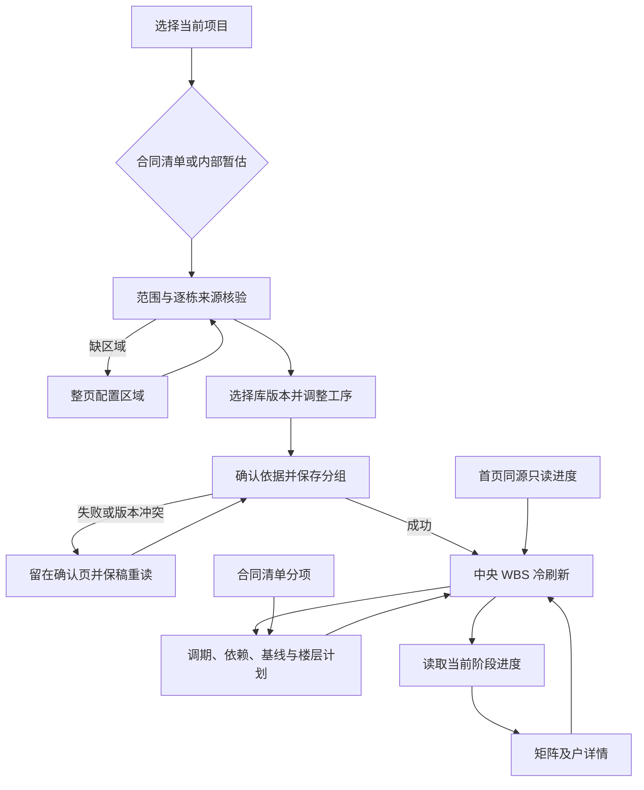

# 02：接通中央 WBS 建组、计划调整与阶段来源往返

> 已发布到 [#444](https://github.com/zodea/crm-new/issues/444)。本文件是发布时的本地审阅快照；当前规格、状态与决定以该 Issue 为准。

## Parent

[复核工程量、排程、目标成本与 A/C1/C2 工资模块 #412](https://github.com/zodea/crm-new/issues/412)，直接规格为 [2026-09-12 排程中央链定稿](https://github.com/zodea/crm-new/issues/412#issuecomment-5644612132)。承接 Story 1～5、7～11、14，以及 6/13/15/16 中项目 WBS 部分；Story 12 的新绑定动作归 03。

## What to build

经办人从当前项目选择合同清单或内部暂估，在“范围 → 工序 → 确认”三步建立楼栋分组，调整任务、楼层计划、依赖和基线，刷新后读取同一中央 WBS；自动进度来自当前阶段完成，能下钻矩阵及户详情，再返回同一工序。首页显示同源只读投影。已有 WBS 经受控迁移后也使用这条路径。

这是完整排程用户路径；库维护归 01，后续暂估绑定归 03，不能以仅接通后台或只读甘特作为本票完成。

## Blocked by

- [#443：接通标准工序库中央版本维护与回读](https://github.com/zodea/crm-new/issues/443)，其中稳定版本读取、身份映射和迁移关系是实际阻塞。独立调查、测试设计可并行，不把表单样式等无关末项当技术协议前置；若调整交付顺序，须先明确已合入且可验的协议范围，不能以未合入代码解除阻塞。
- [#442](https://github.com/zodea/crm-new/issues/442) 的当前区域、模板、分项阶段映射、完成和量口径；已接通的施工合同/清单中央身份；[#434](https://github.com/zodea/crm-new/issues/434) 首页来源入口及 [#435](https://github.com/zodea/crm-new/issues/435) 返回恢复能力作为既有实现复用，不重新开发或等待无关收尾。
- 不以 03、目标成本、工资或 #416 为开工条件；依赖以真实提交和领域能力核验。

## Acceptance criteria

- [ ] **真实项目与唯一来源。** 独立排程页和首页读取同一授权项目、分组、任务及进度投影；正式空项目显示未建计划，不自动种演示 WBS。浏览器的已接管排程日常读写走中央命令源；失败不回退本地旧库或同名对象。首页沿用只读边界，独立排程页承载修改。
- [ ] **合同建组。** 同一分组只有一种依据；合同方式选择同项目唯一施工合同，只消费清单显式楼栋覆盖。户型只能在已确认楼栋范围进一步筛选，不以相同户型名推断覆盖。错项目、错合同类型、缺显式覆盖或失效清单由后台拒绝，保存前重新核验来源。
- [ ] **暂估建组。** 不要求先有合同。按每栋检查楼层、户、模板、有效分项和启用工序映射，不能以另一栋非空掩盖本栋缺源。分组持续明确“内部暂估/待绑定”，不冒充合同范围确认。暂估只取暂估事实，不能以合同量或现场量补齐；两户 `8 / null` 保留已知值和缺失信息，真实 `0` 单独辨认，平方米和米分别汇总。允许/阻断范围沿已定有效分项规则，不能用跨单位总和或把缺失变零来判断范围有效。
- [ ] **区域配置与三步草稿。** 无区域时进入既有整页区域配置，返回恢复项目、依据、名称、日期、楼栋和工序草稿；重新加载后仅移除失效选择并解释。三步中可调整所选库的工序和计划，确认页明确依据、范围与来源；失败保留确认步骤和输入，重试不重复生成分组。
- [ ] **版本与计划快照。** 库的 `stageCode` / `itemCodes` 是全局可复用定义，建组时后台按所选项目解析为当前稳定阶段/分项身份并验证归属，不能用同名或另一个项目的 ID 兜底。随后冻结所选库名、版本、工序定义、已解析映射及前置 key/禁用状态。之后维护新版不改既有项目。楼层计划保留稳定分项、范围及数量快照；暂估模板后来变化不静默覆盖冻结暂估来源。新增任务和设置基线按既定规则保存，移除工序保留删除边界与审计，刷新保持身份及结果。
- [ ] **接回工序库使用情况。** 本票将库版本使用项目/数量接到当前中央 WBS，创建、迁入及合法移除后刷新一致；不继续显示 01 过渡期的未知占位，也不读取本地关联凑数。
- [ ] **调整与依赖。** 整条拖动、结束日/工期调整和精确日期录入一致；只修改某层时仅该层成为人工微调，任务调整后其余自动层重排。依赖为同组 FS+lag，每个后续工序最多一个活跃前置；拒绝自依赖、循环、跨组及非法日期来源。调期冲突先列出关系，取消不写，确认软禁用而非删除身份；原因、时间及审计可见。主动移除与冲突禁用区分，主动移除不进入冲突恢复列表；恢复重验日期、循环及其他活跃前置。
- [ ] **自动与手工进度。** 自动进度分母为本组楼栋、当前工序阶段和模板适用范围内的应做户，分子只取该阶段当前已完成户；责任配置不算完成，映射相同分项的不同阶段互不串值。实际开始取最早阶段完成日；全部应做户完成才显示最晚实际完成日。无计量来源阶段采用手工进度，范围限定 0～100；不伪造自动完成链接。项目/分组的计划偏差按既定工期权重汇总，当前日期取运行日；更正完成事实后刷新读取当前结果，不改历史已发工资或已生成报量快照。
- [ ] **全上下文往返。** 首页 → 工序、排程 → 矩阵 → 户详情 → 原工序、合同清单分项 → 对应楼层计划都使用稳定身份。恢复有效项目、分组、任务、阶段、楼栋、月份、视图、工种和责任户上下文；名称和计划日期仅作来源说明。首次展开、项目会话展开记忆、定位展开沿既有规则。直接深链、浏览器冷刷新及失效/错配身份有明确状态，无同名或演示回退。
- [ ] **事务与失败恢复。** 建组、调期及其依赖变更、基线、增删任务、手工进度等完整用户动作在中央原子执行，并验证 capability、作用域、关联归属、幂等键与 sourceVersion。并发源变化时保稿并重读，传输结果不确定时查询原提交；拒绝同键不同内容。切项目或页签后迟到读取、异步确认与保存不能作用于新目标。迁移/恢复进行中遵守中央互斥与恢复门，不出现部分 WBS 或半组依赖。
- [ ] **暂估绑定边界。** 本票可新建内部暂估和合同清单两类分组，完整读取迁入的既有绑定结果；不能保留直写旧数据库的“绑定合同”正式入口。新的绑定预览及确认由 03 接通，未接通时明确说明并保留原分组，不伪造成功、不直接编辑合同外键。

## Migration and write boundary

- [ ] 受控接管旧分组、楼栋范围、任务、任务映射、依赖及软禁用/删除日志、基线、手工进度、楼层计划及其人工标记/冻结数量、所用工序库快照，以及已有合同绑定身份/全部可识别历史。本票以已绑定样本完整读回关系和历史作为关闭条件，不能把必要历史适配推迟到 03。01 拥有全局库版本迁移；本票验证引用映射，不复制第二套库。03 不再次迁入整张 WBS 图。
- [ ] 预检验证项目/合同/楼栋/楼层/户/分项/阶段/库版本拓扑及旧 ID 映射；缺失或歧义阻断，不按名字、本地同 ID 或当前模板内容补造历史。保留真实 `0`、`null`、计量单位和删除边界；缺冻结暂估来源的历史数据明确登记，不把当前模板或合同量回填为历史。
- [ ] 复用中央备份、候选准备、确认、对账、恢复；对账包括数量之外的关系、计划日期、基线、进度方式、禁用关系、楼层微调、数量完整性和已绑定状态。证明重复确认、部分失败和恢复后的接管状态一致，不回放历史通知；恢复不误删独立中央新建 WBS 或改变工程量完成事实。
- [ ] 迁入后浏览器普通读写不继续访问原本地 WBS。桌面/演示隔离及正式持久化边界沿 ADR 0020，中央可重置实例只证明本票记录范围。

## UI evidence and validation

- [ ] 逐页核对独立 WBS、首页只读区、三步建组、工序详情、楼层计划及依赖确认/恢复；登记实际列、名称/状态、可用筛选和工具，不从图标推断未实现能力。按现行排程蓝本及真实参考层级验收。
- [ ] 真实浏览器至少演示一条合同建组和一条暂估建组；演示区域缺源去配置后返回、版本冻结、调期冲突取消/确认/恢复、人工楼层保留、基线及任务增删、手工/自动阶段隔离、冷刷新与完整往返。用实际领域事实证明保存和下游结果，不以 Toast 或 HTTP 成功代替。
- [ ] 390/768/1024/1280/1440px、局部甘特/表格横滚、长字段、键盘焦点、浮层、错误/无权/空态；保存本票流程图和各关键状态的真实交互效果图，记录来源/视口/场景/SHA，明确设计图与实测图的不同证据等级。
- [ ] 先建立陈旧版本、错配身份、迟到请求及关键计算反例；复用现有计划、依赖、楼层、库快照、中央工程量与受控迁移接缝，覆盖领域/HTTP/组件/真实浏览器。完成类型、规范、定向及修改 JavaScript 后的 `npm test`，独立 Standards/Spec；依据链末端提交范围完成必要集成验证，不无故重复已绿上游全域。
- [ ] 同提交更新数据、命令、读模型、排程页面和设计状态入口；更新既有排程指南并重新生成 PDF，逐页渲染验收。证据与独立提交对应；远端 CI 另按项目规则确认。

## Flow to demonstrate

## Ownership and remaining scope

与 01/03 合计承接 PRG-01/02/03 的排程中央化、稳定身份和版本义务；本票负责 PRG-08/09/10 中排程—工程量及首页的适用链。03 唯一负责新增暂估绑定合同的中央预览/确认/恢复行为。

PRG-07 目标成本中央保存、PRG-08/09/10 中成本来源/往返/联合验收，以及 WAGE-01～12 的 A/C1/C2 来源、发放冻结、防双计、调整和 B 类历史隔离均由 [#412](https://github.com/zodea/crm-new/issues/412) 继续承接和分派；本票不重做 #442 完成录入，也不增加工资、成本或审批动作。#412 不因本票关闭；生产关口归 [#416](https://github.com/zodea/crm-new/issues/416)。现行规则足够，不新增业务 grill。

依据：[排程蓝本](https://github.com/zodea/crm-new/blob/main/docs/rewrite/pages/schedule-progress.md)、[ADR 0010](https://github.com/zodea/crm-new/blob/main/docs/adr/0010-quantity-matrix-and-construction-record-model.md)、[ADR 0017](https://github.com/zodea/crm-new/blob/main/docs/adr/0017-provisional-schedule-before-contract.md)、[ADR 0018](https://github.com/zodea/crm-new/blob/main/docs/adr/0018-versioned-schedule-process-library.md)、[ADR 0020](https://github.com/zodea/crm-new/blob/main/docs/adr/0020-browser-authority-and-demo-workspace-boundary.md)。

查重记录：2026-09-12 已查询开放 Issue 和 #412 最新评论；#442 明确排除 WBS，#434 只承接首页来源入口，旧 #347/#300 被替代未取消义务，未发现同范围开放实施票。定稿读入时本地 HEAD 为 `0a9c37680a02693c6c9a43661cc5e129c38649ea`，不是实施证据。
