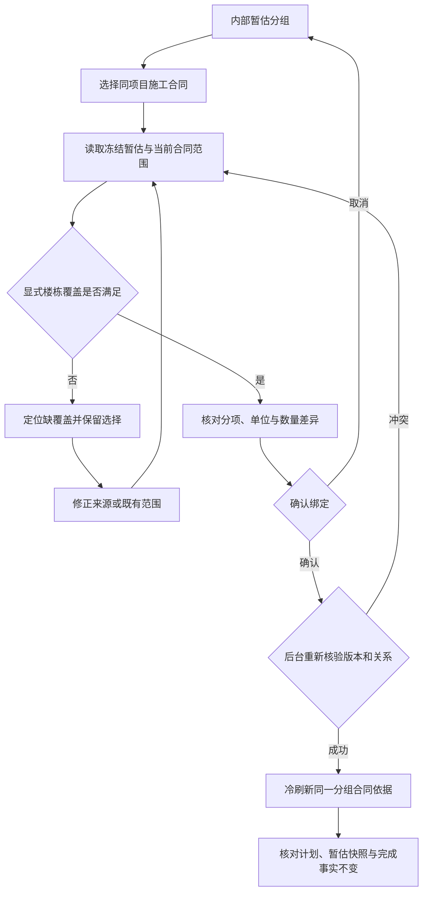

# 03：闭合内部暂估绑定施工合同的中央差异确认流程

> 已发布到 [#445](https://github.com/zodea/crm-new/issues/445)。本文件是发布时的本地审阅快照；当前规格、状态与决定以该 Issue 为准。

## Parent

[复核工程量、排程、目标成本与 A/C1/C2 工资模块 #412](https://github.com/zodea/crm-new/issues/412)，直接规格为 [2026-09-12 排程中央链定稿](https://github.com/zodea/crm-new/issues/412#issuecomment-5644612132)。承接 Story 12，以及 13/14/15/16 中暂估绑定部分；暂估初次建组及 WBS 全图迁移由 02 完成。

## What to build

经办人在已有内部暂估分组中选择同项目施工合同，先看到楼栋覆盖、分项映射及合同量与冻结暂估量的差异。缺覆盖时明确阻断并可去修正来源；满足既定条件后显式确认，冷刷新回读同一分组的合同依据，原计划、基线、完成事实、暂估快照及历史审计保持不变。

本票交付真实预览、确认、失败恢复和绑定后回读，不以改合同外键或展示差异表作为完成。

## Blocked by

- [#444：接通中央 WBS 建组、计划调整与阶段来源往返](https://github.com/zodea/crm-new/issues/444)。需要已接管的稳定分组、冻结楼层暂估来源、版本保护及合同清单身份。
- 复用 [#442](https://github.com/zodea/crm-new/issues/442) 已有当前区域/模板/完成源和已接管施工合同清单；这些是 02 已核验的传递前置，不重复增加 01、工资、目标成本或生产部署的阻塞边。

## Acceptance criteria

- [ ] **合法入口。** 从同一当前项目的内部暂估分组发起绑定；分组依据、未绑定状态及当前 capability 明确。只能选择同项目施工合同，不能跨项目、选其他合同类型或直接编辑合同外键。已绑定分组读取真实既有结果，不把重复操作当作新绑定或开放未定的解绑/换绑流程。
- [ ] **差异预览。** 当前合同清单按稳定楼栋与分项关系读取；显示已覆盖、未覆盖、合同额外楼栋，及每个分项的合同量、冻结暂估量和可计算差异。不能按户型名推断楼栋范围，不能把合同额外楼栋自动并入分组。显示预览所依据的分组和来源版本，保留有效选择及必要来源说明。
- [ ] **覆盖阻断。** 任一分组楼栋没有合同显式覆盖时禁止确认，明确指出楼栋和缺失证据；用户可沿现有入口修正清单证据或范围后返回重新预览。合同额外楼栋只提示，不强制纳入。不因此新造拆分分组能力；涉及范围修正使用现有合法行为，不能为了绕过阻断隐式移除楼栋。
- [ ] **冻结来源与空值。** 预览和最终确认均从分组已有冻结楼层计划读取暂估依据，不能改用当前模板、合同或现场量回填。来源模板之后改变，原暂估快照和本次比较仍可核验；清单分项被软删除不隐藏排程自己保存的楼层计划。两户 `8 / null` 仍标缺失，真实 `0` 不是缺失；按计量单位分组，只有同分项、同单位且完整可比时才展示确定数值差，否则明确不可确定，不生成虚假零差。
- [ ] **绑定语义。** 绑定是独立领域命令。最终提交在同一原子边界再次验证分组仍未绑定、当前项目/合同/清单范围、映射、权限和来源版本；预览后清单或分组发生变化时拒绝陈旧确认，保留选择并要求重读。数量差异按已定规则供核对，不擅自增加差异必须为零的新门槛，也不静默改写暂估量。
- [ ] **绑定后不变项。** 保持原分组、任务、依赖、楼层人工微调、基线、冻结暂估量、完成事实和历史身份；保存明确的新合同依据与必要绑定审计。冷刷新后分组不再误报未绑定，但仍可解释原暂估来源和差异；工程量完成、已发工资及已生成报量不重算、不重复生成。
- [ ] **取消、重复与结果不确定。** 取消预览或最终确认不写入，保留合法草稿/返回上下文。相同幂等命令重试读取同一结果；不同内容复用同键拒绝。断网或响应丢失后先核对原提交结果，不能连点产生重复历史。两个操作者竞争绑定只有符合当前版本的一次成功，另一方得到可解释的已绑定/陈旧状态，不覆盖先前结果。
- [ ] **目标切换与返回。** 预览或确认期间从项目 A 切到 B、切分组或关闭页面，A 的迟到响应和确认结果不能改变 B 或在 B 打开旧确认。缺来源修正后回同一分组重新预览；绑定后可从关联合同清单进入对应楼层计划并返回，恢复有效项目/组/任务及来源视图；错配和失效身份不按名称回退。

## Migration and write boundary

- [ ] 复用并回归 02 已完整迁入的分组、楼层冻结来源、已有绑定状态/关系和全部可识别历史，不重新迁入整张 WBS 图、不另建平行正式表。既有绑定历史适配属于 02 的必需验收；若本票发现遗漏，回到 02 所属迁移接缝补齐并复验，不能将必要历史读取当作本票新绑定动作的可选尾项，更不能凭当前合同/模板重建历史数值。
- [ ] 对缺失冻结快照或绑定关系歧义的旧分组，预检/读取给出可解释缺口；不能以 0、当前暂估或同名关系制造历史。实际缺口沿既定迁移阻断及恢复规则处理；数量缺失本身不变成擅自新增的合同绑定业务门槛。
- [ ] 证明预检 → 确认 → 冷刷新能够呈现一份已有绑定样本，以及一份未绑定暂估样本；仅未绑定样本可执行本票新命令。迁移重复确认不重复历史，失败不留下半个绑定。
- [ ] 沿中央恢复协调器验证绑定状态和所属 WBS/合同依赖一致，保护独立中央新建记录及完成事实，不回放历史通知。日常绑定保存与迁移确认分别原子执行；迁移候选/恢复期间不绕过现有互斥门。浏览器不调用旧本地绑定写入，桌面/演示边界按 ADR 0020。

## UI evidence and validation

- [ ] 使用隔离合成数据演示：内部暂估建组 → 模板后改仍读冻结来源 → 选择缺覆盖合同被阻断 → 修正显式覆盖返回 → 再次预览并确认 → 冷刷新同一 WBS → 下钻楼层计划及完成事实核对不变。另验证 `8 / null`、真实 `0`、平方米/米、额外合同楼栋、预览后来源变化和响应丢失重试。
- [ ] 逐页/状态核对入口、依据状态、差异列、不可比说明、阻断定位、来源链接及确认结果；沿现有绑定交互边界，不把完整业务编辑塞进行级弹窗。实际验证取消保稿、键盘操作、焦点回归与浮层层次。
- [ ] 390/768/1024/1280/1440px 实测；差异表和楼层计划只在自己区域横滚。归档本票流程图、阻断/成功/冲突/返回的真实交互效果图，标注视口、数据来源、场景和提交 SHA；设计图不得冒充已实现截图。
- [ ] 先复现陈旧预览仍可绑定、冻结来源被当前模板替换、重复确认或缺量伪零等适用反例；用领域/HTTP/组件/实际浏览器验证持久化事实和下游不变项。复用现有合同绑定、中央 WBS、工程量及迁移接缝，不以源码检查或 Toast 代替结果。
- [ ] 完成类型、规范、定向测试和修改 JavaScript 后的 `npm test`，独立 Standards/Spec；在 01→02→03 范围冻结后完成必要的一次本地排程链集成验证，绑定证据不能外推为成本/工资联验通过。远端 CI 另按项目规则确认。
- [ ] 同提交更新现有数据/命令/读取/排程蓝本与设计状态入口，更新排程使用指南，重新生成 PDF 并逐页渲染检查；独立提交后按真实证据关闭本票适用范围。

## Flow to demonstrate

## Ownership and remaining scope

本票完成 PRG-01/02/03 中暂估绑定适用部分，并补 PRG-08/09/10 的绑定来源与排程链验收。01 负责工序库，02 负责 WBS 日常生命周期及全图迁移，避免三票重复接管同一数据。

PRG-07 目标成本中央保存、PRG-08/09/10 中成本来源/往返/联合验收以及 WAGE-01～12 的工资/退役历史义务继续由 [#412](https://github.com/zodea/crm-new/issues/412) 唯一承接、另行拆票；本票不生成工资、成本、报量或审批单据，也不新增解绑/换绑及范围自动拆分规则。三票完成不表示 #412 全域完成；正式持久化、备份恢复与部署保留 [#416](https://github.com/zodea/crm-new/issues/416)。沿既定 ADR 和定稿实施，无需新的业务 grill。

依据：[排程蓝本](https://github.com/zodea/crm-new/blob/main/docs/rewrite/pages/schedule-progress.md)、[ADR 0017](https://github.com/zodea/crm-new/blob/main/docs/adr/0017-provisional-schedule-before-contract.md)、[ADR 0010](https://github.com/zodea/crm-new/blob/main/docs/adr/0010-quantity-matrix-and-construction-record-model.md)、[ADR 0020](https://github.com/zodea/crm-new/blob/main/docs/adr/0020-browser-authority-and-demo-workspace-boundary.md)。

查重记录：2026-09-12 已查询当前开放 Issue 和 #412 最新定稿；#442 排除 WBS，本票无同范围开放实施票，旧 #300/#347 的替代关闭不表示绑定已完成。调查基线 `0a9c37680a02693c6c9a43661cc5e129c38649ea` 不是实施证据。
