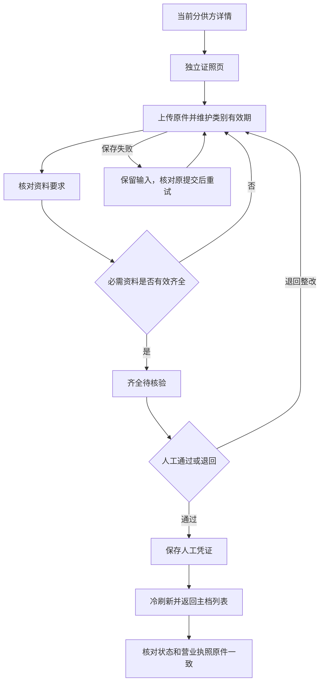

# 01：接通分供方证照原件、资料状态与人工核验中央链

> 已发布至 [#446](https://github.com/zodea/crm-new/issues/446)，原生挂接 #407 并已领取。本文件为发布时本地审阅快照，当前规格与状态以 Issue 为准。

## Parent

[复核客户、分供方、班组和工人主档模块 #407](https://github.com/zodea/crm-new/issues/407)。文件协作范围归 #406，不重复已完成的合作档案与送货原件。

## What to build

从当前中央分供方进入独立证照页，上传真实原件、维护类别/有效期/资料要求，人工核验后冷刷新，并在主档详情和列表读取同一结果。包括旧证照完整图受控迁入。OCR 日常识别与人工回填由后续票接通；此票可用人工上传和维护独立完成核验，不依赖 OCR 服务。

## Acceptance criteria

- [ ] **单一来源与身份。** 正式证照页、主档状态与营业执照列消费同一中央专用领域；实际空态、未接入、加载错误、无权、错来源分开。预览/下载按当前分供方和证照所有权验证；同名不同 ID 不串档，浏览器不回旧本地正式库。
- [ ] **原件完整。** PDF/PNG/JPG/JPEG 的类型、签名与 20 MB 限制服务端复验。保存一次同时产生证照、正文、原件关系及适用审计，失败不留半份。冷刷新后预览/下载字节一致，缺正文明确提示。类别/有效期是行级小对象，可在既有轻量交互维护，不新增实体编辑大弹窗。
- [ ] **资料要求与状态。** 沿既定类别、默认要求及原因维护；有效原件与上海业务日期共同决定缺失或齐全待核验。缺资料不能自动合格，不把远端读取失败视作无文件。
- [ ] **人工核验。** 只从齐全待核验通过或退回，退回原因必填。核验重验当前原件、要求及主档版本，凭证与状态原子保存。普通表单、导入及客户端状态值不得伪造 qualified/rejected。
- [ ] **结论失效。** 影响必需资料的文件/分类/有效期/要求变化、关键工商银行字段真实变化和过期使旧人工凭证失效并重算；无关可选资料、劳务范围、备注或纯时间戳更新不误失效。核对主档整页编辑和证照页双方写入，不能仅覆盖新增证照动作。
- [ ] **删除与撤回。** 错误证照软删除后原件不可作为当前证照读取，齐全度同步更新；沿已有审计撤回恢复同一证照、正文和删除边界，不生成第二份身份。删除后原件泄漏、错误父记录和已失效撤回都拒绝。
- [ ] **列表和往返。** 营业执照按当前受控文件引用显示不可用/真实缺失/可用，计数及入口一致；当前已定状态筛选在真实来源接通后可用，不新增无依据排序。详情→证照→返回恢复有效来源和父列表位置，主档状态冷刷新一致。
- [ ] **错误与重复。** 当前服务端权限、来源和稳定所有权复验；同命令重试一个结果，同键不同内容拒绝。并发变更保稿并核对，响应丢失恢复原提交。A/B、页签和来源切换不应用迟到上传、读取或确认，不误丢当前输入。
- [ ] **完整旧图迁入。** 库存本地分供方稳定 ID 映射到中央主档，接管证照、要求、文件元数据/正文、原始及已确认 OCR 事实、人工凭证、专用审计及软删除。缺关系/歧义阻断；缺正文旧路径只保留线索，不读路径也不计入齐全度。保留旧值原义，不按长度将内部码迁为税号。无供应商级凭证旧人工态按现行规则重算。
- [ ] **迁移协调。** 复用既有备份、预检、准备、原子确认、实际对账和恢复；不修改历史迁移、不自动迁入、不回放通知。故障无部分接管，再确认不覆盖日常更正；回滚保留独立中央记录，有依赖时整体阻断。
- [ ] **审计和隔离。** 业务原件与 OCR 正文只在专用受控读写中处理；动作审计保留既定白名单，不复制敏感值或备注正文。演示只读且需服务端授权，不把同 ID 演示文件带入正式命令。桌面现有适配不被暗改为中央。
- [ ] **真实验收与文档。** 先复现当前中央证照不可用，再以隔离合成身份跑上传→人工核验→冷刷新→列表/详情回读及旧库确认旅程。覆盖五档视口、局部滚动、键盘、浮层、长名称和失败保稿；归档流程图与真实效果图。更新权威源、现有指南及 PDF 逐页验，类型/规范/定向测试/npm test 与 Standards/Spec 双轴复核通过后独立提交。

## Blocked by

- 现有中央分供方主档和当前会话/Repository、受控迁移协调器；候选实际包含 #420、#441、#442 的既有实现。此为代码前置，不能以这些票仍 open 推定实现不存在。
- 不依赖工序库、WBS、工资、OCR 日常识别和生产部署；可与排程链并行。

## Flow to demonstrate

本票不代验 #407 其他主档工具、不扩展付款准入、不声明 #416 正式部署已完成。详细字段及状态规则只引用现有分供方蓝本和 DATABASE。
