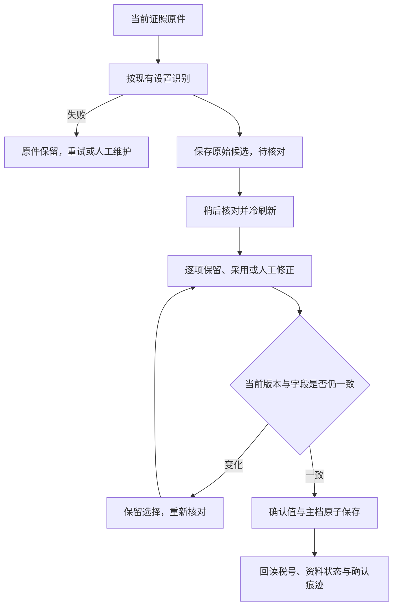

# 02：接通证照 OCR 人工核对与主档回填中央链

> 已发布至 [#447](https://github.com/zodea/crm-new/issues/447)，原生挂接 #407 并由 #446 阻塞。本文件为发布时本地审阅快照，当前规格与状态以 Issue 为准。

## Parent

[复核客户、分供方、班组和工人主档模块 #407](https://github.com/zodea/crm-new/issues/407)。沿用现有 OCR 设置及证照规则，不新增识别服务或业务政策。

## What to build

对当前中央证照发起识别，原始候选保存后可稍后核对；人工逐项处理类别、字段及有效期冲突，再将确认值保存到同一中央证照和主档。冷刷新验证原始候选、已确认值、主档及核验状态一致。同时接通已有人工纳税人核验凭证回读。

## Acceptance criteria

- [ ] **当前原件识别。** 识别只使用当前证照的授权原件和现有 OCR 设置。未设置、无原件、服务失败和无权分别反馈；人工上传结果保留，可重试识别或手工维护。识别页/来源切换后迟到结果不能覆盖其他证照。
- [ ] **持久候选。** 识别成功保存原始候选、置信度和待核对状态；“稍后核对”及冷刷新后可继续。新的识别结果不能抹去上次确认痕迹，审计只保存既定元信息。
- [ ] **人工确认。** 逐项提供保留当前、采用识别或人工修正；类别冲突默认当前。尚未确认不改主档。确认重验当前证照、原始候选、分供方字段及版本，成功原子保存确认事实和选定主档变更；陈旧冲突保留选择供重新核对。
- [ ] **正确字段目标。** 统一社会信用代码/纳税人识别号指向 taxNo，uniqueCode 始终是内部唯一识别码。同一原件有矛盾税号候选时要求人工核对，不静默择一。历史候选和旧字段保留原义，不自动搬值；确认界面显示实际目标及已有值，沿主档重复校验阻止冲突覆盖。
- [ ] **状态联动。** 关键工商银行值、必需资料类别/有效期等确认变化按前置票规则使旧人工结论失效；不影响齐全度的可选资料确认不误撤销合格。证照、详情、列表及再编辑读取一致，不建立第二份主档写源。
- [ ] **人工税务核验。** 复制当前税号、打开既有官网入口并人工完成验证码；应用只保存人工确认结果、来源及时间。未查到保留待确认，不自动判小规模，不抓取官网。新建主体先保存后核验，结果保存失败保留当前输入。
- [ ] **恢复和隔离。** 同命令重试只有一份确认，响应丢失先核验原结果，同键不同内容拒绝；A/B和来源切换迟到不能写错主体。权限变化、删除证照、原件替换或并发主档更正都在后台阻止陈旧确认；演示不可写。
- [ ] **真实完整旅程。** 先复现旧 OCR 信用代码目标错误，验收中央原件识别→稍后核对→冷刷新→保留冲突→人工确认→主档回读，再覆盖识别失败重试、并发保稿和税务结果人工保存。真实 OCR 服务不可用时明确合成服务测试范围，不能声称外部识别效果已验证。
- [ ] **交付。** 五档视口、局部滚动、键盘焦点及确认浮层实测，交付本票流程图与真实交互图；更新现有权威、指南与逐页检查的 PDF，类型/规范/定向/npm test 及双轴复核后独立提交。

## Blocked by

- [#446 接通分供方证照原件、资料状态与人工核验中央链](https://github.com/zodea/crm-new/issues/446)。原件、状态、迁移和审计必须已接通；本票复用完整旧图迁移，不把历史 OCR 保全欠账交给后续。
- 现有 OCR 设置能力及其失败读取修复 #429；不依赖排程、生产存储或真实税务网站自动查询。

## Flow to demonstrate

本票不新增审批/准入政策、自动税务查询、完整账号系统和生产部署；#407 其他主档未完义务继续开放。
