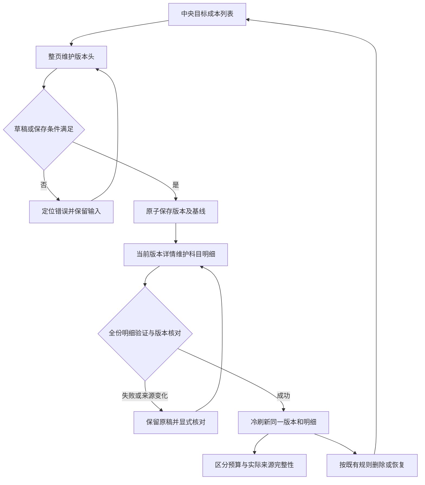

# 目标成本预算版本与科目明细中央链规格

> 本地审阅稿，尚未发布；非权威源。当前母票为 [#412](https://github.com/zodea/crm-new/issues/412)。调查基线 `77281c8d3eac755f7642bb180ab192a0f7a24191`，2026-09-12 已重读 #412 当前正文、评论和 #349 承接义务。本稿仅定稿预算维护切片，不表示代码或运行验收已经完成。

## Problem Statement

目标成本已有列表、版本头整页表单、科目明细和成本对比，但浏览器的正式读取、保存与旧数据仍走本地适配。空金额、空数量和空单价在列表或详情读取中会被转换成零；版本、明细和实际成本来源也缺少一致的中央身份、版本保护和失败恢复。用户不能据此判断预算是否真正保存、当前基线是否唯一，或动态成本是否已有完整来源。

## Solution

经办人从同一中央列表建立或维护预算版本，再在该版本详情内维护科目明细。保存后刷新、换页签和重新打开仍回读同一记录；切换当前基线、删除和恢复均核对当前项目与版本。预算金额及真实零可区分，未接齐的实际成本明确显示来源缺口。既有预算版本、明细与可识别历史一起受控接管，浏览器不保留第二份正式写入来源。

## User Stories

1. 作为预算经办人，我希望按版本名、项目、当前基线和状态定位预算，以便在同一筛选范围查看列表及数量。
2. 作为预算经办人，我希望名称进入只读详情、编辑进入整页表单，以便先核对记录身份再维护版本头。
3. 作为预算经办人，我希望缺少项目或金额时按现行规则保存草稿，以便逐步补齐资料，不把空值写成零。
4. 作为预算经办人，我希望非草稿保存核验真实活跃项目、版本名及对应金额规则，以便错误定位到字段并保留输入。
5. 作为预算经办人，我希望合同收入、计划利润、已签合同额及税价基准独立保存，以便勾稽差异只作提示，不覆盖人工确认值。
6. 作为预算经办人，我希望同项目至多一个活跃当前基线，以便切换时原基线与新基线在同一动作中更新；草稿基线不进入正式成本控制。
7. 作为预算经办人，我希望在详情中一次维护专业分包、合同劳务、材料、机械、工人工资、费用报销和其他科目，以便整份明细草稿同时保存或同时保留。
8. 作为预算经办人，我希望空数量、空单价和真实零保持区别，以便按既定目标金额维护预算，不用数量乘单价强制改写目标金额。
9. 作为预算经办人，我希望明细错误定位到具体行和单元格，以便更正后继续保存，不丢新增、修改、调序或待删除行。
10. 作为预算经办人，我希望保存科目明细不改变版本头状态，以便版本头与明细是两个可解释的动作。
11. 作为预算经办人，我希望并开两个预算版本时各自保留记录身份、草稿和读取基准，以便普通刷新或另一页保存不会把我的旧草稿变成可覆盖的新版本。
12. 作为预算经办人，我希望响应丢失后恢复原提交、并发变化后显式核对，以便重复操作不会产生第二份版本、明细或基线切换记录。
13. 作为预算经办人，我希望切换页签保留草稿，关闭、刷新或返回时确认放弃，以便取消后仍可继续原输入；迟到结果不能作用于另一个项目或版本。
14. 作为预算经办人，我希望删除与恢复沿既有软删除和审计路径执行，以便历史可核验；恢复不能造成两条当前基线或覆盖后来建立的预算。
15. 作为存量数据经办人，我希望整批预检、确认、冷读和恢复覆盖版本头、科目明细与历史，以便日常更正不被重复确认覆盖，危险恢复不破坏独立中央数据。
16. 作为预算查看人，我希望当前预算和历史版本读取各自明细，以便不会因为基线切换而把历史科目替换成另一版本。
17. 作为成本查看人，我希望预算合计与正式成本来源保持分开，以便未接入、无权、缺映射与已知零分别展示，不用录入的已签合同额冒充真实合同聚合。
18. 作为移动端或键盘用户，我希望列表、表单、明细网格和错误恢复均可操作，以便宽表只在自己的区域滚动、错误焦点和弹层返回可用。
19. 作为预算经办人，我希望保留现有预算附件入口，新增、移除和读取原件均核对所属版本与权限，以便资料不会挂错记录或仅剩本机路径。
20. 作为历史预算查看人，我希望旧数据中只有科目、没有分项名称的合法明细仍原样可读，以便接管不会为了满足新编辑表单而编造历史名称；主动编辑时再按当前规则补齐。

## Implementation Decisions

- 沿用当前预算版本、科目明细、草稿/已提交及七类成本语义，不新增审批引擎、自动预算或按名称关联规则。字段及正式控制的参与条件继续由现行数据与页面契约裁定。
- 版本头保存、整份明细保存、删除和恢复分别作为完整中央动作。基线切换与相关版本更新、审计、读取版本和回执在同一原子边界提交；版本头和明细保存不互相暗中提交。
- 复用中央项目身份、现有 Repository/HTTP/command 与受控迁移协调器。命令核验当前工作区、操作人、来源、能力、稳定记录身份及适用版本；业务版本与关联项目版本均不能被普通列表刷新偷换。
- 正式来源只读写中央事实；演示须获授权并隔离只读，桌面既有适配保留。服务失败时只保留未保存草稿和明确错误，不回落到旧浏览器正式写入。
- 空数量、单价和允许为空的金额保留空值；真实零仍可正常保存与展示。明细目标金额是既有独立确认值，不增设自动乘积覆盖规则。
- 只有满足现行状态条件的当前基线参与正式成本控制。删除后没有基线是可解释状态，不擅自选一条历史版本顶替；恢复与其他当前基线冲突时明确要求核对，不能形成双基线。
- 迁移完整保留稳定版本/明细身份、空值、顺序、软删除及可识别操作历史，项目关系使用受控映射。旧数据的重复当前基线或歧义项目关系须预检定位，不按最新时间或同名项目猜选；重复确认保留确认后的日常更正。
- 当前版本头已有预算附件区，沿用已接管实体的文件资产、读取权限与版本归属规则。保存绑定真实原件与元数据，失败不留下半个附件关系；旧附件缺原件明确标缺失，不从本机路径或文件名猜造正文。历史科目级空分项名按旧模型保留，当前明细编辑规则不反向篡改历史。
- 本切片保证预算维护闭环。实际成本对比只消费已接管且有明确领域含义的事实；未接齐来源显示可解释缺口和可用部分，不将未实现工资、材料或财务事实伪造为零。完整成本消费与排程/工程量/工资联验仍由母票拆分承接。
- 实际来源不完整时，剩余预算、偏差及汇总也保留未知或部分已知状态，不能将缺失成本按零参与扣减并显示完整可用余额。涉及比率且分母为零或未知时显示不可计算，不制造零偏差。
- 测试接缝采用现有预算领域与最高层中央命令/读取、真实 SQLite 迁移图、组件和真实浏览器链。属于已授权的例行验证选择，不新增生产依赖。

## Testing Decisions

先建立可失败反例：空值读成零、同项目并发产生双基线、跨版本明细写入、响应丢失重复建立记录、普通刷新抬高另一表单版本、恢复覆盖后续基线或重复迁移覆盖日常更正。

验证列表 → 整页草稿/保存 → 详情明细 → 明细校验修正 → 切换基线 → 冷刷新回读 → 删除/恢复的完整路径。明细应检查保存后的行身份、顺序、空值、软删除和日志，不能仅断言提示消息。迁移使用明确合成源，验证完整图、原子失败与危险恢复保护。

浏览器另覆盖同名不同来源、无权、读取失败、陈旧版本、失响应恢复、并行页签和关闭取消；按 390 / 768 / 1024 / 1280 / 1440px 检查列表、表单、网格、错误状态、局部横滚、键盘焦点及浮层。完成类型、定向测试、修改 JavaScript 后的完整 `npm test`、独立 Standards/Spec、使用指南与逐页 PDF 检查；远端 CI 按既有单独确认规则处理。

## Out of Scope

完整审批/RBAC、多租户、Tauri 正式交付、自动算预算、重新定义成本科目或利润规则、工资生成与发放、新的成本归集关系，以及生产持久化/备份恢复/部署不在此预算切片。完整真实成本聚合及其跨模块往返保留 #412，生产关口保留 #416；不以本切片关闭母票或勾完 PRG-08/09/10。

## Further Notes

- 承接 PRG-07 的完整预算中央保存与迁移，及 PRG-09/10 中预算自身页面、失败恢复、指南和验收部分。#349 被替代关闭不取消其跨域义务。
- 已观察的参考列表与详情使用现有 `R-TARGET-COST-LIVE` 记录；表单无直接参考运行证据，继续沿本地权威。此次只读代码调查未冒充新的参考站或本地浏览器验收。
- 权威入口：[目标成本蓝本](https://github.com/zodea/crm-new/blob/main/docs/rewrite/pages/target-cost.md)、[数据模型](https://github.com/zodea/crm-new/blob/main/docs/rewrite/DATABASE.md)、[ADR 0014](https://github.com/zodea/crm-new/blob/main/docs/adr/0014-full-page-entity-forms.md)、[ADR 0020](https://github.com/zodea/crm-new/blob/main/docs/adr/0020-browser-authority-and-demo-workspace-boundary.md)。具体原子/恢复实现沿已完成中央模块，不新增第二套长期规格。

