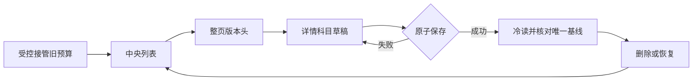

# 01：接通目标成本预算版本、科目明细与存量接管中央链

> 本地审阅稿，尚未发布；非权威源。独立子票草稿，不因本文件存在而视为已领取或已实现。

## Parent

[复核工程量、排程、目标成本与 A/C1/C2 工资模块 #412](https://github.com/zodea/crm-new/issues/412)。直接规格为本次目标成本预算中央链定稿，承接 PRG-07，保留旧 #349 未满足的跨模块义务在母票继续分派。

## What to build

经办人从中央目标成本列表维护预算版本头，再在该版本详情保存整份科目明细，切换当前基线、刷新回读以及按既有规则删除/恢复。空值、真实零、预算与实际成本来源分别说明。旧版本、明细与历史完整接管，正式浏览器不再写入另一套本地预算。

这是预算维护的完整纵向切片，包含当前列表、整页表单、详情及明细网格；不以单独接通接口或迁入版本头作为完成。

## Acceptance criteria

- [ ] **同源列表与入口。** 当前授权范围内搜索、项目/基线/状态筛选、排序、分页及总数使用同一完整集；空记录与筛选无结果可区分。名称打开同一稳定版本的详情，编辑进入整页表单，正式与演示同名记录不混用。
- [ ] **版本头及空值。** 草稿、保存及提交沿现行字段规则校验项目、版本名、金额和状态；空值不转换成零。税价差异只提示，不强制覆盖人工金额；版本头输入的已签合同额不冒充正式合同聚合。错误定位字段并保稿。
- [ ] **唯一基线。** 同项目至多一个活跃当前基线，切换在同一原子动作更新新旧版本与审计；草稿基线不参与正式成本控制。并发切换按版本冲突处理，失败没有半个切换。
- [ ] **整份科目明细。** 当前版本详情维护七类既定科目；分项名称和目标金额按现行必填规则，数量/单价可空、填写时非负。新增、修改、调序、移除一次保存，错误回填具体行和单元格并聚焦首错；金额不被自动乘积改写。保存不静默改变版本头状态。
- [ ] **身份和历史。** 明细只修改所属版本的当前有效行，跨版本、重复行身份或失效行明确拒绝。当前版本和历史版本始终回读各自明细；删除行软删除并保留日志，刷新后行序及空值保持。
- [ ] **预算附件。** 保留现有版本头附件区，文件正文、元数据及所属预算版本通过已接管资产规则保存、读取及移除；原件请求复验当前权限与归属，不泄露其他版本。保存失败不留半个关系，原有本机路径不冒充中央原件；旧附件缺正文明确说明并沿既有合法补传入口处理。
- [ ] **删除与恢复。** 沿已有中央软删除/恢复动作核验版本及项目范围，保护明细和可识别历史。删除当前基线不自动选择其他版本；恢复与后续当前基线或独立中央引用冲突时明确阻断，不产生双基线、不覆盖其他版本。
- [ ] **并行编辑与迟到响应。** A/B 版本各自保留身份、来源、草稿及写入基准；切换项目/版本、停用页面或关闭后，旧加载和保存结果不覆盖新目标。普通列表/详情刷新不静默升级其他表单的提交版本。
- [ ] **取消与不确定结果。** 关闭、刷新、返回及离开明细编辑按现有草稿保护确认；取消保留输入，页签切换保稿。响应丢失先恢复原命令；同键同内容返回同一结果，换内容复用同键拒绝；版本变化显式核对而非覆盖。
- [ ] **预算与实际来源。** 预算摘要从本版本头/明细读取，正式控制只用满足状态条件的当前基线。成本对比只读已接管真实领域事实；未接入、无权、缺关系与已知零分别展示，不能因本地旧表为空显示成本全零。剩余预算、偏差和汇总也保留未知/部分已知，不以缺失成本按零扣减；比率分母为零或未知时明确不可计算。未闭合来源及跨域跳转继续指向母票，不虚构工资或材料记录。
- [ ] **存量完整接管。** 每个预算版本头、所属明细、稳定项目映射、空值/零、顺序、基线、附件资产关系、软删除与可识别日志在受控候选内一并准备和确认。旧模型允许的科目级空分项名原样可读，不编造历史名称；主动编辑才应用当前表单规则。重复基线或歧义关系预检定位，不猜选；重复确认保留接管后的日常更正，失败整批回滚。
- [ ] **恢复协调。** 中央预算日常动作与迁移候选/恢复共用既有互斥约束。恢复前核验独立中央版本/明细对待撤项目等来源的引用，危险恢复整批拒绝；不回放历史通知、不另建平行正式预算表。
- [ ] **真实演示。** 用合成旧库演示预检→确认→普通列表冷读，再新建草稿、完善版本头、保存含空数量和真实零的明细、切换基线、编辑/取消、并发冲突与失响应恢复、删除/恢复及再冷读。核验字段、行身份、日志和唯一基线，不能只验证 Toast。
- [ ] **界面证据。** 逐页按已有直接参考/DC边界核对列、名称入口、状态、搜索、表头和工具；在390/768/1024/1280/1440px检查局部横滚、键盘、首错焦点和浮层。归档每条正常/异常流程图、真实效果截图及各自数据来源/视口/提交依据。
- [ ] **验证与交付。** 先复现空值误零、双基线、跨版本写入、重复提交或恢复覆盖等适用反例；通过领域/HTTP/组件/迁移及真实浏览器验证，完成类型、相关规范、最终完整测试和独立 Standards/Spec。更新现行权威入口、预算使用指南并生成逐页检查的PDF，独立提交后写回适用证据。

## Blocked by

无新增未完成实施前置。复用本地主分支已接管的中央项目身份、公共表单/页签、读写契约与受控迁移；开工时核对实际提交，不把调查基线当实施证据。预算维护不需要等待 WBS、暂估绑定、工资或生产部署；这些领域仅在真实成本消费和跨模块联合验收时形成实际依赖。

## Remaining ownership

本票不关闭 #412。PRG-08/09/10 的排程—工程量—成本聚合及完整往返、WAGE-01～12 和生产关口保留原承接；完整审批与新预算业务规则不在此票范围。现行预算规则足以实施，无新业务 grill。

