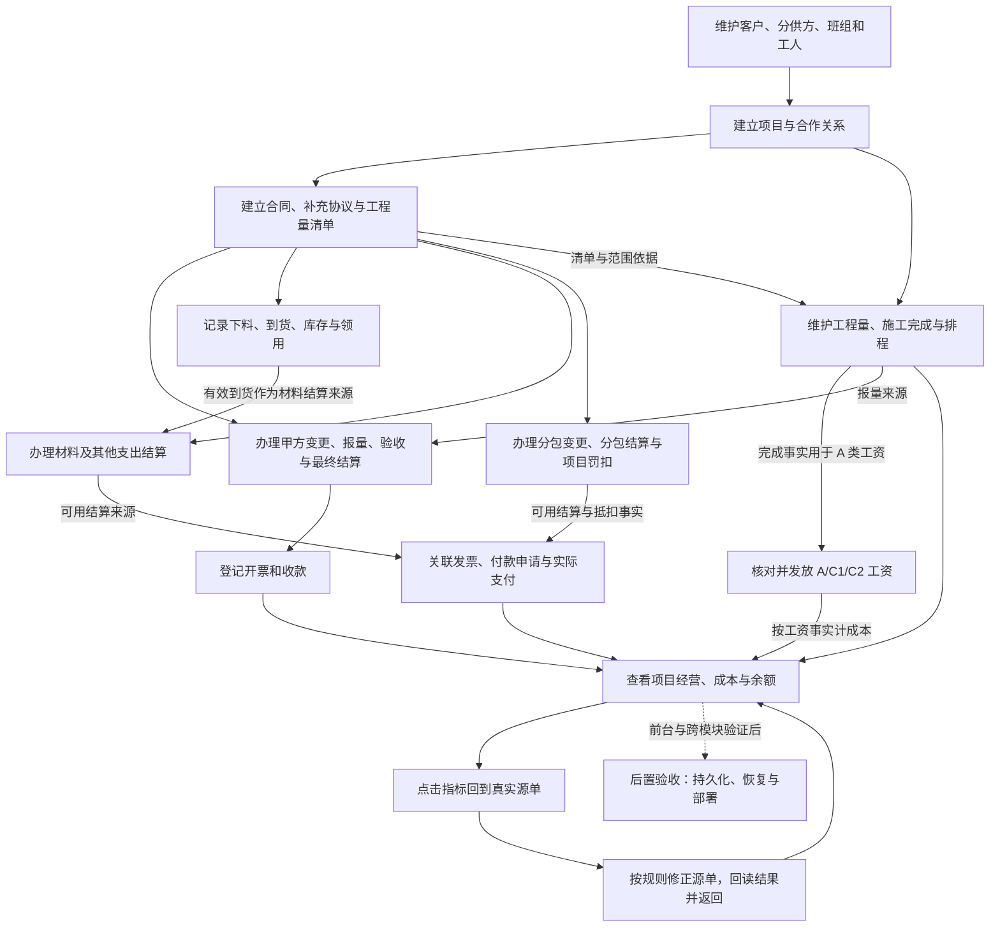
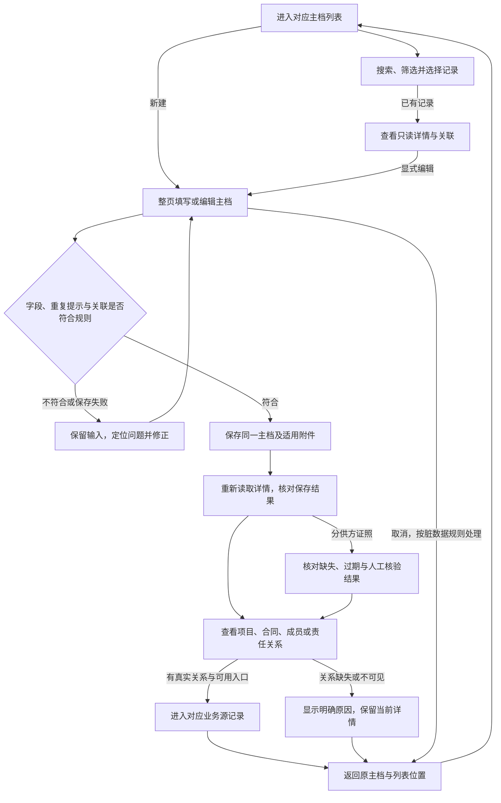
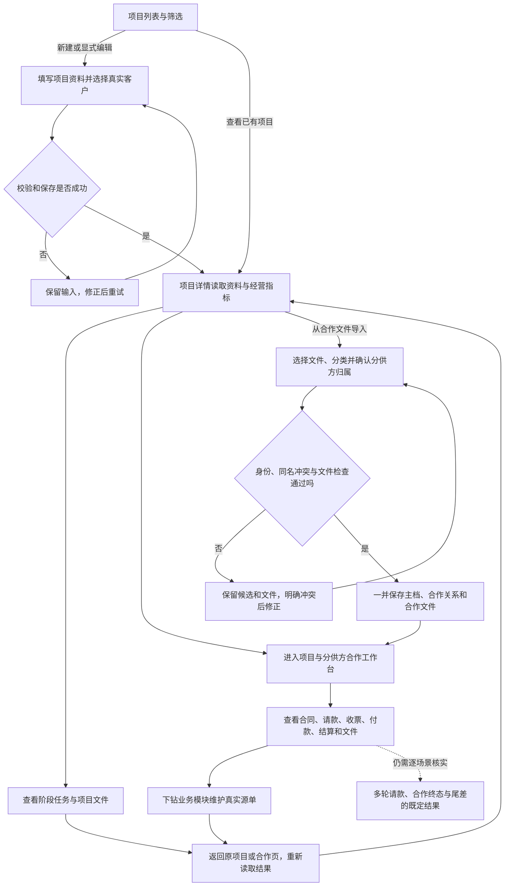
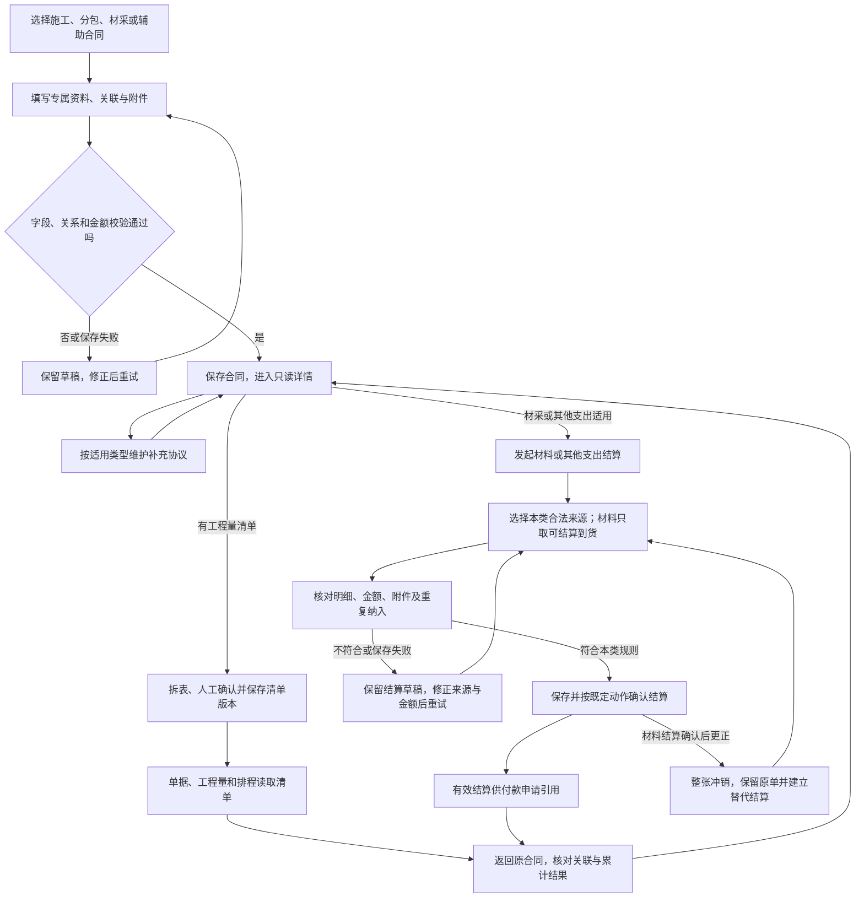
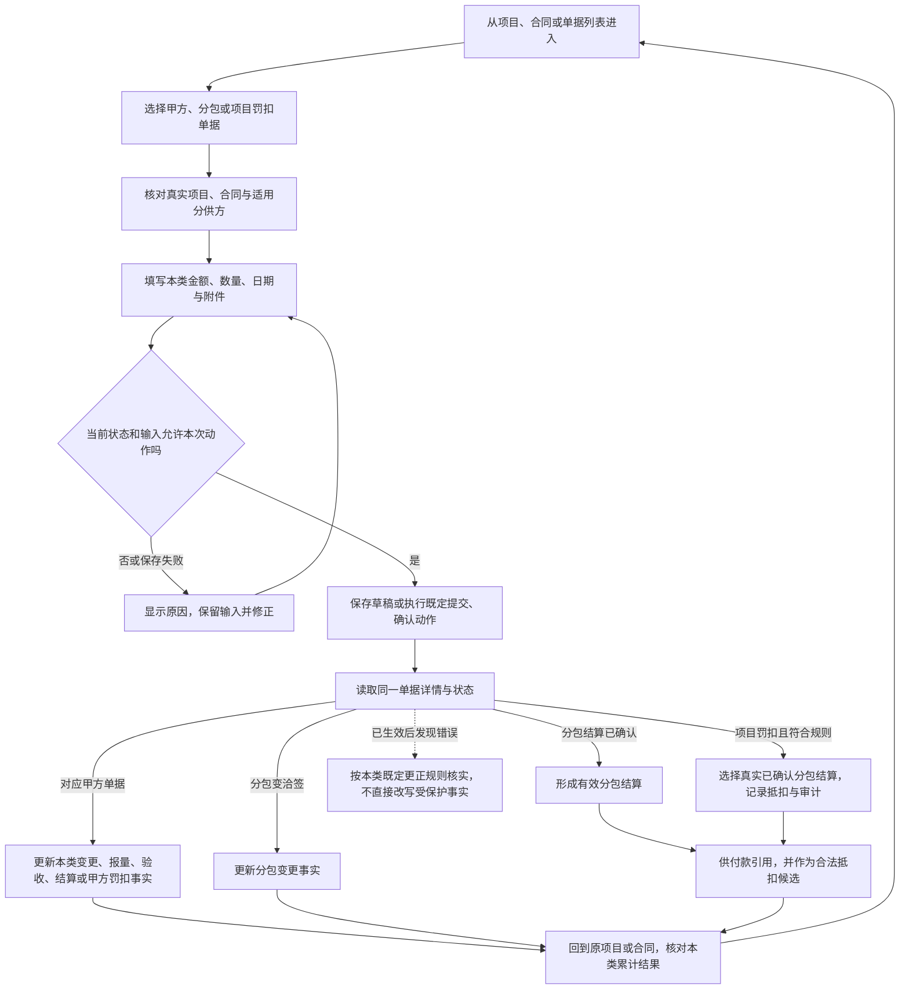
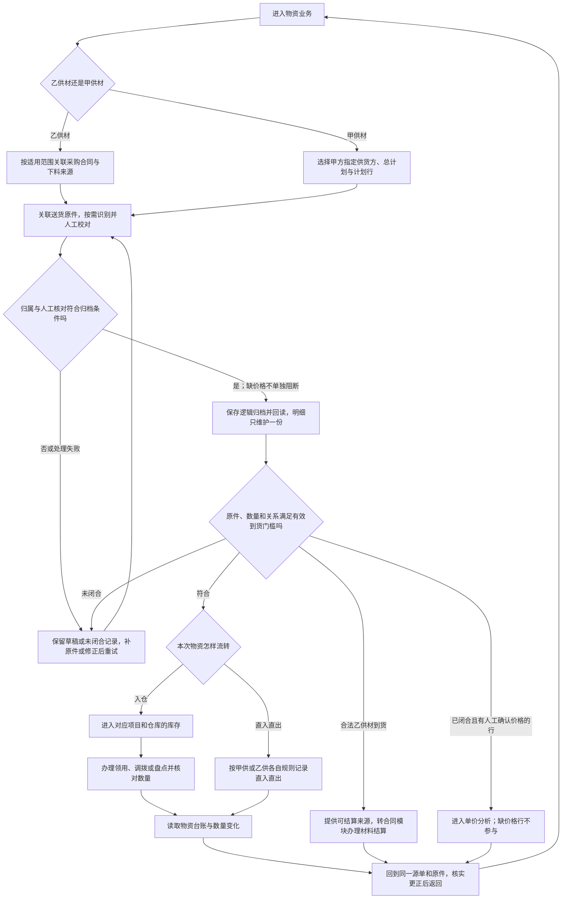
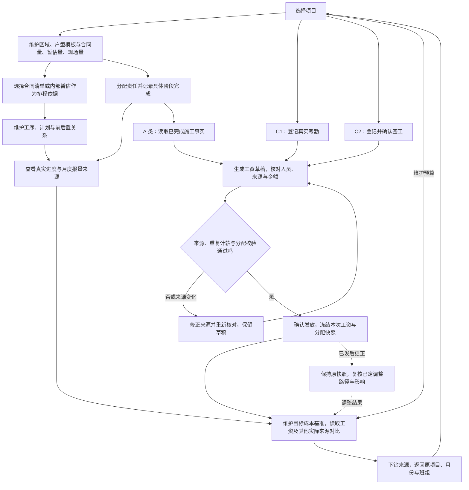
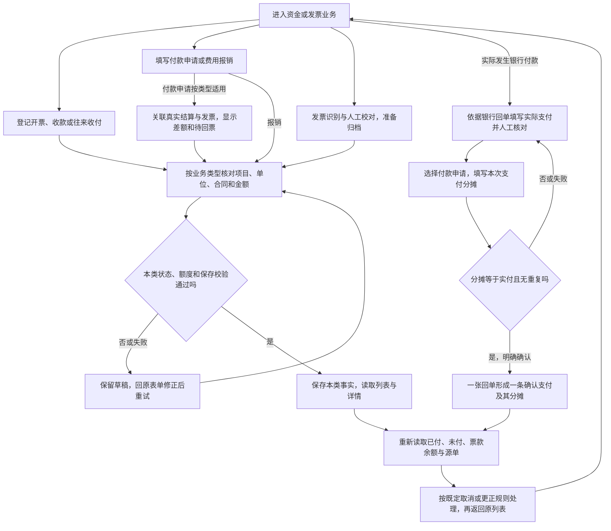
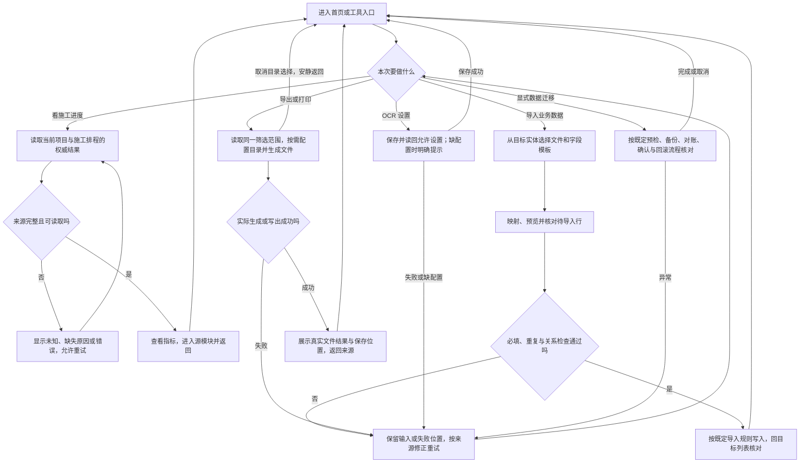

# 模块开发方向流程图

> **非权威源 · 方向确认稿 · 不是当前实现完成声明。**
>
> 本稿依据[全模块复核总图](https://github.com/zodea/crm-new/issues/402)及其模块票，表达已定业务方向和仍需逐场景复核的细节。实线表示业务衔接，虚线提示待核实的更正细节或后置关口；两者均不表示功能已完成。

当前优先界面、交互和数据处理。旧排除保持，不新增完整审批、人员权限或后台业务范围；正式持久化、备份恢复及部署单列后置上线验收。
红圈只作安全只读对照，不复制其真实业务数据。甲供材、工程量、排程与工资中的瑞航规则按本地权威复核，不标作红圈已验证行为。
字段和计算以[数据库](../rewrite/DATABASE.md)、[页面蓝本](../rewrite/pages/)及现行 ADR 为准；复核方法见[模块复核规程](../agents/module-review.md)。

## 全局：业务怎样衔接

**方向边界：**申请、结算、发票、银行支付与工资分别保存各自事实；项目经营汇总读取这些来源，不维护第二份累计值。首页只消费当前项目施工进度。工资发放按[既定支付例外](../adr/0015-form-persistence-and-payment-reconciliation.md)处理，避免与银行付款重复计入成本。

## 1. 基础资料：客户、分供方、班组与工人

对应 [#407](https://github.com/zodea/crm-new/issues/407)。

- **核对重点：**四类主档分别检查，同名不同身份、编辑读回、证照原件及下游引用不能只抽测一种。
- **既定 / 待核实：**既定为唯一主档、真实关联与整页编辑；删除、停用、合并只核对各自既定范围，客户参考详情受限保留证据缺口，不扩展人员账号体系。
- **依据：**[客户](../rewrite/pages/base-customer.md)、[分供方](../rewrite/pages/base-supplier.md)、[班组](../rewrite/pages/base-crew.md)、[工人](../rewrite/pages/base-worker.md)。

## 2. 项目与合作：从项目进入真实业务

对应 [#408](https://github.com/zodea/crm-new/issues/408)。

- **核对重点：**项目指标逐项回源，合作工作台聚合源单；导入失败不留下半个主档或合作关系。
- **既定 / 待核实：**人员姓名沿用不可下钻边界；请款回退、合作终态及导入同名冲突先继承旧票最终决定，再核实未覆盖场景。合作终态结算不替代一般支出结算。
- **依据：**[项目信息](../rewrite/pages/project-info.md)、[项目分供方](../rewrite/pages/project-supplier.md)、[中央写命令](../rewrite/COMMANDS.md)。

## 3. 合同与清单：材料结算在这里完成

对应 [#409](https://github.com/zodea/crm-new/issues/409)。

- **核对重点：**每类合同独立核字段与页签；材料来源不重复结算，后续批次、整张冲销和替代链保留历史。
- **既定 / 待核实：**材料结算唯一归本模块，物资只提供到货，财务只维护票款分摊；其他支出结算沿用本类规则，不能直接套材料冲销动作。待核实是实际界面、失败恢复及下游回读细节。
- **依据：**[核心合同](../rewrite/pages/core-contracts.md)、[合同与结算表单](../rewrite/pages/contract-forms.md)、[清单拆表](../rewrite/pages/boq-import.md)。

## 4. 甲方与分包单据：按单据类型处理结果

对应 [#410](https://github.com/zodea/crm-new/issues/410)。

- **核对重点：**变更、报量、验收/保修、最终结算、甲方罚扣及分包各类单据分别验收；甲方罚扣不混入项目罚扣抵扣。
- **既定 / 待核实：**分包结算唯一归本模块；既有状态与动作保持。需要核实的是奖罚、抵扣、重复执行及更正后的真实影响，不新增完整审批引擎。
- **依据：**[甲方与分包单据](../rewrite/pages/owner-documents.md)、[数据关系](../rewrite/DATABASE.md)、[中央写命令](../rewrite/COMMANDS.md)。

## 5. 物资：原件、到货、库存与价格各有去向

对应 [#411](https://github.com/zodea/crm-new/issues/411)。

- **核对重点：**物理原件与逻辑单据分清，有效到货不重复，库存、调拨两端、盘点及结算来源守恒；重新识别不覆盖人工稿。
- **既定 / 待核实：**仓库身份、甲供材供货方及计划行采用已定关系；甲供材直入直出的到货/领用双计但不入仓是瑞航规则。缺价格仍可归档到货事实，参考空表未证明的细节逐场景核实，不重开已定选择。
- **依据：**[物资管理](../rewrite/pages/material-management.md)、[送货识别与归档](../rewrite/pages/material-delivery.md)、[原件保全](../adr/0019-delivery-export-source-preservation.md)；新决定与旧蓝本差异由 [#411](https://github.com/zodea/crm-new/issues/411)承接收敛。

## 6. 工程量与现场成本：只走 A/C1/C2 工资

对应 [#412](https://github.com/zodea/crm-new/issues/412)。

- **核对重点：**量、责任与完成分层；现场量未知不当作零；考勤/签工互斥、已发冻结、防双计以及排程来源往返逐项验证。
- **既定 / 待核实：**A/C1/C2 及 B 类退役沿用已定决定，只核实落实情况。工资和施工规则以瑞航为准；已发调整、历史迁移、版本冲突及成本回读的细节仍需复核。
- **依据：**[工程量](../rewrite/pages/subcontract-quantity.md)、[工资与考勤](../rewrite/pages/subcontract-payroll.md)、[排程](../rewrite/pages/schedule-progress.md)、[目标成本](../rewrite/pages/target-cost.md)、[暂估排程](../adr/0017-provisional-schedule-before-contract.md)；退役范围以 [#412](https://github.com/zodea/crm-new/issues/412)继承的最终决定为准。

## 7. 资金与发票：申请和实际支付分开

对应 [#413](https://github.com/zodea/crm-new/issues/413)。

- **核对重点：**各收入/支出类型、回票类型、三类分摊和额度逐项验证；单票、多票、部分支付、重复回单及未知金额分开处理。
- **既定 / 待核实：**收款不等于收票，申请和报销不等于银行实付；工资支付保留例外。退款、红冲等只按既有范围判适用，图不预设新增动作或完整审批已完成。
- **依据：**[付款申请](../rewrite/pages/finance-payment.md)、[支付记录](../rewrite/pages/finance-records.md)、[发票](../rewrite/pages/finance-invoice.md)、[收款](../rewrite/pages/finance-receipt.md)、[真实分摊规则](../adr/0015-form-persistence-and-payment-reconciliation.md)。

## 8. 首页与工具：回到各模块的真实结果

对应 [#414](https://github.com/zodea/crm-new/issues/414)。

- **核对重点：**首页只读施工进度，经营汇总留在项目模块；缺源不显示假零；导入失败续导、导出实际文件、取消反馈及设置读回与源模块一致。
- **既定 / 待核实：**独立工具交互可先复核，汇总等待相关事实齐备。迁移界面的方向不代表生产存储、恢复或部署已完成；后置上线关口独立验收。
- **依据：**[首页](../rewrite/pages/homepage-dashboard.md)、[导入](../adr/0005-import-mapping-model.md)、[导出](../adr/0004-export-interaction-model.md)、[OCR](../adr/0006-ocr-paddleocr-vl-single-model.md)、[迁移边界](../adr/0020-browser-authority-and-demo-workspace-boundary.md)。

## 怎样使用本稿

按图逐场景核对操作、保存去向、结果与返回；能由现行规则判断的直接记录依据并推进，真实业务取舍才集中确认。
修订结论回到对应模块 Issue 和原权威源；本稿只同步方向图，不承载字段表、任务状态或验收完成计数。
