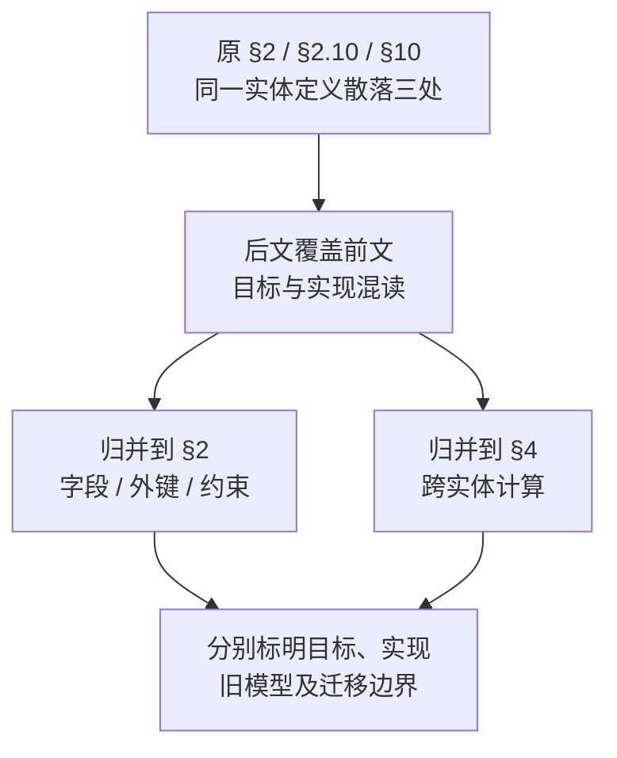
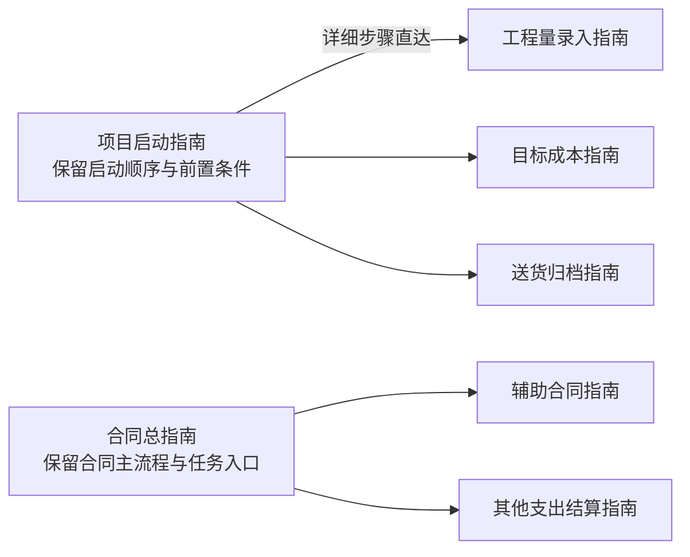
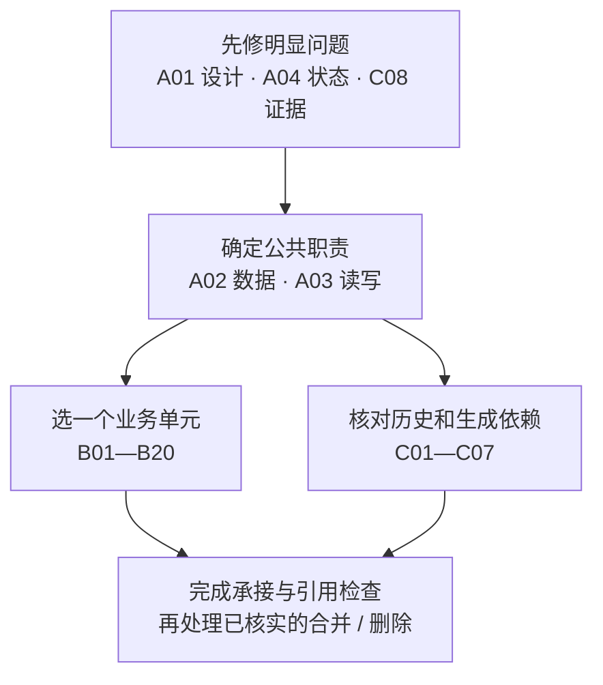

# 文档分模块整理清单

> 更新：2026-09-26。依据 9 月 25 日“精简根目录 Markdown 文档”聊天、当前工作区及随后只读复核。
>
> 本清单供用户逐项选择整理；A01、A02 已按用户授权推进文档整理，各项完成边界仍按对应行理解。本文是临时整理材料，不定义业务规则，也不复制 Issue 的任务状态。

## 1. 先看主要问题

### 1.1 A01：旧设计指令已收口，运行对比另行核对

| 对象 | 清理前的冲突 | 现行决定 | 本轮承接 |
| --- | --- | --- | --- |
| 顶栏 | DESIGN-TASTE 曾允许顶栏毛玻璃 | [ADR 0013](../adr/0013-align-all-ui-to-online-design.md) | 旧例外已删除；[品味说明](../design/DESIGN-TASTE.md)嵌入整理前后规则图 |
| 项目编辑 | 交互参考曾要求右侧 Drawer | [ADR 0014](../adr/0014-full-page-entity-forms.md) | [参考索引](../design/interaction-style-references.md)嵌入形态对照与流程图，只保留来源理由 |
| 设计演示数据 | DESIGN-TASTE 曾要求取真实蓝本 | [ADR 0014](../adr/0014-full-page-entity-forms.md) / [0020](../adr/0020-browser-authority-and-demo-workspace-boundary.md) | [数据来源关系图](../design/DESIGN-TASTE.md#5-演示数据区分设计样例与正式事实)说明匿名设计样例与运行来源隔离；无数据库调整 |

五变体用途和按钮反馈归 [KitUI](../design/kit-ui-component-specs.md)，稳定视觉原则归 [DESIGN-SYSTEM](../rewrite/DESIGN-SYSTEM.md)；移除重复数值表、完成状态副本及泛化的抽屉底栏/按钮打勾指令。两份参考文档保留独有理由与历史定位。与 AGENTS、文档、测试及指南四个入口的关系见[设计入口](../design/README.md#与协作文档测试和指南入口的关系)。

本轮图片为规则重绘，流程图为已定边界说明。按用户指令暂缓红圈实时查看，尚未形成新的红圈 / CRM hover、点击或布局对比证据；文档整理不代表实现已复验。

### 1.2 A02：实体定义已归并，未决政策单列

[DATABASE](../rewrite/DATABASE.md) 原 §2、§2.10、§10 的同实体字段、约束和迁移例外已原位归并；§2.10 只留表单覆盖与来源批次，计算集中到 §4。图为文档结构整理前后对照，不表示数据库已迁移。

- B05 的请款差异已依据 [#439](https://github.com/zodea/crm-new/issues/439)与页面既定规则收口为批复金额，明确零、未填写和历史未知分开；含税收票使用 `total_amount`。公式和小图见 [§4.4](../rewrite/DATABASE.md#44-projectsupplier-汇总project-suppliermd)，不代表 B05 整个工作台整理完成。
- 已确认物资目标（单一送货明细、Party 供货角色、计划头/行及整张冲销）与旧表分开，见[关系与流程小图](../rewrite/DATABASE.md#material-target)。保留打印迁移、原件、金额来源、工资冻结及恢复例外；目标关系尚未实现的部分没有写成已落地。
- **待核对：**PAY-08 历史未知批复的新支付确认门槛，定位在[付款实体及流程图](../rewrite/DATABASE.md#entity-payment-record)。已给申请 10,000、旧批复含义未知、已付 3,000、新回单 2,000 的完整实例供裁定；目前不改变政策。
- 逐项复核已确认补充协议沿原合同关联公司，以及从已有主档选择、只读带出原合同归属的目标；主合同选定或改选分供方时以新主档值覆盖联系人和电话（含手填值），之后允许编辑；合同与主档资料的后续修改不互相自动覆盖。采购明细单位已确认手填、不预设默认值；材质独立保留，有材质时参与对比，缺失时按材料名称、单位、规格对比；允许从 Excel 逐列复制到对应列，不要求整行复制，当前固定列序追加尚不具备该能力；明确倍数时换算比较已确认，原合同量价和单位保留，倍数未知不猜；补查旧设计截图后已纠正网格观察边界。承接在[合同实体](../rewrite/DATABASE.md#contract-party-selection)与[表单流程](../rewrite/pages/contract-forms.md#主体选择与自动带出目标)。我方主体身份方案，以及[采购明细导入与合同单价复用](../rewrite/pages/contract-forms.md#采购明细格式与导入核对)的其余口径仍待核对；目标不表示实现已交付，第 3 项草稿边界也未笼统确认。

| 本轮已读入口 | 与 A02 的关系 | 处理 |
| --- | --- | --- |
| [AGENTS.md](../../AGENTS.md) | 范围、证据、业务裁定、验证与 Git 边界 | 规则未变，不修改 |
| [文档入口](../README.md) | DATABASE 负责实体/字段/关系/迁移，ADR 与页面按各自职责 | 归属未变，不修改 |
| [测试入口](../testing/README.md) | 按受影响文档契约选择现有 unit 检查 | 不新增测试，不修改入口；静态通过不表示业务验收 |
| [指南入口](../guides/README.md) | 用户操作与当前可用状态 | 已确认新录入目标，但尚未实现；不改当前可用操作指南 |

本轮不修改运行页面；结构与流程图为规则示意，合同表单另嵌已有红圈历史截图并注明与阶段目标的差异。按逐项复核要求，逐列粘贴、跨单位报价、税点展示、运费归属和优惠扣减五张简易界面效果图共用可维护 HTML 图源；逐列粘贴区分代码重绘与已确认目标，单位换算与简洁的“含税单价＋税点”分列均已确认且尚待实现；[运费归属与金额核对](../rewrite/pages/contract-forms.md#运费归属与金额核对)已按用户裁定改为两份 4,400 元合同、各另收 600 元的完整例子：不含运费则合同外另计，已含同项运费且约定未变更则注明多收；不同运费条件的报价只作范围参考。[优惠扣减的明细表达](../rewrite/pages/contract-forms.md#优惠与扣减的明细表达)已确认：材料 5,000 元，单列优惠 -200 元，合计 4,800 元；请款样单仅用于表达参考，不移植其税率、比例或取整规则。未明差额仍待核对，未采用说明差额即放行的建议。未实时访问红圈，不把历史图中的入口写成已复验的交互。验证结果及尚未解决项以 A02 行记录为准。

### 1.3 大量重复：总流程复制了专题操作（B04 / B06）

下图表示建议的阅读关系：总指南说明前置条件和结果，详细步骤直接进入已有专题。

待精简正文分别在 [项目启动](../guides/project-start-and-schedule.md)和[合同总指南](../guides/core-contract-and-boq.md)；合并后同步移除详细步骤副本，保留专题独有异常与恢复条件。

### 1.4 状态、历史与检查：先核对依赖，再清退

| 主要问题 | 已核实的例子 | 对应工作 |
| --- | --- | --- |
| 状态矛盾 | [工程量规格](../rewrite/pages/subcontract-quantity.md)称 P6 尚在验收，[工资规格](../rewrite/pages/subcontract-payroll.md)称已随 PR #448 合并 | A04 / B08 / B09：核实版本与环境，清除跨模块状态副本 |
| 历史转引过多 | [历史审阅目录](./issue-review-2026-09-11/)同时保留规格、实施票、JSON、HTML 与回执 | C01 / C02：有效内容回到现有权威，独有历史理由保留来源 |
| 生成器和测试绑定 | [工资登记测试](../../tests/ui/payroll-p6-registration.test.ts)固定检查旧报告结构/状态，覆盖索引来自生成器 | C02 / C05：从源数据和模板调整，保留必要验证 |
| 证据目标缺失 | [分供方验收](../design/evidence/issue-453-production-supplier/frontend.md)链接的结果文件及 6 张截图缺失；[P4 实施票](./issue-review-2026-09-11/payroll-tickets/04-central-adjustments-and-actual-payments.md)链接的提交日志缺失 | C08：查恢复来源或标明不可取得，不以删链接掩盖缺失 |

8 个缺失目标是局部核对结果，不是全仓断链总数。以下清单是整理方向，不代表所有文件已逐段复核或附件可直接删除。

## 2. 逐项推进方式

- 按 **A / B / C 编号**选择一个工作单元；状态统一从“待整理”开始，可改为“整理中 / 待核对 / 已完成”。“后续”表示优先级较低，不表示已经完成。
- 每项先核对最新文件和关联来源，再展示具体保留、压缩、合并与删除候选；完成后在原行补一句承接位置和验证结果。已有 Issue 承载的进度不在本文再复制。
- 同一共享文件可能服务多项：A02/A03 先定职责，各业务单元再原位整理对应章节；按当时最新内容串行修改，保护其他任务改动。
- 规格与操作指南可以并存；不同权限、数据事实、异常恢复和用户任务的区别应完整保留。合同、财务或法律规则的实际调整按根规则核实官方依据与适用事实。
- “合并/退役”均是建议：先确认独有内容、例外和未完义务的接收位置，再核对引用及恢复来源。目录项是审查集合，实际处置仍须列出具体文件。
- 本清单沿用已有文件，不自动创建 Issue、实施代码、提交、推送或触发 CI；授权边界以 [AGENTS.md](../../AGENTS.md) 为准。

建议按下面的依赖推进；每次只选择一个编号，独立项可以并行核对。

## 3. 共享规范与入口

| 编号 / 状态 | 优先级 | 模块及涉及文件 | 主要问题与建议动作 |
| --- | --- | --- | --- |
| A01 · 已完成 | 优先 | **设计原则与参考** [DESIGN-TASTE.md](../design/DESIGN-TASTE.md) · [interaction-style-references.md](../design/interaction-style-references.md) · [design/README.md](../design/README.md) · [DESIGN-SYSTEM.md](../rewrite/DESIGN-SYSTEM.md) · [KitUI](../design/kit-ui-component-specs.md) | **文档范围已完成：**冲突指令回归 ADR 0013/0014，令牌直达样式源、组件行为归 KitUI、长期原则归 DESIGN-SYSTEM；参考文件保留来源与旧引用定位。两张规则图及职责、交互、数据来源图已嵌入。300 个本地链接及锚点检查、7 项运行参考文档契约测试、差异空白检查通过；图源已核对桌面与 390px。红圈实时对照按用户指令暂缓，不改代码或数据库。 |
| A02 · 待核对（已归并，逐项复核中） | 优先 | **实体、字段与计算口径** [DATABASE.md](../rewrite/DATABASE.md) | **承接：**§2.1—§2.9 逐实体归并；§2.10 只留覆盖/历史批次；§4 统一计算。B05 已批请款/含税收票按既定依据收口，目标、来源实现、旧模型及迁移分开；关系、聚合与冲销流程小图就近嵌入，旧锚点保留并修复现行引用。合同主体选择、自动带出与采购明细核对承接见 §1.2；明确倍数时换算比较已确认，公式与原值归属归 DATABASE；含税单价与税点独立成列、对比行精简已确认，合同表单承接效果图及完整实例；头行金额差额的代码事实与待裁定目标分列，运费合同内外归属及多收标注、优惠扣减独立减项参与合计已确认，五图共用一份 HTML。 **验证：**字段/关系/例外对照复核；2 个既有文档契约文件、23 项测试通过；11 份文档 571 条本地出链、全仓 124 条 DATABASE 锚点入链通过；15 张 Mermaid 图已分别在桌面与 390px 实际渲染并核对可读性；5 张界面示意在桌面与 390px 核对，最新优惠扣减图为简洁单行显示，演示前后切换、键盘与表内横滚通过，无整页横向溢出；本次新增第五图未改变前四图源码片段及渲染结果；采购网格历史截图已逐图查看并就近引用；差异空白检查通过。 **未决：**PAY-08 历史未知批复的新支付确认门槛；我方主体身份方案、采购明细 Excel 文件导入格式，运费结构化记录与合同外核算承接、优惠扣减明细的实体及实现方案，以及未明头行金额差额的提交门槛等。共用表单空税率按零计算的实现差距已标明，尚未调整；原 §4.5 独有计数指标的承接及其余逐项复核仍保留。逐列粘贴、单位换算、税点展示、运费处理与优惠扣减仅确认目标；物资目标迁移及生产接管仅标明既有实现边界，本轮未验证或实施。不执行真实迁移、不改业务代码。 |
| A03 · 待整理 | 较高 | **架构、命令与读模型** [ARCHITECTURE.md](../rewrite/ARCHITECTURE.md) · [COMMANDS.md](../rewrite/COMMANDS.md) · [READ-MODELS.md](../rewrite/READ-MODELS.md) | PG、AX、P1—P7 的阶段追加与现行契约交织；公共恢复和版本约束多处重述。 **方向：**分别保留架构边界、写动作、读投影职责；公共协议集中，各领域仅写差异和例外。保留 Issue 出处，压缩开发历程。架构入口上一轮已精简，仅随契约变化同步。 |
| A04 · 待整理 | 优先 | **界面实现状态** [ui-implementation-status.md](../design/ui-implementation-status.md) · [design/README.md](../design/README.md) | 逐日期堆叠状态；#479 同时出现已完成和继续验收；仍有固定任务入口及无条件写回 Issue 的旧指令。 **方向：**核实所选版本后，每模块只留当前边界与证据入口；开发过程留固定版本证据。清掉旧操作指令，保留生成块；设计入口只指路。 |
| A05 · 待整理 | 较高 | **ADR 及替代关系** [adr/README.md](../adr/README.md) · [0007-unified-visual-style-rounded-cards.md](../adr/0007-unified-visual-style-rounded-cards.md) · [0011-redesign-application-shell.md](../adr/0011-redesign-application-shell.md) · [0019-delivery-export-source-preservation.md](../adr/0019-delivery-export-source-preservation.md) · [0004-export-interaction-model.md](../adr/0004-export-interaction-model.md) · [0013-align-all-ui-to-online-design.md](../adr/0013-align-all-ui-to-online-design.md) | 部分 ADR 已主要转引后续规则，仍维持独立入口；索引混入实现状态。 **方向：**0007 的独有原则/理由归 0013 或组件契约；0011 的独有外壳行为归公共契约；0019 的导出决策与原件规则分别归 0004、送货规格。完成承接、入链和恢复定位后才列删除候选。其他 ADR 有独立决策价值时保留。 |
| A06 · 待整理 | 较高 | **组件、表单与通用交互** [kit-ui-component-specs.md](../design/kit-ui-component-specs.md) · [CRM-PATTERNS.md](../rewrite/CRM-PATTERNS.md) · [0003-confirm-dialog-deletion-model.md](../adr/0003-confirm-dialog-deletion-model.md) · [0014-full-page-entity-forms.md](../adr/0014-full-page-entity-forms.md) · [0016-overlay-composition-contract.md](../adr/0016-overlay-composition-contract.md) | 组件正文夹旧待办、调用快照与批次状态；确认交互等在 ADR 和组件文档重复。 **方向：**ADR 保留取舍，KitUI 保留公开契约，通用业务模式归 CRM-PATTERNS，页面只留领域差异。核对失效原型引用；不因文档精简改变组件 API 或表单形态。 |
| A07 · 待整理 | 较高 | **公共导航、消息、页签与列表** [NAVIGATION.md](../rewrite/NAVIGATION.md) · [PUBLIC-SURFACES.md](../rewrite/PUBLIC-SURFACES.md) · [guides/routes.md](../guides/routes.md) · [guides/tabs-and-recovery.md](../guides/tabs-and-recovery.md) · [guides/list-search-and-filters.md](../guides/list-search-and-filters.md) | 导航契约含实施顺序和工资阶段进度；公共能力也另维护“已有/待补齐”。 **方向：**契约只定义目标、返回、恢复及消息行为；操作指南保留实际步骤和异常处理；开发进度回到对应任务。上一轮已整理页签指南，本项只核交叉重复与状态。 |
| A08 · 待整理 | 后续 | **协作小文件与入口** [domain.md](../agents/domain.md) · [triage-labels.md](../agents/triage-labels.md) · [issue-tracker.md](../agents/issue-tracker.md) · [skills-cheatsheet.md](../agents/skills-cheatsheet.md) · [agents/README.md](../agents/README.md) · [docs/README.md](../README.md) · [guides/README.md](../guides/README.md) | 来源映射和标签说明形成小型转引链；入口已精简，进一步收益有限。 **方向：**评估标签并入 Issue 规程、来源映射并入文档入口；保留独有术语使用约束，技能路由按实际可用能力精简。合并才删原文件并修直链。Git、CI、模块复核继续按独立任务保留。 |

## 4. 业务模块与用户指南

数据、命令、读模型共用 A02/A03 的文件，下面只列各业务专题；共同文件不在每行重复登记。

| 编号 / 状态 | 优先级 | 模块及涉及文件 | 主要问题与建议动作 |
| --- | --- | --- | --- |
| B01 · 待整理 | 较高 | **客户档案** [base-customer.md](../rewrite/pages/base-customer.md) · [guides/customer-records.md](../guides/customer-records.md) | 规格、操作和本机保存说明需进一步厘清，不能把环境限制散写成多套规则。 **方向：**页面维护字段与关系，指南维护用户任务；本机差异与 B19 一起处理。可合并同一任务的说明，保留客户与项目关系的独有约束。 |
| B02 · 待整理 | 较高 | **分供方主档、证照及核验** [base-supplier.md](../rewrite/pages/base-supplier.md) · [guides/supplier-records.md](../guides/supplier-records.md) · [guides/supplier-credential-review.md](../guides/supplier-credential-review.md) | 证照状态、人工采用和恢复说明散落在页面、指南及中央契约；主档与本机保存重复环境说明。 **方向：**状态定义、写动作与用户步骤各归其位；证照核验作为独立任务保留，主档只链接入口。与 B19 核对本机模式差异。 |
| B03 · 待整理 | 较高 | **班组、工人与私密名册** [base-crew.md](../rewrite/pages/base-crew.md) · [base-worker.md](../rewrite/pages/base-worker.md) · [guides/crew-worker-records.md](../guides/crew-worker-records.md) · [guides/worker-roster-archive.md](../guides/worker-roster-archive.md) | “附件尚未接入”等泛化状态易混淆普通档案、私密照片和名册的不同能力。 **方向：**保留班组、工人实体差异及联合操作指南；把可用性说明限定到具体能力和环境。私密名册的权限、原件和归档流程继续独立。 |
| B04 · 待整理 | 较高 | **项目、启动与 Excel 导入** [project-info.md](../rewrite/pages/project-info.md) · [guides/project-start-and-schedule.md](../guides/project-start-and-schedule.md) · [guides/project-excel-import.md](../guides/project-excel-import.md) | 启动指南重复工程量、成本、送货步骤；项目规格重复档案包说明并夹实现历程。 **方向：**启动指南保留先后顺序、前置条件、结果及直达专题链接；详细操作分别归 B08/B13/B15。归并档案包规则；项目文件导入继续独立于旧库迁移。 |
| B05 · 待整理 | 优先 | **项目×分供方工作台** [project-supplier.md](../rewrite/pages/project-supplier.md) · [guides/project-supplier-workbench.md](../guides/project-supplier-workbench.md) | 聚合公式与 DATABASE 重复；请款 amount / approved_amount 差异已由 A02 依 #439 收口，未完成本项其余整理。 **方向：**沿已核实口径，不按篇幅或现有实现另选公式。计算归数据权威；工作台保留展示、来源、缺源及下钻；支出结算与合作终态继续区分。 |
| B06 · 待整理 | 较高 | **核心/辅助合同、清单与其他结算** [core-contracts.md](../rewrite/pages/core-contracts.md) · [contract-forms.md](../rewrite/pages/contract-forms.md) · [boq-import.md](../rewrite/pages/boq-import.md) · [guides/core-contract-and-boq.md](../guides/core-contract-and-boq.md) · [guides/auxiliary-contracts.md](../guides/auxiliary-contracts.md) · [guides/other-expense-settlement.md](../guides/other-expense-settlement.md) | 合同总指南重复辅助合同/其他结算完整步骤；页面复制 DTO；BOQ 样本观察与通用规则混写。 **方向：**总指南只保留这些任务的入口及结果，详细步骤归已有专题；类型快照回到读模型/代码来源。分清样本与通用导入规则，保留尚无其他承接位置的材料采购结算内容。 |
| B07 · 待整理 | 较高 | **甲方单据、分包单据与罚扣** [owner-documents.md](../rewrite/pages/owner-documents.md) · [guides/core-contract-and-boq.md](../guides/core-contract-and-boq.md) | 后续 Issue 的追加段与原单据章节并存，指南末尾又叠加结算和罚扣说明。 **方向：**按单据把字段、生命周期、异常和操作归回原章节；沿用合同指南承接用户步骤，无须为盘点补建新指南。 |
| B08 · 待整理 | 较高 | **工程量、责任与完成** [subcontract-quantity.md](../rewrite/pages/subcontract-quantity.md) · [guides/quantity-central-workflow.md](../guides/quantity-central-workflow.md) · [guides/quantity-totals-and-export.md](../guides/quantity-totals-and-export.md) | 区域/模板操作在启动指南重复；工资 P6 进度叙述与工资页面不一致。 **方向：**保留矩阵、责任、完成和归档规则；工资只留关联来源，不复制阶段状态。录入完成与核对输出两种任务继续分开。 |
| B09 · 待整理 | 较高 | **工资主流程、考勤与签工** [subcontract-payroll.md](../rewrite/pages/subcontract-payroll.md) · [guides/payroll-attendance.md](../guides/payroll-attendance.md) | P0—P7 进度流水与现行流程混排，跨模块文件继续复制不同时间的完成状态。 **方向：**按来源→配置→核对→发放→冻结组织；A/C1/C2 的来源、精度和输出差异完整保留。阶段号只作出处，状态核实时注明版本与环境。 |
| B10 · 待整理 | 较高 | **工资更正、费用与空鼓** [guides/payroll-adjustments.md](../guides/payroll-adjustments.md) · [guides/payroll-fees.md](../guides/payroll-fees.md) · [guides/payroll-hollow.md](../guides/payroll-hollow.md) | 各专题反复解释原单冻结、实际收付、来源返回和输出；与 B08/B09 交叉。 **方向：**继续保留三个独立任务指南；共用规则直链对应数据/命令/页面章节，指南只保留本任务步骤、异常与特例。更正和真实补退不能混为同一动作。 |
| B11 · 待整理 | 较高 | **工资正式出具与完整工作簿** [guides/payroll-official-numbering.md](../guides/payroll-official-numbering.md) · [guides/payroll-complete-workbook.md](../guides/payroll-complete-workbook.md) · [subcontract-payroll.md](../rewrite/pages/subcontract-payroll.md) | 编号、冻结、单份输出、整册归档之间有重复说明及多处阶段状态。 **方向：**先保留独立任务入口，明确出具与归档顺序、各自结果及权限；共用输出规则只维护一次。是否合并短指南需确认完整流程，不抹平编号、工作簿和私密名册差异。 |
| B12 · 待整理 | 较高 | **排程、工序库与首页进度** [schedule-progress.md](../rewrite/pages/schedule-progress.md) · [homepage-dashboard.md](../rewrite/pages/homepage-dashboard.md) · [guides/home-project-progress.md](../guides/home-project-progress.md) · [guides/project-start-and-schedule.md](../guides/project-start-and-schedule.md) | 排程规格内有历史示例工序及首页布局副本；首页另复制测试文件清单。 **方向：**现行工序规则与历史样本分开；首页布局归首页规格，排程只定义提供的数据/入口。测试定位直达已有模块索引，本机工序库差异与 B19 配套。 |
| B13 · 待整理 | 较高 | **目标成本** [target-cost.md](../rewrite/pages/target-cost.md) · [guides/target-cost.md](../guides/target-cost.md) | 项目、排程、成本文档交叉说明版本、基线与金额可用性。 **方向：**版本头、科目、基线和未知金额规则集中在对应权威；其他页面只保留来源及入口。规格与用户指南用途不同，继续分开。 |
| B14 · 待整理 | 后续 | **物资与材料价格** [material-management.md](../rewrite/pages/material-management.md) · [guides/material-price-analysis.md](../guides/material-price-analysis.md) | 需核对材料登记、价格分析与合同结算之间的重复，尚未确认需要整份合并。 **方向：**保留材料对象和价格分析任务；材料结算继续指向合同专题，避免复制另一套结算规则。只清理已证实重复和历史状态。 |
| B15 · 待整理 | 较高 | **送货识别、归档、原件与 OCR** [material-delivery.md](../rewrite/pages/material-delivery.md) · [guides/material-delivery.md](../guides/material-delivery.md) · [guides/ocr-settings.md](../guides/ocr-settings.md) · [delivery-recognition.md](../prd/delivery-recognition.md) | PRD 与页面重复识别、核对、归档及异常流程；项目启动指南又重述打印。 **方向：**稳定交互归页面，用户步骤归指南，OCR 设置单独保留；PRD 仅保留独有目标与未完验收义务，无独有内容后才候选退役。原件保真与 A05 协同。 |
| B16 · 待整理 | 较高 | **付款申请与实际支付** [finance-payment.md](../rewrite/pages/finance-payment.md) · [finance-records.md](../rewrite/pages/finance-records.md) · [guides/finance-payment.md](../guides/finance-payment.md) | 页面含历史观察和跨域实现状态；申请、支付、工资边界已有正确直链需要保留。 **方向：**分别维护申请与支付事实，通用保存协议引用 COMMANDS；核对历史观察仍影响哪些规则，留结论和证据。业务金额及勾稽关系不在精简时自行改变。 |
| B17 · 待整理 | 较高 | **收款、往来、开票申请与报销** [finance-receipt.md](../rewrite/pages/finance-receipt.md) · [finance-billing.md](../rewrite/pages/finance-billing.md) · [finance-reimbursement.md](../rewrite/pages/finance-reimbursement.md) · [guides/receipt-registration.md](../guides/receipt-registration.md) | 不同对象夹带共用保存规则及旧运行快照，容易误把历史缺口当当前状态。 **方向：**各对象继续独立；通用幂等/冲突说明直链命令契约，保留页面特有校验和操作。没有独立指南的对象不因本次盘点自动新增文件。 |
| B18 · 待整理 | 后续 | **发票、开票因子与 Excel 兼容** [finance-invoice.md](../rewrite/pages/finance-invoice.md) · [real-ticket-excel-reference.md](../rewrite/pages/real-ticket-excel-reference.md) · [guides/finance-invoice.md](../guides/finance-invoice.md) · [guides/invoice-factor.md](../guides/invoice-factor.md) | 真实票据研究位于 pages，易与现行规格混用；样本、导入兼容与因子工具需要分工。 **方向：**发票台账、开票申请和因子工具保持区别；兼容规则归已有规格，独有样本分析保留来源。样本研究无独有价值后才退役，不仅搬目录。 |
| B19 · 待整理 | 较高 | **本机保存、备份与旧库迁移** [guides/local-customer-storage.md](../guides/local-customer-storage.md) · [guides/local-project-storage.md](../guides/local-project-storage.md) · [guides/local-supplier-storage.md](../guides/local-supplier-storage.md) · [guides/local-process-library-storage.md](../guides/local-process-library-storage.md) · [guides/local-backup-and-restore.md](../guides/local-backup-and-restore.md) · [guides/local-data-migration.md](../guides/local-data-migration.md) | 多篇短指南重复环境、原提交核对和生产边界；各领域也有真实差异。 **方向：**公共运行配置归既有生产入口；领域保存差异可并入相应业务指南的环境章节。备份恢复、旧库身份迁移继续独立；逐项保留恢复条件、门禁和未接管范围。 |
| B20 · 待整理 | 后续 | **经营汇总、迁移对账与生产承接** [project-operating-summary-index.md](../prd/project-operating-summary-index.md) · [project-operating-summary-and-import.md](../prd/project-operating-summary-and-import.md) · [summary-field-catalog.md](../migration/summary-field-catalog.md) · [ruijing-workbook-mapping.md](../migration/ruijing-workbook-mapping.md) · [ruijing-data-quality-and-reconciliation.md](../migration/ruijing-data-quality-and-reconciliation.md) · [ruijing-acceptance.md](../migration/ruijing-acceptance.md) · [project-operating-summary-work-breakdown.md](../implementation/project-operating-summary-work-breakdown.md) · [production-gate-work-breakdown.md](../implementation/production-gate-work-breakdown.md) | 目标、公式、样本映射与实施入口多处交叉；部分入口已缩短，不能视作都需合并。 **方向：**数据契约维护通用计算；迁移材料分别维护字段映射、差异归因和验收。PRD 保留用户目标和未完义务；工作分解只保留必要承接，不能凭模块完成就清退生产关口。 |

## 5. 历史材料、证据与检查工具

本组可能涉及生成器、测试或钩子；这些文件先列为配套核对范围，当前仅编制清单。

| 编号 / 状态 | 优先级 | 模块及涉及文件 | 主要问题与建议动作 |
| --- | --- | --- | --- |
| C01 · 待整理 | 较高 | **历史实施票与规格副本** [payroll-central-facts.md](./issue-review-2026-09-11/payroll-central-facts.md) · [payroll-central-spec-draft.md](./issue-review-2026-09-11/payroll-central-spec-draft.md) · [schedule-central-spec.md](./issue-review-2026-09-11/schedule-central-spec.md) · [supplier-credentials-central-spec.md](./issue-review-2026-09-11/supplier-credentials-central-spec.md) · [target-cost-central-spec.md](./issue-review-2026-09-11/target-cost-central-spec.md) · [payroll-tickets/](./issue-review-2026-09-11/payroll-tickets/) · [schedule-tickets/](./issue-review-2026-09-11/schedule-tickets/) · [supplier-credential-tickets/](./issue-review-2026-09-11/supplier-credential-tickets/) · [target-cost-tickets/](./issue-review-2026-09-11/target-cost-tickets/) | 完整票据正文、旧状态、历史规格与现行契约重复，部分证据仍回链这些票据。 **方向：**按业务核对每条独有规则/未完义务的承接；纯副本可清退，独有理由留现有证据。目录内各票逐份确认，先修回链，不按目录一刀切。 |
| C02 · 待整理 | 较高 | **历史交互报告及其登记测试** [README.md](./issue-review-2026-09-11/README.md) · [rows-business.json](./issue-review-2026-09-11/rows-business.json) · [index.html](./issue-review-2026-09-11/index.html) · [build_report.py](./issue-review-2026-09-11/build_report.py) · [payroll-p5-registration.test.ts](../../tests/ui/payroll-p5-registration.test.ts) · [payroll-p6-registration.test.ts](../../tests/ui/payroll-p6-registration.test.ts) · [payroll-p7-registration.test.ts](../../tests/ui/payroll-p7-registration.test.ts) | 历史报告仍有持续更新指令；生成器可能覆盖补入的边界说明；测试固定检查旧报告结构和状态。 **方向：**先决定保留的历史证明与唯一数据源，压缩重复呈现。若调整生成器/测试，单列代码影响并保留必要证据验证，不能只为删报告取消检查。与 C01/C05 协同。 |
| C03 · 待整理 | 较高 | **验收证据及附件** [evidence](../design/evidence/) · [guide-pdf-cleanup-2026-09-14.md](./guide-pdf-cleanup-2026-09-14.md) | 工资等证据组保存多轮渲染、回执和原始载体；可能重复，尚未完成逐附件去留核对。 **方向：**优先核对工资 C2、C1、费用、A、空鼓、目标成本组。按验证事件保留版本/场景/结果/限制及必要原件；对候选附件列精确路径、用途、引用及恢复来源。现有 PDF 清理记录仍承担恢复指针，先保留。 |
| C04 · 待整理 | 后续 | **测试模块索引** [testing/README.md](../testing/README.md) · [modules](../testing/modules/) | 28 个模块重复长导语；当前登记未发现漏项或重复，本次未发现专用生成器。 **方向：**共用归属和阅读规则只留 README，模块保留领域分组与定位价值。清理后核对全部登记路径、重复与漏项；不将测试名称索引当业务验收证明。 |
| C05 · 待整理 | 较高 | **生成覆盖索引与运行审计** [module-review-coverage.md](../design/module-review-coverage.md) · [module-review-coverage.json](../design/module-review-coverage.json) · [design-coverage.json](../design/design-coverage.json) · [runtime-evidence-ledger.json](../design/runtime-evidence-ledger.json) · [runtime-reference-audit.md](../design/runtime-reference-audit.md) · [runtime-visual-regression.md](../design/runtime-visual-regression.md) · [sync-module-review-coverage.mjs](../../scripts/sync-module-review-coverage.mjs) · [sync-design-coverage.mjs](../../scripts/sync-design-coverage.mjs) · [sync-runtime-evidence-ledger.mjs](../../scripts/sync-runtime-evidence-ledger.mjs) · [module-review-obligations.mjs](../../scripts/module-review-obligations.mjs) · [module-review.md](../agents/module-review.md) | 生成索引体量大；运行方法、参考采证与逐页验收有重复，直接删生成块会被覆盖。 **方向：**保留防遗漏、设计对应、参考证据的不同职责。确需压缩输出时从现有生成源/模板改，验证再生成一致性；逐页复核方法集中，其他位置直链。 |
| C06 · 待整理 | 后续 | **研究、工具比较与流程方向** [research/README.md](./README.md) · [kit-ui-primitives-wave2-prd.md](./kit-ui-primitives-wave2-prd.md) · [kitui-to-shadcn-migration.md](./kitui-to-shadcn-migration.md) · [schedule-dependency-editor-brief.md](./schedule-dependency-editor-brief.md) · [module-development-flows.md](./module-development-flows.md) · [antfu-starred-tooling-2026-09-24.md](./antfu-starred-tooling-2026-09-24.md) · [antfu-starred-testing-local-audit-2026-09-24.md](./antfu-starred-testing-local-audit-2026-09-24.md) · [invoice-recognition-app-port-plan.md](./invoice-recognition-app-port-plan.md) · [ocr-recognition-strategy.md](./ocr-recognition-strategy.md) · [ocr-ux-benchmark.md](./ocr-ux-benchmark.md) · [project-switcher-patterns.md](./project-switcher-patterns.md) · [browser-audit-2026-09-05.md](./browser-audit-2026-09-05.md) · [red-circle-ui-gap-2026-07-11.md](./red-circle-ui-gap-2026-07-11.md) | 历史稿仍复制 API、尺寸、验收及开发方向；工具比较包含易过期环境快照。 **方向：**逐专题保留独有观察、官方来源和取舍；采纳后的规则归现有权威，工具使用归测试入口。有价值的流程图就近归页面/指南。先核独有价值再合并或删除，不把候选工具写成强制要求。 |
| C07 · 待整理 | 后续 | **分支整合与交付流水** [local-branch-integration-2026-09-05.md](./local-branch-integration-2026-09-05.md) · [local-branch-integration-2026-09-10.md](./local-branch-integration-2026-09-10.md) · [issue-tracker-audit-2026-07-06.md](./issue-tracker-audit-2026-07-06.md) · [completed-issue-delivery-2026-09-22.md](../design/evidence/completed-issue-delivery-2026-09-22.md) · [issue-412-decision-closeout.md](../design/evidence/issue-412-decision-closeout.md) | 存在领先数、测试计数、未推送状态和多轮过程叙述；部分文件仍承担冲突取舍与收尾来源。 **方向：**保留独有裁定、固定提交、恢复定位及未完义务；其余重复过程从工作树清退。不能把当时状态当当前状态，也不能因已完成整份删除。 |
| C08 · 待整理 | 优先 | **断链与文档检查缺口** [frontend.md](../design/evidence/issue-453-production-supplier/frontend.md) · [payroll-tickets/04-central-adjustments-and-actual-payments.md](./issue-review-2026-09-11/payroll-tickets/04-central-adjustments-and-actual-payments.md) · [documentation-tooling.md](../testing/modules/documentation-tooling.md) · [git-hooks.mjs](../../scripts/git-hooks.mjs) · [.lintstagedrc](../../.lintstagedrc) · [pre-commit](../../.husky/pre-commit) | 本轮抽查发现 8 个文件目标缺失；已有专用契约测试不等于一般 Markdown 文件/锚点检查。 **方向：**先查缺失证据的提交或产物，恢复正确入口或明确不可取得；不得通过删链接伪称证据完整。若补长期检查，复用现有工具，区分历史原路径与阅读链接；钩子/测试行为变更另行审阅。 |

## 6. 暂时保留及配套承接位置

| 文件或类别 | 处理边界 |
| --- | --- |
| [根 README](../../README.md)、[CLAUDE](../../CLAUDE.md)、[AGENTS](../../AGENTS.md)、[CONTEXT](../../CONTEXT.md) | 上一轮已处理入口、协作规则及术语；先整理下层重复，不再把有效规则拆成更多入口 |
| [Git 工作流](../agents/git-workflow.md)、[CI 使用](../agents/ci-usage.md)、[模块复核](../agents/module-review.md) | 触发场景不同，保留独立；仅随实际引用变化同步 |
| [ADR 0001](../adr/0001-invoice-single-table.md)、[0002](../adr/0002-change-order-generates-ledger.md)、[0010](../adr/0010-quantity-matrix-and-construction-record-model.md)、[0012](../adr/0012-exact-factor-combination-solver.md)、[0017](../adr/0017-provisional-schedule-before-contract.md)、[0018](../adr/0018-versioned-schedule-process-library.md) | 有独立决策价值，按对应模块核对，不为减少数量强行合并 |
| [ADR 0005](../adr/0005-import-mapping-model.md)、[0006](../adr/0006-ocr-paddleocr-vl-single-model.md)、[0008](../adr/0008-adopt-shadcn-vue-on-unocss.md)、[0009](../adr/0009-vxe-table-as-datagrid-engine.md)、[0015](../adr/0015-form-persistence-and-payment-reconciliation.md)、[0020](../adr/0020-browser-authority-and-demo-workspace-boundary.md)、[0021](../adr/0021-single-operator-windows-production-storage.md) | 保留选型、读写与运行边界；业务或组件单元触及时收去重复字段、样本和历史状态，不自行改变方案 |
| 工资更正、费用、空鼓、名册；工程量录入与导出；文件导入、旧库迁移与备份 | 同组审查不代表合成一篇；每个任务仍能独立找到前置条件、操作结果和恢复办法 |
| 真实参考资料、数据库、密钥、其他任务改动、活动产物 | 仅按相关依赖核对；不得作为文档冗余批量清理，也不扩展修改用户全局规则 |

文件覆盖：上表涉及页面目录的 24 个 Markdown 文件（其中含真实票据样本研究），以及指南目录的全部 38 个文件：1 个 README 入口、36 篇操作专题和 1 篇路由索引。清单中的历史目录还需在相应工作单元逐文件核对，未声称完成全附件审查。

## 7. 每项完成标准

处理一个编号时，逐项核对以下条件；“保留”也需要检查正文，不能仅凭标题判定。

- [ ] 独有规则、例外、决策理由、退役业务仍有效的限制和未完验收义务都有明确承接。
- [ ] 现行规则、已定待开发、实际实现、历史观察表述清楚；未以代码现状直接覆盖已定规格。
- [ ] 受影响的文件链接、锚点、词条、代码/测试引用、生成源已核对；新增/并行修改已复扫。
- [ ] 证据保留固定版本、场景、操作、结果和限制；未凭相似截图、失败日志或旧日期作删除判断。
- [ ] 合并后的旧正文已移除，入口直接指向承接位置；删除候选有精确路径及恢复方式。未跟踪独有内容不假称可从 Git 恢复，外部历史链接的限制如实注明。
- [ ] 按改动运行必要检查：纯文档核对差异、链接和相关契约；改变生成器/测试再验证相应行为。无关应用全套测试和 CI 不自动运行。
- [ ] 用对应真实任务检查导航，例如找到页面规格、完成一次导入、查询工资概念或回看验收依据；没有增加不必要的跳转。
- [ ] 原行已简记处理动作、承接位置、验证结果和剩余限制；工作区已有改动保持完整。

每批交付只展示选定编号的差异和验证，不把整份清单视为一次性实施授权。全部整理完成后，将独有长期说明并回既有权威文件，清退本清单及临时输出；不再追加另一份重复总结。
