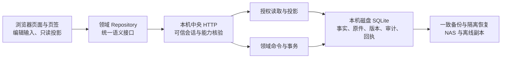
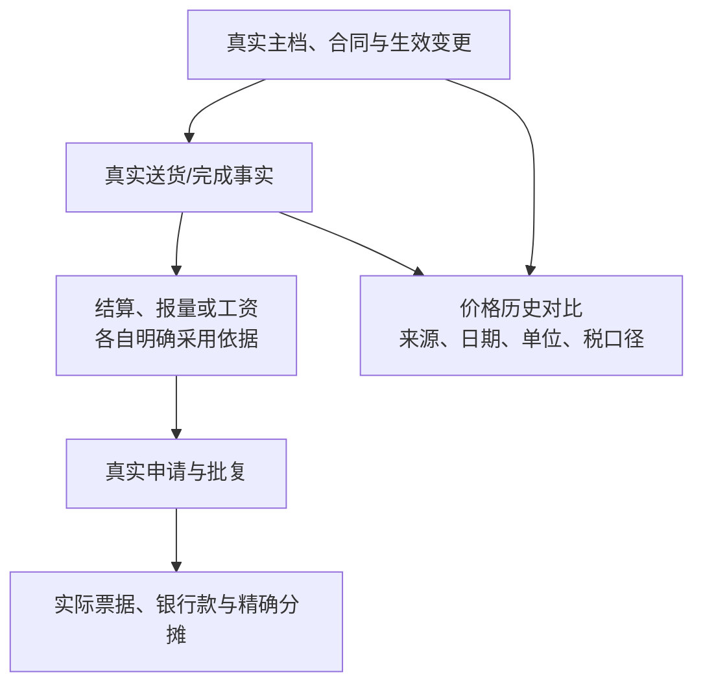

<a id="当前技术架构"></a>

# A03 技术架构与数据归属

本文定义后续开发的目标职责、运行环境和唯一权威边界。A01/A02 已确认的业务决定继续有效；A03 按本轮用户确认重构，核实基线为 `main@31f8ec34293f7edca8cc732285073f044acb5b03`（2026-10-04）。本文中的目标设计不代表已经交付；当前实现和差距集中在[实现与目标差距](#implementation-gaps)。

## 文档职责与阅读入口

| 权威文档 | 唯一维护的内容 | 本文如何使用 |
| --- | --- | --- |
| 本文 | 运行形态、模块职责、逻辑数据 owner、正式/演示边界、我方签约主体设置 | 决定功能和事实应该放在哪里 |
| [COMMANDS](./COMMANDS.md) | 写动作、幂等、版本核对、可靠回执、原命令恢复、草稿生命周期、正式合同编号防重 | 决定何时能写、失败后怎样继续 |
| [READ-MODELS](./READ-MODELS.md) | DTO、Problem、标量、分页、一致性、权限、加载/空/错误、可空值和完整性 | 决定读到的事实如何解释与显示 |
| [DATABASE](./DATABASE.md) | 实体关系、原始事实字段、领域公式、历史物理结构与迁移边界 | 核实稳定身份、归属和真实数据来源 |
| [NAVIGATION](./NAVIGATION.md) | 语义目标、目标解析、来源返回和跨域入口 | 将已经验证的稳定身份转为站内路径 |
| [PUBLIC-SURFACES](./PUBLIC-SURFACES.md) | 应用壳、页签、全局通知与洞察宿主 | 复用公共交互，不复制领域规则 |
| [ADR](../adr/) | 已采纳的技术取舍及其适用范围 | 保存决定依据，不复制实现进度 |

公共规则只有一个现行出处。领域章节只补充本领域的差异、限制和例外，直接链接对应规则；Issue 与验收记录是需求和实现证据，不能以历史未决文字覆盖用户已确认的决定。

本文采用四种表述：**目标设计**是后续开发应满足的契约；**当前实现**是当前工作区可核实的代码行为，上述 HEAD 只作本轮比对起点；**待实施能力**是目标尚未满足的部分；**历史证据**是特定提交、测试实例或迁移来源的证明。页面完成度继续维护在[界面实现状态](../design/ui-implementation-status.md)，不在这里复制任务清单。

<a id="runtime-environments"></a>

## 1. 运行形态

目标沿用 [ADR 0020](../adr/0020-browser-authority-and-demo-workspace-boundary.md) 与 [ADR 0021](../adr/0021-single-operator-windows-production-storage.md)：首期本人在 Windows 本机使用浏览器，通过本机中央服务访问一个磁盘 SQLite 权威库，业务事实、原件、审计、版本与命令回执一起进入可靠持久事务。



| 环境 | 权威与用途 | 约束 |
| --- | --- | --- |
| 本机正式目标 | 单一磁盘库；服务端持久 owner 身份；原件同库 BLOB | 首期只绑定 `127.0.0.1`。未就绪参与者、版本损坏、缺配置或业务门禁不通过时明确拒绝 |
| 开发验证实例 | 可重置内存/测试存储；确定性场景用于接口和交互验证 | `dataOrigin='real'` 只是来源身份，不证明生产持久化；测试 reset 不是业务操作 |
| 演示来源 | 独立确定性数据，仅供显式授权的只读展示 | 可见性开关与后台 `demo:read` 同时满足；不能进入正式命令、正式合计或外键候选 |
| 浏览器旧库 | sql.js/IndexedDB 来源快照、受控迁移输入与历史演示适配 | 已接管领域普通读写阻断；不作为中央失败、空库或权限失败的回退源 |
| Tauri 2 桌面路径 | 现有 SQLite、文件与 dialog adapter | 历史/独立运行路径。浏览器验证不能证明其正式交付；不扩大本期生产范围 |

数据库不放在 NAS 或同步盘上运行。备份、RPO/RTO、原件容量、启动、故障与恢复要求以 ADR 0021 为唯一方案出处；参与者清单与存储版本见 [DATABASE](./DATABASE.md#共享正式存储版本与参与者463)。实际正式可用仍须通过 [#471 上线验收](https://github.com/zodea/crm-new/issues/471)。

### 身份与会话

目标与本次确认：正式模式只有一个有效的独立登录会话。新登录成功后旧会话失效；旧页面停止业务读写并明确提示，重新认证后依 [原命令恢复](./COMMANDS.md#idempotency-and-recovery)核实结果未知的提交。共享同一浏览器 cookie 的多个窗口不等于两个独立登录，不承诺限制物理窗口数量。

`workspaceId`、`actorId` 与 capability 来自服务端会话，客户端不能自报。登录切换不重建业务身份，也不删除原命令事实。会话失效后的敏感投影清理以 [READ-MODELS](./READ-MODELS.md#permissions-and-stale-data)为准。此决定不引入多人协作、完整账号/RBAC、多租户、公网或离线写入。

OCR 凭证只在 Nitro 非公开运行配置使用，不能进入 public config、日志或浏览器持久化。桌面静态构建不假定 Nitro 永远可达，边界沿 [ADR 0006](../adr/0006-ocr-paddleocr-vl-single-model.md)。

## 2. 技术栈

| 层 | 当前选择与职责 |
| --- | --- |
| 前端 | Nuxt 4 SPA（`ssr: false`）、Vue、TypeScript、Vue Router |
| 共享状态 | Pinia；局部和功能实例状态按生命周期选择组件、composable 或 context |
| 服务端 | Nitro HTTP、领域读写模块、可信会话与 capability 校验 |
| 正式持久化目标 | ADR 0021 固定运行时的 `node:sqlite`；同库事务和原件 |
| 历史适配 | 浏览器 sql.js/IndexedDB、Tauri SQLite/tauri-plugin-sql |
| 样式与交互 | UnoCSS、项目令牌、reka-ui/shadcn-vue 结构、vue-sonner、VueUse |
| 表格 | vxe-table，经适用的项目组件封装 |
| 验证 | Vitest、Vue Test Utils、Playwright；桌面专属能力另行验收 |
| 包管理 | pnpm，精确版本以 `package.json#packageManager` 为准 |

依赖版本只以 [package.json](../../package.json) 为当前事实，选型决定以 ADR 为准。本轮文档设计不授权换技术栈、增加生产依赖或另建数据库服务。

## 3. 源码布局

```text
app/
├─ assets/                 运行时令牌与全局样式
├─ components/ui/          跨领域稳定控件和适用封装
├─ components/shared/      应用壳、整页表单壳与公共宿主
├─ components/<domain>/    具有领域语义的组合界面
├─ composables/            可复用响应式行为
├─ lib/<domain>/           领域规则、接口、Repository 与 adapters
├─ lib/db/                 历史连接、schema、迁移、seed 与软删除
├─ lib/forms/              整页表单契约与共享行为
├─ lib/nav/、lib/tabs/      导航、语义目标与页签身份
├─ lib/migration/          受控快照、映射与迁移 Repository
├─ lib/platform/、lib/io/  平台与文件能力接缝
├─ pages/                  路由和页面组合
├─ stores/                 需统一管理的共享状态与领域 actions
├─ types/、workers/        共享类型、重计算或文件处理
server/                    读模型、命令、会话、存储、原件、迁移与 OCR
src-tauri/                 桌面壳、权限与打包
tests/、e2e/               单元/组件与用户旅程验证
DC重构设计源码/            设计运行态；不是业务生产源码
```

<a id="module-responsibilities"></a>

## 4. 数据与状态流

### 模块职责

| 模块 | 接口承担的职责 | 不接管的事实 |
| --- | --- | --- |
| 页面与领域 UI | 组合读模型、收集输入、显示差异、调用明确 action、维护本实例操作状态 | 不从列表列名推 schema，不直接写数据库，不决定服务端权限 |
| 领域 Repository | 用稳定身份暴露读取与命令接口；隔离 HTTP、历史 SQLite 与测试 adapters | 不为每个 adapter 创造不同空值、金额、错误含义 |
| 读模型模块 | 授权读取实际源；在可证明的一致范围内投影 DTO、计数与汇总 | 不写业务事实，不把未接入源变成零，不复制可编辑台账 |
| 领域命令模块 | 校验状态、关系和业务限制；原子写事实、原件、审计、版本与回执 | 不相信前端金额、核验布尔值或按钮状态就是提交证据 |
| 持久化模块 | 持久事务、完整关系、升级、原件、命令恢复与备份参与者 | 内存 Map 只能是可重建投影，不能成为第二权威 |
| 身份模块 | 验证入口、建立/失效会话、提供可信操作者和能力 | 页面查询不能切换工作区或声明权限 |
| 原件模块 | 稳定文件 ID、领域 owner、版本、实际字节数/摘要、受控读取 | 路径、OCR 候选和文件名不能证明存在完整原件 |
| 公共通知与洞察 | 统一 inbox、toast、角标、消息抽屉、详情目标与宿主生命周期 | 领域规则和真实业务来源仍由对应领域提供 |
| 迁移与恢复 | 不可变来源、显式 ID 映射、对账、接管与受保护回滚 | 不是日常编辑入口，不在启动时猜接或静默迁移 |

接口应集中承担调用者共同需要的校验、来源核对和恢复行为。调用页面只需理解动作、目标、结果与可恢复状态，不各自实现一套“保存成功”和“读取失败”。保留真正存在差异的 adapters，不为假想平台提前增加空封装。

### 状态归属

局部输入留在组件；同一功能实例内共享优先使用类型安全的 context 或 `provide/inject`；跨页、跨组件且须统一管理的状态由 Pinia 管理。简单界面状态可按公开 API 绑定，业务联动只经领域统一方法修改。

合同编辑以 `(workspace, dataOrigin, kind, id)` 为实例身份；同一应用窗口再次打开同一合同，激活原编辑页签，不创建第二份编辑实例。查询串、显示名称或合同编号不是实体身份。新建页与其他合同页分别持有输入、待确认命令及版本，导入不能覆盖另一页的保存目标。跨浏览器/窗口的实际约束由会话和后台规则共同承担，不能只靠按钮防抖或页签去重替代。

草稿保存、最小恢复信息、离页保护、何时清输入以及保存后的跳转统一见 [COMMANDS](./COMMANDS.md#draft-lifecycle)。读取代次、旧数据显示和来源切换清理统一见 [READ-MODELS](./READ-MODELS.md#permissions-and-stale-data)。

<a id="data-ownership"></a>

### 逻辑数据归属

下表说明谁拥有原始事实，不代表已经增加物理表或完成中央接管。具体关系和字段继续由 DATABASE 维护。

| 事实 owner | 拥有的事实 | 消费边界 |
| --- | --- | --- |
| 我方签约主体设置 | 可选择的真实我方公司、稳定身份及核实资料 | 合同持明确选择与签约快照；不是客户/分供方的替身 |
| 客户、分供方、项目、班组、工人 | 各自主档和稳定 ID；项目关系显式建立 | 按同来源 ID 连接；不按同名、编号或近似金额猜关系 |
| 主合同、补充协议 | 原签约事实、签约双方快照；协议独立 ID、父 ID、真实增额和变更依据 | 有效合同额是投影，不复制进结算/付款成为可编辑余额 |
| BOQ 与甲方/分包变洽签 | 清单稳定行、变更事实、签证时序及生效量价 | 工程量仅索引外部 BOQ 身份；后续报量消费有效依据 |
| 材料送货与到货 | 原送货头/明细、归档证据、有效到货关系与原始量价 | 单一明细与有效到货 1:1 目标沿 #284；不从发票反建送货事实 |
| 报价、合同价、送货价 | 各来源的独立历史样本、单位、日期和税口径 | 历史对比只作参考；不覆盖另一来源原始价格 |
| 支出结算 | 材料、分包/工程、其他费用的结算事实、确认及抵扣依据 | 分类统一为支出；不因此物理合并合同、材料、报销、结算和票款 |
| 付款申请及批复 | 申请用途、源结算、批复金额及其真实来源和核实范围 | 申请额、批复额和实际支付不同；历史批复未知保持未知 |
| 发票、票据对应与分摊 | 原件、原始票面、人工采用值、真实业务对应 | 发票类型及分类是维度；名称不同不伪造票面或强制一一字面相等 |
| 实际收付款 | 真实收付凭据、金额、渠道、确认及精确分摊 | 同一真实收付按稳定身份计一次，可有多笔合法分摊；不从申请、税额或工资应付推定已付 |
| 工程量与施工完成 | 三量、当前责任、完成时责任/范围、完成照片 | 模板活链接与已提交/已发工资冻结有不同生命周期 |
| 工资核算与更正 | A/C1/C2 采用来源、费用/扣款、冻结输出、更正及实际收付 | C1/C2 同人同项目同月互斥；更正不改原签字及冻结事实 |
| WBS、标准库、目标成本 | 不可变库版本、WBS 及绑定事实、冻结暂估、成本版本 | 排程完成事实、合同承诺、实际成本和现金各取真实源 |
| 税务事实 | 真实纳税主体、期间/计税方式、申报与缴纳证据 | 义务、申报、已缴分开；缺事实不虚构税额，不任意分摊到项目 |
| 附件、审计、原命令 | 领域 owner 原件、事实变更证据、命令指纹和可靠结果 | 备份/升级保全；私密数据不复制到普通审计、缓存或公共 DTO |

甲供供货身份沿已确认 Party 角色与计划关系；不据 #285 自动批准“我方签约主体”的新角色。独立工程/报销等开销使用真实类型与 owner，不为无合同支出造合同，也不把员工个人垫款和公司实际付款重复计成本。经营指标的合同承诺、结算成本、管理费实际来源和资金占用沿 [DATABASE 经营公式](./DATABASE.md#operating-calculations)，展示完整性只由 READ-MODELS 定义。

**Q-A03-02（2026-10-05）确认承接范围：**既有费用、往来、付款申请与实际支付的 F3 链由当前中央事务及持久参与者机制接管，包含无合同原费用到申请、实付的稳定关联、显式迁入、原件和冷恢复。沿用现有实体及各自事实归属，不新建第二份成本或现金记录；引用未接入的外域时保留冻结证据与明确缺口，不能借开发实例提供正式事实。目标确认不代表当前接管已经验收，实际开放范围见[实现与目标差距](#implementation-gaps)。

<a id="our-signatories"></a>

### 我方签约主体设置（A03-01）

**已确认目标：**提供一个集中设置位置维护多个我方签约主体，合同逐份选择真实主体。该目录拥有稳定主体 ID、签约名称和真实核实资料；合同拥有选定 ID 与文书采用的名称/资料快照。补充协议继承原合同双方及项目，不能在协议中换成另一家我方公司。

主档更名不回写已经签署的合同文书。旧 `party_a/partyA` 文本仍是历史原值，人工核实映射后才能获得主体关系；不能按同名自动接入。工作区表示运行与授权范围，不能拿其默认公司替代每份合同的签约公司；选择多个我方主体也不表示新增多租户。

这是独立的**逻辑主档与设置职责**。中央设置入口 `/settings/our-signatories` 与独立整页表单已注册，使用当前中央 owner 的真实工作区/操作者和 `our-signatory:read/write` 能力；物理主档、核实历史、快照及迁移字段只见 [DATABASE](./DATABASE.md#our-signatory-storage)。开发环境使用明确的临时 SQL owner，本机正式环境使用同一 `ruihang.sqlite` 参与者，不能借开发实例宣称生产耐久。旧主体文本仍须人工核实，不自动猜映射。

独立 Native/Tauri 不扩大本期生产范围。当前没有一致可信的本地目录 workspace/actor owner，不能借 HTTP 会话冒充本地身份或把远端目录当作本地事实。中央目录维护与新选择在该路径明确不可用；Native 合同可空金额、原主体文本、已有真实采用快照及同库编号兼容仍保全，后续 Native 接入须先明确一致 owner。已登记目录不扩大员工/垫付人或其他真实交易方的身份职责。

<a id="read-write-boundaries"></a>

### 读写边界与业务依据

<a id="opt-02-production-adoption"></a>

### 工程量、WBS、预算与完整工资的正式接管边界

这些领域沿用既有 `productionStorage/coordinator`、正式项目与班组工人主档、不可变工序库、F3/Other、共享原件及原命令机制。工程量负责区域、模板、三量、责任、完成与空鼓；WBS 负责计划、暂估和明确绑定；预算负责自己的版本与基线；工资负责 A/C1/C2、成员分配、配置与价格修订、更正和真实补退、费用与管理簿、空鼓与整改采用、P7 原计划和执行、正式编号及完整目录引用。固定实名名册与照片继续由既有工人资料 owner 管理。领域接入不复制主档、成本或现金事实，也不把工资计提当成银行现金。

既有主档 `record_json` 的虚拟列仅为只读 SQL 投影，身份与删除事实仍由原主档 owner 修改；读取不能同步主档、复活软删人员或建表。各参与者通过同库连续升级安装，不能运行 Native 全量初始化、交换 sql.js 连接或借开发主档补正式源。迁入从真实完整 SQLite 字节核验，来源文件外部保留，正式库仅保本领域原图、原 JSON、未知扩展、稳定 ID、原件、审计、冻结、原回执与采用证据；完整文件及恢复边界只见 [DATABASE](./DATABASE.md#native-domain-snapshot)。命令恢复和实际消费版本的唯一规则分别见 [COMMANDS](./COMMANDS.md#idempotency-and-recovery) 与 [版本核对](./COMMANDS.md#version-and-dependency-checks)。

预算版本只依赖其实际项目和基线关系，可与工程量、工资并行接入；缺少实际成本来源时由读模型声明缺口。C1/C2 不因工程量尚未接入而增加虚构的工程量依赖。完整工资迁入必须包括 P7 协调原计划、尝试、执行回执及取整修订，不能只保存输出工资头或以新计划替代原执行。

<a id="opt-02-scope-decision"></a>

**Q-OPT02-01 已确认：必须有真实上游。**工程量 BOQ、WBS 合同绑定和依赖它们的 A 工资，不以开发合同、复制清单或冻结截图替代正式上游 owner。**Q-OPT02-02 于 2026-10-07 已确认：**从项目菜单新建施工主合同，以该主合同作为后续合同和用工关联、查看开支的上游入口。此确认接续施工合同、协议、BOQ 与实际有效变洽签来源；不取消工人全局稳定身份及跨项目复用，不把关联改成主档复制或全局唯一合同归属。具体关联和归集沿现行权威模型核查，现有方案不能证明的多合同或跨域分配取舍集中核对；真实上游尚未闭合时仍保持来源明确不可用。预算版本、C1/C2 和既定恢复能力按真实依赖并行推进。

现行模型保留同项目多份施工主合同、每份合同独立管理费配置，以及公司合同独立且不挂虚拟项目。**Q-OPT02-03 已答：**发放前先核工人所做工程量属于哪个项目，沿真实来源核定工资，不能仅选择工人直接发放；原项目工资簿与已确认的各格式来源保留，此答复不授权新增跨施工主合同金额分配。**Q-OPT02-04 已答：**每份合同或费用只归一份施工主合同，共用费用先拆明细；不建立默认比例分摊或复制合同、工资及支付事实。**Q-OPT02-05 已答：**公司业务支出按实际项目关联，纯个人且与公司无关的消费不纳入记录；公司合同主档继续独立，项目归属落在真实费用明细，不以付款人的个人身份排除公司报销、不补造项目或清除原历史。以上整批已明确，一般合同及费用关联可推进。

**Q-OPT02-06 已答并纠正范围：**工资每单只对应一个明确项目，多项目工资分开处理；同一工人有多个项目款项时，付款必须明确各项目金额或明确哪一项目已付清。保留原项目工资簿、冻结、月锁、唯一支付与恢复路径，不增加施工主合同维度的工资金额分配，不按成员收款分配或工程量比例猜金额归属。主合同开支只归集已有明确单份关联的真实合同及费用；项目工资按其真实项目范围单独展示，不能把整项目工资重复计入每份施工主合同。

**Q-OPT02-07 已答：**新建项目支出合同和原费用明细时，工程名称为必选动态搜索下拉，在此完成真实施工主合同对应；不采用先保存新记录再独立补关联的推荐方案。同一工程多份主合同用名称及编号区分，保存稳定身份，不默认第一份；原记录、关联及采用依据由原命令同事务保存。历史冻结不强填新关联，已发生银行款仍照实记录。**Q-OPT02-08 已答：**公司合同头继续独立，不新增工程归属；项目业务费用明细按 Q-07 新建必选工程。甲方、工程项目、分供方适用字段均使用可动态搜索的真实主档下拉，沿原字段职责及稳定 ID 核对，不自由文本冒名、不改变已采用文书快照。

[#496](https://github.com/zodea/crm-new/issues/496) 的 DC 与 Vue 差距分别核对；公共原语决策及本轮必要修复直接见 [KitUI](../design/kit-ui-component-specs.md#issue-496-decisions)。接管不授权换 UI 底座、合并不同领域职责或删除菜单。整机部署、NAS/RPO/RTO、完整税额现金来源、全部通知及全站设计补齐继续各自验收。



图说明事实的引用关系，不声明所有领域必经同一审批或存在完整中央链。合同约定不等于到货，到货不等于已确认结算，批复不等于银行已付。发票由人工核对与真实业务的对应；付款核验不新增税额自动阻断，但既有关系、额度和分摊校验继续有效。材料 PAY-08 核验顺序仍沿 [DATABASE 已确认付款规则](./DATABASE.md#102-支付记录及付款申请分摊)，非材料支出不机械要求送货单。

价格生效及旧送货更正由 [COMMANDS](./COMMANDS.md#price-basis-and-corrections)维护；报量在未提交时采用有效签证价的自动复算例外由 [版本与依赖核对](./COMMANDS.md#version-and-dependency-checks)维护。冻结与不可变事实沿对应实体规则，不能用“最新”重写既有审计证据。

<a id="pg-11-business-documents"></a>

### 商务单据正式接管边界

商务命令聚合承接八类单据及项目罚扣的整改、独立抵扣，复用同一 `productionStorage/coordinator`、真实主档和共享原件。已经正式保存的甲方变洽签继续委托原 BOQ owner 的稳定事实、原意图与回执，不再复制一份变更台账、完成量、成本或现金。月报消费工程量与 BOQ；验收、保修和甲方罚扣保留各自职责；最终结算与分包结算分别引用实际合同、变洽签及已接入收付，未接来源明确为缺口。接管不新增审批，也不合并报量、最终结算和支出结算。

<a id="pg-11-settlement-owner-decision"></a>
**Q-PG11-01（2026-10-07）已采纳：**统一支出结算在原 `expenditure_settlements` 明确 `business / other` owner，稳定 ID、编号与原正文只保存一份。商务负责分包结算；Other 保留原读取、冻结、历史清偿、PAY-08 和原回执。已确认结算原额与业务正文继续冻结，项目罚扣抵扣为独立事实并推进双方版本。F3 按所选结算的实际 owner 校验权限，沿真实申请与实付的精确分摊读取；不能精确归属的付款保持未知，不建平行结算台账。

登记版本、完整来源及备份事实只见 [DATABASE](./DATABASE.md#pg-11-business-storage)，原命令与危险恢复只见 [COMMANDS](./COMMANDS.md#owner-document-production-commands)，金额、来源分区及主档受限投影只见 [READ-MODELS](./READ-MODELS.md#business-document-production-read)。项目详情和合同宿主消费同一商务事实，在现有事务/响应中投影来源卡片；实际入口与往返见[页面规格](./pages/owner-documents.md)。整机部署、首次正式业务写入门禁、NAS/RPO/RTO、完整税额现金来源、全部通知及全站设计仍按各自范围验收。

读取只派生状态、DTO 与警告。证照到期提醒和当前有效性不在 GET 中持久撤销历史人工核验；真实资料更新和核验走明确命令。到期预警期限、持续警告及通知状态见 [READ-MODELS](./READ-MODELS.md#supplier-expiry-warnings)。供应商工商变更首期由签约时人工核实，提供企查查等外部查询入口；不自动同步工商信息，不将外部页面冒充稳定 API。

### 来源切换与受控迁移

正式与演示的相同 ID 也属于不同身份。来源开关须先处理未保存输入，再通过授权切换；旧读投影、最近候选与连接一并失效，迟到响应不能污染新来源。

迁移仅经显式 `preflight → immutable backup → dry-run → import → reconciliation → confirm`。沿稳定旧 ID 和真实拓扑映射，补充协议、甲方/分包单据、原件和审计按所属关系接管。既有 IndexedDB 核心迁移由本地 adapter 验证备份字节，中央核验提交证明与写后事实。切换准备冻结旧库后，确认和恢复确认从浏览器快照复核来源哈希、备份字节哈希及独立报价的迁入状态。Native 维护出口与用户明确选择完整文件的领域迁入按 [DATABASE](./DATABASE.md#native-domain-snapshot) 核验实际来源；不借维护出口建立 Native 的正式工作区身份，也不恢复旧本地库日常写入权威。确认后进入同一日常命令事实源，旧库保留受保护恢复入口。

迁移回滚、灾难恢复与发布回退分别处理。后续改动、原命令/回执、删除历史、独立业务依赖以及整批拒绝规则统一见 [COMMANDS](./COMMANDS.md#migration-and-rollback)，不能沿旧实现撤去本批后续真实业务。

## 5. 导航、页面与表单

侧栏代码权威为 `app/lib/nav/nav-tree.ts`，缺 `to` 表示没有可用入口。路由由 `app/pages/` 生成，active nav 和页签身份由 `app/lib/nav/`、`app/lib/tabs/` 统一管理，页签上限及恢复 descriptor 沿 PUBLIC-SURFACES。

后台提供语义目标和稳定 ID，前端唯一 target registry 解析路径；蓝色名称、编号、金额、消息目标及返回来源沿 NAVIGATION。没有可验证关系时展示事实文本，不用编辑页冒充详情、不按公司名或合同编号猜 variant。

实体新增/编辑使用独立整页路由（[ADR 0014](../adr/0014-full-page-entity-forms.md)、[ADR 0015](../adr/0015-form-persistence-and-payment-reconciliation.md)）；明细、确认与轻量 action 可用行内或 Dialog。表单公共行为位于 `app/components/forms/`、`app/lib/forms/`，领域状态不能因共享壳而丢失差异。更改既定实体表单形态须另行说明并取得确认。

## 6. UI 模块边界

`app/components/ui/` 放稳定通用能力；`shared/` 放应用壳、KitUIHost 和公共组合件；领域组件保留 WBS、工程量、票款分摊等领域逻辑。先核实已有组件的契约与质量再复用，不平行创建重复宿主。

`useKitUI()` 是 toast、confirm、formModal 入口。智能洞察的 metadata/subject、右侧 Sheet、全局 inbox 与消息扇出经 PUBLIC-SURFACES；领域负责事件事实和稳定目标，不单独创建消息系统。复杂状态的界面效果须按用户已确认的 A03-12 展示方法体现：独立显示读取状态、授权范围和金额完整性，其语义和例子只在 [READ-MODELS](./READ-MODELS.md#read-status-and-completeness)维护。

视觉权威、令牌、组件层次与响应式规则见 [设计文档](../design/README.md)及 [DESIGN-SYSTEM](./DESIGN-SYSTEM.md)。

<a id="implementation-gaps"></a>

## 7. 验证边界

### 当前实现与目标差距

| 范围 | 当前工作区可核实的实现/历史证明 | 尚需满足的能力 |
| --- | --- | --- |
| 正式存储 | 既有磁盘参与者、我方主体、材采合同及消息沿同库连续升级，实际归属与备份事实直达 [DATABASE 参与者清单](./DATABASE.md#共享正式存储版本与参与者463) | 完整交付参与者、代表性数据/原件恢复与上线仍需分别验收；未登记领域不能借开发实例兜底 |
| 浏览器业务链 | #281、#318–#331、#436、#441–#449、工资 #412/#477/#479 等证明指定中央接口/交互切片 | 可重置实例与本机正式交付分开验收；读链闭合不证明所有支付/审批/生命周期来源接入 |
| 主体与合同编号 | 中央独立目录、核实历史及三核心合同采用快照已接；Native 两张主合同表同事务全种类占号，中央正式材采同库占号/历史及冷恢复已接 | 未接正式合同域保持不可用，不能用 Map 代替跨正式域完整占号；Native 一致目录 owner 仍未接，不猜旧文本或增加身份 |
| 表单与命令恢复 | 公共 action 已接核心合同、主档、班组工人、收款、独立报价、F3、Other 及正式商务单据；原编号、回执和冻结历史沿实际 owner 保全，可靠后读保留后来输入，具体接线见 [COMMANDS 当前证明](./COMMANDS.md#implementation-gaps) | 未接领域仍逐项核实；独立 Native F3 缺可信工作区及人员 owner，维护快照与旧库事实保全不授予正式 HTTP 写权 |
| 单据依据 | 正式商务单据已登记同库持久 owner；BOQ 甲方变洽签复用原事实，月报核实际消费版本、未提交有效价复算保手工量、提交后冻结 | 当前来源缺口逐项呈现；登记、冷恢复与接口证明不代替真实界面验收或整机上线 |
| 会话与页签 | 本机会话新登录使旧 token 失效；应用窗口内既有页签去重 | 统一会话失效显示及原命令恢复；明确共享 cookie 窗口并非独立登录 |
| 供应商到期 | 同来源业务日投影已采用 7 天预警；GET 不再改写核验事实，原件与不可变人工核验历史保全；同库证照事件及已读/原命令已接消息参与者 | 全域审批/抄送事件及正式交付边界继续按 [PUBLIC-SURFACES](./PUBLIC-SURFACES.md#6-当前实现差异与实施归属)核实 |
| 公共读模型 | 当前已接读面验证 schema、真实 owner/版本/读取时点、独立来源可用性、可空金额及稳定分页；未知不归零，候选分页不静默截断 | 尚未接入的真实税额、完整管理费与现金来源继续声明缺口；规则和领域适配只见 [READ-MODELS](./READ-MODELS.md) |
| 受控迁移 | 既有显式备份、映射与对账保留；准备发布前核验各 owner 的后来事实和独立历史引用，拒绝损坏整图的回滚；支持版本的真实旧库和原件已定向验证 | 所有正式参与者的接管图、冷恢复与完整交付仍分别验收；旧 #398 的撤除后来修改行为仅作历史依据 |

本表是架构差距，不复制 Issue 的任务、进度或排期。实现入口与证据详见 COMMANDS、READ-MODELS 的当前证明章节、[DATABASE](./DATABASE.md)参与者及各既有验收记录。生产实施范围和原生依赖直接核对 [#416](https://github.com/zodea/crm-new/issues/416) 的子票，实际上线须通过 [#471](https://github.com/zodea/crm-new/issues/471)，不在本地重建 #450–#471 的任务表。

<a id="production-investigation-evidence"></a>
### 生产调查与驱动探针的历史定位

2026-09-22 调查采用 `084e1e4b97001089452e61407ed1aa6ca6d1ef4d` 代码基线，原调查、Node `24.12.0` / SQLite `3.50.4` 读值与合成探针记录保留在 [Git 固定提交 `ac7ebc3`](https://github.com/zodea/crm-new/blob/ac7ebc3d6ed55ca78747b8752de2ed7667ffa882/docs/implementation/production-gate-work-breakdown.md)。探针只证明驱动原语：已提交事实、原件和回执可在独立进程冷读，未提交事务中断后不留半成品，一致副本通过原件摘要、外键及完整性核对。它没有运行 CRM 全域接管、物理断电、NAS、容量或 RPO/RTO 验收，也没有写真实业务库。

原承接页中的公共边界已分别归本文、COMMANDS、READ-MODELS、DATABASE 与 ADR 0021；原子票和依赖由对应 Issue 保存。历史旧存储调查表不描述本机已接管参与者的当前权威，也不授权内存/浏览器回退。

### 后续开发验收边界

1. 通过领域接口验证真实身份、授权、失败语义及原子提交；读写 adapters 共享同一契约。
2. 重启后原命令、原件和审计可核实；重复原键不重复付款、发放、扣款或导入。进程退出测试不替代物理断电验收。
3. 验证正式/演示隔离、源切换、独立表单实例、相关依据变化和真实冻结事实；不以 mock 或页面回读声称生产验收。
4. 界面验证主要视口、键盘、焦点、滚动、浮层及 ADR 0013 的缩放范围；桌面专属文件/权限另行验证。
5. 备份恢复覆盖实际交付参与者、原件、回执与接管状态，再评估 ADR 0021 的 RPO/RTO。

文档契约、代码行为、真实界面及持久恢复分别验收；单元或开发实例通过，只证明其实际执行范围，不替代未登记领域和整机正式交付。
