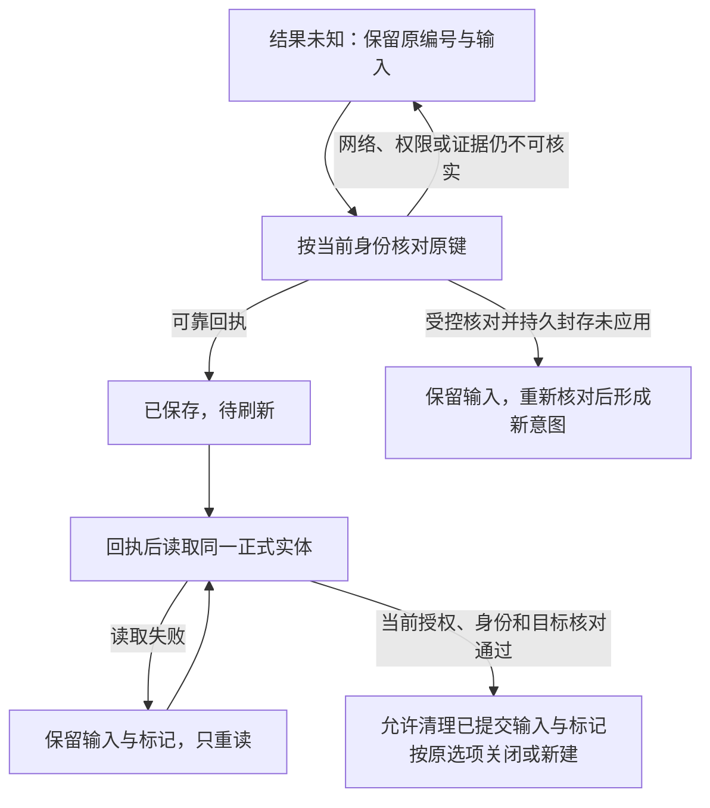

# 中央写命令契约

> 本文是写信封、命令身份、幂等、版本核对、成功回执、原命令恢复、业务唯一约束和草稿清理的权威源。运行环境、模块职责和数据 owner 见 [ARCHITECTURE](./ARCHITECTURE.md#data-ownership)；实体字段、关系、金额依据及历史保全见 [DATABASE](./DATABASE.md)；DTO、Problem、权限读态、来源版本和完整性见 [READ-MODELS](./READ-MODELS.md)。

本轮目标设计依据 A01/A02 已确认业务规则及 A03 的全部确认结果。审阅起点为 `31f8ec34293f7edca8cc732285073f044acb5b03`，当前实现按工作区内容和本轮验证原位更新；旧接口、完成评论或可重置实例不能反向覆盖已确认方案，也不能扩大正式持久化证明。

- **目标设计**：后续开发必须遵守的契约，包括本轮确认的公共规则和领域例外。
- **当前实现**：当前工作区已接通的接口及限定能力；其运行环境以 [ARCHITECTURE](./ARCHITECTURE.md) 为准。
- **待实施**：目标与当前实现的差距，集中见[实现差距](#implementation-gaps)。已完成的业务工作单元按其验证范围登记，未核实来源及正式上线关口继续保留。
- **历史证据**：既有 ADR、Issue 和验收记录说明当时范围，不因旧标题或“完成”自动扩大成全域正式保存证明。

公共规则只在下列章节定义；领域章节保留允许动作、目标身份、消费依据、事务参与者及例外。读接口清单和 DTO 不在本页重复维护。

## 1. 命令信封与执行边界

以下是目标语义，不要求把各领域现有请求强制改成同一个巨型 DTO。领域 adapter 将现有字段映射到这些含义，并使用按动作区分的封闭类型；不允许任意组合 `kind`、`action` 与可选字段。公共标量和错误结构沿 [READ-MODELS](./READ-MODELS.md)。

| 内容 | 写入契约 |
| --- | --- |
| 协议版本 | 识别请求 schema 及原指纹规则。既有无显式版本的请求按原领域协议识别，不静默按最新 schema 改写 |
| `commandId` | 一次明确用户提交意图的稳定编号；重试和恢复使用同一编号，正文固定后不能换用别的内容 |
| 工作区、操作者、命令族 | 工作区与操作者由可信服务端会话核对；命令族由服务端路由/领域契约决定，客户端不能声明额外权限或改归属 |
| 目标 | 已存实体稳定 ID，或新建意图的独立草稿身份；路由 ID、封套目标和正文 ID 必须一致。页面实例 ID 和本地草稿 ID 不是正式主键 |
| 来源 | 只允许该正式命令消费的来源；URL、文件名、客户端 origin 或前端布尔值不是授权证据 |
| 保存基准 | 本单/领域聚合版本及实际消费的依赖依据，详见[版本与依赖](#version-and-dependency-checks)；新建基准按领域明确为空或系列/范围基准 |
| 动作及正文 | 封闭的领域动作与人工输入。客户端不提交任意核算行、来源资格、金额副本、冻结结果或审批事实代替后台核验 |
| 文件变更 | 只表达允许的新增、删除、恢复或原件替换意图；owner、上传人、稳定原件 ID 和最终摘要由领域服务确定 |

服务端先校验原请求的未知字段、来源覆盖和身份，再进行领域解码；不能先丢弃非法字段后宣布请求合法。新实体及明细 ID、最终版本、更新时间和回执由服务端生成。外部旧 ID 仅是来源/匹配标识，不能替代系统主外键。

执行顺序为：核验当前身份与能力 → 固定协议与命令身份 → 核对原回执/封存 → 重验本单、依赖与业务资格 → 原子提交 → 返回原回执。原回执重取也须具有当前允许的身份和权限；不能借已提交编号绕过撤权。异步等待后、发布结果前须复验会话、权限和实际消费依据；失效则拒绝本次未提交动作。

一个完整用户动作的事实、明细/关系、原件变更、版本、必要审计与成功回执在同一 owner 的事务中提交。跨领域动作由已经明确的协调边界统一提交，不能靠前端连续调用数个独立保存冒充原子成功。正式保存成功只在可靠提交之后返回；原件正文不复制进普通动作审计。OCR、文件复制等长等待在事务外执行，发布时重新核对，并保留意图、失败和恢复依据。

首击立即固定命令并发送；发送中禁用同动作的重复提交。防抖只抑制重复点击，不能把首次提交变成延迟任务，也不能替代后台幂等。取消未提交输入不产生写动作；已提交或结果未知时按恢复协议处理，不能由取消按钮撤销真实事实。

## 2. 幂等与原命令恢复

### 命令身份与保留

目标幂等键为 **工作区 × 操作者 × 命令族 × 原 `commandId`**，不依赖登录会话寿命。同一命令族内不同动作、目标、来源或正文不能复用原编号。服务端保存按原协议得到的规范正文/指纹、动作、目标和原结果；同键同文返回首次可靠提交的结果，同键异文明确拒绝，不重复建实体、递增版本、取号、扣款、发放或导入。

命令族按事实 owner 的稳定边界划分；主档与会影响同一主档凭证的分供方导入、证照、OCR、税务命令属于同一分供方恢复边界；工资各格式动作与配置不能互借编号或恢复解析。不同族可各有物理回执表，但共同遵守上述逻辑隔离；新增动作必须登记所属族，不能靠临时页签或 HTTP 方法生成新的防重空间。

成功回执和明确未应用的封存记录长期保留，随业务历史和原件一起备份。软删、作废、离页、重新登录、归档和迁移不能让旧键重新变为可执行。协议升级后保留旧 schema、正文及指纹规则，能够追查和恢复原结果；不为兼容添加默认值后改变原指纹，不把旧命令转换为一次新提交。不能解释的旧协议明确停止并保留原编号。

迁入的来源回执属于原来源历史；原工作区、人员及命令编号即使与当前中央身份字符串相同，也不能取得当前授权。当前提交与恢复只消费当前授权命令的可靠回执，不能把旧来源结果误认作本次已应用或据此清除新输入。来源原请求、结果及编号保全在其完整原证据关系中，仍可只读追查；各领域的物理隔离及来源图见 [DATABASE](./DATABASE.md#native-domain-snapshot)。

普通本机命令编号沿当前可核验格式：3–80 位字母/数字/下划线/连字符，首位字母或数字。项目 Excel 的确定性来源键是明确例外，见[项目 Excel 导入](#项目-excel-导入423)；不把其长键开放成其他领域任意编号。

### 恢复结果

| 服务端证明 | 客户端处理 |
| --- | --- |
| 已有可靠提交回执 | 校验原工作区/操作者/命令族/编号与目标，进入[已保存待刷新](#success-receipt-and-readback)，读取同一正式目标；不再次执行业务写入 |
| 同一受控提交队列内核对未应用，并持久封存原键 | 返回绑定原编号的明确 `not-applied`；迟到请求不可提交。保留当前输入供用户重新核对，再形成新意图 |
| 网络、权限、读取、协议或回执完整性不能核实 | 保留原编号和未知状态；恢复当前身份与读取后继续核对原键，不换新键、不宣告未保存 |

只读查回执未命中、HTTP 404、本单不存在、旧版本错误或通用失败，均不证明原提交未应用。解除未知状态的 `not-applied` 必须来自同队列的受控核对和封存，或已经具备同等持久封存证明的原动作结果；客户端严格匹配原编号和身份。现有 `outcome`、`state`、`commandOutcome` 的 wire 形状由领域 adapter 承接，共同含义不得不同；Problem 结构见 [READ-MODELS](./READ-MODELS.md)。

客户端内存仍有完整原请求时，可以沿原键原正文核对/重取结果；冷恢复仅有编号时，使用对应 owner 的受控 resolve。身份恢复不自动新建命令，会话失效和重新认证也不解除旧命令防重。单一登录及同 cookie 多窗口的具体运行边界只见 [ARCHITECTURE](./ARCHITECTURE.md)。

客户端恢复存储只保留 `workspaceId / actorId / family / commandId / targetId / action` 六个最小字段；需要从稳定操作上下文独立定位时，可附加 `scopeId`，其值必须是非空稳定身份，不能含空白、路径分隔、查询片段或控制字符。不持久化请求正文、工人完整资料、银行卡草稿、附件正文或回执正文。`scopeId` 不改变原幂等键、owner、编号或版本核对。读取兼容旧六字段描述，未知字段或非法上下文明确停止且保全原记录。

成员加入/转组用原目标班组 ID、移出用原班组 ID 作为 `scopeId`。班组成员区独立定位同一工作区及操作者的原操作；结果未知可“核对原成员提交”，已有回执可“重新读取已保存成员”，期间禁止新成员意图，原工人已经不在可选候选中仍能恢复。旧描述缺少班组上下文时不能归入当前班组，只在原授权下显式核对其原工人键。身份、权限或来源变化立即隐藏旧定位，原记录保留待合法授权恢复。

## 3. 本单版本、依赖核对与自动复算

目标采用 **本单/领域聚合版本 + 实际消费的依赖版本或事实依据**，不把整项目或整个工作区任意变化当作保存冲突。读 DTO 的 `sourceVersion` 用于识别读取依据；它与写入基准的区别见 [READ-MODELS](./READ-MODELS.md)。现有 `baseVersion`、双版本、系列基准和复合 `sourceVersion` 由领域 adapter 映射，不能直接互换。

| 变化 | 处理 |
| --- | --- |
| 本单被后来合法保存、删除、提交或进入受保护状态 | 以当前事实拒绝陈旧写，保留本页输入；不能用一次重读自动前移 `baseVersion`，也不能覆盖后来版本 |
| 关系不存在/失效、权限变化、来源资格变化、数量上限或金额分配不合法 | 在提交事务中重新验证并拒绝不合法动作；单一登录和单编辑页不能替代这些检查 |
| 未消费的其他记录或其他项目发生变化 | 不影响本次保存；不得仅因粗粒度来源号变化制造人工冲突 |
| 实际消费依据变化且涉及用户必须重新决定的范围/资格 | 保留输入并提示具体变化，待用户核对；不能把旧选择改接同名身份 |
| 已明确允许自动派生的有效价格变化 | 服务端按领域规则采用当前依据重算，不因该变化本身增加二次人工确认；已冻结历史仍受保护 |

**甲方报量的已确认例外：**尚未提交的同一报量，按当前已签证且适用的有效单价重新计算金额，保留手工申报量；无需仅因单价变化让用户二次确认。提交时固化当次期次、采用量价与来源证据。已提交/审定报量不被后来签证价格追改；审定沿原冻结单价。缺量或缺价不能补 `0`。单价自动复算不授权绕过本单版本、项目—合同关系、删除/状态、数量上限或当前权限核对。

例如同一未提交报量的本单版本未变，手工申报量为 `20`，原有效单价 `100` 元，金额为 `20 × 100 = 2,000` 元。当前有效签证将适用单价改为 `95` 元后，保留申报量 `20`，自动重算为 `20 × 95 = 1,900` 元，不增加单价二次确认；若报量已经提交则保留原冻结金额，若本单已被后来保存则按本单冲突处理。

发生本单冲突后，可以读最新版供比较，但读失败不前移基准，其他页签读取不修改此页基准。用户明确采用/处理最新版后，才以该版本形成新的提交；此前未知原命令须先核实结果，不能通过换版本和新编号绕开。表单反复进入同一合同应复用当前合法编辑目标，不把同一实体误开成互相覆盖的保存会话；输入、附件和待核对编号按当前目标保留。

版本范围由领域登记：主档按实体；分供方资料核验消费主档与证照范围；工序库按编码系列；WBS 消费原分组/任务及相关项目区域、清单、库版本；工资消费原单及对应责任/考勤/签工、价格、成员、占用和真实已付；预算消费原版本及实际基线/项目关系。需要共享额度、唯一性或月锁的动作，在事务中核验相关集合；该保护不等于强制整项目粗锁。

## 4. 成功回执与同目标读回

可靠提交证明“已保存”；自动清输入、清恢复标记、关闭页签或执行“保存并新建”，还必须完成同一实体的正式后读。二者分别记录，不能把保存后的读取故障表现为又一次保存失败。

| 写入状态 | 事实及可执行动作 |
| --- | --- |
| 发送中/结果未知 | 原请求可能尚未提交或已经提交；保留输入与编号，只核对原提交，不新建另一笔写入 |
| 已保存，待刷新 | 已取得可靠原回执；明确显示已保存和读取问题。只重读/恢复原结果，不再发送业务写入，不自动清输入或关闭 |
| 同目标已读回 | 原回执与本次真正读取的同身份、同来源、同实体相符；才能自动清理已提交输入/恢复标记，刷新关联缓存，按用户选项关闭或新建 |

回执表达原命令、正式目标、提交后版本/来源依据、必要动作结果与引用；准确字段由各域契约定义。客户端验证回执属于原命令，不用本地 draft 伪造成功结果。后读必须在可靠回执之后发起，校验当前授权与稳定目标；提交前的在途读、复制 DTO、带本地预览正文的计算结果、另一实体成功读取均不能解除恢复状态。

后读可能已经包含另一窗口在原提交之后的合法更正。此时以可靠原回执确认原提交成功，并展示同实体当前事实及后来变化；不要求当前日期、人员或状态永远等于原结果，不用旧输入覆盖当前事实。新的尚未提交输入与已提交正文分别保留，不能因清理已提交意图顺带丢弃后来输入。仍有后来输入或原件时保留当前表单实例，不为切换规范地址或执行保存后关闭而替换它；采用已核实回执及后读的稳定目标与版本，后续明确提交继续更新该记录，不能因为地址仍是新建入口而重新创建。

工资发放、正式编号、名册和目录的完整输出继续核验各自冻结证据及引用；原事实可靠保存不等于文件下载成功。下载只按当前权限取得同一原件，失败重读/重试输出，不重新发工资、取号、归档或记现金。

## 5. 草稿、离页与清理

正式浏览器只持久保留原 `commandId` 和核对它所必需的最小工作区/操作者/命令族/目标/动作定位；原正文、人工选择、附件字节留在页面会话内存。编号存储需可靠写入并读回核对，无法可靠保留时不发送新命令。照片、实名资料、OCR/税务正文及文件字节不进入浏览器持久存储。

这不承诺强制刷新、关浏览器或另一次登录后复原未保存输入。冷打开先沿原编号核对已保存结果或封存未应用键，再读取正式目标；只有编号时不补造旧正文。需要跨刷新续填的业务草稿，使用该领域已开放的显式中央草稿动作，保存后以正式稳定 ID 回读；没有草稿能力的实体不得显示虚假保存草稿入口。

页签切换保留内存输入和原保存基准；离页、关闭、来源切换和取消须保护脏数据与待确认提交。用户放弃尚未发送的输入可以清本页稿；未知原编号仍保留待核对，已保存待刷新仍需完成后读，不能把放弃稿解释为撤销业务事实。暂时撤权只停用操作，不把原命令误清或改认未应用；当前不再可读的私密显示按 [READ-MODELS](./READ-MODELS.md) 清理。

同实体编辑、Excel 行导入和配置动作各自隔离目标与请求代次。迟到结果不得更新新目标、自动下载、关闭另一页或抬高其他草稿基准。无自动 outbox、离线重放或自动合并；用户明确提交才构成新意图。

中央 `draft` 是持久业务状态，允许缺少该实体的业务必填；稳定身份、父子结构、权限及文件 owner 不能省略。`save`、`submit`、`confirm`、`release`、`issue`、`archive` 各自校验和状态按领域，统一动作条不生成额外审批。历史开发项目的 `project-draft-*` 正文/附件暂存只是旧非生产实现，不是本轮正式草稿目标。

页面开放的可编辑业务字段必须通过所属 owner 的明确命令持久化，并由同目标正式后读证明；字段尚未具备保存能力时不得用仅保页面输入的动作冒充保存。只读派生值继续按 [ARCHITECTURE 数据归属](./ARCHITECTURE.md#data-ownership)消费真实来源，不另写一份可编辑余额。

## 6. 主合同编号唯一约束

所有主合同正式提交时，对**已填写编号**执行全域同号阻断，跨项目、合同种类和我方签约主体共同查重；施工、分包、材采、项目其他支出及公司支出主合同都参加。草稿阶段先提示同号，不将编号增加为新的必填门槛。号码规范化沿字段既有 decoder，不新增未经确认的大小写、全半角或模糊匹配规则。

校验由服务端在提交事务中完成，完整正式集合不受列表分页或当前可读页范围限制；排除本实体自身稳定 ID。已经正式成立的历史作废、失效、软删除记录仍占号，不能通过删除和重新建档回收编号。历史重复保留原证据及诊断，不自行改号、合并主合同或猜测归属；权限错误不得泄露不可读合同正文。

补充协议拥有独立 ID，按父合同编号检索后绑定真实父 ID；它不是另一份重复主合同，不参加主合同新增的同号判断。我方签约主体的设置、选择与合同快照目标见 [ARCHITECTURE](./ARCHITECTURE.md#our-signatories)；普通工作区名称和项目客户不能冒充我方主体。主体更名不反写已签历史快照。

## 7. 价格依据、票据对应与真实更正

合同约定价、实际送货价、结算事实、申请、批复、实际票面和银行实付各由自己的 owner 保存，归属见 [ARCHITECTURE](./ARCHITECTURE.md#data-ownership)。一次价格变化不能自动覆盖其他来源，金额展示也不能代替真实更正命令。

- 后来的价格上涨不追调旧送货价格。降价只产生协商提醒；经人工协商并有真实依据后，才沿送货、结算等原 owner 的明确更正路径记录，不先把旧记录自动改低。
- 新送货按补充协议的真实生效时间与实际涉及材料，采用当次有效约定；旧送货不追调不表示以后送货继续固定旧价。采用依据随真实送货保存，不能凭协议标题把全部历史材料统一改价。
- 已确认材料结算需要更正时，沿 A02 已定的全额冲销与替代，保留原票款稳定 ID；不原地重写已确认结算，不自动追改银行支付。
- 实际票据人工核实与真实交易的对应，保留原票面和原件；不以名称必须逐字相同代替人工关系核验，不为凑合同或支付金额改写票面。票面、合同与送货的名称、单位或单价差异先提示，允许人工核实并记录真实对应及依据后继续；差异本身和税额核对不新增用户付款门槛，但既有金额、关联额度和分配合法校验继续有效。
- 未提交甲方报量采用当前有效签证价的自动派生是[版本规则](#version-and-dependency-checks)的明确例外；已提交冻结保护与历史送货不追调的规则分别适用。

A01/A02 已确认的材采优惠/扣减单列负金额并参与合计，保留材料真实数量与单价；补充协议只增额，材料变更保留原行及依据；合同外运费沿真实独立费用链归“其他支出”，员工垫款清偿引用原费用，不重复生成成本。这些字段与计算只维护在 [DATABASE](./DATABASE.md#23-合同类通用基础--类型定制) 及资金实体，不因本轮公共命令设计增加未经确认的物理表或价格算法。

## 8. 受控迁移与危险回滚

迁移命令使用独立 `core:migration:write`、稳定命令及批次状态机，不是普通新建/编辑接口。既有入口为 `POST /api/migrations/core/preflight`、`dry-run`、`:batchId/import|confirm|rollback`，权威快照为 `GET /api/migrations/core/snapshot`。原命令幂等、协议升级和恢复同样遵守[公共契约](#idempotency-and-recovery)。

迁移从受保护的不可变来源字节重算摘要和版本，创建与恢复两端拒绝不一致。既有浏览器 IndexedDB 核心迁移不上传整库备份，服务端不能冒充能够读取其原字节；服务端重算 canonical 来源哈希、验证备份证明并绑定批次，按实际写入状态对账，确认前拒绝阻塞差异。用户明确选择 Native 一致快照的领域迁入，由服务端核验实际完整文件字节，来源、存储和历史保真只按 [DATABASE](./DATABASE.md#native-domain-snapshot) 执行。备份后的本地来源已经变化则先处理原待确认批次，不能悄悄沿旧备份接管。

准备不可见数据库和各 owner 候选，全部通过完整图、引用及对账后统一发布；任一失败中止全部候选，原活动状态保持。确认后迁入身份进入各 owner 的普通读写源，迁移快照不成为第二份日常正式读源；同批再次同步保留接管后的日常更正。

**目标回滚保护：**恢复只处理本批所属事实图。若本批记录存在接管后的日常编辑、删除/恢复、原命令回执或受保护历史，或独立后续业务仍依赖待撤的身份、来源、冻结或原件，整批拒绝回滚并列明依据。软删除不解除引用保护。不能为了恢复旧基线删除后来更正、独立新记录、审计或回执，也不能仅因回执丢失就认定没有后来业务；图损坏、来源无法证明或引用不能核实同样整批停止。

通过恢复的批次仍保留可追查迁移/恢复依据和原命令防重边界；重复操作不能回放历史通知、再发工资、再占编号或再记现金。灾难备份恢复、业务迁移回滚和发布回退的前提分别见 [ARCHITECTURE](./ARCHITECTURE.md) 与 [ADR 0021](../adr/0021-single-operator-windows-production-storage.md)，不能互相借用绕过引用保护。

### 核心迁移身份接管（#398）

**当前实现：**确认批次把项目、客户、分供方、班组和工人接入普通中央命令源，列表与编辑使用同一稳定 ID；迁入分供方缺人工核验事实仍保持资料不全。本轮开发 owner 已在同步发布前核验待撤身份的独立/历史引用，并拒绝会吞掉后来修改、删除、附件、打印或原回执的整批回滚；重复同步保留后来事实。原件、历史和命令记录不因失败回滚清除。旧 #398 的“回滚撤回本批接管身份及其后续修改”仅是历史实现行为，不能恢复成现行规则。这些验证实例与真实旧库测试仍不证明所有正式磁盘 owner 已完成接管；正式迁移需另验完整参与者事实图、持久回执及冷恢复。参见 [ADR 0020](../adr/0020-browser-authority-and-demo-workspace-boundary.md) 及 [DATABASE](./DATABASE.md)。

## 9. 领域命令与当前接入

以下端点与动作按基线登记，公共规则默认适用；领域未列出的审批、删除或恢复不因公共能力而开放。已迁入/接通的中央验证实例与本机磁盘参与者分开阅读，完整运行边界见 [ARCHITECTURE](./ARCHITECTURE.md)。

### 基础主档与核心合同

| 领域与命令入口 | 当前动作/资格差异 | 原契约与依据 |
| --- | --- | --- |
| 项目 `POST /api/commands/projects`、`PUT /api/commands/projects/:id` | `draft / save / submit`；正式项目核对主/次客户可读、存在且可用；Excel 新建见下节 | [项目契约](../../app/lib/project/command-contract.ts)、[项目页面](./pages/project-info.md)；#293/#423/#452 |
| 客户 `POST /api/commands/customers`、`PUT /api/commands/customers/:id` | `draft / save / submit`；非草稿名称、联系人必填，正式客户非空税号查重 | [客户契约](../../app/lib/customer/command-contract.ts)、[客户页面](./pages/base-customer.md)；#315/#450 |
| 分供方 `POST /api/commands/suppliers`、`PUT /api/commands/suppliers/:id` | `draft / save / submit`；公司全称、类别、主要联系人沿既有校验；税号/内部编码分别唯一；普通附件变更当前为空，核验走专用命令 | [分供方契约](../../app/lib/supplier/command-contract.ts)、[分供方页面](./pages/base-supplier.md)；#314/#421/#453 |
| 班组、工人 `POST /api/commands/{crews,workers}`、`PUT /api/commands/{crews,workers}/:id` | `draft / save / submit`；工人 `crewId` 只能引用同正式源稳定 ID；普通中央附件尚未接入，不伪造原件 | [命令契约](../../app/lib/crew-worker/command-contract.ts)、[DATABASE 基础主数据](./DATABASE.md#21-基础主数据跨项目共享)；#316 |
| 材采 `POST /api/commands/material-contracts`、`PUT /api/commands/material-contracts/:id` | `draft / save / submit`；后台复算材料明细及头行一致性；项目/分供方用正式稳定 ID；本轮减项目标不直接变成负材料数量/单价 | [材采契约](../../app/lib/material-contract/command-contract.ts)、[合同表单](./pages/contract-forms.md)；#318 |
| 施工 `POST /api/commands/construction-contracts`、`PUT /api/commands/construction-contracts/:id` | `draft / save / submit`；新选择核对项目当前主客户；已存历史甲方不随项目改客自动改写；`actualCompletionDate` 非日常可写字段，缺事实保留空值 | [施工契约](../../app/lib/construction-contract/command-contract.ts)、[客户历史归属](./pages/base-customer.md)；#320 |
| 分包 `POST /api/commands/subcontract-contracts`、`PUT /api/commands/subcontract-contracts/:id` | `draft / save / submit`；核对项目/分供方及劳务/专业类别，不接受客户关系或采购明细 | [分包契约](../../app/lib/subcontract-contract/command-contract.ts)；#321 |

本机正式新建材采、分包及项目业务原费用，按 [Q-OPT02-07/08](./ARCHITECTURE.md#opt-02-scope-decision) 在原命令携实际工程对应的施工主合同身份、项目及所选资格依据；草稿也核对该依赖。原记录、原件、编号、关系历史和各自回执同事务提交，关联故障整事务撤回，不能由界面先保存新记录再补发第二次关联。完整原请求先固定再作业务依赖校验；同原键异文、被封存后迟到、所选来源版本变化均拒绝。已应用历史原命令继续返回原回执；历史原记录不强填新字段或改写冻结，后来维护关系仍走既有独立关系命令。

**当前实现：**#281、#293、#314—#316、#318、#320—#331 已形成上述主档、项目分供方、核心/辅助合同和领域单据接缝；#329—#331 已在基线中。客户/项目的本机删除恢复见后文 PG，不能再用“所有主档删除未接通”概括。班组、工人、分供方主档及核心合同未登记的生命周期动作仍不开放。

### 分供方表格映射导入（#421）

`POST /api/commands/suppliers/import` 沿 [ADR 0005](../adr/0005-import-mapping-model.md) 的目标实体入口、模板、映射、人工预览、逐行执行和失败续导。请求只含映射主数据，不携主档 ID、`baseVersion`、附件、审批或人工核验结论。服务端在同一执行段查找并合并当前版本，复用主档校验及资料结论失效规则。

每行公司全称必填；首次建档未映射类别为“其他”、纳税人类型为“未核验”、资料状态为 `incomplete`。`externalRef` 精确匹配同一正式集合：空/未命中新建，唯一命中只覆盖明确映射字段，未映射保留，显式空值可清空选填项，多记录命中拒绝。`laborScope` 与 `mainBusiness` 独立；`uniqueCode` 与 `taxNo` 分别映射/查重，不互填，也不按名称猜合并。

一行是一个事务，不承诺整批原子。可预期空名称列行级拒绝；其余业务或请求失败停在当前行，已完成行不重写。每行保存并同实体读回才计入完成；未知或后读失败先核原键。`SupplierCommandStore.importRow` 的完成通知刷新读面，不 hydrate 当前编辑稿、不改变编辑目标或版本。来源和字段见 [分供方页面](./pages/base-supplier.md)；当前不承诺刷新/关页恢复文件、映射和预览。

### 项目 Excel 导入（#423）

项目列表与 `/import/mapping/project` 使用同一 `ProjectCommandStore` 行 action，复用普通项目 POST 和正式表单读回。文件解析选择一个 Sheet，映射现行模板，人工预览后提交；项目名、客户、项目经理必填，日期沿表单 decoder，阶段预览同时展示原值和采用值。客户/次客户从完整中央候选解析：精确 ID 优先，其次唯一名称/别名；缺失、歧义、停用、失效或越权逐行拒绝，不建临时客户。准备后固定关系 ID，提交时重验，不因改名接到别的客户。

导入仅新建：无 `id`、`baseVersion=null`、`action=save`，携合法 `importSource`。来源字段只见 [DATABASE 导入追溯](./DATABASE.md#entity-import-source)。同工作区内同一文件摘要+Sheet+原行，或该 Excel 链路已保存的非空外部旧 ID，规范内容相同复用原项目 ID；不同内容冲突，须显式编辑，两个来源键不能指向不同项目。该规则不查询受控整库 `legacyId → serverId` 映射，不按名称合并；文件变化且无外部旧 ID 是新来源。

本机允许 `project-excel:` 加原文件 SHA-256、Sheet、原行元组的确定性命令键，完整键不超过 4096 字符，且精确等于请求来源元组；普通手填长键无此资格。命令回执与来源防重分别保留，命中新来源复用身份时仍保存当前命令原回执，不改原导入来源。

业务拒绝保留原行号并继续其他行；网络未知或写后读失败停当前行沿原键核对。部分成功可下载来源/原因清单、进入成功项目或仅重试未导入行；已成功行不再创建。导入前取消无写，执行中停止等待当前行完成后停止其余行。重新上传原文件可安全续导，但不承诺恢复内存的映射/预览；来源切换按全局脏数据确认处理，原文件不作为附件上传。

### 项目分供方文件导入（#317）

`POST /api/commands/project-suppliers/import` 使用 `project-supplier:write` 和原项目/关系依据。服务端核对当前项目、完整正式分供方稳定 ID 候选及 canonical 已有合作关系，`forbidden / unavailable` 不能当零关系；不能以列表前 100 条代替身份复验。

文件分类为合同、请款、收票、付款、结算、资质、其他；Base64 可解码且真实字节与声明大小相同。新/复用分供方、ProjectSupplier、文件元数据与正文作为一个事务，上传人取可信 actor。失败不留主档、关系或文件半成品。成功同项目正式详情后读并刷新反向关系，新分供方进入通用主档链；导入不创建合同、请款、发票、支付或结算。契约见 [项目分供方命令](../../app/lib/project-supplier/command-contract.ts)。

### 甲方与分包商务单据

`POST /api/commands/owner-documents` 使用按 `kind + action` 区分的[封闭契约](../../app/lib/owner-document/central-command-contract.ts)。`owner-document:write` 与 `subcontract-document:write` 分别控制甲方/分包动作；表单读回必须核对顶层 kind/id、draft ID 和附件 owner，身份错配或非法日期不能 hydrate。附件维护不把已提交单据伪装成可编辑草稿。字段/状态来源见 [甲方与分包页面](./pages/owner-documents.md)。

| kind | 当前动作及领域保护 |
| --- | --- |
| `owner_change` | 保存/提交/签证及受限删除/附件；量价变更合计与审定金额分开，纯金额签证可由审定含税或不含税任一正金额成立；系统台账与手录签证同一 canonical 源 |
| `owner_report` | 保存/申报/审定及受限删除/附件；精确 `periodNo` 快照，审定每行显式量含真实 `0`；未提交重算及已提交冻结见[版本规则](#version-and-dependency-checks) |
| `acceptance` | 同一验收 ID 的单向 accepted/warranty/expired 生命周期，追加事实审计，终态锁定；不建第二张保修主记录 |
| `final_settlement` | 草稿保存/提交/附件；提交后业务字段锁定，审定金额/日期只读已有事实，当前无新审定 action |
| `owner_penalty` | 原罚扣字段保存/提交/附件；申诉说明不创建申诉审批 action，不借项目罚扣抵扣链 |
| `sub_change` | 仅 draft→submitted 的保存/提交及合法附件；项目/分供方/分包合同一致，提交正数审批金额、真实日期及事由；owner=`subcontract_change_order`，不新增审批 |
| `sub_settlement` | 见下节 AX02 |
| `project_penalty` | 见下节 AX03；`deduct-penalty / rectify-penalty` 只允许此 kind |

甲方变洽签签证按当前已签证链重算有效量价：调减可负，有效量不能负；缺新单价不按零价。签证日期不覆盖申报日期，必须是真实日历日且不早于同合同既有签证尾；同日以签证动作写入的不可变单调执行时间排序，附件维护不改序。新增物化稳定 BOQ 行，后续变更/报量引用原 ID；纯金额签证不修改 BOQ 或月度量快照。

月报只在申报时固化取数基准、来源版本/时点、经办人与系统提交时间，草稿不是提交审计。受控迁移保留完整 BOQ 目录和未成单月度完成事实；历史单据量价仅在目录确缺行时兜底，不覆盖同 ID 当前 canonical 名称/量/价，无对应期次不得借其他月量。量源见 [READ-MODELS 工程量与月报](./READ-MODELS.md#工程量中央读取与甲方月报442)。历史证据为 #323–#327 的限定中央接缝。

### AX02 分包结算

`kind=sub_settlement` 使用 `subcontract-document:write`；`save` 保存草稿，`submit` 确认同一支出结算并锁定。核对项目/分供方/分包合同、正金额、名称和日期，附件 owner=`expenditure_settlement`。正式候选只包含真实已确认结算并按稳定关系过滤；独立抵扣进入结算净额，未接齐或不能精确归属的付款保持未知。依据见 [DATABASE 支出结算](./DATABASE.md#支出结算统一源单) 和[#328 页面边界](./pages/owner-documents.md#issue-328-分包结算中央只读链)。

### AX03 项目罚扣命令

`#329` 的 `project_penalty` 使用草稿保存/提交/附件及抵扣/整改。普通编辑仅草稿，提交金额不能经表单改写。抵扣携原罚扣 `baseVersion` 和真实已确认分包结算 `settlementId + settlementVersion`，同事务核对双方关系与剩余额度，追加独立抵扣并更新双方版本；允许合法多次部分抵扣，但重放不重复入账。整改只追加期限、说明、actor/时间，不伪造签认审批。依据见 [DATABASE](./DATABASE.md#ax03-中央项目罚扣与独立抵扣事实) 和[执行链](./pages/owner-documents.md#issue-329-项目罚扣中央执行链)。

### AX04 辅助合同命令

`POST /api/commands/auxiliary-contracts` 使用 `auxiliary-contract:write`，接受 `other_expense / company_expense` 的 `draft / save / submit`。项目合同只关联真实项目/分供方；公司支出不建虚拟项目。头资料与附件元数据同事务，主合同编号同时服从[全域唯一](#contract-number-uniqueness)。字段与聚合见 [DATABASE](./DATABASE.md#ax04-辅助合同中央事实) 和[合同表单](./pages/contract-forms.md#ax04-当前浏览器实现330)。#330 只证明中央接缝及已存附件元数据，不证明全域原件或生产持久化。

### AX05 其他支出结算命令

`POST /api/commands/other-settlements` 使用 `other-settlement:write`；`draft` 可不完整，`save` 校验并保留当前状态，`submit` 进入待确认，仅待确认接受 `confirm`，确认后锁定。有合同时核验同项目、实际服务分供方和非草稿真实其他支出合同；无合同时须采用同事务可核实的原费用及明确收款身份，不从空合同键推定合法。头、原费用采用行、冻结历史、原件、审计和回执在同一实际参与者事务完成；金额与历史清偿承接边界只见 [DATABASE](./DATABASE.md#ax05-其他支出结算中央事实)。

`/contract/other-settlement/import` 显式选择完整 Native 一致快照，服务端重验实际字节、原图和逐项主档版本映射后采用；原历史命令只作为冻结来源证据。迁入 family 为 `other-settlement-import`，动作 `import`，目标 null；原编号未确定前不发新命令，已知保存后只读核验，不重复写入。领域原件缺口和正式存储范围直接见 [DATABASE](./DATABASE.md#native-domain-snapshot)，页面操作见[其他支出结算指南](../guides/other-expense-settlement.md)。

奖罚、申请、支付独立读源，#331 接管已有其他结算抵扣，不把 #329 新增抵扣扩大到所有结算。付款批复来源只能由付款 owner 的真实核验事实给出，读来源标签不能确认历史批复。字段/现有状态见 [DATABASE](./DATABASE.md#ax05-其他支出结算中央事实) 和[其他支出页面](./pages/contract-forms.md#ax05-当前浏览器实现331)；PAY-07/PAY-08 的后续写入继续沿[支付事实规则](./DATABASE.md#entity-payment-record)。

2026-10-05 已确认的[历史清偿承接](./DATABASE.md#historical-expense-clearance)复用 `POST /api/commands/finance` 的 `kind=reimbursement / action=save`，目标及 `baseVersion` 固定已保存原费用头。追加替代原件使用 `draft={id,clearanceAttachmentsOnly:true}`，只追加实际新增字节；核定使用 `draft={id,clearanceVerificationEdit}` 且 `attachments={}`，edit 携实际原费用行、当前 `sourceVersion / sourceHash`、依据、已保存 file IDs、逐项旧处理份额及明确既有采用关系。服务端同事务生成冻结核定，原回执携 `clearanceVerificationId / clearanceVerificationSha256`，绑定完整核定。正常编辑、追加原件和核定三个意图分别复验，不能混正文或删除原件；执行能力仍为已有 `finance-reimbursement:read/write`，不新增负责人审批身份。

普通 Other `save / submit / confirm` 的 `originalExpenses` 可携 `clearanceAllocations=[{verificationId,itemId,amount}]`；同次写入先建立真实采用行，再核实际已核 item 的未占用份额并原子保存关联，不能先把含旧份额的总额当纯新采用额拒绝或把后补关联留在第二次事务。已确认结算追加关联使用原 `save` 的 `draft={id,clearanceLinkEdit:{verificationId,bindings:[{expenseAllocationId,itemId,amount}]}}`、原版本和 `attachments={}`；实际采用行须来自该已确认结算，旧头及现金保持不变。原回执 `clearanceLinkIds` 必须在同目标可靠后读中完整核对，缺关联时只读重试并保原编号；其他恢复、晚输入及撤权边界沿公共契约。

Native 财务迁入可携 `declaredMissingOriginals=[{fileId,reason}]`，仅用于服务端当前预检判定为真实旧清偿头外部原单的明确缺件。请求指纹同时绑定真实原库 SHA-256、完整来源图摘要及逐件声明；不接受任意 owner、已嵌入正文、银行回单或原费用附件的缺件豁免，不制造零字节替代正文。最小恢复描述仍是原 `finance-import` 六字段，不保存来源正文、映射、原件或声明理由。迁入、原费用核定、后继合并采用和原号恢复已完成限定正式流程验证；精确外部缺件声明的真实 Native 图及组件验证与纸单整页场景分别说明，范围见 [DATABASE](./DATABASE.md#historical-expense-clearance)。

确认已提交结算时重新核对实际消费摘要。仅当本结算提交时原子建立的旧份额关联与原采用行完全对应，且排除自身关联后仍能还原原摘要，才接受该自身变化并冻结当前摘要；其他结算占用或来源变化仍须拒绝并保留输入。

### F3 财务与历史批复核验

F3 五类事实使用现有 `POST /api/commands/finance`，按 `kind` 对应原财务命令族。付款申请核验仍为 `kind=payment_application / action=save`：目标及 `baseVersion` 指向已保存的原申请，`draft` 严格只含 `{ id, verificationEdit: { actualDueAmount, cumulativePayableAmount, basis, fileIds } }`，不混入普通表单编辑或附件变更。两项金额为累计结论；原件只选本申请已可靠保存的稳定 ID。资格及金额依据只在 [DATABASE 的 PAY-08](./DATABASE.md#entity-payment-record)定义。

服务端从同一事务内的真实申请、采用关系、结算、原费用和原件生成冻结核验，采用可信 actor 与时间；追加原申请版本、核验子记录、元信息审计和原回执，不重新保存历史整单正文。核验保存的原回执携带 `paymentVerificationSha256`，绑定完整冻结核验；普通命令和既有历史回执不补造该字段。新支付仍使用原支付记录的 `confirm`，同事务消费当前核验和真实累计现金；不可用来源保持明确拒绝并保留原记录。核验保存及支付确认的原编号、未知结果、封存、保存后读失败和晚输入保留统一沿[公共恢复](#idempotency-and-recovery)及[后读规则](#success-receipt-and-readback)，不新增第二个恢复命令族或客户端批准标记。

### 普通收款登记命令（#436）

`POST /api/commands/receipts` 使用 `receipt:write`，动作仅 `draft / save / submit`。核对现有及请求中的项目、主客户、可选施工合同的读权/真实归属、字段、非空流水号唯一和文件正文；头、原件新增/删除/恢复、审计、版本同事务。重新激活缓存页重验权限，保留原输入/基准，读失败禁写。附件读取核对同收款 owner 及长度/哈希，保存位置选择先于异步正文取得。

当前不新增收款确认、退款、红冲或作废命令。受控迁移完整接管原字段及已存附件正文；后读、草稿和恢复统一沿公共规则，老实现的回执即清 pending 属差距。业务状态见 [收款页面](./pages/finance-receipt.md)，契约见 [收款命令](../../app/lib/receipt/contract.ts)。

### 工程量中央命令与迁移接管（#442）

`POST /api/commands/quantity` 使用 `quantity:write`，目标绑定项目及原区域/模板/阶段/责任/完成/照片。提交核对当前项目、祖先和实际成员；归档后编辑要显式确认，其授权意图参与原指纹，取消不发送授权重试。模板复制来源只作审计，删除原模板不阻止复制件合法编辑。

甲方月报仍由 owner-document 提交，工程量提供当前真实量的串行读取窗口；提交采用依据与冻结按[版本规则](#version-and-dependency-checks)。外部 BOQ 迁移只接身份关系，不造本地施工合同或复制量价。完整图准备/发布、独立引用保护沿[受控迁移](#migration-and-rollback)。领域数据见 [DATABASE](./DATABASE.md#工程量物理模型103)，读面见 [READ-MODELS](./READ-MODELS.md#工程量中央读取与甲方月报442)，实际记录见 [#442 证据](../design/evidence/issue-442/README.md)。

### 标准工序库版本命令（#443）

`POST /api/commands/process-libraries` 仅 `create-version`，使用工序库读写能力。新编码首版，基于任意可见旧版沿同编码追加下一版；系列基准包含历史删除版本，不回收编号、不按前台可见行算基准。保存一次发布完整版本图，旧版及既有项目快照不改写。

阶段/分项码是全局定义，保存库不要求某项目先有工程量；WBS 建组才解析项目稳定阶段/分项。切库/来源后的迟到读取不覆盖目标，列表读取不抬高本编辑系列基准。库事实见 [DATABASE](./DATABASE.md#标准工序库中央版本443)；本机路径见 [#463](#本机工序库命令463)，不是 WBS 全部生产保存证明。

### 中央 WBS 命令（#444）

`POST /api/commands/schedule` 使用 `schedule:write`，允许建组、任务/楼层计划、同组依赖、冲突调期、基线、任务增删和受限撤销。建组重验合同显式楼栋覆盖，或暂估逐栋区域/模板/分项与映射；库版本解析项目身份并冻结库定义、计划依据。真实零、缺量和跨单位分开，不以跨单位总量决定有效范围。

一次动作在工程量/WBS 共享协调边界提交计划、受影响依赖、楼层人工标记和回执。依赖冲突取消不写，确认仅软禁用明确关系列表；恢复重验同组、日期、循环与唯一活跃前置。`dependency:null` 表示本次未编辑依赖；主动移除用独立 `remove-dependency`，合法同日开工/Lag 不能阻断普通字段保存。

版本只核实际消费的原计划、区域/量源、合同清单和不可变库依据，按[本单与依赖](#version-and-dependency-checks)区分可自动派生与需重认变化；不以整项目任意变化制造冲突。首页只读，受限 undo 不越域，不借普通撤销解绑/换绑。事实见 [DATABASE](./DATABASE.md#中央-wbs-事实与整图接管444)，运行证据见 [#444](../design/evidence/issue-444/README.md)。

本机正式 WBS 普通动作沿原入口分派到同库 `wbs` 参与者，`POST /api/commands/schedule/resolve` 仅以同身份、项目、动作和原编号核对不可变原意图/回执或封存，不从客户端恢复正文。已知回执后只读同目标；读取失败保编号及当前内存稿。建组消费选定楼栋和正式不可变库；任务、计划、依赖、基线及撤销各核实际采用的正文、父子、边、冻结量或原日志，未采用的兄弟记录不抬高基准。当前只开放内部暂估；新合同范围与绑定遵循 [上游范围](./ARCHITECTURE.md#opt-02-scope-decision)。完整原库采用与整批受保护恢复见 [排程指南](../guides/project-start-and-schedule.md)。

### 中央暂估绑定与合同楼栋证据更正（#445）

`schedule` 的 `bind-contract` 固定原项目/分组/合同与预览实际依据，核对未绑定、同项目施工合同、显式楼栋覆盖和稳定分项映射。缺覆盖/映射阻断；额外合同楼栋仅提示不自动采用；数量差异及缺失本身不新增绑定门槛。成功只改变原组合同依据并保存当时比较/审计，原任务、冻结暂估量、基线、完成和下游事实不变。已有绑定只读，不开放解绑/换绑。

`POST /api/commands/boq-building` 使用 `owner-document:write`，只更正已有已确认导入基准行的显式楼栋，固定项目/合同/行、楼栋 ID、原因及原依据。来源资格由原导入/确认事实证明，签证新增或不明来源行只读；不改量价/分项/ID/签证时序。更正和前后楼栋、原因、原来源及审计一起发布，旧绑定预览失效须重建；重复同步保留日常更正，恢复保护包含真实后来绑定，即使审计/回执缺失也不能吞掉。依据见 [DATABASE](./DATABASE.md#中央暂估绑定与楼栋证据445)、[#445 证据](../design/evidence/issue-445/README.md)。

### 送货归档、修订与原件命令（#441）

`POST /api/commands/deliveries` 使用 `delivery:write`，允许 `archive / revise / source / print`、合法删除/恢复及受控撤回。归档人工核对必需事实；缺价格须明确确认待补录，异常金额需复核原因。修订必填原因，逻辑记录、材料行、独立原件及修订一起保存；替换建立新资产，不能同原件 ID 改正文。后续涨降价处理只见[价格依据与更正](#price-basis-and-corrections)。

打开打印不写结果；人工确认实际输出才记已打印，排除只记已排除。批量逐 owner 重验权限/版本，共用原件不只核第一条；预览/导出逐条核归属及正文长度/MIME/摘要，取消后迟到字节不写出。归档后的分供方别名记忆是独立主数据命令，失败单独重试，不冒称归档原子成功；项目建议沿已人工确认送货原文和稳定关系，旧别名迁移另按既定边界。

当前归档不自动创造有效到货、库存或材料结算资格。保全及来源见 [DATABASE](./DATABASE.md#送货单原件持久化约束)、[#441 证据](../design/evidence/issue-441/README.md)。

### 分供方证照与人工核验命令（#446）

`POST /api/commands/supplier-credentials` 使用独立证照读写能力，允许 `upload / edit / requirement / review / delete / restore`。消费原主档与证照事实基准；普通主档不能写人工合格/退回。原件仅 PDF/PNG/JPG/JPEG，复验 MIME、扩展名、字节签名、实际长度和 20 MB 上限；上传发布证照、正文及 owner，edit 仅类别/有效期，错误文件以新上传和合法删除更正。

`review` 只允许当前自动齐全且待人工核验的资料通过/退回，退回原因必填。受控关键工商/银行字段真实变化，或影响必需原件的资料变更，在原明确写命令内使旧人工凭证失效；无关可选资料和非关键变更不误失效。资料要求服从固定必需/条件原因。`restore` 绑定同证照、删除审计及 `deletionToken`，不能用旧撤回恢复后一次删除，缺正文旧线索不得借恢复补造原件。

**目标读写分离：**过期/临近过期由 GET 按当前业务日派生警告，保留历史核验凭证，不在读取中自动撤销或改写主档。七天预警及历史状态读语义见 [READ-MODELS](./READ-MODELS.md#supplier-expiry-warnings)。资料受控变更和人工核验仍通过上述明确写命令，门禁不能由 GET 绕过。专用动作审计仅既定元信息，不复制 OCR、税号、银行号或核验备注正文。

物理图见 [DATABASE](./DATABASE.md#分供方证照中央事实446)；业务流转见 [分供方页面](./pages/base-supplier.md#credentialstatus-流转)。上传和迁入不自动 OCR；原 GET 撤销行为是[待改差距](#implementation-gaps)。

#### OCR 人工确认与税务核验（#447）

证照动作增加 `ocr-recognize / ocr-confirm`。识别只携证照身份与允许运行选项，从授权原件取字节，不接受客户端伪候选；外部 OCR 等待后重验当前身份、主档/证照基准和同原件，才发布待核对快照。未配置、无原件、无权、服务失败分开，识别失败不删原件。

确认固定 `recognitionId`、逐字段 `keep-current / use-recognized / manual`、类别和长期有效选择，并保留 category/longTerm 的采用方式。采用识别值指定同字段候选 ID；类别冲突默认保留当前，矛盾税号不静默选第一/最后。除证照能力还需 `supplier:write`；确认记录、选定主档字段、旧凭证失效与脱敏审计一起提交，保留原候选不覆盖。原键已经提交时不再调 OCR。

`POST /api/commands/suppliers/:id/taxpayer-verification` 使用 `supplier:write`，固定已保存税号 `expectedTaxNo` 与主档依据；接受既定人工结果/备注，服务端时间生成。普通表单不接受自报凭证，税号/纳税类型实际变化才撤旧凭证；官网查询/验证码由用户完成。成功后只合并原核验五字段及相应基准，保留其他未保存输入。未知恢复沿公共协议，不销毁人工选择或因暂时撤权释放原键。

### 目标成本中央命令（#412）

`POST /api/commands/target-costs` 使用预算读写能力，允许 `save-header / save-items / delete / restore`。新建 `targetCostId` 为空并有独立 `draftKey`；原头/整份科目分别保存。头核对项目/金额/基线，与附件和基线变化审计提交；科目核对行归属、字段/顺序，失败定位行格。删除不自动替换当前基线，恢复重核唯一基线、不抢后来基线。

预算项目目录来自项目 owner，不要求工程量查看权限或存在工程量图。目标只核原预算及实际项目/基线依据，旧全工作区 `budget + projects` 粗版本是实施差距。共用工作区事务/迁移互斥不让预算拥有工程量。数据见 [DATABASE](./DATABASE.md#目标成本中央版本与完整接管412)、[预算页面](./pages/target-cost.md)，限定运行见 [#412 预算证据](../design/evidence/issue-412-target-cost/README.md)。

正式预算原编号核对使用 `POST /api/commands/target-costs/resolve`；相同原键同文返回原可靠结果，明确未应用的封存阻止迟到请求。浏览器仅持久保存定位描述，原正文、附件和回执留在当前页面内存；新建按独立 `draftKey` 隔离。同目标授权后读成功才清描述，已保存但读失败仅重读。正式保存只核原版本和实际项目/同项目基线关系，开发 adapter 的全工作区 `budget + projects` 粗版本不进入正式链，成本实际版本不抬高草稿基准。限定文件迁入使用 `target-cost:import` 的显式预检、采用、对账及受保护恢复，与其他域整体切换分开；操作见 [预算指南](../guides/target-cost.md)。

### 工资资料接管阶段的写入边界（#412）

P0 通过受控迁移接管完整工资/考勤/签工图，历史读取不新造核算/发放授权；P1–P7 接续以下日常动作。浏览器旧本地写入口继续阻断，不能只隐藏按钮。B 类已退役，不为兼容重新开放新建/核算。A 来自施工完成，C1 来自真实考勤，C2 来自确认签工；历史缺证不从当前成员/价格/数量补齐。

迁移使用真实项目/人员映射及完整来源候选，工资与工程量/WBS/预算共用引用保护。既定工资实际支付例外见 [ADR 0015](../adr/0015-form-persistence-and-payment-reconciliation.md)，完整旧图及限制见 [DATABASE](./DATABASE.md#工资完整资料中央接管412)。

### A 工资中央命令（#412，P1）

`POST /api/commands/payroll-a` 使用 `payroll:write`，接受 `save-a-draft / check-a / set-a-pay-ratio / set-a-ratio-plan / release-a / save-a-subject-config / save-a-prices`。工资绑定原 `statementId` 或独立 `draftKey`，配置绑定完整原 `configScope`；客户端不提交已付合计、来源资格、核算行或冻结结果。

草稿可保存主体范围、全成员、月份、比例和备注；`set-a-ratio-plan` 仅对未发工资保存完整分项及费用比例，服务端核对当前稳定身份、合法比例与尾款固定 100%。已核对单修改整单默认或分项比例均持久标需重核，已发只读。核对/发放重读原责任、现场量、适用价、成员、本簿此前真实已付；依据不一致时提交需重核结果，不能抛错回滚后仍显示已核对。实发/全成员分配精确到分含零成员，唯一发放、完整快照及采用关系一起提交。结算/尾款与价格修订见 [工资页面](./pages/subcontract-payroll.md#工资核算)、[DATABASE](./DATABASE.md#a-工资中央来源配置与发放412)，历史验证见 [P1](../design/evidence/issue-412-payroll-a/README.md)。

### 考勤与 C1 工资中央命令（#412，P2）

`POST /api/commands/payroll-attendance` 仅 `upsert-attendance`；`POST /api/commands/payroll-c1` 为 `save-c1-draft / check-c1 / release-c1 / save-c1-rates`。考勤原目标是项目/工人/真实日期，消费月份、班组及原归属；合法重存保同 ID，不借任意记录号或新班组改历史。工时有限非负，正常/加班合计不超 24，同事务核人员项目资格、C1/C2 互斥及已发月锁。空项目/月的矩阵预览不授权空范围写入。

C1 工资绑定原单/独立稿，费率动作绑定完整配置范围，工资身份为空；草稿无 A 比例/档位，固定当月 100%。个人费率显式保存兜底日薪与独立加班价，展示档案价/推导默认值不能冒充输入。核对/发放重取逐日事实、人员、采用费率、全成员与占用；考勤/费率改动使受影响已核单需重核，外部档案变化读取提示，发放复验。实发/全成员到分一致，原 0 应发不可发；P6 完全抵完的明确零实发见下节。

考勤 pending 定位至原项目/工人/日期；配置与单据分别定位，不因换单元格/月份/页签更换未知原键。工资表和考勤表必须读取同次完整冻结输出才完成确认。来源/月锁见 [DATABASE](./DATABASE.md#c1-逐日考勤个人费率与冻结来源412p2)，限定验证见 [P2](../design/evidence/issue-412-payroll-c1/README.md)。

### 签工与 C2 工资中央命令（#412，P3）

`POST /api/commands/payroll-daywork` 仅 `save-daywork / confirm-daywork`；`POST /api/commands/payroll-c2` 为 `save-c2-draft / check-c2 / release-c2 / save-c2-config`，各有独立正文/结果/恢复解析，不转换成 A/C1。签工新建独立稿，编辑/确认绑定原 `recordId + originalScope`；编辑后范围在正文单独表达，不能替换原目标。确认只补证明人/确认日；一次明确保存并确认仍核日期/时段、1/0.5 工数、同日重叠/上限、原新范围互斥及月锁，合法晚于两天人工确认不自动免费/处罚。

配置绑定项目×负责人及原配置 ID，不以页面月份/全部班组冒充身份；工资只输入主体/全成员/月/备注。来源 ID、合计、价和冻结后台取，已确认可用签工逐条唯一领用；待确认/他单占用/坏来源分别说明，无可用源不能建空 C2。合法未发签工/配置更正标需重核、保旧关联/审计，核算为当月实际工数×主体价、100%，不扣上月实付。0 应发、超额、漏成员、差一分拒绝；发放、冻结、关联/月锁一起提交。

签工按原记录/新稿，配置按项目×负责人，工资按原单/新稿隔离 pending；后来合法改动按[后读规则](#success-receipt-and-readback)呈现，不要求可变事实永久等于旧回执。C2 发放须读取同次完整可用工资/签工配对输出。原来源见 [DATABASE](./DATABASE.md#c2-签工主体配置与冻结来源412p3)，验证见 [P3](../design/evidence/issue-412-payroll-c2/README.md)。

### 工资更正与实际收付命令（#412，P4）

`POST /api/commands/payroll-adjustment` 仅 `save-adjustment-draft / confirm-adjustment / confirm-actual-payment / confirm-recording-reversal`。新更正、实际补退和错记冲销各有原目标/独立稿，不互借提交号。核算更正引用原已发工资及具名新旧依据，确认后仅追加引用前序的纠错；真实补退保存实际日、有符号金额、原成员分配/处理额，0 元不造事件；错记冲销明确被误记且未发生事实，不冒充工人退款。

A/C1/C2 release 可选 `adjustmentApplications`，每项原更正、整数分处理额、余额及来源包含版本；缺省保旧正文/指纹/冻结兼容，有值严格核对。选择/草稿/核对不提前结清，成功实发才形成处理关系；A 已包含更正不重复扣减，核增由正常工资承担仍唯一关联发放。核算更正与后月处理关系不造第二次现金，实际链见 [DATABASE](./DATABASE.md#工资更正实际补退与后月处理412p4)，证据见 [P4](../design/evidence/issue-412-payroll-adjustments/README.md)。

### A 工资费用与独立管理簿命令（#412，P5）

`POST /api/commands/payroll-a-fees` 仅 `save-a-fees / save-a-management-book / start-a-management-draft / save-a-negative-lines`，固定用途簿、原稿/配置范围及原基准，不接客户端合计/领取资格。费用逐项核真实分项、单位、明确完成量范围/费率；房补默认采用保留语义确认及经办依据。新增/修订/关闭/移除分开；移除保原正文追加修订，不要求把旧失效范围改成新事实。已发月原簿不倒改，未来修订从明确生效月适用。

管理关系核原责任/细格、管理人/模式，公司代管不造单；新管理草稿重核同簿期间唯一，重复发起定位已有稿。负价固定未发管理单和原行，含量/单位/负单价/责任/事由/依据；引用实际记录证明同项目/资格但不造现金，已发更正沿 P4。A 核对/发放消费费用、管理、适用负价、原完成、本簿此前实付，管理首次采用、来源 V2、费用冻结及原分配一起提交；不能因费用证据缺失回退无费用核算。普通/管理簿独立，不合并补退；已发普通簿不阻止合法同月管理簿。

实体、修订/包含证明见 [DATABASE](./DATABASE.md#a-工资费用独立管理簿与负价清单412p5)，操作及限定状态见[费用指南](../guides/payroll-fees.md)。

### 户级空鼓和人工扣款命令（#412，P6）

`quantity` 动作为 `create-hollow-inspection / revise-hollow-inspection / rectify-hollow-inspection`，使用 `quantity:write`；新建固定户/真实房间/分项，修订/整改固定 `recordId + expectedRevisionId`，修订原因必填。检查可明确零，整改为正安全整数且不超余量，日期/原责任/可见祖先及连续历史一起核验。冷打开另一记录/动作仍标原提交所属动作，先核原键，不把旧输入套新动作。

`POST /api/commands/payroll-hollow` 仅 `save-hollow-policies / start-hollow-deduction`，配置范围与原已存工资身份互斥；原系列/修订、生效月、开关/非负单处金额保零和空值，不倒改后月发放依据。开始只表达明确确认，后台共享事务取原检查、整改、配置、已处理/金额，采用原责任合法未处理源并标原单需重核；源/配置变更旧核对不能发，重新开始保前次启动。

A/C1/C2 核对/发放共同核空鼓快照及金额组成，采用/冻结同提交；开始后只能完整净额，超额/部分处理保留规则缺口。完整正扣款恰抵可领额可明确实发 0，其他原零额限制不变；已处理源不因后月/整改/退款/改名再开放。P4 可修量价但原采用身份/来源不变，实际补退/后月关联仍独立，确认更正不造现金。依据见 [DATABASE](./DATABASE.md#户级空鼓整改与工资采用412p6)、[P6 指南](../guides/payroll-hollow.md)。

### 批量工资协调命令（#412，P7）

`POST /api/commands/payroll-a-rounding` 仅 `save-a-rounding`，固定项目/负责人/普通或管理簿/生效月/原基准，追加明确关闭或向下整百；已发月只读，缺配置不自动存默认。

`POST /api/commands/payroll-batch` 的 `confirm-batch` 固定同项目同月预览、资金输入、人工决定及全成员整数分分配，只创建不可变计划；`prepare-batch-item` 绑定最新计划版本及下一执行编号，核原工资修订/依据后先保存完整原格式命令，暂缓项不准备；`execute-batch-original` 仅调用 prepared 预留执行号的所存原命令，核原工资回执再推进计划。

原工资明确未应用时保留人工决定，后续重新准备；未知、中断或原事务成功但协调未落结果均保原键原正文恢复。批次不绕过格式算法、来源/金额、空鼓、更正、成员分配或权限。物理依据见 [DATABASE](./DATABASE.md)，操作见 [工资页面](./pages/subcontract-payroll.md)。

### 工资正式出具命令（#477）

`POST /api/commands/payroll-numbering` 的 `initialize / issue` 使用 `payroll:write`。起点登记明确下一内部号及纸质旧号核对依据，仅一次；出具只指原已发且有完整冻结证据的 A/C1/C2 单，不接受客户端自报号/金额/摘要。同项目普通/管理簿、负责人、格式、月/结算档共享一个序列；第一次原件引用与取号同提交，已出具原单再提交返回原号，不前端预占。

读取失败不重取新号，输出按[可靠回执后读](#success-receipt-and-readback)。物理规则见 [DATABASE](./DATABASE.md#工资正式出具与项目序列477)、[出具指南](../guides/payroll-official-numbering.md)。

### 工人私密资料与工资名册命令（#449）

`POST /api/commands/worker-roster` 仅 `save-profile / archive`。私密能力 `worker:sensitive:read` 独立，资料保存还需 `worker:write`，归档需工资读写。核完整已发成员、同项目、当前工人资料及原件摘要；资料只追加劳动合同事实版本/用途照片，照片为独立新原件。归档冻结所选原工资范围、登记日/实际归档时、成员资料与缺口，同范围版本递增，不声称当年发工资时已有这些资料。

`POST /api/commands/worker-roster-resolve` 按当前工作区/actor/原号及操作类型核回执或封存。最小编号保留、原目标后读沿公共规则；审计只含既定版本信息，不存私密正文。实体见 [DATABASE](./DATABASE.md)、[名册指南](../guides/worker-roster-archive.md)。

### 工资完整工作簿目录命令（#479）

`POST /api/commands/payroll-workbook` 仅 `archive`，固定项目/模式/原工资/所选名册与预览依据，不接客户端冻结文档/金额/号/名册正文/目录摘要。服务端重新组合原输入，工资冻结、正式编号、实际账或固定名册有相关变化时拒绝旧预览并保选择；保存追加不可变目录、稳定引用及缺口。可保存可交付部分，但完全无可证明冻结工资正文不能保存；归档不发工资、取号或记收付。

`POST /api/commands/payroll-workbook-resolve` 固定原工作区/actor/项目/命令，已有应用核原目录后回，未应用同队列封存；可靠保存与下载分开。完整迁入沿原核心协调流程，不新建绕过 authority 的归档写路；目录/名册迁入不再发号，重复准备保后来版本。数据见 [DATABASE](./DATABASE.md#工资完整工作簿保存目录479)、[工资页面](./pages/subcontract-payroll.md)。

## 10. 本机磁盘路径与维护命令

本节只登记已加入同一正式 storage/coordinator 的切片。正式用途业务写门禁仍关闭；合成 `verification` 可写和冷重启验证不是首次真实业务写入批准。完整参与者/schema/备份清单只见 [DATABASE](./DATABASE.md#共享正式存储版本与参与者463)，环境与认证见 [ADR 0021](../adr/0021-single-operator-windows-production-storage.md)。未接管正式 API 明确未就绪，不回落开发实例。

### PG-01 本机客户命令（#450）

客户 POST/PUT 接磁盘 owner，客户/附件/版本/审计/回执可靠提交。单件真实正文上限 10 MiB，活跃附件最多九份，owner/真实字节/大小核对；税号唯一包含已删除客户。`:id/lifecycle` 只 `delete / restore`，绑定原实体和版本；父软删不改子原件独立删除状态。`customer-resolve` 精确 `{commandId}`，同事务回原回执或封存未应用键，GET 查无不能替代。

读回及草稿目标按公共协议；当前客户端回执即清编号的路径列差距。证据见 [#450](../design/evidence/issue-450-production-customer/README.md)、[客户指南](../guides/local-customer-storage.md)。

### 本机工序库命令（#463）

沿原 `create-version` 协议消费可信维护人及工序库读写能力；完整图、系列修订、原正文/摘要、回执/审计同磁盘事务。重复原键返回原版不加系列号，读取交叉核版本/命令/审计，损坏停止不跳坏行或填演示库。旧版只读，服务重启原号有效。

本机目录和详情从同事务正式 WBS 投影真实使用项目及数量；无权或参与者未接时仍为未知，实际无引用才为零，不回写不可变库正文。库命令不授予其他领域写入或上游接管能力。证据见 [#463](../design/evidence/issue-463-production-process-library/README.md)、[本机工序库指南](../guides/local-process-library-storage.md)。

### PG-03 本机项目命令（#452）

项目 POST/PUT 复用中央草稿/保存/提交，真实客户关系另核 `customer:list:read`。原件单件上限 10 MiB，不套客户九份限制；不接客户端路径、owner 或演示来源。`:id/lifecycle` 仅软删/恢复，`project-resolve` 仅原编号受控核回执/封存。Excel 命令/来源防重在同库保存，系统 ID 后台分配，原来源不改写。

正式表单仅浏览器编号恢复，开发项目仍有旧本地正文草稿实现；两者不能混称正式能力。证据见 [#452](../design/evidence/issue-452-production-project/README.md)、[本机项目指南](../guides/local-project-storage.md)。

### PG-04 本机分供方命令（#453）

主档、行导入、纳税人核验与证照接同一磁盘 owner，事务内从磁盘加载候选状态，不另保 Map 权威。`supplier-resolve` 只 `{commandId}`，覆盖这些动作，封存也阻断迟到 OCR 发布。识别等待在事务外，回后重取磁盘、身份/权限、原件摘要及主档/证照依据；已提交原号不重复调识别。

正式主档表单已复用 [`forms/command-session.ts`](../../app/lib/forms/command-session.ts) 的公共回执、读回和恢复链，适配原 `crm:supplier-command:v1` 编号存储，不另持久化输入或原件。独立纳税人命令继续使用 `taxpayer:<supplierId>` 旧键；恢复不把税务回执当成主档回执，也不自动接受核验后别人的主档版本。输入清理与同源目标读回只遵循[公共成功规则](#success-receipt-and-readback)。

项目合作档案/其他领域不借该路径落库。到期读取已改为纯派生，明确关键资料写动作归档旧人工凭证后重算当前状态，见[证照命令](#分供方证照与人工核验命令446)。历史阶段证据见 [#453](../design/evidence/issue-453-production-supplier/README.md)，持久归属见[DATABASE 参与者](./DATABASE.md#pg-04-本机分供方持久参与者453)。

### 公共通知已读命令

`POST /api/commands/notifications` 仅接受原 `commandId / workspaceId / actorId / action / eventId`，动作是 `open / mark-all-read`；工作区、操作者、能力及通知归属由可信会话重新核验。事件、每 actor 已读记录和原命令回执在同一 notifications owner 事务内提交。可靠回执的 `eventIds` 是当次实际采用的稳定事件集合；单条打开必须只含原 `eventId`，全部已读不将后来新到的事件补进旧回执。

浏览器最小恢复记录按工作区及操作者隔离，只保留原命令身份与动作，不缓存标题、正文或目标。已有可靠回执而后读失败时仅重读；冷开结果未知时核对原命令及其采用集合，当前未读为零不能代替原回执。恢复后的导航仍须从当前授权读面解析目标，不使用旧回执中的私密目标。清理条件沿[公共成功与合法后读规则](#success-receipt-and-readback)；已读与持续问题解除分别由各自 owner 维护，见[公共消息宿主](./PUBLIC-SURFACES.md#4-全局审批与抄送消息)及[供应商警告](./READ-MODELS.md#supplier-expiry-warnings)。

### 本机备份维护命令（#451）

`POST /api/commands/production-backups` 严格 `{commandId,action,sourceBackupId}`，仅 `backup / copy-offline / verify-restore`；新备份来源为空，其他动作引用本工作区已成功主包。客户端不提供路径/actor/能力/来源覆盖，可信会话及 Origin 核对；指纹包含受控配置，配置改变不能借旧键。

先可靠登记意图，长文件复制不占业务事务，完成/失败在同磁盘库；响应未知保原号/动作/包身份，进程中断的 running 冷开标未完成、副本待核对。成功后才对本人工具生成、已验证且有成功回执的旧包按策略清理，清理失败不抹备份成功，留诊断。隔离恢复不切活动库，不是迁移回滚/上线批准；人工维护可按既定会话规则续期，后台任务不依赖浏览器轮询或伪 actor，状态 GET 不续期。

模型与证明见 [DATABASE](./DATABASE.md#pg-02-备份记录与隔离恢复证明451)、[备份指南](../guides/local-backup-and-restore.md)。

## 11. 实现差距与证明范围

下表保留基线差距并登记本轮已闭合的验证边界，不复制 Issue 的待办/进度。后续验收须同时检查目标行为与原领域保护；关闭历史票、浏览器刷新或中央内存成功不能代替生产耐久验收。

| 目标 | 当前差距、已闭合边界与出处 |
| --- | --- |
| 全域同键异文拒绝及长期可恢复 | 本轮[共享指纹与原键记录](../../server/utils/command-journal.ts)已接旧客户/项目/班组工人/施工与分包合同/收款/owner-document/核心迁移的开发 owner，核完整原文及 operation、工作区/actor/命令族，同文返原回执、异文拒绝；来源防重命中也保存当前命令回执。开发 Map 不具正式耐久证明；尚未接管的正式领域仍需持久原协议/回执与重启恢复 |
| 最小编号持久、正文内存 | PG/名册/目录已有最小恢复；三核心合同、收款、[班组工人及成员归属](../../app/stores/crew-worker-command.ts)已仅登记原编号、身份、动作和目标，正文留内存，开发 owner 的记录仍受运行门禁限制。[工资 pending](../../app/lib/payroll/central-pending.ts)及已登记正式预算/WBS 消费最小描述和内存正文；其他未接表单仍需按实际接线核验；旧[项目草稿](../../app/stores/project-command.ts)仍有开发正文暂存。不承诺强刷输入复原 |
| 原命令受控封存 | PG、名册/目录已有持久 resolve 墓碑；本轮旧开发 owner 补原键核对及未应用封存，施工异步关系校验后重新核当前 owner/权限/墓碑，迟到请求不能保存。三合同与收款 Repository 严格匹配原号及结果，404/未知响应不解除恢复保护；这些开发封存尚不能代替未接正式 owner 的持久记录 |
| 可靠回执与同实体后读共同清理 | [公共表单 action](../../app/lib/forms/command-session.ts)已接三核心合同、正式客户、项目、分供方及班组工人；[收款 action](../../app/lib/receipt/command-session.ts)与成员归属沿同一规则，在当前身份下核可靠原回执及同目标合法后读，随后才清最小编号；已保存读失败只重读，未知结果保原键，保留后来输入及原保存基准。其他尚未接线表单仍需逐项核实；工资已有后读证据机制，需分别核对接线及耐久边界 |
| 本单+消费依赖版本 | 正式预算、工程量和WBS按动作核实际采用版本；工资原单及所选人员、日期、价格、成员或月锁沿自己的实际来源核对，A 仅消费已选负责人/成员、完成与原工资价格修订，不把全项目无关完成、另一工资簿或 BOQ 的 E 维修价当作 A 工资改价。开发组合来源的较广修订不能反向进入正式链；不得将无关变化当冲突。报量当前已取有效签证价复算，后续不能改成单价变化一律人工确认 |
| 主合同已填编号全域唯一 | Native 两张主合同表同事务校验五种主合同，中央已接管材采在同一正式事务保存占号及不可变编号依据；草稿提示不占号、空号非新增必填、作废/软删仍占号。改号旧值保历史不自行永久禁用；未接正式合同域仍不可用，不能把开发 Map 或单域占号当作全域正式开放 |
| 只读到期警告、明确资料写维护 | [证照服务](../../server/utils/supplier-credential-service.ts)及生产适配已纯读取；关键写在原命令事务内归档旧凭证并使当前结论失效，正常/跨日/响应未知/原键恢复及冷重启保持原件与历史 |
| 回滚保后来变更/回执/独立引用 | 本轮旧 core 的[同步提交准备](../../server/utils/core-migration-preparation.ts)先完成各 owner 删除守卫；主档/核心与辅助合同/收款/结算/商务单据/送货的后来事实及独立历史引用阻断整批回滚，原件、历史、回执和 authority 保全。真实旧库与跨 owner 测试已验开发接缝；正式接管仍须覆盖所有持久参与者的完整事实图与冷恢复，不以 Map 成功宣告全域验收 |
| A01–A03 本轮正常写入 | 我方主体设置及合同快照、材采独立减项/协议明细已接当前命令；独立报价、班组工人、F3 五类实体与 Other 已登记实际持久 owner、原回执及封存，原件与冷恢复沿实际存储验证。最小原键描述和可靠后读沿公共 action；正式文件迁入核实际字节与原冻结图，不复制来源原键的当前执行权限。总合同管理费只提供[确认的配置位置](./DATABASE.md#construction-contract-management-fee-configuration)，P5/P4 实际管理费仍只证明同 owner 可核实小计。运行环境与归属见 [ARCHITECTURE](./ARCHITECTURE.md#data-ownership)，已完成限定正式验证的[历史清偿承接](./DATABASE.md#historical-expense-clearance)及外域缺源只见 DATABASE |
| 原件与生产证明 | 施工主合同与原协议、工程量、工资、WBS和预算正式适配保存单库原意图、原回执、封存、领域原图与共享原件；BOQ 原文件正文只在共享 BLOB 保存，固定未应用意图及已封存意图保原件，不能因未形成清单行就当孤儿删除。未接的核心/辅助合同域仍有明确缺口；开发实例的进程状态不进入该链。已登记磁盘切片、原件及备份也未代表全域正式上线 |

公共命令实例和接口测试只证明各自边界。生产持久化须依完整参与者清单验收可靠提交、重启恢复、原件一致性、备份/恢复、迁入切换及部署；完整账号/RBAC、多租户、通用离线 outbox、自动冲突合并仍不因本页扩展。

## 12. 文档与后续实现验收

| 场景 | 应有结果 |
| --- | --- |
| 首次点击与快速重复点击 | 首击立即发送一份固定意图，重复操作禁用；同键重放不重复写 |
| 改正文/目标/动作复用编号；协议升级后重取旧号 | 前者拒绝，后者沿旧 schema/指纹恢复原结果；不静默转新提交 |
| 提交后响应丢失；GET查无；权限失效 | 原编号保留；查无不认未应用；受控封存阻断迟到，撤权不绕权重放 |
| 已有可靠回执但详情不可读 | 明确已保存待刷新，不再写、不自动清输入/标记或关闭；合法同实体后读后完成 |
| 原目标后来已合法更正 | 原回执仍证明原提交，后读展示后来事实，不覆盖、不要求永远等于旧正文 |
| 无关记录更新；当前本单已被修改 | 前者不挡写，后者拒陈旧稿并保输入；重读不自动提高本页基准 |
| 尚未提交报量遇有效签证价变化；已申报记录再遇改价 | 前者保手工量自动重算，后者保持原冻结，不新增单价二次确认 |
| 同主合同编号跨项目/类型/我方；旧正式记录已删 | 正式提交仍阻断，草稿提示，自己ID排除；空编号不增加必填 |
| 查看到期证照；明确改关键资料 | GET仅派生警告且不改凭证；写动作按领域规则使受影响旧凭证失效 |
| 来源上涨/下降；票面名称与主档不逐字相同 | 旧送货不自动追调，降价提示协商后真实更正；人工核实对应并保原票面 |
| 回滚会吞后来编辑、已删历史、原回执或独立引用 | 全域保持当前事实，整批拒绝；损坏/无法核实同样停止 |
| 草稿切页/关页/强刷；文件导入后读失败 | 页签内存保值、离页保护；不承诺强刷复原正文；原编号核对后续读，不重造已保存行 |

本轮文档验收核对职责、动作/状态、例子、来源、旧锚点和三份 A03 公共权威是否一致。以上表格是行为验收依据；已闭合范围见[实现差距与证明范围](#implementation-gaps)，没有逐项证明的领域不因本轮定向验收视为全部通过。
