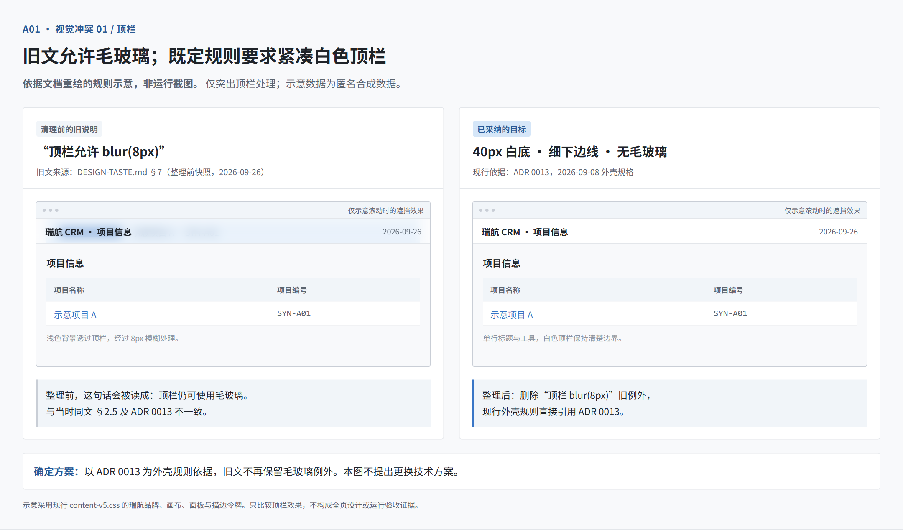
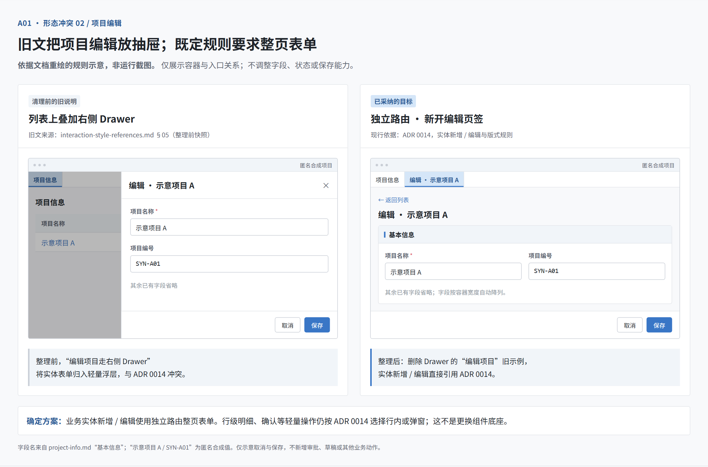

# 设计系统边界

本文维护稳定视觉原则、令牌消费与跨领域页面结构，不复制会漂移的色值、像素表或业务读写规则。

## 1. 来源与令牌消费

业务规格、运行参考、DC 设计和 ADR 的适用范围统一见[设计入口的职责表与关系图](../design/README.md#权威源与职责)。本文维护稳定视觉原则和消费边界，组件配方直达 [KitUI](../design/kit-ui-component-specs.md)。

- 共享颜色与形状来自 [content-v5.css](../../DC重构设计源码/_ds/crm-e3d87120-cf57-4b83-8a9b-188c305f529d/tokens/content-v5.css)，该文件导入 typography 与 spacing，分别维护字体字阶、间距与动效令牌。
- [app/assets/css/tokens.css](../../app/assets/css/tokens.css) 直接导入共享源，维护 Nuxt 桥接、外壳专属值及兼容别名。设计稿与应用不另起两套品牌系统。
- 发现两侧语义不一致时，在对应工作单元核对并对齐；业务页面不另写硬编码补洞。

## 2. 稳定视觉语言

- 专业、克制、数据密集但可扫读。
- 外壳按 ADR 0013 的直接复刻裁定使用深色窄侧栏、单行图标导航与紧凑顶栏；内容区使用白底、小圆角和细线层次，不使用卡片阴影或毛玻璃。
- 品牌色负责主操作和导航，状态色只表达状态，不承担装饰。沿用冷蓝灰阶与瑞航单一品牌色，不混入暖灰、第二品牌色、纯黑正文、霓虹外发光或装饰性渐变。
- 字体消费现行 `--font-sans` / `--font-mono`，不另引花哨或衬线字体。金额、编号、日期、数量、百分比和计数使用等宽字体与 tabular 数字；金额列右对齐，文本、状态和操作保持各自一致对齐，关键数字完整可读。
- 一个容器只有一个主要层次：避免面板里重复嵌套同等圆角和边框的面板。
- 图标使用 Lucide 单色线性图标；产品文案不混 emoji，使用具体任务语言，省去营销词和无助于下一步操作的填充引导。
- 字段标签位于输入上方，错误贴字段下方，不使用浮动标签；空态和必要反馈遵循 [KitUI 页面状态](../design/kit-ui-component-specs.md#09--页面状态-state-panel--表格空态--已定案2026-07-27)，信息显隐见[公共页面结构](#a01-interface-information)。未闭环功能不以演示反馈伪造成功，也不因视觉相似而删除既有能力。
- 动画只用于状态变化、进入退出和必要反馈。ripple、常驻氛围动画、全局路由动画、表格行持续动画、金额滚动计数、拖拽物理弹簧、滚动视差和自定义鼠标动效均不采用。既有 Sheet 拖拽及退场行为按组件契约核对，不因借鉴外部演示追加物理动效。
- 支持 `prefers-reduced-motion: reduce`；动效时长与缓动消费现有令牌，具体组件保留必要反馈，不复制旧品味快照的位移或时长表。

确切颜色、圆角、间距、字号和阴影必须使用令牌，不从本文抄常量。

## 3. 组件层次

| 层 | 位置 | 责任 |
| --- | --- | --- |
| 原子 | `app/components/ui/` | 输入、按钮、Dialog/Sheet、Tabs、链接、状态、表格封装 |
| 全局组合 | `app/components/shared/` | AppShell、KitUIHost、跨领域表单/布局壳 |
| 领域组合 | `app/components/<domain>/` | 只在特定业务含义成立的复杂交互 |
| 页面 | `app/pages/` | 路由取参、数据装配、页面级编排 |

业务页面不得复制通用按钮、浮层、表格、状态标签或工具栏配方。新增原语前先确认现有组件是否能通过兼容扩展承担。

## 4. 交互原语

- Dialog / Sheet 使用 reka-ui 底座，必须保留焦点陷阱、Esc、遮罩、焦点返回和可访问名称。
- toast 由唯一 KitUIHost 承载：system 泳道用于结果和需阅读消息，process 泳道用于进行中任务。
- 数据网格通过项目封装使用 vxe-table；业务页面不创建另一套网格行为。
- 穿透组件的实体/金额差异、零值及无目标退化直达 [KitUI 第 07 节](../design/kit-ui-component-specs.md)，语义目标及权限由 NAVIGATION 决定。
- 业务已允许的删除按 [ADR 0003](../adr/0003-confirm-dialog-deletion-model.md) 选择确认和撤回；导入、导出、OCR 分别遵守对应 ADR。组件不自行开放领域删除或覆盖受保护历史。

浮层的交互平面、模态栈、工作区锁定和焦点关系以 [ADR 0016](../adr/0016-overlay-composition-contract.md) 为唯一权威，组件接入合同见 KitUI；#166 保留为原始问题依据。

## 5. 响应式

流式布局、容器重排、动态高度、滚动边界、关键数字可读及验证矩阵只维护在 [ADR 0013 响应式契约](../adr/0013-align-all-ui-to-online-design.md#响应式与自适应契约2026-07-18-补充)。表单列数、锚点、详情辅助栏及浮层退化直达各自 KitUI 组件合同；SVG 使用 `viewBox` 和流式尺寸，需要重绘时观察容器可用空间。

## 6. 验收清单

- 有直接参考页时按只读证据同屏对照构图、密度、组件状态和安全交互；同时用 `app.dc.html` 核对瑞航品牌、字段和保留能力。
- 复核默认、hover、focus-visible、active、disabled、loading、empty、error；交互观察覆盖“默认 → 悬停或键盘焦点 → 安全点击展开 → 关闭或返回”，记录提示、选中态、焦点与滚动位置的变化。
- 验证键盘顺序、Esc、焦点返回、滚动锁和多浮层组合。
- 按 ADR 0013 的影响范围与视口矩阵验证响应式及 200% 等效宽度。
- 通用原语先在 `/dev/kit-ui` 或组件测试成立，再验证真实业务页面。

参考站操作遵循[只读协议](../design/runtime-reference-audit.md#2-严格只读观察协议)及用户当前授权；只观察语义明确且无写入的控件。新增、修改、保存、提交、审批等行为在本地隔离环境验收，不以参考站业务数据试操作。

验证命令及覆盖边界见[测试入口](../testing/README.md)；组件具体状态见 [KitUI](../design/kit-ui-component-specs.md)。[公开交互参考](../design/interaction-style-references.md)保留独有来源；历史规则对照见下节，均不能代替运行验收。

## 7. A01 设计理由与历史规则对照

“克制面板 × 高密度台账”服务于项目记账与核对：白底、细线和适量留白帮助扫读，关键操作突出，数字对齐便于比较。早期密度 7 / 变化 2 / 动效 2 只描述品味，不作为可量化验收阈值。

原 `docs/design/DESIGN-TASTE.md` 的现行原则已归本文件、组件配方归 KitUI、外壳取舍归 ADR 0013，本轮归并独有说明后退役该文件，旧正文通过 Git 查询。按钮、令牌、表格主题与开发示例的权威定位已改为 KitUI 按钮契约及本文件的公共页面结构。

| 历史指令 | 已采纳的权威与适用边界 |
| --- | --- |
| 顶栏毛玻璃例外、外壳“有意分叉” | [ADR 0013](../adr/0013-align-all-ui-to-online-design.md)；[ADR 0011](../adr/0011-redesign-application-shell.md)仅按替代关系保留行为条款 |
| 实体编辑使用右侧抽屉 | [ADR 0014](../adr/0014-full-page-entity-forms.md)；轻量操作与速览的组件差异见 KitUI |
| 演示数据取真实蓝本 | [ADR 0014 §9](../adr/0014-full-page-entity-forms.md#9-数据与实施纪律)及 [ADR 0020](../adr/0020-browser-authority-and-demo-workspace-boundary.md)，设计匿名样例与运行演示/正式事实分开 |
| 固定组件数值和按钮反馈配方 | [KitUI](../design/kit-ui-component-specs.md)及现行令牌，按钮修正的独有历史见 [#109](https://github.com/zodea/crm-new/issues/109#issuecomment-4998491581) |

两图为匿名重绘的规则说明，不是当前运行截图；可维护图源见 [A01 规则对照](../design/assets/show-me-a01-ui-comparisons.html)。当前组件、页面和数据能力仍按对应契约与实际运行验收。

## 8. 公共页面结构

原 `CRM-PATTERNS.md` 的独有设计规则并入本节；原必要标题锚点继续保留。页面只记录字段映射、领域差异与实际验收，查询事实和数据状态直接见 [READ-MODELS](./READ-MODELS.md)，保存及恢复直接见 [COMMANDS](./COMMANDS.md)，来源返回直接见 [NAVIGATION](./NAVIGATION.md)。本节描述已确认目标，不将文档归并或共享组件接入计作各业务页面已验收。

### 8.1 界面信息显隐

用户在 2026-09-08 确认减少实际页面的解释文字；指南和规格中的必要解释仍按文档职责保留。

| 信息 | 默认处理 |
| --- | --- |
| 完成任务所必需 | 常驻标题、字段名、真实值、单位、操作与必要状态；错误、必填/校验、无权限、失败与重试、未保存提醒、危险操作影响和防止选错来源的提示保持可见 |
| 按需理解 | 字段释义、金额口径和低频帮助放到相邻问号入口；短说明用 tooltip，长内容或带链接/操作时用 popover，交互见 [KitUI 第 17 节](../design/kit-ui-component-specs.md) |
| 不帮助判断或操作 | 重复标题、复述字段值、开发/架构说明、占位解说和无实际内容的介绍直接删除，不整段搬进浮窗 |

常驻文案简短且就近，已有明确标题时不再加同义副标题或“下方展示……”段落。问号只用于有解释需求的内容。来源用紧凑可辨标识表达；只读、来源差异和操作限制的必要识别信息留在对象或动作旁，不重复长篇来源介绍。

逐页核对列表、详情及子表、整页表单、工作台和动态类型的默认态与说明展开态；帮助入口须支持 hover、键盘、触摸、关闭及焦点归还。共享原语通过不能代替逐页检查。

### 8.2 列表布局与逐页对应

标准顺序为标题/视图与搜索/主要动作、可选次行筛选、数据表格或卡片、汇总与分页。已有连续工作面的页面使用 [KitUI `ListShell continuous`](../design/kit-ui-component-specs.md)，工具在窄屏有序换行；壳不决定业务查询、汇总和来源恢复。

默认完整展示参考页中适用于瑞航的列，保留参考顺序和密度；独有列接在对应语义分组后，既定排除项由领域规格说明，不为缩短表格隐藏适用列。宽表只在表内横滚。实体名和聚合金额按 KitUI 穿透组件显示；无有效目标时呈普通文本。图标操作有明确 tooltip 或 `aria-label`。

每页在所属规格中维护两张对应表，用户确认依据见 [#404 原始反馈](https://github.com/zodea/crm-new/issues/404#issuecomment-5582280040)：

- 列对应：参考列/顺序、瑞航字段与权威来源、默认展示或既定排除依据、格式/空值、链接、状态语义、筛选/排序、当前差异与验收证据。
- 工具对应：参考位置与已核实名称、对应操作、范围与结果、权限/暂不可用原因、当前状态与验收证据。搜索右侧每个入口独立登记；未核实含义写“待采证”，缺能力写“待实现/待依赖”，不凭图标猜功能或自动永久排除。

有直接参考页时按证据核对，无直接参考页时标明 DC 来源。#418 等历史批次只证明其实际接入范围，当前差异仍逐页验收。

### 8.3 搜索、筛选与工具控件

查询集合、排序、分页、汇总、导出范围、同源快照、来源切换及过期响应以 [READ-MODELS](./READ-MODELS.md) 为准；下列只定义控件交互：

- 中文输入法组合期间不提交半成品，候选确认不误作搜索提交；输入完成后短防抖提交，Enter 立即提交，清空撤销关键词。搜索、表头与工具入口显示同一活动查询条件。
- 固定枚举使用复选候选列表，提供全选、清空及选中数量；弹出字段面板用“应用”提交草稿，直接展示筛选组即时联动。开放文本使用输入匹配。表单赋值、当前录入范围和排序不因外观一致而改作列表枚举筛选。
- 控件常态使用细实线，名称蓝链的键盘焦点用下划线、浅底或细焦点线明确表达；不用浏览器默认凹凸框或粗框包住文本。深色侧栏按 ADR 0013 保持可读字号。

每页只放适用工具，必要而暂不可用的能力在规格中保留差距；显示禁用态时解释原因，不放装饰性假按钮。刷新、排序和筛选表达当前条件与真实反馈；导入见 ADR 0005、导出见 ADR 0004、新增见 ADR 0014，查询与保存结果分别直达 READ-MODELS / COMMANDS。

列设置只改展示顺序、显隐及允许调整的固定列/列宽，提供恢复参考默认列。偏好按当前设备、工作区、实际页面/类型和列版本隔离；重开恢复，新列按默认补入，失效列配置丢弃，读写失败使用默认视图并提示。只保存列标识和布局，不保存行、关键词或敏感值，不扩展为账号云同步；这是已确认目标，尚无统一公共 API 的页面继续记录差距。

表头标记、键盘、状态 tag 只看 [KitUI 第 12 / 16 节](../design/kit-ui-component-specs.md)。运行验收须检查真实列、活动条件与清除、中文输入/Enter/清空、跨页结果和汇总/导出、连续搜索、空结果/重试、各工具结果、详情返回、局部滚动与浮层。

### 8.4 详情与整页表单

详情按标题/主要动作、简要元信息/高频摘要、资料或业务页签与当前事实表、真实可用辅助区组织。完整资料作为一级页签时只在该页签显示，不在业务表前重复；默认页签与深链归领域规格，导航及焦点恢复见 NAVIGATION。主内容和辅助栏的容器退化、`compact/navigation` 及 `ReadOnlySection` 见 [KitUI 第 10 / 14 节](../design/kit-ui-component-specs.md)，不将整页详情自动转为 Sheet。尚未接入审批、评论、动态或文件时不造空白占位；证照等专用工作流沿独立页面。

实体形态以 ADR 0014 为准；[KitUI 第 11 节](../design/kit-ui-component-specs.md) 维护返回/标题/状态、分区导航、字段、可选明细与 sticky 动作的壳合同。必填失败同时提供字段错误和全局摘要，首个错误滚入视口并聚焦；保存、草稿、提交、dirty、权限和回执属于 COMMANDS 与领域层，壳不承担业务写入。

### 8.5 工作台、树与矩阵

OCR、归档、排版工作台以队列、原件/主视图和校对/操作区组织。宽屏可多栏，窄屏分段切换或 Sheet；切换不丢当前实体与草稿状态，多个分区不复制当前选择。上传、识别、核对、归档仍按各领域独立状态转换，反馈与保存结果见 COMMANDS。

树选择和右侧过滤使用同一状态源；真实身份与关系见 DATABASE。大矩阵在自身区域横向/纵向滚动，局部网格按自身容器宽度响应，页面/背景不与模态内容竞争滚动。

状态视觉与必要反馈见 KitUI 第 09 / 16 节，业务值由 READ-MODELS 与领域决定；高影响动作须显示对象和影响，确认/撤回见 ADR 0003，浮层层级与背景锁定见 ADR 0016。一个任务保留清楚的主要滚动区；嵌套模态须有业务必要，优先在当前模态内分步或使用其子浮层。

页面验收沿本文件第 6 节、[测试入口](../testing/README.md)和[运行态视觉回归](../design/runtime-visual-regression.md)执行；需同时验证真实事实/写入、来源导航和界面，不能以 toast、截图、减少文字或代表页通过替代业务闭环。
