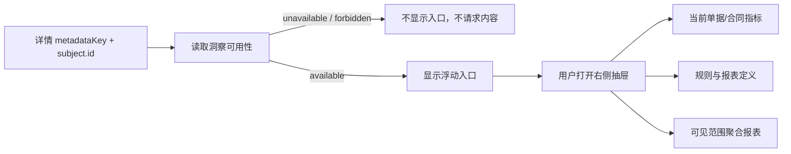
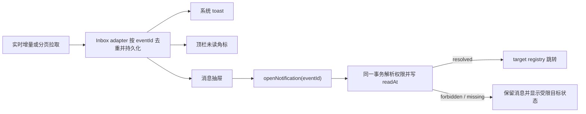

# 公共洞察、消息与工作台页签契约

本文规定智能业务洞察、全局审批/抄送消息和应用内业务页签的共同边界。页面字段与读 DTO 继续以 [`READ-MODELS.md`](./READ-MODELS.md) 为准，蓝色目标与返回语义继续以 [`NAVIGATION.md`](./NAVIGATION.md) 为准；本文只回答这些公共能力何时出现、怎样组合、怎样恢复，以及哪些状态不能互相冒充。

以下参考行为以标明的采证日期为界，不声称已复核参考站之后的变化。公共能力由[全站交互复核](https://github.com/zodea/crm-new/issues/404)承接；既有消息与状态反馈不扩展为完整审批引擎。可独立复核/实现的通知、页签不等待整条财务链，只有依赖具体业务事实的定稿与验收才建立相应阻塞关系。

## 1. 直接证据与安全边界

2026-08-13 在已登录参考站按严格只读协议复核，未点击消息、文件、评论、下载、导入、新建、打印、审批或任何业务写入口：

- 浏览器只有 **1 个页面**；页面内恢复了 **25 个业务页签**，默认回到持久化工作台“支付记录”。因此“浏览器页面数”和“应用内业务页签数”是两套状态，不能混称。
- 从付款申请列表进入付款详情后，业务页签增至 26。洞察入口不是首屏同步出现，而是在详情及能力判定完成约 3.5 秒后出现；这证明入口至少受“当前详情 + 业务元数据/能力结果”控制，不是由已打开页签数量控制。
- 付款详情的右侧“智能业务洞察”包含三层：统一检查结论、当前合同付款与结算/发票指标、跨项目/跨供应商应付报表。当前单据会改变前两层；跨域报表按用户可见范围读取，不等于当前项目的数据。
- 两张不同付款申请均出现入口，其中一张无合同且审批中，另一张有合同且已支付；合同有无和审批状态会改变检查结果，但本轮证据不支持把它们当作入口开关。
- 付款申请列表、付款管理列表、支付记录列表、材料采购合同详情、分供方详情、项目详情和开票申请详情均未出现入口。开票申请详情等待 5 秒后仍无入口；不能把通用洞察组件无条件挂到所有详情页。
- 页签栏内“刷新当前页”会让洞察面板收起，但保留当前付款详情和稍后重新出现的入口。浏览器刷新则丢弃刚打开的付款详情与洞察面板，恢复到 25 个持久化工作台及“支付记录”。
- 刷新后可观察到外壳级即时通讯 SDK 初始化，顶栏未读角标仍由独立查询事实呈现。该证据只支持“存在持续通道 + 分页/计数对账”，不能把用户截图中的某条抄送 toast 强行绑定到某个私有传输帧。
- 高页签状态下，本轮审查通道出现过元素点击和截图超时；这不是终端用户性能结论，但足以要求实现为后台页签暂停轮询、洞察分层缓存和页签恢复设定明确上限。

私有 URL、认证参数、真实人员、项目、合同、金额和文件均不进入仓库。参考站接口只抽象为以下稳定语义：业务元数据、记录身份、详情位置、规则/报表版本、可见范围和统计时点。

## 2. 洞察挂载矩阵

`已确认无入口` 只约束当前同类详情，不代表未来永远禁用；新增挂载必须先提供直接证据或明确产品决策，再登记稳定 `metadataKey`。

| 页面族 | 当前参考证据 | 瑞航目标 | 当前实现差异 |
| --- | --- | --- | --- |
| 付款申请详情 | 已确认延迟出现浮动“业务洞察”入口，点击后打开右侧抽屉 | 首个正式挂载点；先读取 `InsightAvailabilityDTO`，可用时才显示入口 | 当前 `PaymentApplicationInsightPanel` 作为详情常驻 aside，无能力判定、浮动入口或可关闭抽屉 |
| 付款申请列表 | 已确认无入口 | 不挂载 | 无需补入口 |
| 付款管理 / 支付记录列表 | 已确认无入口 | 不挂载 | 无需补入口 |
| 材料采购合同详情 | 已确认无入口 | 暂不挂载；合同仍可作为付款洞察的当前指标来源 | 不得因存在付款数据而自动挂载 |
| 分供方详情 | 已确认无入口 | 暂不挂载；分供方仍可作为付款洞察的聚合维度和蓝色目标 | 不得因存在往期合作或付款数据而自动挂载 |
| 项目详情 | 已确认无入口 | 暂不挂载；项目仍可作为付款洞察的聚合维度和蓝色目标 | 不得把组织级洞察误挂成“当前项目洞察” |
| 开票申请详情 | 已确认等待后仍无入口 | 暂不挂载；发票只作为付款洞察的一层指标和蓝色目标 | 不得复用付款详情组件冒充开票洞察 |
| 其他财务详情 | 未逐一形成直接证据 | 默认不挂载，后续按 `metadataKey + position + capability` 增量登记 | 不能按路由前缀、项目或金额存在与否猜挂载 |

挂载顺序固定为：



- 可用性加载期间不先闪现一个无内容按钮；失败可在下一次进入详情或显式重试时重查。
- 切换付款详情时，已打开的抽屉可以保留，但必须立即进入当前层 loading，并按新 `subject.id + sourceVersion` 重算；上一单据指标不得短暂冒充新单据。
- 抽屉关闭只清理呈现状态，不失效后台已验证的可用性和分层缓存。
- `unavailable` 是该业务元数据当前未配置洞察，`forbidden` 是配置存在但用户无权读取；二者都不能用空报表或“检查通过”代替。

### 2.1 参考接口形态与瑞航适配边界

参考站的洞察不是付款页面内部写死的组件，而是由公共业务详情壳承载。详情主体挂载后，公共壳以当前业务元数据、记录标识和位置发起异步分析；返回 `show` 才挂载 40px 浮动入口。入口点击后再打开当前页签自己的右侧抽屉。参考请求可脱敏抽象为：

```ts
interface ReferenceInsightRequest {
  metadata: { key: string }
  records: Array<{
    record: { id: string, metadataKey: string }
    related: unknown[]
    treeRelated: unknown[]
  }>
  position: 'detail' | 'upsert'
  approvalContext?: { processDefinitionId: string, activityId: string }
}

interface ReferenceInsightResult {
  show: boolean
  topArea?: {
    controlMode?: 'pass' | 'block' | 'alert' | 'exception'
    tip?: string
  }
  contentArea?: Array<{
    key: string
    title: string
    sourceType: 'check-group' | 'metric-group' | 'report'
  }>
}
```

- 详情、编辑表单和审批动作是三种不同位置：详情使用稳定记录 ID；表单可以携带尚未保存的完整记录；审批还需要流程定义和活动节点。三者不能共用只含 `route + projectName` 的宽松参数。
- 参考站会在详情挂载后直接执行一次分析并用 `show` 决定入口；瑞航仍保留独立 `InsightAvailabilityDTO`，避免为 `unavailable/forbidden` 页面预取完整检查和跨域报表。两者语义要能适配，但不复制参考站的请求次数。
- 参考站的规则结果同时影响只读入口、表单保存提示和审批前校验；允许继续时会把明确的“已确认继续”标记与洞察审计上下文带入原业务命令。瑞航若后续实现写前拦截，必须使用类型化 `InsightDecisionDTO` 和业务命令幂等键，不能让前端布尔值单独绕过后台规则。
- 浮动入口的位置可按用户和企业保存，但抽屉开合、请求和返回数据都是当前业务页签的瞬时状态。瑞航只允许持久化呈现偏好；`multiTabUuid`、Vue 组件实例或洞察结果不得进入页签恢复描述符。
- 参考站另有按 `metadataKey + subject.id` 查询洞察日志的分页读模型。瑞航首版不因此新增业务路由；若付款详情需要历史记录，应作为洞察抽屉内的只读分区并复用统一分页、权限和完整度语义。

## 3. 洞察三层布局与状态

桌面端使用不遮挡全局侧栏的右侧 Sheet；窄屏（`<= 768px`）改为底部 Sheet，最大高度 82svh，内部滚动。内容顺序固定：

1. 标题与关闭按钮；统一结论显示未通过数、全部通过、无匹配规则或部分可见。
2. 当前业务层：合同付款情况、结算/发票情况。每组是可折叠指标区，不堆叠成多个大卡片。
3. 跨域报表层：项目维度和分供方维度的应付管理表。表头固定，只有表格区域横向滚动；行的蓝色目标必须来自 `NavigationIntentDTO`，无稳定目标时整行保持普通文本。

每层独立展示读取状态，并另外展示计算完整性与授权范围；三者的唯一契约见 [READ-MODELS](./READ-MODELS.md#read-status-and-completeness)。历史 `ReadState.partial` 已退役；现行 adapter 使用独立 `unavailable` 和 `unauthenticated` 问题码，计算 `partial` 及授权范围分别按该契约呈现：

| 状态 | 呈现 |
| --- | --- |
| loading | 分区骨架，不清空其他已就绪层 |
| 成功读取且有数据 | 指标或表格；金额保留定点字符串语义 |
| 成功读取且真实空集 | 保留分区标题和表头，说明无记录、无匹配规则或无当前关系 |
| 就绪但计算不完整 / 授权范围受限 | 分别标明缺失来源与可见范围；已知小计不冒充完整总额，汇总与行使用同一权限范围 |
| forbidden | 不泄露行数、金额或对象名称，只显示无权读取该分区 |
| error | 仅该分区失败并可重试，不把整个详情改成错误页 |

宿主按 [READ-MODELS 的分层缓存身份](./READ-MODELS.md#insight-cache-identity)消费当前单据/合同指标及跨项目报表；工作区、操作者、来源、授权范围和来源版本不由页签呈现状态替代。

## 4. 全局审批与抄送消息

参考截图只确认右上角会出现“抄送：业务类型”的轻量通知卡，正文包含发起人、业务单据和处理结果，带手动关闭；顶栏同时有未读角标。卡片点击、自动关闭时间和失败重试未安全验证，因此瑞航采用明确、可测试的本地规则：



- 事件先持久化再扇出呈现；同一 `eventId` 重复投递只更新同一条，不重复 toast、不重复增加未读数。
- toast 使用 `system` 泳道，标题、摘要、结果和发生时间来自同一 `NotificationDTO`；卡片本体不承担隐式跳转，若提供操作则使用明确“查看”按钮。
- toast 自动消失或手动关闭只改变 `presentationDismissedAt`（本地呈现状态），不写 `readAt`。打开消息抽屉也不批量已读。
- 用户激活某条消息时调用 `openNotification(eventId)`：adapter 在同一事务内按当前权限解析目标并在首次打开时写 `readAt`，返回 `NotificationOpenResultDTO`。`resolved` 再交 target registry；`forbidden` / `missing` 显示受限目标，但消息仍留在列表。
- 导航渲染失败不回滚已读事实；保留消息和明确的“重试打开”即可。重复打开幂等，不重新增加未读数。
- 抽屉的“全部已读”是显式批量命令；删除消息不属于首版服务器事件协议，现有前端删除按钮必须在迁移时移除或另行建立归档命令。
- 实时通道只负责提示有变化；启动、断线重连和窗口重新获得焦点后均以分页事件流及服务器未读计数对账。SQLite adapter 与 HTTP adapter 使用相同 `eventId/readAt/permissionState` 语义。
- `app/stores/notifications.ts` 静态样本只在服务端授权后的演示模式展示。本机中央证照提醒通过正式事件 Repository、原子已读命令、启动与焦点分页对账进入壳层；其他运行环境或未接领域明确显示来源尚未就绪。演示 fixture 不得成为正式运行 fallback；可见性遵守 ADR 0020。

证照主动预警复用此 inbox 宿主：supplier owner 保存稳定问题事实，public notifications owner 在同一中央库保存事件、每 actor 已读与原命令结果；壳层只建立一份对账及 system 提示。提示关闭时间只保存在本地最小呈现记录；已读提交、采用集合与原编号恢复直接遵循 [COMMANDS](./COMMANDS.md#notification-read-commands)。业务持续警告规则只在 [READ-MODELS](./READ-MODELS.md#supplier-expiry-warnings)维护，不由已读动作解除资料问题。

## 5. 业务页签、恢复与性能

### 5.1 本轮决定

- 保留本地 `MAX_TABS = 15`（不含首页），不因参考站可显示 25+ 就静默上调。瑞航当前每个页签对应一个 KeepAlive 页面实例，15 是内存、订阅和草稿隔离的保护边界。
- 横向溢出继续由前后翻页、滚轮横移、活动页签自动滚入视口和“当前页签数量”承担；达到上限只阻断新页签，已存在页签仍可复用。
- 浏览器已按当前工作区与用户隔离持久化版本化 `TabDescriptor`，字段契约见 [`restoration-contract.ts`](../../app/lib/tabs/restoration-contract.ts)。只记录位置、来源、协议版本及已知源版本，不序列化 Vue 实例、请求、抽屉状态、表单草稿或页面数据。启动时只挂载活动页；其他恢复页签在首次激活时校验和加载。
- 可恢复：列表、工作台、稳定 ID 的只读详情。默认不恢复 `/new`、`/form`、`/edit`、导入映射和未保存写态；这些页面必须先有独立草稿协议，不能靠浏览器刷新保存表单。
- `/settings/our-signatories` 只恢复目录阅读入口，并重新核当前目录能力；其整页编辑以及班组/工人整页编辑仅在有合法最小原命令描述时保留精确启动 URL，用于核对原编号。未保存正文不加入页签 descriptor，统一原命令恢复规则见 [COMMANDS](./COMMANDS.md#idempotency-and-recovery)。
- 已接公共原命令恢复的表单与领域迁入页，在具有合法最小原提交描述时保留精确启动地址，由所属 owner 核对原编号。实际 family、动作与身份契约只见 [COMMANDS](./COMMANDS.md#idempotency-and-recovery)；写态正文仍不进入 `TabDescriptor`，没有合法原编号时按普通写态回退。
- 浏览器刷新恢复最近持久化的可恢复页签及活动项；若活动项不可恢复，则回退最近一个可恢复页签，再回首页。页签内“刷新当前页”只失效活动页缓存，保留页签集合、活动路由和其他页签状态。
- 页签关闭、关闭其他、关闭右侧和关闭全部必须同步删除对应 descriptor 与缓存；恢复列表仍受 15 上限约束，超出的旧数据按 `updatedAt` 取最近 15 个并记录一次可诊断迁移结果。
- 恢复使用显式阅读入口白名单；只读详情通过当前 Repository 核对稳定身份、canonical kind、来源、关系与能力，再交唯一 Target Registry。源版本变化以当前读取结果更新，未知版本保留未知；未接入读取的详情返回 `not-connected`，不借用旧实体或演示数据。
- 初始恢复排在 Nuxt 初始导航之后、首次挂载之前；直接深链优先于旧活动项。启动只结构校验全部描述符，活动项及回退候选串行验证；单次恢复读取有取消与等待上限，新导航和关闭后的迟到结果不得重新打开旧页。
- 恢复意图只来自启动恢复、旧页签激活、重试或关闭后的旧页签回退。业务列表、关系入口及普通直接深链表达本次导航意图，同路径旧恢复失败不能拦截它；实际导航成功后才移除该 key 的旧恢复问题和待核验描述，不继承旧数据版本。取消或拒绝导航保留原问题，旧无权页签再次激活仍须恢复校验；目标页面继续按当前业务来源和权限读取，路由进入本身不构成实体授权。
- 删除、身份或来源不符、撤权、读取未接入、上下文失效与读取失败均保留可重试或关闭的提示。活动项失败时按最近使用次序回退，最终回首页。非法、损坏、未知格式、重复和超限的旧存储安全整理；写入存储失败不阻断当前使用。操作说明见[页签与页面恢复指南](../guides/tabs-and-recovery.md)。

### 5.2 后台活动约束

- `onDeactivated` 后，业务页停止轮询、分页预取、洞察内容请求和页面级实时订阅；再次激活时按 `sourceVersion/asOf` 判断是否重取。
- 全局通知连接只允许由应用壳维护一个实例，不能随 15 个业务页签重复建立。
- 洞察可用性可在活动详情加载完成后读取；跨域报表只在用户打开抽屉后读取，不因恢复 15 个详情页签并发拉取。
- 每个 adapter 支持取消过期请求。快速切换详情时，只允许最后一个 `subject.id` 更新当前层。

## 6. 当前实现差异与实施归属

| 能力 | 已有基础 | 必须补齐 |
| --- | --- | --- |
| 洞察 | 付款详情已有真实 SQLite 派生的审批、结算、发票、支付四类检查 | 增加可用性 adapter、浮动入口、可关闭 Sheet、三层 DTO、跨项目/分供方表格、权限/版本/统计时点与分层缓存；付款界面实施归支出财务票 |
| 消息 | 本机证照事件 Repository、磁盘已读及原命令、启动补算、壳层分页幂等对账、system 提示与响应式 Sheet 已接；真实零/来源不可用和演示分别呈现；目标统一走 target registry | 其他审批/抄送领域事件和实时变化通道未接入，不能用已有样本宣称全域通知完成；首次真实写入仍依生产门禁 |
| 页签 | 15 上限、同路径复用、KeepAlive、滚动翻页、批量关闭、活动页刷新，以及浏览器描述符恢复、写态排除、迁移与失败回退已实现（#435） | 缺失领域只读恢复入口、全域后台页暂停；本轮不改变上限 |

在线正式写入权威已由 [ADR 0020](../adr/0020-browser-authority-and-demo-workspace-boundary.md)裁定；命令、冲突和失败草稿以 [`COMMANDS.md`](./COMMANDS.md) 为准，通用离线 outbox 与自动回放仍不在范围内。旧决策票不再是等待重新选择写入权威的前置；当前缺口按[模块复核规程](../agents/module-review.md)形成具体实施票，不用随机数据、私有接口复制或第二套状态词汇填空。

## 7. 验收覆盖

- 单元：洞察挂载 resolver、可用/无配置/无权限/失败；缓存键；`eventId` 去重；原子打开；15 上限与恢复迁移。
- 组件：浮动入口延迟出现；抽屉三层的加载/空/无权/错误及独立完整性、授权范围；390/768/1024/1440px；蓝色行仅在目标 resolved 时可达；toast 关闭不已读；消息抽屉打开不批量已读。
- E2E：付款详情切换不串指标；材料合同与开票详情不误挂；实时事件只产生一份 toast/未读/抽屉记录；无权限目标保留消息；应用刷新与浏览器刷新语义不同；15 页签溢出、关闭和恢复；后台页无重复洞察/通知请求。
- 数据：SQLite 与 HTTP fixture 对同一 DTO 做契约测试；空表、权限裁剪、规则版本变化、事件重投和断线对账均使用确定性 fixture，禁止 MockJS 与随机值。
