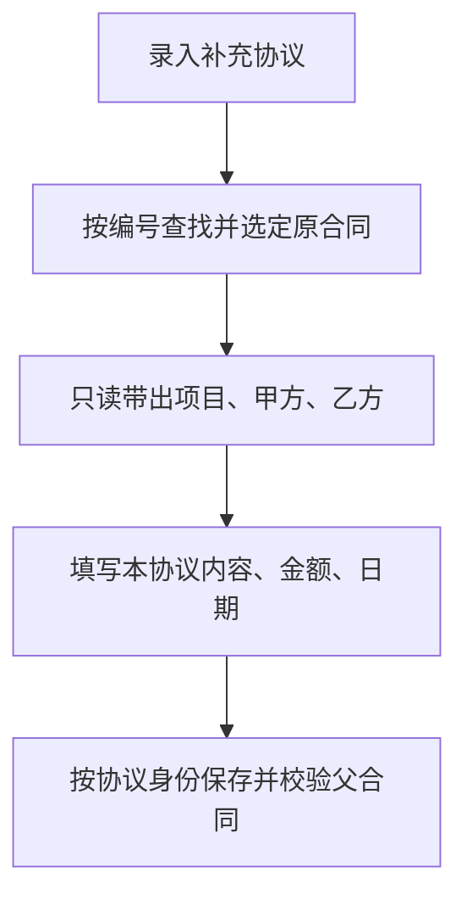
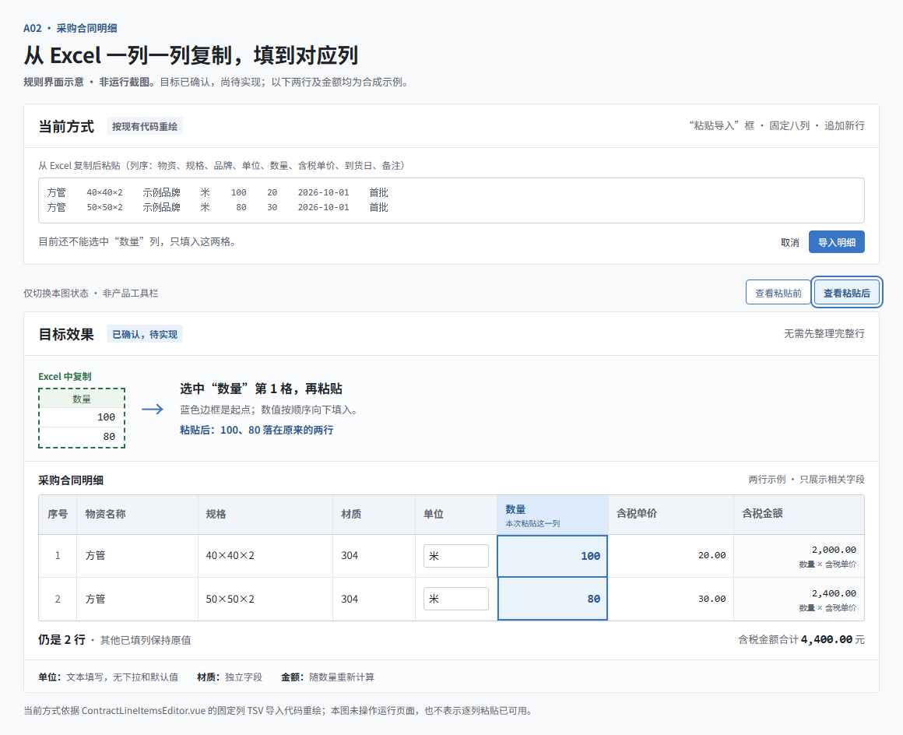
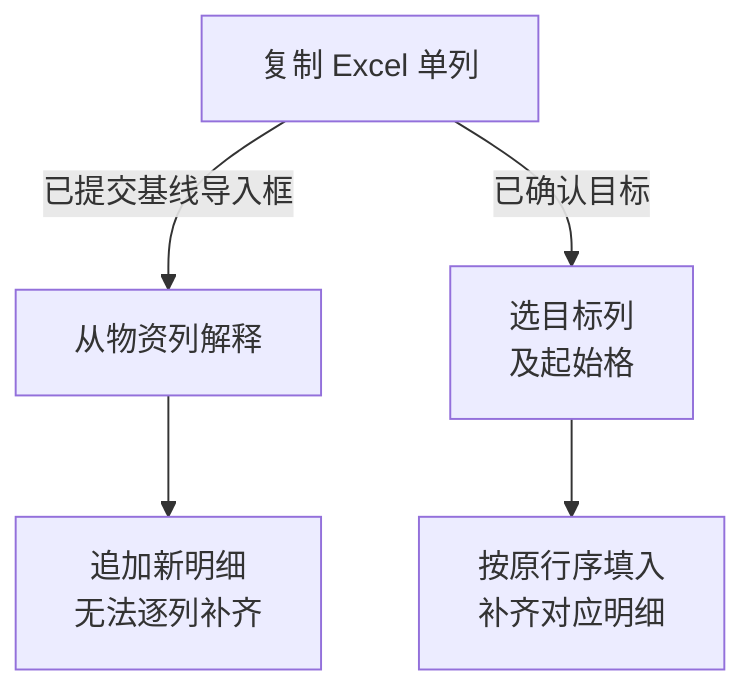
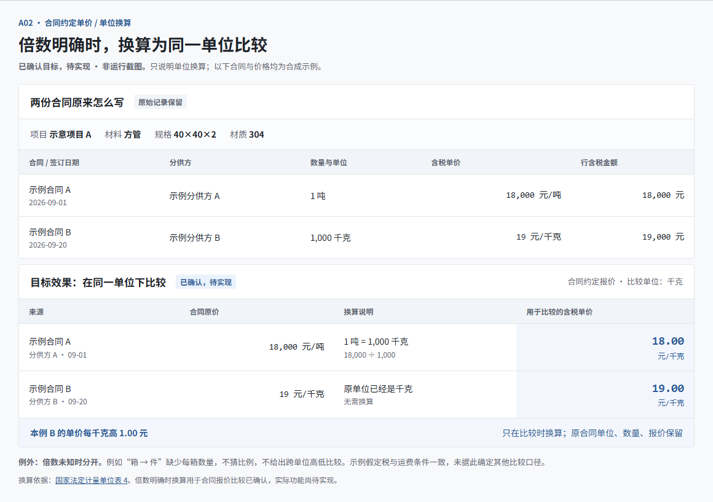
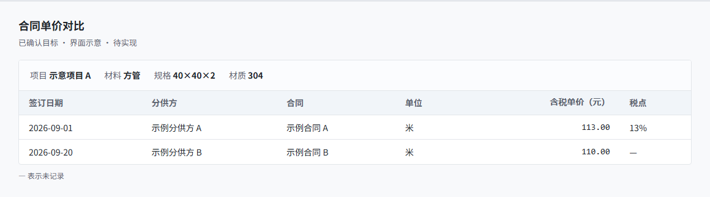
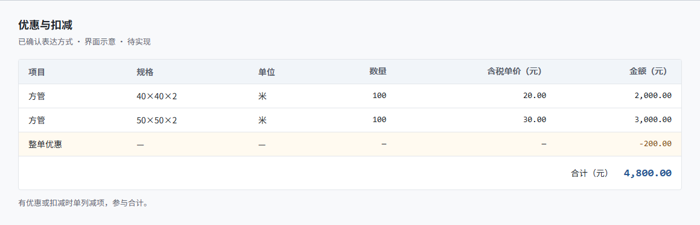

# 合同表单与辅助合同结算

> 直接设计源：`DC重构设计源码/kit/CompanyExpScreen.jsx`、`OtherExpScreen.jsx`、`OtherSettleScreen.jsx`、`MatSettleScreen.jsx`、`forms/ContractForms.jsx`、`forms/MaterialForms.jsx`
> 表单蓝本：`conContractForm`、`subContractForm`、`matContractForm`、`otherExpForm`、`companyExpForm`、`otherSettleForm`、`matSettleForm`
> 持久化权威：`DATABASE.md` 的 `contracts`、`contract_supplements`、`contract_line_items`、`company_expense_contracts`、`expenditure_settlements`

有直接对应页的构图、密度、专属列组织、控件状态与安全路径按 [ADR 0013](../../adr/0013-align-all-ui-to-online-design.md) 和 [运行参考](../../design/runtime-reference-audit.md) 对齐红圈；业务字段、状态与数据关系仍以现行数据库/决策为准。合同与材料结算由 [#409](https://github.com/zodea/crm-new/issues/409) 统一复核，分包结算另归 #410。

## 一、三类项目合同

施工、分包、材料采购共用整页表单；路由决定合同类型，用户不能在编辑时跨类型切换。

| 分区 | 字段与规则 |
|---|---|
| 基本信息 | 合同编号、合同名称*、项目*、甲方客户*（仅施工）或乙方分供方*（支出侧）、分包类别（劳务/专业）、是否补充协议、合同内容简述*、签约日期*、合同状态、发票类型、履约联系人、联系方式；支出侧联系资料默认带出后允许编辑，甲方选择与带出边界按下文目标，不视为已实现 |
| 合同金额 | 含税合同金额*、税率；无税金额和税额实时计算，未填写税率时按无税费处理（税额 0、不含税等于含税），定义见 [DATABASE](../DATABASE.md#canonical-合同与补充协议)；变更后合同金额、累计结算、累计开/收票和累计收/付款均为关联单据派生只读值 |
| 总合同管理费配置 | 仅施工主合同的独立金额与合同依据，详情可核对当前采用和配置历史；定义及运行边界直引 [DATABASE](../DATABASE.md#construction-contract-management-fee-configuration) |
| 合同条款 | 主要条款、支付及结算方式、品牌及质量标准、工期或交付时间、质量保修责任、特别约定 |
| 质保金 | 质保金比例、质保金金额、质保期（天） |
| 开票方 | 开票名称、纳税人识别号、开票地址及电话、开户行、银行账号 |
| 材采明细 | 仅材料采购合同：使用共享 `KitEditGrid` 维护物资名称*、规格、品牌、材质（独立字段，缺值保留空）、单位、数量*、含税单价*、派生含税金额、计划到货日期、备注；支持单位手填、逐列粘贴及文件映射预览整批追加；独立减项和协议自有行直引 DATABASE |
| 附件与备注 | 合同审批稿、正式合同扫描件、备注 |

项目、客户、分供方 lookup 均保存真实 ID。选择“补充协议”后必须选择原合同，保存到补充协议实体；不得把补充协议伪装成第二份主合同。材料采购明细逐行持久化，金额由数量×单价派生；头行金额关系及提交门槛见下文核对，不以“提示勾稽”概括现有提交拦截。

### 主体选择与自动带出（目标）

项目与签约主体选择、联系资料来源及当前实现缺口统一见 [DATABASE：主档选择与联系资料带出](../DATABASE.md#contract-party-selection)。候选中没有真实记录时，先完善相应主档；不能以同名自由文本建立关系。补充协议先选择原合同，再只读展示对应归属；以下为已确认流程示意，不是运行截图或已交付声明。

施工/分包的 #322 已证明迁入协议的读取与聚焦；材采中央协议新增/编辑已接通自有明细和读回聚焦，施工/分包完整协议新增仍按各自现有边界。三核心合同的我方选择与采用快照已接集中设置目录；正式磁盘与独立 Native 是否可维护目录只见 [DATABASE 主体物理承接](../DATABASE.md#our-signatory-storage)。当前中央材采/分包主合同已接通分供方联系资料带出，具体边界及验证见上述 DATABASE；历史截图中的相似字段不能代替本项目运行验收。

施工合同每次进入新建/编辑时重新读取中央完整正式项目/客户候选，包含已新建及已确认迁入的身份，不复用固定候选或上一份表单缓存。保存前重新检查同会话可读身份及项目当前主客户；来源失效、无权、服务失败、关系错配时不写合同。幂等重试和版本冲突继续由同一中央命令处理。已保存合同的客户归属沿合同自身 ID，项目改客户不自动迁移旧合同。从客户关系进入详情后显式编辑，保存保留客户来源与列表返回上下文，见[导航契约](../NAVIGATION.md#施工合同客户来源返回)。

三类核心合同表单的“保存并新建”成功后进入空白新建页，不受“保存后关闭”勾选影响；已有另一份新建草稿时，先沿未保存确认流程处理。不同页签的目标与版本隔离遵循[中央命令契约](../COMMANDS.md#4-网络失败与本地草稿)，不会将 A 页输入提交到 B 合同。

### 采购明细格式与导入核对

采购明细的独立材质字段及缺值对比条件、单位手填阶段方案、当前实现差距与合同约定价复用方向以 [DATABASE 的 `contract_line_items`](../DATABASE.md#材采明细与公司支出合同) 为准。材料对比条件、明确倍数时换算，以及含税单价与税点分列已确认；Excel 文件用于当前合同预览后追加，数量与单位一起核对、全部错误修好再整批追加。字段、源行及整单保存边界归 DATABASE；现行文件入口复用解析和映射，逐行核实数量、单位及计价单位后一次追加，保留已有行和真实来源原件。旧八列 TSV 不因此改变列序。

图为代码现状与确认目标的规则示意，**不是运行截图**；仅验正数量/非负单价不能替代单位核对。可维护图源见[数量与单位](../../design/assets/show-me-a02-procurement-entry.html#quantity-unit-review)。

**已确认操作目标：按列复制、按行对应。**从 Excel 复制某一列的连续单元格，选中采购明细对应列的起始单元格后向下填入；再复制其他列，填到同一批明细行。只改变本次粘贴列，按源行位置对应，中间空单元格不能导致后续行上移。该操作不要求先整理完整行或识别整张表头，也不据此扩展为任意矩形区域粘贴。

下图用两条方管明细展示录入效果：名称、规格、材质、单位已填，选中数量列第 1 格，将 Excel 的 `100 / 80` 向下粘贴；单价分别为 `20 / 30` 元，按既定公式得到 `2,000 / 2,400` 元。分列录入仍是两条明细，不会每粘一列就再新增物资。

**图为按代码与已确认规则绘制的界面示意，不是运行截图。**示例数据为合成数据；当前方式与待实现目标分开标注。[可维护 HTML 图源](../../design/assets/show-me-a02-procurement-entry.html)可切换粘贴前后，图中演示控件不属于产品新增按钮。

**已提交基线的差距发生在目标列定位。**`8756be2d` 的 `ContractLineItemsEditor.importTsv` 从物资名称开始解释固定八列并追加，单列也按物资名称处理；先粘名称再粘规格会增加额外物资行。当前工作区已按起始格定位单列、保留中间空格及原行序，单位手填且未填保持空白；组件及浏览器验收覆盖多列分次填写、非法数字整批拒绝、键盘、局部滚动和保存回读，范围见 [DATABASE 实现边界](../DATABASE.md#材采明细与公司支出合同)。下图及原效果图保留已提交基线对照，不能将其中的待实现标记理解为当前源码仍无逐列粘贴。

查看逐列粘贴流程与实现差距

下图补充结构说明，不改变其他单据的网格契约。

本轮核对的红圈历史证据包括旧手动截图库 `DC重构设计源码/screenshots/红圈系统/合同页`、`红圈系统/api/raw/fields.json`（对象字段）及 `红圈系统/05-乙供材管理/05-乙供材管理.md`（观察记录）。此前仅查后者目录而未找到展开网格的记录，由以下直接截图更正：

| 参考画面 | 已观察内容 | 不能据此确认 |
| --- | --- | --- |
| 下方普通明细网格 | 清单明细、物资名称、规格型号、品牌、材质、单位等列；单位是关闭的下拉框；可见下载导入模板、导入数据、切换 EXCEL 模式和全屏编辑入口 | 单位下拉选项、默认值及后台维护方式 |
| Excel 网格左侧（历史原路径：`DC重构设计源码/screenshots/红圈系统/合同页/PixPin_2026-06-27_09-20-11.png`，本工作区未随附） | 含税单价、数量、含税金额等列；“设置多字段匹配”入口；底行标明“此行仅用于粘贴数据” | 匹配规则、粘贴校验与保存结果 |
| Excel 网格右侧（历史原路径：`DC重构设计源码/screenshots/红圈系统/合同页/PixPin_2026-06-27_09-20-19.png`，本工作区未随附） | 参考单价、税率、无税单价/金额、是否超量/价、税额、计划到货日期、累计已下料量新、备注 | 各公式、业务适用条件及真实导入行为 |

历史观察记录（原图文件名日期 2026-06-27）记载“采购合同明细”右侧为单位下拉框；原定位 `DC重构设计源码/screenshots/红圈系统/合同页/PixPin_2026-06-27_09-20-04.png` 本工作区未随附，也未查到对应 Git 记录，本次无法重验该截图。上述网格列与入口同样保留为历史观察，不作为当前可点击图源。**本项目阶段已确认单位文本输入**，规则见上述实体定义；可定位的原始字段记录与采集说明仍按下文核对，不将参考下拉控件作为已实现要求。

- `purchaseContractDts3X` 接口字段记录包含物资编码/分类、材料名称、品牌、材质、规格、单位、数量、含税单价/金额、税率、无税单价/金额、税额、计划到货日期和备注；`unit` 类型为单选，`unitSys` 为公式文本，与单位选择控件相符。对象字段仍不等于全部可见列或列顺序。
- 2026-07-02 采集说明记录“导入模板／EXCEL 模式”，历史截图观察记录记载入口和网格，原图未随附，当前不能重验；尚未取得模板文件或单位选项展开图，未验证文件格式、列映射、校验或提交行为。本轮未进行参考站实时交互。
- 本项目现有八列粘贴尚无材质，与上述对象字段并不等同；不能直接将多一列材质的内容当作原八列格式粘贴，须同步处理字段映射，避免后续列错位。旧基线的补充协议缺少独立材料明细链；当前已经按真实父键保存协议自有行，不能据此宣称完整复刻红圈或已具备合同单价趋势分析。

### 合同约定单价的跨单位对比

固定倍数换算的条件、公式与原值归属以 [DATABASE：合同价格单位换算](../DATABASE.md#contract-price-unit-conversion) 为准。当前材料价格页已独立展示有效合同及协议约定价，允许临时输入比较单位、正倍数及核实依据，缺少依据保持原单位。下图说明页面如何同时展示原报价与比较价；[送货单价格分析](./material-management.md#三材料单价分析)的现行量级分组不随本项改变。

完整例子：同一示意项目采购同规格 `40×40×2`、同材质 `304` 的方管；9 月 1 日与分供方 A 签订合同，`1 吨 × 18,000 元/吨 = 18,000 元`；9 月 20 日与分供方 B 签订合同，`1,000 千克 × 19 元/千克 = 19,000 元`。示例假定税与运费条件相同，只讨论单位。

**已确认展示目标：**本例在比较视图并列显示原报价与 `18 元/千克`、`19 元/千克`，后者每千克高 `1 元`；回看合同仍分别是吨和千克。若另一行按箱报价而未记录每箱件数，显示“缺少换算依据，按原单位查看”，不猜一个换算价。

上图为已确认目标的界面示意，不是现有材料价格页面的运行截图。数值依据为国家法定计量单位表的 `1 吨 = 1,000 千克`，见[市场监管部门公布的国务院命令及附表 4](https://scjgj.xinjiang.gov.cn/xjaic/flfg/202106/2ce0e077f50e49bfa5c0a3cb43ff80d1.shtml)；现行[计量法实施细则第二条](https://www.samr.gov.cn/jls/zcfg/jlfg/art/2023/art_41061647ce67439b948f1a7ff833bd97.html)继续规定执行国家法定计量单位制度。官方依据证明单位换算关系，比较展示方式来自本轮用户裁定；不调整具体合同结算或地方计价规则。

### 合同约定单价的税口径

**已确认展示目标：对比行简洁，含税单价与税点分列。**每行保留签订日期、分供方、合同、单位、含税单价与税点；税点显示 `13%` 等实际值，缺失显示 `—`，表外统一说明“未记录”。不在对比行中堆叠数量、总额、无税参考价、公式、核实过程或差价分析；需要的规则说明留在文档，原合同数据不变。

示例仍为同一项目、同规格 `40×40×2`、同材质 `304` 的方管，两份合同各采购 `100 米`：A 含税 `113 元/米`、适用税点已确认 `13%`；B 含税 `110 元/米`、税点未记录。原合同数量与 `11,300 / 11,000 元` 的行金额保留在原单据，对比行只呈现上述精简列。

图为已确认规则的界面示意；当前独立合同价表已按本行税点分列，空税点显示 —，不会套头税率。含税价格及税点来源按 [DATABASE](../DATABASE.md#材采明细与公司支出合同)，不因精简展示而将未知税率当零或推定其适用性。

税率与征收率的计算依据仍为 2026 年 1 月 1 日起施行的[《增值税法实施条例》第十六条](https://shanghai.chinatax.gov.cn/zzzb/zcwj/202601/t478908.html)：一般计税与简易计税分别采用适用税率、征收率。简化列展示不改变既有含税与不含税计算，也不认定实际抵扣后成本；具体主体、交易与发生时间的适用事实仍须核实。

### 运费归属与金额核对

运费规则以 [DATABASE：运费归属及比价边界](../DATABASE.md#contract-freight-treatment) 为准，已确认目标，尚未实现结构化核算与核查。页面须能看出原合同是否含运费及另收费用的说明；比较行保持简洁，运费条件不一致时只作范围参考，不据此宣称已算出同条件到货成本。

完整实例采用两份假设合同，均写明：方管 `40×40×2` 为 `100 米 × 20 元/米 = 2,000 元`，方管 `50×50×2` 为 `80 米 × 30 元/米 = 2,400 元`，合同及材料明细合计均为 **4,400 元**：

- **合同 A 不含运费：**另计运费 600 元属于合同外费用，原材料合同仍为 4,400 元，不将运费加进合同总额。
- **合同 B 已含运费：**材料报价已包含该运输事项，原约定未变更；再收 600 元时注明“多收运费 600 元”，原合同仍为 4,400 元。这里记录另收事实，不推定该笔已经支付，不自动生成付款、拒付或冲回。

图是已确认规则的排列示意，不是运行截图，也不代表已确定费用实体或新页面；[HTML 图源](../../design/assets/show-me-a02-procurement-entry.html#amount-reconciliation)保留。当前仅有合同条款和备注等文本承载，未接通图示的结构化标注及单独核算。

合同外运费不能用来补平头行金额差额；优惠、扣减的明确事项按下节单列减项。合同头与自身明细一致、实际采购可低于签约额、付款重点核对的确认口径及现有减项实现缺口见 [DATABASE：头行金额勾稽](../DATABASE.md#contract-amount-reconciliation)，本轮未调整校验或执行真实合同保存、提交。开票量价调整不自动反写合同，票面与合同事实边界见 [DATABASE：票据指标](../DATABASE.md#42-票据信息面板project-infomd)。

### 优惠与扣减的明细表达

**已确认表达方式，待实现。**优惠、扣减作为明细中的独立减项参与合计，规则和当前物理模型边界归 [DATABASE：明细减项](../DATABASE.md#contract-detail-deductions)。用户提供的请款截图仅用作这种表达方式的参考，不据此制定税率、进度比例、取整或开票规则。

完整简例：同一份合同的方管 `40×40×2` 为 `100 米 × 20 元/米 = 2,000 元`，方管 `50×50×2` 为 `100 米 × 30 元/米 = 3,000 元`；另约定整单优惠 200 元。表内保留两条材料行，再增加“整单优惠 -200 元”减项，最终合计为 **4,800 元**。本例优惠只按约定金额扣减，不涉及按税率计算。

上图是已确认计算表达的界面示意，不是运行截图；[HTML 图源](../../design/assets/show-me-a02-procurement-entry.html#order-discount)可维护。现行编辑器已提供独立减项录入、负额展示与合计；读写、稳定身份及提交复算直引 [DATABASE](../DATABASE.md#contract-detail-deductions)。协议自有行保留原行引用、实际新单价、本次明确增额与依据，主合同原签约行及历史证据保持可追溯。

## 二、四类列表

四类列表共用 [KitUI 第 13 节的连续列表工作面](../../design/kit-ui-component-specs.md)，保留各自的业务列、筛选、金额含义和分页口径。

| 列表 | 路由 | 列与搜索 | 筛选与边界 |
|---|---|---|---|
| 公司支出合同 | `/contract/company-expense` | 合同名称、编号、类别、对方单位、合同金额、签订日期、合同期、状态；搜索名称、编号或对方单位 | 类别、状态；不显示项目筛选或项目列 |
| 其他支出合同 | `/contract/other-expense` | 合同名称、编号、项目、类别、对方单位、合同金额、签订日期、状态；搜索名称、编号或对方单位 | 项目、类别、状态 |
| 其他支出结算 | `/contract/other-settlement` | 结算名称、单号、项目、分供方、其他支出合同、结算金额、结算日期、状态；搜索名称、单号、源合同或分供方 | 项目、状态；分供方可由来源上下文限定，只展示机械/其他类源合同结算 |
| 材料采购结算 | `/material/settlement` | 结算名称、单号、项目、分供方、采购合同、结算金额、结算日期、状态；搜索名称、单号、采购合同或分供方 | 项目、状态；分供方可由来源上下文限定，只展示材料类源合同结算 |

### 运行态补验与关联边界（#283）

2026-08-13 的严格只读走查覆盖参考站的“项目其他收入合同、其他支出合同、其他支出结算、公司支出合同、材料采购结算”。前三类辅助合同/结算和公司支出当前样本均为空，但仍显示各自专属分类、表头、分页与空态；材料采购结算有可见记录、全量金额汇总、分页和独立只读详情。

| 参考入口 | 已观察的专属读模型 | 本地裁定与缺口 |
| --- | --- | --- |
| 项目其他收入合同 | 合同名、项目、甲方、类型、签约日、合同号/金额/税率、起止日、主要条款、备注、正式扫描件、审批稿 | 本轮沿用旧排除，只作为参考邻接页，不新增占位路由或实体，不重新提问是否扩张 |
| 其他支出合同 | 合同名/编号、项目、乙方、含税/变更后合同额、累计结算/收票/支付、按结算/收票应付、合同/结算/结清状态 | 本地 `contracts(kind='其他支出')` 的列表只投影基本金额与状态；金额链应从真实结算、发票和支付外键聚合。参考站显示的内部字段名不得原样复制，缺少 canonical 完工/结清事实时显示“未记录” |
| 其他支出结算 | 结算名称/日期/类型、项目、合同、分供方、含税金额、奖罚、本次结算、累计申请/可申请/已付/未付和审批/业务类型 | 本地统一 `expenditure_settlements` 的实体边界正确；当前列表缺奖罚和付款余额投影，应从真实抵扣、付款申请与支付事实派生 |
| 公司支出合同 | 合同名、审批状态、分类、甲乙方、含税额/税率/无税额/税额、审批稿/扫描件、发票类型、累计收票/已付/按票应付、负责人/部门/创建信息 | 本地独立 `company_expense_contracts` 且不挂项目的边界正确；当前读模型缺甲乙方拆分、税额、附件、票款聚合和经办审计字段，不能用虚拟项目或项目分供方补齐 |
| 材料采购结算 | 列表含付款状态、项目/采购合同/分供方、含税结算、奖罚、本次结算、累计申请/可申请/已付/未付、审批/业务类型，并有全量金额汇总 | 本地列表只有单号、来源关系、金额、日期、状态；付款状态和四档余额须真实聚合，汇总需明确“当前筛选”与“全部”口径，不能混用 |

材料采购结算详情采用“顶部摘要 + 审批轨迹 + 详细资料”结构，顶部展示项目、采购合同、分供方、含税金额、日期和结算类型；详细资料分基础信息、前期信息、结算信息、累计信息、应付信息、质保金和系统信息，并保留附件集合。参考详情另有 `采购结算明细` 空表，字段为结算明细编号、关联到货单、送货单号、到货日期、到货单合计、本次结算金额。红圈空明细只证明可见列；瑞航的结算—有效到货关系已定，由 #409 核验数据库迁移和纳入/冲销/替代实现。不得重开基数选择，不复制原件明细，也不把采购合同物资行冒充结算明细。

2026-08-13 走查时，辅助列表还存在 SQLite 路径、名称进入编辑和返回丢失上下文的问题。#330 的其他支出合同已合入，#331 的其他支出结算已通过 [PR #417](https://github.com/zodea/crm-new/pull/417) 合入；#409 按选定提交核验这些成果与剩余差异，不把远程合并直接当作本地基线已包含，不重复建设，也不把旧 SQLite 路径当中央回退。名称应进入同来源只读详情，编辑为显式动作；返回恢复搜索、筛选、页码与焦点。

历史 seed 主要覆盖空态，不能证明材料结算密度、汇总和跨域链。非空验收使用隔离的确定性测试数据或授权演示来源，经当前 Repository / 命令写入；正式来源不自动 seed，也不绕过中央直写 SQLite。

筛选后的条数和金额合计只统计当前结果；分页基于当前筛选结果，切换搜索或筛选后回到第一页。宽表只能在表格区域横向滚动，名称列和操作列保持可定位。

空态必须区分：

- 数据源确实没有记录：显示对应业务说明和“新建”入口。
- 有数据但筛选无结果：保留当前筛选条件并提供“清除筛选”，不误导用户新建重复记录。
- 加载失败：原位显示错误与“重新加载”，不能伪装成空数据。
- 结算表单没有可选源合同：说明须先创建并提交同项目、同类型合同，并提供返回合同列表的路径；草稿合同、自由文本合同和错误类型合同均不得成为候选。

## 三、其他支出合同

| 分区 | 字段与规则 |
|---|---|
| 基本信息 | 合同编号、合同名称*、工程名称*（新建明确选择施工主合同）、甲方（我方主体 lookup）、类别（机械租赁/检测服务/其他）、对方单位*（分供方 lookup）、签订日期*、租期或服务期；原合同内容、履约联系人与联系方式可空保留 |
| 合同金额 | 合同金额*、付款周期（月/季/年/一次性） |
| 条款与附件 | 主要条款、合同附件 |
| 经办与备注 | 状态、备注 |

其他支出合同保存真实项目和分供方 ID；新建含草稿的工程选择沿 [已答施工归属决定](../ARCHITECTURE.md#opt-02-scope-decision)由原命令同事务保存。已有未绑定的历史源保原工程关系，详情独立核实归属；经营分类仍稳定映射为机械或其他。

## 四、公司支出合同

| 分区 | 字段与规则 |
|---|---|
| 基本信息 | 合同编号、合同名称*、甲方（我方主体 lookup）、类别（房租/软件/其他）、乙方分供方*（明确选择已有主档）、签订日期*、租期或服务期 |
| 合同金额 | 合同金额*、付款周期 |
| 条款与附件 | 主要条款、合同附件 |
| 经办与备注 | 状态、备注 |

公司支出合同不挂项目，不创建虚构项目。中央合同 owner 隔离实现中，保存明确选择的分供方稳定 ID、选择时版本和合同采用名称；新建含草稿须选择，旧合同保留原对方单位文字及未关联状态，不按名称推断。运行中的局域网服务尚未更新。

## 五、其他支出结算

| 分区 | 字段与规则 |
|---|---|
| 基本信息 | 结算单号、结算名称*、项目*、其他支出合同*（项目级联） |
| 结算金额 | 含税结算金额*、不含税结算金额、税额、税率、结算日期*、结算期间、扣减说明 |
| 合同情况 | 项目、分供方、合同金额、累计支付由真实源合同只读带出 |
| 经办与备注 | 状态、备注、结算单/对账附件 |

项目变化后只提供该项目的其他支出合同。保存时再次校验合同类型和项目一致性，分供方从源合同带出，不保存自由文本副本。

## 六、材料采购结算

| 分区 | 字段与规则 |
|---|---|
| 基本信息 | 结算单号、结算名称*、项目*、材料采购合同*（项目级联） |
| 结算金额 | 含税结算金额*、不含税结算金额、税额、税率、结算日期*、结算期间、扣减说明 |
| 合同情况 | 项目、分供方、合同金额、累计支付由真实材料采购合同只读带出 |
| 对账附件 | 结算单、对账资料、备注 |

项目变化后只提供该项目的材料采购合同。材料采购结算与其他支出结算共用 `expenditure_settlements`，以业务类别区分；不得另建材料结算副本。

## 七、明细实体边界

是否使用明细网格取决于真实领域实体，不能按“辅助合同/结算”一概禁止。材料结算已定需要可追溯的有效到货来源及纳入关系；持久化结构只在 DATABASE.md 维护，不复制合同物资行或建立临时事实表。

- 材料采购合同的物资明细仍归 `contract_line_items`，只在材料采购合同表单维护。
- 材料采购结算引用真实材料采购合同和有效到货来源；#409 继承整张冲销/替代、到货不重复纳入、后续批次与历史保留规则，不重新裁定上述方向。
- 其他支出结算同样只保存结算头和附件；需要逐项核对的资料以文件归档，不转成没有领域模型支撑的结构化行。
- 库存盘点的盘点行属于物资库存领域，与合同/结算明细无关，不能复用为结算行。

## 八、保存、提交与状态

- 新建和编辑均使用 ADR 0014 整页表单；进入页面不产生写入。
- “保存草稿”保留 `草稿`，允许业务字段暂不完整；提交时校验必填、金额非负、项目—合同—分供方关系、合同类型及源合同非草稿状态。
- 合同提交后进入 `审批中`；合同后续可按本地生命周期展示 `履约中`、`已签订`、`已结算`、`已结清`，不得从外部参考推断审批人或审批轨迹。
- 结算提交后进入 `待确认`；只有真实已确认（`confirmed/已确认`）的支出结算才能进入付款候选、付款关联和动态成本。审批通过不等于结算确认，草稿、待确认及仅审批字符串不能提前计入；保存付款申请时须再次校验源结算仍已确认。
- 编辑时业务种类由路由锁定；错误路由不能修改另一类结算。
- 所有附件走 `file_refs`；正式合同、结算单和对账资料不会序列化到头表。
- 删除采用软删除；存在付款分摊、发票或其他下游引用时展示级联影响并阻止普通删除。

## 九、验收

### AX04 当前浏览器实现（#330）

2026-09-06 重新只读核验登录参考站：其他支出合同已出现可安全打开的详情，采用顶部摘要、详细资料与票款/结算页签、分区字段和附件；公司支出合同仍为空列表，详情采用其专属列证据与瑞航详情原语，不声称取得公司详情直接证据。匿名结构与本地运行验收见 [AX04 证据](../../design/evidence/issue-330/README.md)。上文 #283 的空样本与本地链描述仅是当时历史状态。

两类列表名称进入各自 `/:id` 只读详情，编辑分别进入 `/form/:id`。正式浏览器由登记后的同库 Auxiliary owner、既有 Repository 与原命令持久读写；开发实例仅供原界面回归，历史试验边界见 [ADR 0020](../../adr/0020-browser-authority-and-demo-workspace-boundary.md#ax04-辅助合同接管)。完整 Native 原图在两类列表的同一全域入口核验、明确映射及采用，不按同名或同旧 ID 合并公司与项目合同；实际字段、原件及聚合权威见 [DATABASE](../DATABASE.md#ax04-辅助合同中央事实)，操作见 [使用指南](../../guides/auxiliary-contracts.md)。

列表保留各自专属列、类别树/窄屏筛选、当前筛选汇总和分页。其他支出支持真实项目筛选与项目/分供方来源入口。详情显示资料、金额、分类原件、增补与审计，不生成合同分项；缺来源显示未知，未接通的票款不显示成零。原件可上传、按稳定目录下载或预览，历史缺件和未知时间分别保留。列表 query、页码及来源页签、锚点、滚动与焦点按受限上下文恢复。保存结果未知先核对原编号，可靠回执后的读取失败仅重读原目标，后来输入与附件保留；权限或来源切换使旧候选失效。

其他支出结算的后续 AX05 实现见下文；材料采购结算仍由 #409 核验实际迁移与实现，不把两类合同闭环外推为全部辅助域完成。

### 通用验收项

1. 七类表单使用整页表单与统一底栏；有直接运行参考的列表按 ADR 0013 展示各自列、筛选、汇总与分页，其余采用 DC。
2. 公司支出合同不出现项目字段；新其他支出合同含草稿必须明确选择工程及真实施工主合同，与原头同事务落盘；历史不强填关联。
3. 两类结算只允许选择同项目、同类型真实源合同，编辑刷新后项目、合同、分供方、金额、税务、期间、扣减和状态均正确回填。
4. 四类列表分别覆盖真实空态、筛选无结果、加载中、加载失败、清除筛选和分页边界。
5. 材采合同明细与材料结算到货来源按各自事实回读；没有领域模型的辅助合同不伪造明细，已定结算关系不被旧“禁止网格”条款阻止。
6. 390、768、1024、1280–1440px 下页面不整体横滚，密集表格局部横滚，键盘焦点和错误重试可达。

### AX05 当前浏览器实现（#331）

2026-09-06 重新只读观察登录红圈其他支出结算列表及名称详情：参考已存在可安全读取的记录，历史空样本不再作为当前证据。列表采用窄分类树和紧凑宽表，成功读取后才展示当前筛选汇总。详情采用顶部摘要、页签及基础/前期/结算/累计/系统分区，保持瑞航品牌。未记录的审批轨迹、费用明细、质保事实不仿造；证据见 [AX05 验收](../../design/evidence/issue-331/README.md)。

浏览器 `/contract/other-settlement` 名称进入 `/:id` 专属只读详情；新建与编辑使用 `/form`、`/form/:id`，完整原库迁入使用 `/import`。正式持久工作区可在整页表单明确采用已确认原费用行，保留公司或真实项目归属，并分别展示服务交易方与实际垫付收款人。[历史清偿承接](../DATABASE.md#historical-expense-clearance)已于 2026-10-05 确认并完成限定正式流程验证；“旧份额关联与待实付”分显示新增、旧份额及总采用，普通保存同次携明确关联，已确认结算仅追加实际采用行的旧份额关联。待核定、依据变化及缺证显示不可用原因，真实原件、合并采用、原号恢复、冷读和五档界面的具体验证范围见该权威规则。其他支出合同分支继续由其实际 Native/开发验证 owner 承接；正式服务未注册该合同来源时明确不可用。字段、净额及迁移权威直接见 [DATABASE](../DATABASE.md#ax05-其他支出结算中央事实)，原编号及恢复见 [COMMANDS](../COMMANDS.md#ax05-其他支出结算命令)。

详情链接真实项目、分供方和合同；奖罚、申请、支付按稳定关联 ID 独立读取中央源单详情，query 保留事实、页签和源单返回链。申请与支付可逐级往返；源单失败可单独重试，删除、无权限或关系失效时明确显示原因，不向旧本地编辑页猜接。列表和多级来源保留筛选、页码、锚点、滚动与焦点。无权限、未找到、错配、未知关系、请求重试、版本冲突与幂等保存均独立处理。当前操作见[使用指南](../../guides/other-expense-settlement.md)。

详情增加已保存版本的原费用、收款身份、原件与历史审计核对。旧 Native 原头、原采用行、审计、原命令及原版本仍在同一不可变迁入证据中，当前关系仅按明确版本映射投影；未知旧奖罚和付款净额继续显示未记录。原件入口只读取该结算及所选历史版本的真实正文，无正文的历史元数据不能预览或生成空文件。迁入页在正式浏览器读取完整 SQLite 快照并逐条确认当前主档；Native 先从设置导出一致快照，其本地身份不借 HTTP 会话充当中央授权。
