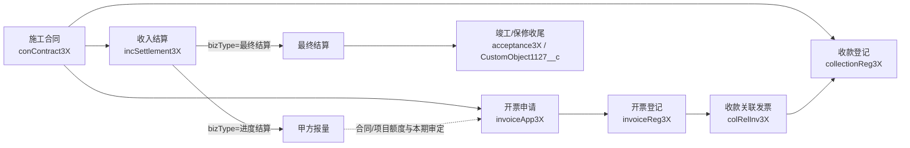
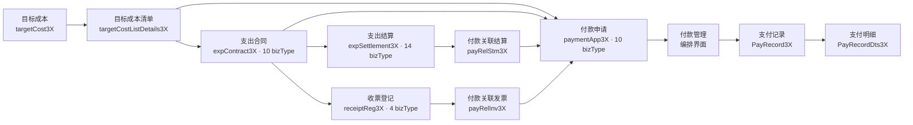
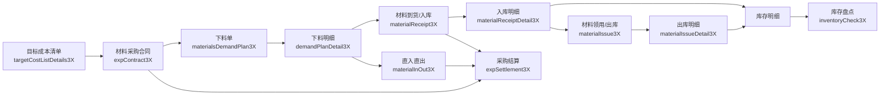
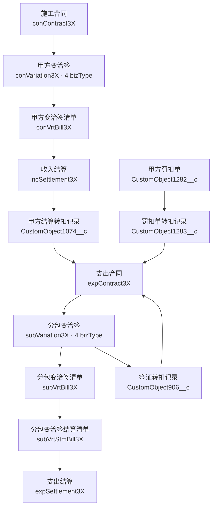
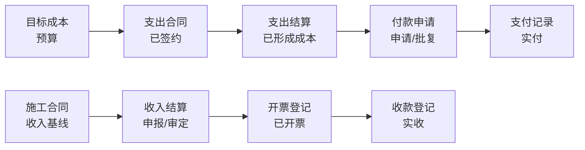

# 红圈业务流转：收入、支出、物资、工程量·变更

> 本文记录红圈参照系中的对象流转、`bizType` 多路复用和金额勾稽，用于 DC 领域建模与页面穿透设计；它不是 DC 数据模型的替代品。DC 的当前术语与实体仍分别以 [`CONTEXT.md`](../CONTEXT.md) 和 [`docs/rewrite/DATABASE.md`](../docs/rewrite/DATABASE.md) 为权威。
>
> 数据来源：[`api/raw/registry.json`](api/raw/registry.json)、[`api/raw/biztypes.json`](api/raw/biztypes.json)、[`api/raw/fields.json`](api/raw/fields.json)、[`api/对象目录.md`](api/对象目录.md)、[`api/引用关系.md`](api/引用关系.md) 及各模块补采文档。Issue #27 原验收项提到的 `api/字段/` 目录在当前仓库中不存在，因此下文用“`fields.json` → 具体 `metaName`”定位字段源，不另建会漂移的字段副本。

## 1. 读图与口径

### 1.1 `bizType`：一个对象，多套菜单与表单

红圈不是“一菜单一表”。菜单注册项先定位 `metaName`，再由 `bizType` 选择业务语义、表单布局、审批流和预置列表视图。同一对象的主键池、公共字段与关联方式保持一致。

| 共享对象 | `bizType` | 菜单/视图效果 |
|---|---|---|
| `incSettlement3X` | 进度结算、最终结算 | 同一收入结算对象分别显示为“甲方报量”和“最终结算” |
| `expContract3X` | 材采、混凝土、周转材租赁/采购、设备租赁、劳务/专业分包、其他支出、框架、公司合同，共 10 类 | 同一支出合同对象进入不同合同菜单 |
| `expSettlement3X` | 材采、混凝土、周转材、设备、专业/劳务分包、甲供材、其他/框架、三类零星、无合同材采，共 14 类 | 同一支出结算对象进入不同结算菜单 |
| `paymentApp3X` | 5 类合同/无合同/预付款、项目管理费、项目费用、公司付款，另有分包付款和无合同非材料付款，共 10 类 | 菜单先选业务类型，再打开不同字段布局 |
| `invoiceApp3X` | 项目有/无合同、公司有/无合同，共 4 类 | 开票申请复用 |
| `invoiceReg3X` | 项目有合同、项目无合同，共 2 类 | 开票登记复用 |
| `receiptReg3X` | 项目有/无合同、公司有/无合同，共 4 类 | 收票登记复用 |
| `collectionReg3X` | 项目有/无合同、总包收款、抵押物变现、公司有/无合同，共 6 类 | 收款登记复用 |
| `conVariation3X` | 变更洽商、现场签证、索赔、材料认价，共 4 类 | 甲方变洽签分类树 |
| `subVariation3X` | 业主变签、管理失误、原班组错误/仅施工部分、有预算未归类，共 4 类 | 分包变洽签按责任归属分类 |
| `materialInOut3X` | 混凝土、其他材料、甲供材、乙供材有/无合同，共 5 类 | 直入直出复用 |

完整 ID 值见 [`api/raw/biztypes.json`](api/raw/biztypes.json)，菜单到对象的重复映射见 [`api/对象目录.md`](api/对象目录.md)。

### 1.2 三类数值不得混写

| 类型 | 含义 | 例子 |
|---|---|---|
| 原始事实 | 用户录入或审批确认的单据金额 | 合同含税金额、结算含税金额、申请金额、批复金额、支付金额 |
| 时点快照 | 单据保存时抄下的前后累计，服务审计 | 收款登记的 `beforeTotalReceivingAmount` / `afterTotalReceivingAmount` |
| 派生聚合 | 从关联子表汇总或公式计算，不应手填 | 合同累计结算、累计收票、累计支付、剩余可付 |

勾稽默认使用已生效/审批通过记录；“申报”与“审定”、“申请”与“批复”、“批复”与“实付”必须保留为不同轨道。结算允许超过合同金额，红圈以审定事实为准，只做风险提示而不做硬上限。

---

## 2. 收入链

### 2.1 对象流转

“甲方报量”和“最终结算”不是两张表，而是 `incSettlement3X` 的两个 `bizType` 视图。开票、收款都回挂项目与施工合同；收款与具体发票之间另由 `colRelInv3X` 明细关联。补采样本中的报量、销项票和收款形成了可核对的一单一链，页面结构见[主合同管理](10-主合同管理/10-主合同管理.md)。

### 2.2 关键对象与字段

| 环节 | 对象/业务类型 | 关键字段（`fields.json` 键） | 作用 |
|---|---|---|---|
| 合同基线 | `conContract3X` | `contractNo` 合同编号；`customer` 甲方；`project` 项目；`taxContractAmount` 含税合同额；`supplementContractAmount` 补充协议；`changeAmount` 累计签证；`amountAfterContractChange` 变更后合同额 | 收入合同的额度与归属主轴 |
| 报量/结算 | `incSettlement3X`；进度/最终结算 | `conContract`；`taxDeclaredAmount` 含税申报；`taxApprovedAmount` 含税审定；`otherDetailTaxAmount` 奖罚扣款；`deductionAfterTaxSettlementAmount` 本次结算；`afterTotalSettlementAmount` 累计结算；`contractReceivingRatio` 收款比例；`receivableAmount` 按比例应收 | 申报、审定、扣款、应收分轨 |
| 开票申请 | `invoiceApp3X`；4 类 | `conContract`；`taxAmount`；`taxRate`；`applicationDate`；`invoiceStatus`；`actualInvoiceAmount`；`noInvoiceAmount` | 申请额与实际已开票额分开 |
| 开票登记 | `invoiceReg3X`；2 类 | `invoiceApp`；`conContract`；`invoiceCode`；`name` 发票号码；`taxAmount`；`actualReceivingAmount`；`noReceivingAmount` | 销项发票事实及其回款余额 |
| 收款登记 | `collectionReg3X`；6 类 | `conContract`；`customer` 付款单位；`receivingAmount`；`receivingDate`；`beforeTotalReceivingAmount`；`afterTotalReceivingAmount`；`invoiceReceivingAmount` | 实收事实、累计快照与发票分摊 |
| 发票分摊 | `colRelInv3X` | 父单=收款登记、目标=开票登记、关联金额 | 一笔收款可覆盖一张或多张发票 |

字段源定位：`fields.json` → `conContract3X`、`incSettlement3X`、`invoiceApp3X`、`invoiceReg3X`、`collectionReg3X`、`colRelInv3X`。

### 2.3 金额勾稽

| 口径 | 勾稽公式/约束 | 红圈字段 |
|---|---|---|
| 变更后合同额 | 原合同含税额 + 有效补充协议 + 已审定变更；以合同聚合结果为页面口径 | `taxContractAmount`、`supplementContractAmount`、`changeAmount`、`amountAfterContractChange` |
| 本次收入结算 | 含税审定金额结合本单奖罚扣款得到本次结算金额 | `taxApprovedAmount`、`otherDetailTaxAmount`、`deductionAfterTaxSettlementAmount` |
| 合同已结算 | 所有有效收入结算的累计结算额 | 合同 `totalSettlementAmount` ↔ 结算 `afterTotalSettlementAmount` |
| 结算应收 | 合同累计结算 − 合同累计收款 | 合同 `SettlementNoReceivingAmount` |
| 开票未回 | 合同累计开票 − 合同累计收款；若收款按发票精确分摊，则以未覆盖发票余额汇总校验 | 合同 `invoiceNoReceivingAmount`；发票 `noReceivingAmount` |
| 单次收款快照 | 含本次累计 = 不含本次累计 + 本次收款 | `afterTotalReceivingAmount = beforeTotalReceivingAmount + receivingAmount` |
| 申请→实开 | 剩余待开票 = 申请含税额 − 已登记开票额 | `invoiceApp3X.noInvoiceAmount`、`actualInvoiceAmount` |

补采交叉验证表明，主合同各期含税审定可与合同已结算、合同累计开票逐期核对；累计开票减累计收款可与项目开票未收汇总核对。报量行保存的“累计收款金额”是时点快照，不能替代当前合同累计收款的实时聚合。

---

## 3. 支出链

### 3.1 对象流转

“付款管理”是把已批复申请组织成支付的应用界面，注册表类型为“应用程序”，不是新的业务对象；资金事实最终落在 `PayRecord3X` / `PayRecordDts3X`。目标成本清单、合同、结算、发票和付款申请之间都保存真实 lookup 或明细行，不能靠自由文本串联。

### 3.2 支出合同与结算的多路复用

| 对象 | `bizType` |
|---|---|
| `expContract3X` | 材料采购、混凝土采购、周转材租赁、周转材采购、设备租赁、劳务分包、专业分包、其他支出、框架、公司合同 |
| `expSettlement3X` | 材料采购、混凝土采购、周转材采购、周转材租赁、设备租赁、专业分包、劳务分包、甲供材采购、其他支出、框架、零星采购、零星用工、零星机械、无合同材料采购 |

菜单只是上述对象的预筛视图。补充协议在红圈样本中可能表现为带 `originalContract` 反链的独立合同行；DC 已将补充协议收口为 canonical 合同的子实体，不能照抄成第二份主合同。

### 3.3 关键对象与字段

| 环节 | 对象 | 关键字段（`fields.json` 键） | 作用 |
|---|---|---|---|
| 预算 | `targetCost3X` / `targetCostListDetails3X` | `taxTotalPrice` 目标成本；`field2__c` 已签合同额；`field3__c` 实际发生成本；`field4__c` 已申请付款；清单 `field38__c` 剩余可签合同额 | 预算、承诺、成本、申请四轨 |
| 合同 | `expContract3X` | `easyCostList` 成本清单；`subcontractor`；`taxContractAmount`；`amountAfterContractChange`；`totalSettlementAmount`；`totalReceiveInvoiceAmount`；`totalPaymentAmount`；`SettlementNoPaymentAmount`；`ReceiveInvoiceNoPaymentAmount` | 支出合同的预算归属及双应付 |
| 结算 | `expSettlement3X` | `expContract`；`settlementType`；`taxSettlementAmount`；`deductionAfterTaxSettlementAmount`；`field20__c` 已申请；`field21__c` 可申请；`field24__c` 已付；`field25__c` 未付 | 付款额度管控四件套 |
| 收票 | `receiptReg3X` | `expContract`；`subcontractor`；`taxAmount`；`associatedPaymen`；`noAssociatedAmount` | 发票事实与未分摊申请额度 |
| 付款申请 | `paymentApp3X` | `easyCostList`；`expContract`；`applicationAmount`；`field15__c` 本期批复；`F_actualPaymentAmount`；`totalSettlementAmount`；`totalReceiveInvoiceAmount`；`noPaidAmount`；`easyCostExcessPrice` | 申请、批复、实付、超量/价预警 |
| 结算分摊 | `payRelStm3X` | `expSettlement`；`applicationAmount` 结算额；`field7__c` 剩余可支付；`field5__c` 本次申请；`field4__c` 实际支付 | 申请金额占用真实结算额度 |
| 发票分摊 | `payRelInv3X` | `receiptReg`；`taxAmount` 发票额；`noReceiveInvoiceAmount`；`applicationAmount` | 申请金额占用真实发票额度 |
| 支付 | `PayRecord3X` / `PayRecordDts3X` | 头 `actualPaymentAmount`；明细 `applicationNo`、`project`、`expContract`、`actualPaymentAmount`、`paymentDate`、`field1__c` 凭证 | 银行支付事实与申请分配 |

字段源定位：`fields.json` → `targetCost3X`、`targetCostListDetails3X`、`expContract3X`、`expSettlement3X`、`receiptReg3X`、`paymentApp3X`、`payRelStm3X`、`payRelInv3X`、`PayRecord3X`、`PayRecordDts3X`。

### 3.4 金额勾稽

| 口径 | 勾稽公式/约束 |
|---|---|
| 剩余可签 | 目标成本清单金额 − 已归属该清单的有效合同额；超量/超价只预警，不静默改预算 |
| 合同按结算应付 | 累计结算 − 累计支付；预付尚无结算时允许为负 |
| 合同按收票应付 | 累计收票 − 累计支付 |
| 结算剩余可申请 | 本次/累计可付款额度 − 已关联付款申请金额；关联行总额不得重复占用 |
| 结算剩余未付 | 结算可付金额 − 已确认实际支付 |
| 发票剩余未关联申请 | 发票含税金额 − 已关联付款申请金额 |
| 付款申请生命周期 | 申请金额、批复金额、实际支付金额分别记录；`实际支付 ≤ 有效批复`，部分支付保留余额 |
| 先款后票 | 待回票金额 = 申请金额 − 已有效关联发票金额；后续补票实时下降 |
| 支付记录 | 一张银行回单形成一条支付记录；申请承担额落支付明细/分摊，不复制银行事实 |

分包样本进一步证明：结算单上的“累计已付”是结算维度，合同“累计支付”还包含结算前预付，两者不可直接互换。页面结构见[分包及人工](07-分包及人工/07-分包及人工.md)与[资金管理](08-资金管理/08-资金管理.md)。

---

## 4. 物资链

### 4.1 对象流转

盘点是账实校准支线，不是采购结算的前置审批。采购结算依据合同、到货/直入直出及结算明细形成；入库后领用与直入直出是两种互斥的库存路径。模块全貌和截图见 [`05-乙供材管理`](05-乙供材管理/05-乙供材管理.md)。

### 4.2 关键对象与字段

| 环节 | 对象/业务类型 | 关键字段（`fields.json` 键） | 额度/数量勾稽 |
|---|---|---|---|
| 下料头 | `materialsDemandPlan3X` | `project`；`field6__c` 采购合同；`planApproachDate`；`field8__c` 下料金额；`field13__c` 明细数；`field14__c` 完成入库数；`field15__c` 部分入库数；`field16__c` 未完成数 | 头表聚合明细到货状态 |
| 下料明细 | `demandPlanDetail3X` | `field1__c` / `easyCostList` 成本清单；`field3__c` 合同明细；`applyQuantity`；`availableReceiveQty`；`noContractQuantity`；`accumulativeReceiveQty` | 申请量、可入库量、可签量、累计到货分轨 |
| 到货头 | `materialReceipt3X` | `project`；`subcontractor`；`expContract`；`field2__c` 送货单号；`receiveDate`；`receiveTaxAmount`；`field23__c` 剩余可结算金额 | 一张到货单聚合明细金额 |
| 到货明细 | `materialReceiptDetail3X` | `quantity`；`taxPrice`；`taxAmount`；`availableIssueQty`；`accumulativeIssueQty`；`F_availableSettlementQty`；`F_accumulativeSettlementQty` | 入库、出库、结算分别占用数量 |
| 领用/出库 | `materialIssue3X` / `materialIssueDetail3X` | `project`；`field2__c` 领用班组；`field1__c` 班组合同；明细 `quantity`、`availableReturnQty`、`inventoryDetail` | 出库减少库存，退库恢复可用量 |
| 直入直出 | `materialInOut3X`；5 类 | `project`；`expContract`；`field4__c` 送货单号；`field11__c` 明细金额；`field12__c` 到货总额；`field16__c` 领用班组 | 同单记录到货与消耗，不写仓库余额 |
| 库存盘点 | `inventoryCheck3X` / `inventoryCheckDetail3X` | `warehouse`；`project`；`checkingDate`；明细 `booksQty`、`checkQty`、`ProfitLossQty`、`booksAmount` | `盈亏数量 = 盘点数量 − 账面数量` |
| 采购结算 | `expSettlement3X`；材采相关类型 | `expContract`；`taxSettlementAmount`；`F_purchaseDetailTaxAmount`；`field21__c` 可付款；`field25__c` 未付款 | 到货可结算额度与结算明细不得重复占用 |

字段源定位：`fields.json` → `materialsDemandPlan3X`、`demandPlanDetail3X`、`materialReceipt3X`、`materialReceiptDetail3X`、`materialIssue3X`、`materialIssueDetail3X`、`materialInOut3X`、`materialInOutDetail3X`、`inventoryCheck3X`、`inventoryCheckDetail3X`、`expSettlement3X`。

### 4.3 关键约束

1. 下料明细的 `累计入库量 + 剩余可入库量` 应回到可执行下料量；审批中入库量单列，不得提前当成完成。
2. 入库明细的累计出库不得超过入库可出库量；退库单独恢复，不能直接改原出库数。
3. 到货单价与采购单价保留差额和对比状态，超价只告警。
4. 直入直出不产生仓库库存，但仍参与成本清单、合同和采购结算勾稽。
5. 盘点差异是库存修正证据；修正后必须能追溯盘点单，不能覆盖原入出库事实。

---

## 5. 工程量·变更链

### 5.1 对象流转

变洽签负责“变更量价与责任归属”，转扣记录负责“把收入侧扣款或签证责任落到某份支出合同/分供方”。两者是相邻但不同的事实，不应合并为一个状态字段。

### 5.2 甲方变洽签

| 对象 | `bizType` | 关键字段 |
|---|---|---|
| `conVariation3X` | 变更洽商、现场签证、索赔、材料认价 | `field2__c` 立项指令单；`conContract`；`customer`；`taxDeclaredAmount`；`taxApprovedAmount`；`originalContractTaxAmount`；`amountAfterContractChange` |
| `conVrtBill3X` | 随父单 | `billName`；`declaredPrice` / `declaredAmount`；`approvedQuantity` / `approvedPrice` / `approvedAmount`；`contractTaxPrice`；`totalSettlementQuantity`；`noSettlementQuantity` |

勾稽：

- 申报金额 = Σ申报工程量 × 申报单价；审定金额 = Σ审定工程量 × 审定单价。
- 合同变更额只认已审定/有效记录，申报额单列用于风险与谈判视图。
- 清单 `累计结算工程量 + 剩余可结算工程量` 应回到可结算审定工程量。

### 5.3 分包变洽签

| 对象 | `bizType` | 关键字段 |
|---|---|---|
| `subVariation3X` | 业主变签；项目管理人员失误（无效成本）；原班组错误或仅施工部分；有成本预算但未归类 | `field2__c` 甲方签证；`field3__c` 主合同；`expContract`；`subcontractor`；`taxDeclaredAmoun`；`taxApprovedAmount`；`originalContractTaxAmount`；`amountAfterContractChange` |
| `subVrtBill3X` | 随父单 | `expContractBill`；`taxDeclaredPrice` / `taxDeclaredAmount`；`approvedQuantity` / `taxApprovedPrice` / `taxApprovedAmount`；`totalSettlementQuantity`；`noSettlementQuantity` |
| `subVrtStmBill3X` | 随支出结算 | `parent__s` 支出结算；`referencePrice`；`currentSettlementQuantity`；`taxSettlementPrice`；`currentTaxIncludedSettlementAmount`；`noSettlementQuantity` |

分包结算可超过原合同额，意味着 `amountAfterContractChange` 与变洽签台账并不必然一一相等；完工审定回写和显式变更要分来源展示，不能根据差额反造变洽签。

### 5.4 结算转扣

| 来源 | 转扣对象 | 目标与金额字段 | 语义 |
|---|---|---|---|
| 收入结算 | `CustomObject1074__c` | `parent__s` 收入结算；`field3__c` 支出合同；`field4__c` 乙方；`field6__c` 罚扣额；`field7__c` 签认额 | 甲方结算扣款向责任合同传导 |
| 分包变洽签 | `CustomObject906__c` | `parent__s` 分包变洽签；`field4__c` 支出合同；`field5__c` 乙方；`field7__c` 罚扣额；`field10__c` 签认额 | 签证责任转扣 |
| 甲方罚扣单 | `CustomObject1283__c` | `parent__s` 罚扣单；`field5__c` 支出合同；`field6__c` 乙方；`field8__c` 罚扣额；`field9__c` 签认额 | 独立罚扣向支出侧传导 |

正式入账使用签认/审定金额，申请或罚扣原额保留用于差异。转扣目标必须是一份真实支出合同与分供方，且在对应支出结算中可追溯抵减。

字段源定位：`fields.json` → `conVariation3X`、`conVrtBill3X`、`subVariation3X`、`subVrtBill3X`、`subVrtStmBill3X`、`CustomObject1074__c`、`CustomObject906__c`、`CustomObject1283__c`。

---

## 6. 跨链总账视角

项目页的金额穿透至少要能回答：

1. 预算还可签多少，哪些合同未挂预算清单；
2. 合同累计结算、收票、支付分别来自哪些单据；
3. 付款申请申请了多少、批了多少、实际付了多少；
4. 收入结算申报与审定差多少，开票与收款差多少；
5. 变更或罚扣最终转给了哪份支出合同、采用原额还是签认额。

红圈项目详情正是这些下游单据的只读聚合枢纽，相关结构见[项目信息](03-项目信息/03-项目信息.md)。DC 应复用这种“数字可穿透、事实不手改”的原则，但仍按自己的施工进度、发票归档与支付分摊模型落地。
