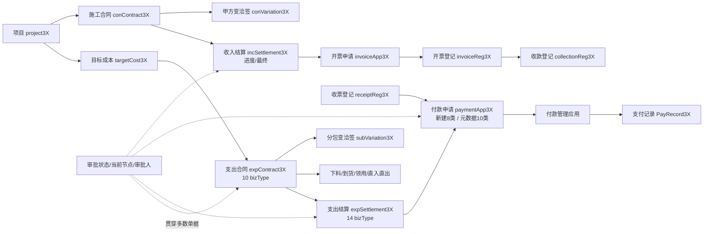
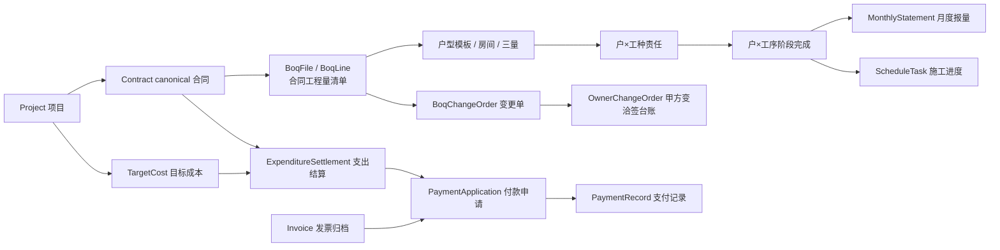

# 红圈对象 → DC 实体命名对照与系统全景

> 本文是迁移/参照索引，不是新的数据模型权威源。DC 术语以 [`CONTEXT.md`](../CONTEXT.md) 为准，实体与表名以 [`docs/rewrite/DATABASE.md`](../docs/rewrite/DATABASE.md) 为准，红圈对象以 [`api/对象目录.md`](api/对象目录.md) 与 [`api/raw/fields.json`](api/raw/fields.json) 为准。
>
> 本次覆盖基线：红圈对象目录 124 个 `metaName`；DC `DATABASE.md §2.1–§2.9` 89 个有效实体。计数仅用于本次覆盖校验；实体增删仍以两份权威源为准，正文 SQL 的重复展开和已废弃实体不重复计数。

## 1. 对照分类

| 分类 | 判定 |
|---|---|
| **强对应** | 业务身份、主生命周期和金额/数量事实基本一致；字段与状态仍不要求一比一 |
| **结构不同** | 两边覆盖相近能力，但存在合表/拆表、头明细、视图与实体、审批单与资金事实等关键结构差异 |
| **DC 独有** | DC 为施工方实际管理新增，红圈 124 对象中没有同等业务身份 |
| **红圈独有** | 红圈存在，当前 DC 范围明确不承接；不能因为有相似字段就硬塞进别的实体 |

对照只决定迁移归属，不决定“照抄红圈”。特别是红圈的 `bizType` 多路复用、审批元数据和 DC 的 canonical 合同、发票归档、支付分摊、施工进度模型都必须保留自己的边界。

## 2. 命名调整清单

当前 `DATABASE.md` 已完成 Issue 正文所要求的主要改名，本轮不再重复改权威源。

| 旧名/易混名 | DC 当前名 | 红圈参照 | 结论 |
|---|---|---|---|
| `TicketRegistration` / `ticket_registrations` | `Invoice` / `invoices`，界面称发票台账/收票 | `receiptReg3X` 收票登记 | 旧实体已废弃；识别与归档台账单表 |
| `ReceiptRegistration` 被误解为收票 | `ReceiptRegistration` / `receipt_registrations`，中文固定“收款登记” | `collectionReg3X` | `receipt` 在 DC 这里指收款回单，不指进项票 |
| 销项发票申请/登记混称 | `InvoiceApplication`，中文“开票申请” | `invoiceApp3X` + `invoiceReg3X` | DC 申请实体承接申请与开票结果；红圈拆申请、登记 |
| 供应商 / 乙方 | `Supplier`，中文“分供方” | `subcontractor3X` | 供应商仅保留票面语境；乙方仅作合同角色 |
| 甲方 / 开发商 / 业主档案 | `Customer`，中文“客户” | `customer` | 甲方仅作合同角色 |
| 往来单位被当作分供方 | `CurrentTransaction` 的往来对手方；不建通用主数据 | `stakeholder3X` | 红圈通用往来单位是红圈独有主数据 |
| 付款批次 / 实付金额 | `PaymentRecord`，中文“支付记录” | `PayRecord3X` + `PayRecordDts3X` | 一张银行回单一条支付事实，申请承担额走分摊 |
| 付款申请与支付混称 | `PaymentApplication`，中文“付款申请” | `paymentApp3X` | 申请/批复不等于实付 |
| “结算”泛称 | `ExpenditureSettlement` 支出结算单；`Settlement` 项目×分供方终态结算 | `expSettlement3X` | 两个 DC 实体不可合并 |
| 施工/支出合同多表继续扩张 | `Contract` canonical 合同；旧表只迁移兼容 | `conContract3X` + `expContract3X` | DC 用 `kind/sub_kind` 收口，红圈用两个对象加 `bizType` |
| 工地 | `ProjectAlias` 项目别名 | 红圈项目文本/项目 lookup | 工地不是独立实体 |
| 人工 | `Contract` 的合同劳务 与 `WageStatement` 工人工资 | 劳务分包合同/结算 | 合同劳务与直接工人工资严格分轨 |

## 3. 系统流程全景

### 3.1 红圈视角：对象 + `bizType` + 审批

红圈的优势是通用对象引擎、审批流、列表视图和 `bizType` 配置；代价是大量业务含义藏在字段元数据、菜单预筛与公式聚合里，同一 `metaName` 在多个菜单复用。

### 3.2 DC 施工方视角：canonical 事实 + 施工进度

DC 新增了红圈缺失的“合同清单 → 户型模板三量 → 责任 → 阶段完成 → 进度/月度报量”事实链。审批流被弱化为单据状态和必要确认：系统优先保存可勾稽事实、来源追溯与撤回，不复制红圈的组织审批引擎。

### 3.3 差异摘要

| 维度 | 红圈 | DC |
|---|---|---|
| 合同 | 收入/支出对象分开，支出靠 `bizType` 多路复用 | `Contract` 统一 canonical ID，旧表仅兼容 |
| 发票 | 开票申请、开票登记、收票登记分对象 | 进项票识别+台账单表；销项申请独立 |
| 付款 | 申请、付款管理应用、支付记录 | 申请—结算/发票分摊；支付—申请分摊 |
| 工程量 | 合同/结算清单服务商务单据 | 房间级三量、责任、阶段完成、月度报量与排程共用稳定 ID |
| 变更 | 甲方/分包变洽签及清单 | 清单变更单驱动甲方变洽签台账；分包变更独立 |
| 审批 | 通用审批状态、节点、当前审批人贯穿对象 | 业务状态、人工确认、软删除/撤回；不建审批引擎 |
| 附件 | 每对象重复 File/Image 字段 | `FileRef` / `FilePayload` 多态统一 |
| 导入审计 | 依赖平台日志和对象动态 | `ImportBatch` / `ImportSourceRef` / `ReconciliationIssue` 显式追溯 |

---

## 4. 红圈 124 对象逐一对照

### 4.1 主对象与业务单据（1–76）

| # | 红圈对象 | 中文名 | 分类 | DC 对应/处理 |
|---:|---|---|---|---|
| 1 | `agreement3X` | 联营协议 | 红圈独有 | 当前 DC 不建联营协议域 |
| 2 | `deductionAndRefund3X` | 联营方扣返款 | 红圈独有 | 当前 DC 不建联营扣返款 |
| 3 | `constructionReport3X` | 施工日志 | 红圈独有 | DC 用阶段完成事实，不等同施工日志 |
| 4 | `qualityAndSafetyInspection3X` | 质量安全检查 | 红圈独有 | 当前 DC 不建质安巡检域 |
| 5 | `qualityAndSafetyRectification3X` | 质量安全整改 | 红圈独有 | 当前 DC 不建质安整改域 |
| 6 | `marginReturn3X` | 保证金/押金退还 | 红圈独有 | 资金汇总可纳入其他流出，但无独立实体 |
| 7 | `conVariation3X` | 甲方变洽签 | 结构不同 | `BoqChangeOrder` 驱动 `OwnerChangeOrder`，纯金额签证可手录台账 |
| 8 | `incSettlement3X` | 收入结算 | 结构不同 | 进度结算→`MonthlyStatement`；最终结算→`OwnerFinalSettlement` |
| 9 | `acceptance3X` | 竣工验收 | 强对应 | `ProjectAcceptance` |
| 10 | `invoiceApp3X` | 开票申请 | 强对应 | `InvoiceApplication` |
| 11 | `invoiceReg3X` | 开票登记 | 结构不同 | 开票结果并入 `InvoiceApplication`，不复刻第二主表 |
| 12 | `conContract3X` | 施工合同 | 结构不同 | `Contract(kind=施工)`；`ConstructionContract` 仅兼容 |
| 13 | `collectionReg3X` | 收款登记 | 强对应 | `ReceiptRegistration` |
| 14 | `currentCollection3X` | 往来收款 | 结构不同 | `CurrentTransaction(direction=收)` |
| 15 | `bidInformation3X` | 投标记录 | 红圈独有 | 当前 DC 不建投标域 |
| 16 | `CustomObject1127__c` | 保修到期确认单 | 结构不同 | 收口到 `ProjectAcceptance` 保修信息 |
| 17 | `reimbursementDts3X` | 报销明细 | 强对应 | `ExpenseReimbursementLine` |
| 18 | `purchaseContractDts3X` | 采购合同明细 | 结构不同 | `ContractLineItem` |
| 19 | `purchaseStmDts3X` | 采购结算明细 | 结构不同 | `ExpenditureSettlement` 的结算内容，不另建通用明细表 |
| 20 | `expContract3X` | 支出合同 | 结构不同 | `Contract(kind=分包/材采/其他支出)`；兼容 `ExpenditureContract`；公司合同→`CompanyExpenseContract` |
| 21 | `expSettlement3X` | 支出结算 | 强对应 | `ExpenditureSettlement` |
| 22 | `materialIssue3X` | 出库单 | 强对应 | `MaterialUse` |
| 23 | `materialReceipt3X` | 入库单 | 强对应 | `MaterialArrival` |
| 24 | `materialIssueDetail3X` | 出库明细 | 结构不同 | `MaterialUse` 当前以业务明细结构承接，不复刻红圈对象 |
| 25 | `pendingTasks` | 待办任务 | 红圈独有 | 通用审批待办不进入 DC 项目阶段任务 |
| 26 | `taskReporting` | 待办任务汇报 | 红圈独有 | 当前 DC 不建通用待办汇报 |
| 27 | `CustomObject65__c` | 分包产值确认 | 结构不同 | 以 `ExpenditureSettlement` 审定事实和工程量派生承接 |
| 28 | `CustomObject72__c` | 分包签证结算 | 结构不同 | `SubcontractChangeOrder` + `ExpenditureSettlement` |
| 29 | `CustomObject163__c` | 付款申请明细（到货） | 结构不同 | `PaymentApplication` 的真实结算/发票分摊，不建“到货付款明细”对象 |
| 30 | `riskWarning` | 风险预警 | 红圈独有 | DC 页面即时预警，不建通用风险对象 |
| 31 | `CustomObject1282__c` | 甲方罚扣单 | 强对应 | `OwnerPenalty` |
| 32 | `otrExpenses3X` | 甲方罚扣 | 结构不同 | 与上一红圈对象共同收口 `OwnerPenalty` |
| 33 | `CustomObject1074__c` | 甲方结算转扣记录 | 结构不同 | `OwnerPenalty` 来源 + 支出结算扣款追溯 |
| 34 | `materialInOut3X` | 直入直出 | 结构不同 | 甲供材→`OwnerMaterialDirect`；乙供材→到货/领用同单语义 |
| 35 | `materialsDemandPlan3X` | 物资需用计划 | 结构不同 | `MaterialRequisition` / `OwnerMaterialRequisition` |
| 36 | `materialsTotalPlan3X` | 物资总计划 | 强对应 | `OwnerMaterialControl` |
| 37 | `targetCost3X` | 目标成本 | 强对应 | `TargetCost` |
| 38 | `targetCostListDetails3X` | 目标成本清单明细 | 强对应 | `TargetCostItem` |
| 39 | `CustomObject1035__c` | 物品档案 | 红圈独有 | 物品资产管理不在当前 DC 范围 |
| 40 | `CustomObject1056__c` | 物品领用单 | 红圈独有 | 同上 |
| 41 | `CustomObject1059__c` | 物品移交单 | 红圈独有 | 同上 |
| 42 | `CustomObject1060__c` | 物品归还单 | 红圈独有 | 同上 |
| 43 | `CustomObject1061__c` | 物品销毁单 | 红圈独有 | 同上 |
| 44 | `demandPlanDetail3X` | 需用计划明细 | 结构不同 | `MaterialRequisition` 的明细结构 |
| 45 | `totalPlanDetail3X` | 物资总计划明细 | 结构不同 | `OwnerMaterialControl` 的控制明细 |
| 46 | `CustomObject67__c` | 巡检产值确认【删除】 | 红圈独有 | 红圈已删除对象，不迁移 |
| 47 | `CustomObject73__c` | 项目罚扣 | 结构不同 | 人员/班组扣罚→`PenaltyRecord`；合同转扣保留来源差异 |
| 48 | `CustomObject878__c` | 项目其他收入合同 | 红圈独有 | DC 当前合同 `kind` 不含其他收入 |
| 49 | `CustomObject172__c` | 质保金回收计划 | 红圈独有 | 当前 DC 不建独立计划实体 |
| 50 | `PayRecordDts3X` | 支付明细 | 结构不同 | `PaymentRecord` + `PaymentRecordApplicationAllocation` |
| 51 | `warehouse3X` | 仓库档案 | 红圈独有 | DC 当前无仓库主数据实体 |
| 52 | `inventoryCheck3X` | 库存盘点 | 强对应 | `StockCheck` |
| 53 | `materialBatchTransfer3X` | 批量调拨 | 红圈独有 | 当前 DC 不建调拨域 |
| 54 | `materialReceiptDetail3X` | 入库明细 | 强对应 | `MaterialArrivalLine` |
| 55 | `materialsNo3X` | 物资档案 | 红圈独有 | DC 以合同/到货行文本和项目分项为主，不建物资主数据 |
| 56 | `materialsType3X` | 物资分类 | 红圈独有 | 同上 |
| 57 | `subcontractor3X` | 分供方 | 强对应 | `Supplier` |
| 58 | `customer` | 客户 | 强对应 | `Customer` |
| 59 | `stakeholder3X` | 往来单位 | 红圈独有 | DC 不建万能往来单位主数据 |
| 60 | `project3X` | 项目信息 | 强对应 | `Project` |
| 61 | `taskRelease3X` | 任务发布 | 红圈独有 | 通用协同任务不在当前范围 |
| 62 | `taskReport3X` | 任务汇报 | 红圈独有 | 同上 |
| 63 | `certificateBorrowing3X` | 证件借用 | 红圈独有 | 证件借还不在当前范围 |
| 64 | `certificateFile3X` | 证件档案 | 红圈独有 | 同上 |
| 65 | `certificateReturn3X` | 证件归还 | 红圈独有 | 同上 |
| 66 | `marginApp3X` | 保证金/押金申请 | 红圈独有 | 当前 DC 不建独立申请实体 |
| 67 | `pettyCashApp3X` | 备用金申请 | 红圈独有 | 当前 DC 不建备用金域 |
| 68 | `pettyCashReturn3X` | 备用金退还 | 红圈独有 | 同上 |
| 69 | `expReimbursement3X` | 费用报销 | 强对应 | `ExpenseReimbursement` |
| 70 | `subVariation3X` | 分包变洽签 | 强对应 | `SubcontractChangeOrder` |
| 71 | `paymentApp3X` | 付款申请 | 强对应 | `PaymentApplication` |
| 72 | `centralizedPayApp3X` | 集中付款申请 | 结构不同 | 多份 `PaymentApplication` + 支付分摊；不建批量申请头 |
| 73 | `otherPayment3X` | 其他付款 | 结构不同 | 审批意图→`PaymentApplication`，实付→`PaymentRecord` |
| 74 | `receiptReg3X` | 收票登记 | 结构不同 | `Invoice` 识别+归档台账单表 |
| 75 | `currentPayment3X` | 往来付款 | 结构不同 | `CurrentTransaction(direction=付)` |
| 76 | `PayRecord3X` | 支付记录 | 强对应 | `PaymentRecord` |

### 4.2 关联/明细对象（77–124）

| # | 红圈对象 | 中文名 | 分类 | DC 对应/处理 |
|---:|---|---|---|---|
| 77 | `CustomObject1020__c` | 报销关联到货单 | 结构不同 | `ExpenseReimbursementLine` 记录来源；送货归档为 `DeliveryRecord` |
| 78 | `CustomObject1023__c` | 报销关联发票 | 结构不同 | 报销明细引用 `Invoice` |
| 79 | `CustomObject1283__c` | 罚扣单转扣记录 | 结构不同 | `OwnerPenalty` 来源追溯 + 支出结算扣款 |
| 80 | `CustomObject12__c` | 关联下料单 | 结构不同 | `MaterialArrival` / `MaterialArrivalLine` 引用 `MaterialRequisition` |
| 81 | `CustomObject51__c` | 甲供材总量统计【删除】 | 红圈独有 | 红圈已删除对象，不迁移 |
| 82 | `CustomObject879__c` | 项目其他收入合同明细 | 红圈独有 | 当前 DC 不建其他收入合同 |
| 83 | `CustomObject906__c` | 签证转扣记录 | 结构不同 | `SubcontractChangeOrder` 来源 + 支出结算扣款 |
| 84 | `CustomObject920__c` | 报销转扣记录 | 结构不同 | `ExpenseReimbursementLine` / `PenaltyRecord` 保留来源与扣款事实 |
| 85 | `admixtureDts3X` | 外加剂及增加费 | 结构不同 | `ContractLineItem` 或支出结算内容 |
| 86 | `billQuantities3X` | 工程量清单 | 结构不同 | `BoqFile` + `BoqLine`；标准分项归 `Item` |
| 87 | `casualLaboureDts3X` | 零星结算明细 | 结构不同 | `ExpenditureSettlement` |
| 88 | `centralizedPayDts3X` | 集中付款明细 | 结构不同 | 多份 `PaymentApplication` / 支付分摊 |
| 89 | `colRelInv3X` | 收款关联发票 | 结构不同 | `ReceiptRegistration` 与开票结果关联；DC 不复刻红圈销项发票主表 |
| 90 | `conContractTerms3X` | 施工合同条款 | 结构不同 | `Contract` / 兼容 `ConstructionContract` 的合同字段与附件 |
| 91 | `conVrtBill3X` | 甲方变洽签清单 | 强对应 | `BoqChangeLine` |
| 92 | `currentCollectionDts3X` | 往来收款明细 | 结构不同 | `CurrentTransaction(direction=收)` 明细化字段 |
| 93 | `currentPaymentDts3X` | 往来付款明细 | 结构不同 | `CurrentTransaction(direction=付)` 明细化字段 |
| 94 | `entryOrderDts3X` | 进场明细 | 结构不同 | 租赁/机械 `ContractLineItem` 与 `ExpenditureSettlement` |
| 95 | `entryOrderOtsDts3X` | 其他费明细 | 结构不同 | 同上 |
| 96 | `equipmentUseDts3X` | 机械设备使用明细 | 结构不同 | 同上 |
| 97 | `equipmentUseOtsDts3X` | 机械其他费用 | 结构不同 | 同上 |
| 98 | `expContractBill3X` | 分包合同清单 | 强对应 | `ContractLineItem` |
| 99 | `expContractExp3X` | 其他费用明细 | 结构不同 | `ContractLineItem` |
| 100 | `expContractTerms3X` | 支出合同条款 | 结构不同 | `Contract` 字段/附件 |
| 101 | `expStmBill3X` | 分包结算清单 | 结构不同 | `ExpenditureSettlement` 的结算内容 |
| 102 | `inventoryCheckDetail3X` | 盘点明细 | 强对应 | `StockCheckLine` |
| 103 | `inventoryDetail3X` | 库存明细 | 结构不同 | 由 `MaterialArrivalLine`、领用与 `StockCheckLine` 聚合；无库存主表 |
| 104 | `invoiceAppDts3X` | 开票申请明细 | 结构不同 | `InvoiceApplication` 的申请内容 |
| 105 | `invoiceRegDts3X` | 开票登记明细 | 结构不同 | `InvoiceApplication` 的开票结果 |
| 106 | `leaseContractDts3X` | 租赁合同明细 | 结构不同 | `ContractLineItem` |
| 107 | `leaseStmDts3X` | 签证明细 | 结构不同 | `ExpenditureSettlement` |
| 108 | `materialBatchTransferDetail3X` | 批量调拨明细 | 红圈独有 | 当前 DC 不建调拨域 |
| 109 | `materialInOutDetail3X` | 直入直出明细 | 结构不同 | `OwnerMaterialDirect` 或乙供材到货/领用明细 |
| 110 | `otherPaymentDts3X` | 其他付款明细 | 结构不同 | `PaymentApplication` / `PaymentRecord` |
| 111 | `otrExpensesDts3X` | 项目罚扣明细 | 结构不同 | `OwnerPenalty` |
| 112 | `outDamageDts3X` | 报损明细 | 结构不同 | 领用/库存差异事实；当前不建独立报损对象 |
| 113 | `outOrderDts3X` | 出场明细 | 结构不同 | 租赁 `ContractLineItem` / `ExpenditureSettlement` |
| 114 | `outOrderOtsDts3X` | 维修及其他费用 | 结构不同 | 同上 |
| 115 | `payAccountDts3X` | 付款转扣记录 | 结构不同 | `PaymentApplicationSettlementAllocation` 的扣款口径和来源追溯 |
| 116 | `payRelInv3X` | 付款关联发票 | 强对应 | `PaymentApplicationInvoiceAllocation` |
| 117 | `payRelStm3X` | 付款关联结算 | 强对应 | `PaymentApplicationSettlementAllocation` |
| 118 | `pumpingDts3X` | 泵送机械费 | 结构不同 | `ContractLineItem` / `ExpenditureSettlement` |
| 119 | `qntStmBill3X` | 合同结算清单 | 结构不同 | `ExpenditureSettlement` 结算内容 |
| 120 | `rentApplyDts3X` | 租赁申请明细 | 结构不同 | `ContractLineItem` |
| 121 | `stopRentOrderDts3X` | 停租明细 | 结构不同 | `ContractLineItem` / `ExpenditureSettlement` |
| 122 | `subVrtBill3X` | 分包变洽签清单 | 结构不同 | `SubcontractChangeOrder` 当前以头表/附件承接，不照抄红圈明细对象 |
| 123 | `subVrtStmBill3X` | 分包变洽签结算清单 | 结构不同 | `SubcontractChangeOrder` + `ExpenditureSettlement` |
| 124 | `vrtStmBill3X` | 变洽签结算清单 | 结构不同 | `ExpenditureSettlement` |

---

## 5. DC 补集（45）

§4 已是唯一的红圈→DC 映射表。本节只列无法作为某个红圈对象直接目标出现的 DC 实体，用来补足 `DATABASE.md` 的 89 实体覆盖，不反向复制已有映射。

| DC 实体 | 分类 | 红圈参照/差异 |
|---|---|---|
| `SupplierCredential` | 结构不同 | 红圈分供方附件/证照字段拆成实体 |
| `SupplierCredentialRequirement` | 结构不同 | 红圈无“要求”和“实收资料”分离模型 |
| `FileRef` | 结构不同 | 红圈各对象 File/Image 字段统一成多态引用 |
| `FilePayload` | 结构不同 | 附件正文与引用拆开、按需读取 |
| `BankCode` | DC 独有 | 内置银行行号字典 |
| `ProjectSupplier` | 结构不同 | 红圈由项目、合同、分供方关系隐式聚合 |
| `Settlement` | DC 独有 | 项目×分供方合作终态；不等于 `expSettlement3X` |
| `PhaseTask` | 结构不同 | 项目阶段资料 checklist；不等于红圈通用审批待办 |
| `SupplementAgreement` | 结构不同 | 红圈用 `originalContract` 反链合同表达 |
| `MonthlyStatementLine` | 结构不同 | 红圈收入结算清单/工程量派生 |
| `ContractSupplement` | 结构不同 | 红圈两侧补充协议统一 |
| `OwnerMaterialArrival` | 结构不同 | `materialReceipt3X` 的甲供材菜单视图 |
| `OwnerMaterialUse` | 结构不同 | `materialIssue3X` 的甲供材菜单视图 |
| `DeliveryLine` | DC 独有 | 送货单识别明细与单价对比来源 |
| `ProjectAlias` | DC 独有 | 工地文本归一到项目 |
| `Crew` | DC 独有 | 班组核算单元，不等于红圈分供方 |
| `CrewWorker` | DC 独有 | 班组×工人关系 |
| `CrewProjectConfig` | DC 独有 | 班组项目配置 |
| `CrewProjectItem` | DC 独有 | 班组分项单价 |
| `Worker` | DC 独有 | 工人主数据 |
| `WorkerCert` | DC 独有 | 工人证件，不等于红圈公司证件借还 |
| `ItemUnitPrice` | DC 独有 | 零星维修单价库 |
| `HouseTypeTemplate` | DC 独有 | 户型模板活链接 |
| `HouseTypeTemplateItem` | DC 独有 | 模板房间×分项三量 |
| `ConstructionStage` | DC 独有 | 稳定工序阶段目录 |
| `ConstructionStageItem` | DC 独有 | 阶段×计量分项及唯一报量阶段 |
| `UnitAssignment` | DC 独有 | 户×工种责任 |
| `UnitAssignmentScope` | DC 独有 | 个人房间×分项下钻范围 |
| `UnitStageCompletion` | DC 独有 | 户×阶段完成事实 |
| `WageStatement` | DC 独有 | 负责人请款簿/工资单头 |
| `WageStatementLine` | DC 独有 | 工人应发/实发快照 |
| `AttendanceRecord` | DC 独有 | 工人考勤 |
| `Building` | DC 独有 | 施工区域楼栋 |
| `Floor` | DC 独有 | 楼层 |
| `Unit` | DC 独有 | 户 |
| `Room` | DC 独有 | 户型模板稳定房间/整户范围 |
| `ScheduleGroup` | DC 独有 | 合同内楼栋排程分组 |
| `ScheduleGroupBuilding` | DC 独有 | 分组×楼栋 |
| `ScheduleTask` | DC 独有 | 工序/WBS |
| `TaskDependency` | DC 独有 | 前后置依赖 |
| `TaskItemMap` | DC 独有 | 工序×分项 |
| `ScheduleTaskFloorPlan` | DC 独有 | 楼层自动计划与微调 |
| `ImportBatch` | DC 独有 | 源文件导入批次 |
| `ImportSourceRef` | DC 独有 | 实体到源行追溯 |
| `ReconciliationIssue` | DC 独有 | 导入/系统聚合差异与归因 |

## 6. 维护边界

本表只回答“红圈对象迁到哪个 DC 业务身份”；字段、状态和建表约束继续链接权威源，不由本表定义。红圈或 DC 实体增删时，应重新运行 124/89 双向覆盖检查并按新的权威源更新计数。
